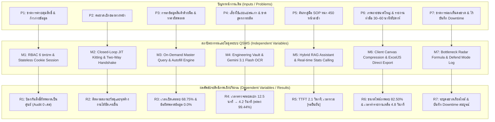
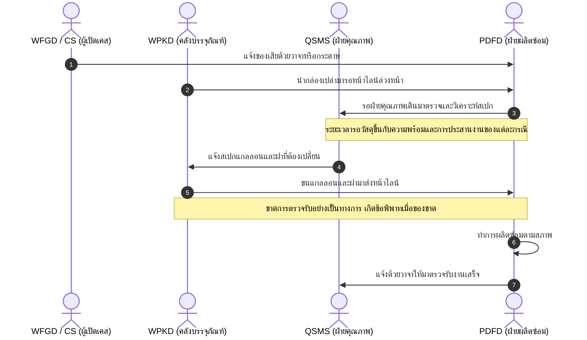
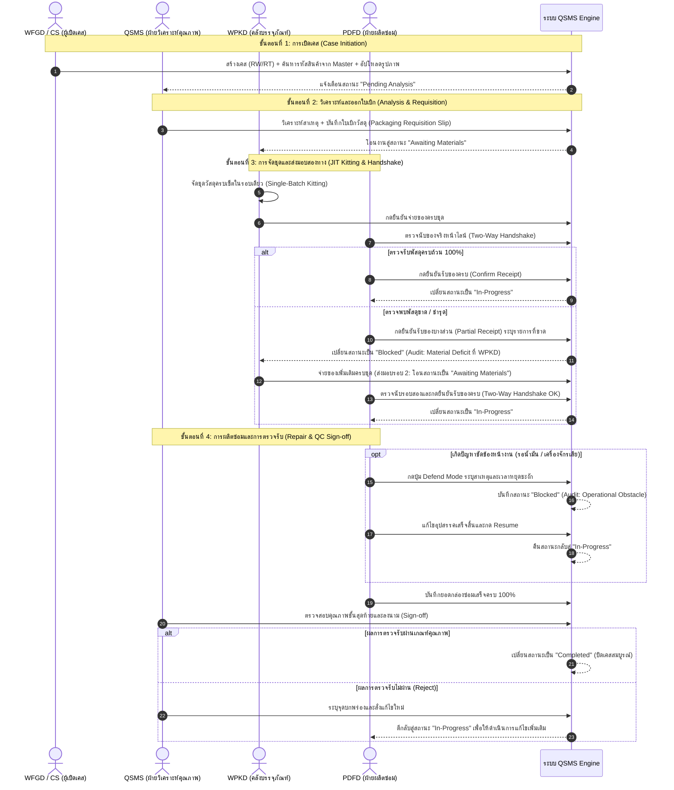
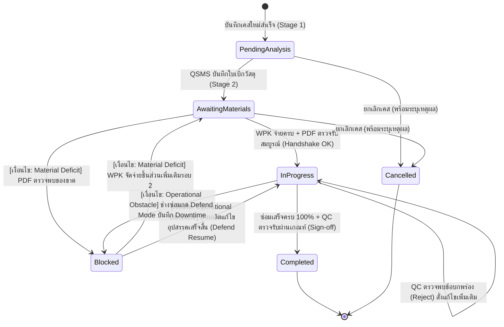
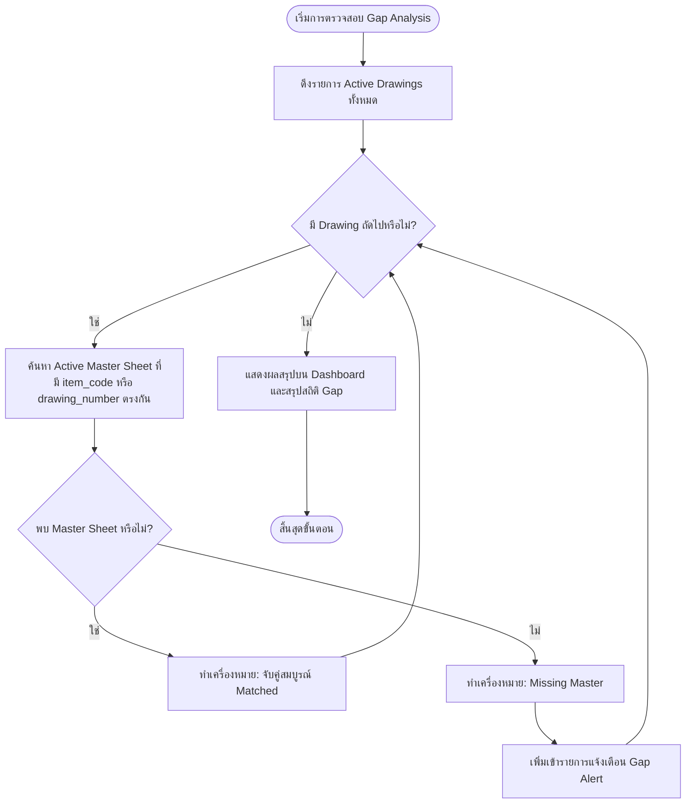
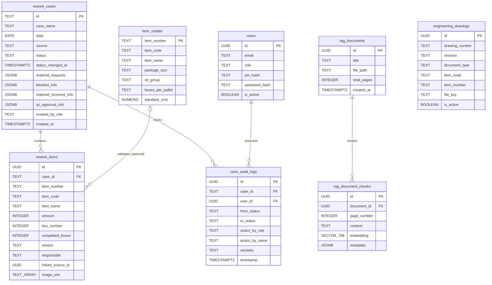

# ระบบบริหารจัดการกระบวนการแก้ไขผลิตภัณฑ์และคลังเอกสารข้อกำหนดมาตรฐานการผลิตอัจฉริยะ

**ชื่อปริญญานิพนธ์ (ภาษาไทย):**  
ระบบบริหารจัดการกระบวนการแก้ไขผลิตภัณฑ์และคลังเอกสารข้อกำหนดมาตรฐานการผลิตอัจฉริยะ  

**Thesis Title (English):**  
QSMS: Quality and Rework Management System with Intelligent Manufacturing Specifications and Retrieval-Augmented Generation  

> **สถานะเอกสาร:** ร่างเนื้อหา Markdown สำหรับตรวจทาน ไม่ใช่รูปเล่มฉบับส่ง ต้องจัดหน้าในเทมเพลตปริญญานิพนธ์ของภาควิชาและตรวจสอบข้อมูลที่ทำเครื่องหมาย `[รอยืนยัน]` ก่อนส่ง

> **บันทึกการรวมเนื้อหา (สำหรับผู้จัดทำ ไม่ใช่เนื้อหาฉบับส่ง):** ใช้ชื่อเรื่องและข้อมูลผู้จัดทำจากไฟล์ Word และรวมเฉพาะเนื้อหาที่เกี่ยวกับ QSMS โดยนำกลุ่มปัญหา 5 ประการในบทที่ 1 ของ Word มาเชื่อมกับปัญหาย่อย P1–P7 ในฉบับ Markdown ส่วนบทคัดย่อและบทที่ 2–5 ใน Word ที่กล่าวถึงหุ่นยนต์เก็บกู้วัตถุระเบิดไม่นำมาใช้ เพราะไม่ใช่เนื้อหา QSMS ผู้จัดทำยืนยันเวลาจัดทำรายงานฐานเดิม 30–60 นาทีต่อสัปดาห์ และใช้ชื่อหน่วยงานพาณิชย์ CSPD ตาม Word ทั้งนี้ต้องตรวจว่าค่าหลังปรับปรุง 4.80 วินาทีวัดในรอบงานรายสัปดาห์เดียวกันก่อนสรุปอัตราการลดเวลา

---

## ส่วนประกอบตอนต้น (Front Matter)

### ข้อมูลผู้จัดทำและคณะกรรมการ (Project Information)
- **ผู้จัดทำโครงงาน:** นายสพลฎณัย ชัยพงษ์ (รหัสนักศึกษา 6752500398)
- **อาจารย์ที่ปรึกษา:** ดร. ภาคภูมิ ปฐมภาคย์
- **สาขาวิชา:** วิศวกรรมหุ่นยนต์และระบบอัตโนมัติ
- **คณะ:** วิศวกรรมศาสตร์และเทคโนโลยี
- **สถาบัน:** สถาบันการจัดการปัญญาภิวัฒน์
- **ปีการศึกษา:** 2569

---

### หน้าอนุมัติปริญญานิพนธ์ (Approval Sheet)
**[ใช้ข้อความอนุมัติและลงรายชื่อหลังได้รับการยืนยันจากภาควิชา/คณะกรรมการสอบเท่านั้น]**
ร่างข้อความ: ปริญญานิพนธ์ฉบับนี้ได้รับการพิจารณาและอนุมัติให้เป็นส่วนหนึ่งของการศึกษาตามหลักสูตรวิศวกรรมศาสตรบัณฑิต สาขาวิชาวิศวกรรมหุ่นยนต์และระบบอัตโนมัติ คณะวิศวกรรมศาสตร์และเทคโนโลยี สถาบันการจัดการปัญญาภิวัฒน์

คณะกรรมการสอบปริญญานิพนธ์:
- ........................................................... ประธานกรรมการสอบ (ดร. ภาคภูมิ ปฐมภาคย์)  
  ([รายชื่อจาก Word; ยืนยันรายชื่อและตำแหน่งก่อนจัดทำฉบับส่ง])
- ........................................................... กรรมการ (ดร. อภิชาติ ชัยชวลิต)  
  ([รายชื่อจาก Word; ยืนยันรายชื่อและตำแหน่งก่อนจัดทำฉบับส่ง])
- ........................................................... กรรมการ (ดร. โพธิวัฒน์ งามขจรวิวัฒน์)  
  ([รายชื่อจาก Word; ยืนยันรายชื่อและตำแหน่งก่อนจัดทำฉบับส่ง])
- ........................................................... กรรมการ (อาจารย์ศิลา วงศ์สุนทรพจน์)  
  ([รายชื่อจาก Word; ยืนยันรายชื่อและตำแหน่งก่อนจัดทำฉบับส่ง])

---

### กิตติกรรมประกาศ (Acknowledgements)
ปริญญานิพนธ์ฉบับนี้สำเร็จลุล่วงได้ด้วยคำแนะนำและการให้คำปรึกษาจาก ดร. ภาคภูมิ ปฐมภาคย์ อาจารย์ที่ปรึกษาปริญญานิพนธ์ ผู้จัดทำขอกราบขอบพระคุณเป็นอย่างสูง

ขอขอบพระคุณคณะผู้บริหาร วิศวกร และบุคลากรหน้างานในโรงงานกรณีศึกษาอุตสาหกรรมผสมและบรรจุสารหล่อลื่น **[รอยืนยันการอนุญาตและเลขที่หนังสือจากเอกสารจริง]** โดยเฉพาะบุคลากรจากทั้ง 5 แผนก ได้แก่:
1. แผนกบริหารคุณภาพและความปลอดภัย (QSMS: Quality and Safety MGT System)
2. แผนกผลิตและบรรจุ (PDFD: Production Filling Department ในระบบใช้รหัสบทบาท `PDF`)
3. แผนกคลังสินค้าสำเร็จรูป (WFGD: W/H Finished Goods Department ในระบบใช้รหัสบทบาท `WFG`)
4. แผนกคลังบรรจุภัณฑ์ (WPKD: W/H Packaging Department ในระบบใช้รหัสบทบาท `WPK`)
5. หน่วยงาน Commercial Special Product (CSPD; ในระบบใช้รหัสบทบาท `CS`)

ที่ได้สละเวลาให้ข้อมูลกระบวนการหน้างาน ร่วมในการสัมภาษณ์เพื่อรวบรวมความต้องการของระบบ ให้ความร่วมมือในการทดสอบระบบนำร่อง 8 สัปดาห์ และร่วมประเมินความสามารถในการใช้งานของระบบ

สุดท้ายนี้ ผู้จัดทำขอน้อมรำลึกในพระคุณของบิดา มารดา และครอบครัว ที่ได้ให้การสนับสนุนกำลังใจและการศึกษาเล่าเรียนเสมอมา รวมถึงเพื่อนร่วมรุ่นทุกคนที่มีส่วนช่วยเหลือและแลกเปลี่ยนความรู้ จนกระทั่งโครงงานปริญญานิพนธ์ฉบับนี้สำเร็จสมบูรณ์ได้ตามวัตถุประสงค์ทุกประการ

นายสพลฎณัย ชัยพงษ์  
ผู้จัดทำ

---

### บทคัดย่อภาษาไทย (Abstract in Thai)

**ชื่อปริญญานิพนธ์:** ระบบบริหารจัดการกระบวนการแก้ไขผลิตภัณฑ์และคลังเอกสารข้อกำหนดมาตรฐานการผลิตอัจฉริยะ  
**คำสำคัญ:** การควบคุมงานแก้ไขชิ้นส่วน, การจัดการคุณภาพ, การผลิตแบบลีน, การควบคุมการเข้าถึงตามบทบาท, การดึงข้อมูลเสริมการสร้างคำตอบ, โมเดลภาษาขนาดใหญ่หลายรูปแบบ  


กระบวนการแก้ไขชิ้นส่วนผลิตภัณฑ์ที่ไม่เป็นไปตามข้อกำหนด (Rework Process) ในโรงงานผสมและบรรจุสารหล่อลื่นกรณีศึกษา ประสบปัญหาความสูญเปล่าตามแนวคิดลีน (การรอคอยและกระบวนการที่เกินจำเป็น) และปัญหาจุดคอขวดในกระบวนการทำงาน 7 ประการ ได้แก่ 1) การเข้าถึงข้อมูลข้ามสายงาน 2) คอขวดจากการเบิกจ่ายบรรจุภัณฑ์ล่วงหน้า 3) ความผิดพลาดจากการกรอกข้อมูลสินค้าและมูลค่าของเสียด้วยมือ 4) ความเสี่ยงจากการนำแบบแปลนเก่าที่ยกเลิกแล้วมาผลิตซ่อม 5) ความล่าช้าในการเข้าถึงคู่มือขั้นตอนการปฏิบัติงานมาตรฐานในกะการผลิต 6) ภาระการจัดการไฟล์ภาพถ่ายและการจัดทำรายงานสรุปประจำงวดด้วยมือ และ 7) การขาดความสามารถในการมองเห็นจุดคอขวดข้ามแผนกแบบเรียลไทม์

ปริญญานิพนธ์ฉบับนี้นำเสนอการวิเคราะห์ ออกแบบ และพัฒนาระบบสารสนเทศ QSMS ด้วยระเบียบวิธีวิจัยแบบอไจล์ (Agile SDLC) สถาปัตยกรรมระบบได้รับการจัดโครงสร้างตามแนวคิด Feature-Sliced Design ประกอบด้วย 7 โมดูลหลัก ทำงานบน Next.js และ React โดยระบบรองรับการกำหนด Supabase สำหรับงาน RAG แยกจากฐานหลักผ่าน environment variables แต่หากไม่ได้กำหนดค่าแยกจะใช้ URL ฐานหลักเป็น fallback การยืนยันว่า deployment ที่ประเมินใช้ฐานข้อมูลแยกจริง **[รอยืนยันจากค่ากำหนด deployment]**

ผลการประเมินประสิทธิภาพในสภาพแวดล้อมปฏิบัติงานจริงเป็นระยะเวลา 8 สัปดาห์ (ปริมาณงาน 78 เคส) พบว่า:
1. การควบคุมการเข้าถึงตามบทบาท (RBAC) มี 6 บทบาทและชุดทดสอบ RBAC 42 กรณี ครอบคลุม 15 ฟังก์ชันตามรายงานโครงการ ส่วนผล audit log (จากเดิม 6 ครั้ง/เดือนเป็น 0 ครั้ง, บล็อก 14 ครั้ง และ ADMIN Override 2 ครั้ง) **[รอยืนยันจาก log จริง]**
2. กระบวนการ JIT Kitting และ Two-Way Handshake ช่วยให้ติดตามสถานะการจัดเตรียมวัสดุและหน่วยงานที่รับผิดชอบได้ชัดเจนขึ้น จากบันทึก Audit Log และการปิดเคส โดยทั่วไประยะเวลารอวัสดุอยู่ที่ประมาณ 1–7 วัน และไม่พบกรณีรอถึงหนึ่งเดือน ยกเว้นกรณีที่ต้องประสานงานกับผู้ขายหรือ Customer เช่น สินค้า Limited ซึ่งอาจใช้เวลานานกว่าปกติ ทั้งนี้รายงานเป็นข้อสังเกตจากการติดตามงาน ไม่ใช่ผลทดสอบเชิงสถิติ
3. กลไกตรวจสอบข้อมูลหลักลดเวลาเปิดเคสจาก 8.0 นาทีเหลือ 2.5 นาที (68.75%) โดยอัตราความผิดพลาดเป็น 0% เฉพาะรายการที่มีใน Master (ความครอบคลุม 85%) ตามข้อมูลหลักของโครงการ
4. คลังแบบแปลนวิศวกรรมดิจิทัลและโมเดล Gemini 3.1 Flash **[รอยืนยันรุ่นจาก log การเรียกใช้จริง เนื่องจากระบบมี fallback]** สกัดข้อมูล 11 ฟิลด์ได้แม่นยำ 96.36% (530/550 ฟิลด์, 95% CI [94.44%, 97.64%]) และลดเวลาตรวจสอบสเปกจาก 12.5 นาทีเหลือ 4.2 วินาทีต่อฉบับ (ลดลง 99.44%) ตามข้อมูลหลักของโครงการ ทั้งนี้สถิติส่วนเบี่ยงเบนมาตรฐานและผลทดสอบนัยสำคัญของการเปรียบเทียบเวลายัง **[รอยืนยันจากข้อมูลดิบ]** พร้อมระบบติดธง Superseded สำหรับควบคุมฉบับแบบ
5. ระบบผู้ช่วยเทคนิค Hybrid RAG (pgvector ร่วมกับ PostgreSQL FTS ผ่านขั้นตอนวิธี RRF) มีเวลาเริ่มสตรีมคำตอบแรก (TTFT) 2.1 วินาที และมีความถูกต้องของคำตอบและการอ้างอิง 97.50% (39/40 คำถาม) ตามข้อมูลหลักของโครงการ ส่วนเวลารวมในการค้นหาและทำความเข้าใจคู่มือ รวมถึงผลทดสอบนัยสำคัญ **[รอยืนยันจากข้อมูลดิบก่อนรายงาน]**
6. การบีบอัดภาพผ่าน Canvas ลดขนาดไฟล์เฉลี่ยจาก 2.00 MB เหลือ 0.35 MB (82.50%) โดย 98 จาก 100 ภาพมีขนาดไม่เกิน 400 KB ตามข้อมูลหลักของโครงการ ส่วนเวลาจัดทำรายงานฐานเดิม 30–60 นาทีต่อสัปดาห์ (ผู้จัดทำยืนยัน) และเวลา Export หลังพัฒนา 4.8 วินาทีต่อครั้งยังมีขอบเขตการจับเวลาต่างกัน จึงยังไม่สรุปอัตราการลดเวลาและ **[รอยืนยันความเทียบเท่าของงานที่จับเวลา]**
7. ระบบมีแดชบอร์ดภาระงานและโหมด Defend; ตัวชี้วัดเวลาตอบสนองและความสอดคล้องกับผู้ประเมิน **[รอยืนยันจากผลประเมินจริง]**
คะแนน SUS จากตารางคะแนนในร่างมีค่าเฉลี่ย 83.33 และส่วนเบี่ยงเบนมาตรฐาน 3.62 (n=15) **[รอยืนยันแหล่งที่มาของแบบสอบถามจริง]**; งานวิจัยนี้งดรายงานผล ROI, NPV และระยะเวลาคืนทุน เนื่องจากบริษัทไม่อนุญาตให้เผยแพร่ข้อมูลต้นทุนและกระแสเงินสด

---

### Abstract in English

**Thesis Title:** QSMS: Quality and Rework Management System with Intelligent Manufacturing Specifications and Retrieval-Augmented Generation  
**Keywords:** Rework Management, Quality Assurance, Lean Manufacturing, Role-Based Access Control, Retrieval-Augmented Generation, Multimodal Large Language Models  

The rework process for non-conforming products in lubricant blending and packaging plants encounters operational wastes (waiting and overprocessing) and cross-departmental bottlenecks. Field observations at the case study facility identified seven primary challenges: 1) unauthorized cross-departmental data modifications, 2) premature packaging requisitions and shortage disputes, 3) manual data entry errors distorting scrap valuation, 4) risks of utilizing superseded engineering drawings, 5) delayed access to standard operating procedure (SOP) manuals during shift operations, 6) network bandwidth consumption from large photo uploads and labor-intensive manual report generation, and 7) the absence of real-time visibility into cross-departmental work-in-process bottlenecks.

This thesis presents the design, implementation, and empirical evaluation of the QSMS information system developed using an Agile SDLC. Structured according to Feature-Sliced Design principles, the platform encompasses seven core subsystems built with Next.js and React. The application supports a separate Supabase project for RAG through environment variables, but falls back to the primary database URL when a separate URL is not configured; whether the evaluated deployment used separate databases remains **[pending deployment configuration verification]**.

Empirical evaluation conducted across an 8-week production pilot (78 rework cases) demonstrates that:
1. Access control is configured for six roles, and the project report lists 42 automated RBAC tests covering 15 operations. Audit-log claims (from 6 incidents/month to zero, 14 blocked attempts, and 2 ADMIN overrides) remain **[pending verification against actual logs]**.
2. The JIT Kitting and Two-Way Handshake workflow makes material status and the responsible department easier to track through audit logs and case-closure records. The observed waiting period is generally 1–7 days; cases requiring supplier or customer coordination, such as limited products, may take longer. This is reported as an operational observation, not as a statistical test result.
3. Automated item-master verification reduced case creation time from 8.0 to 2.5 minutes (68.75%), with a 0% error rate for registered items (85% master coverage), according to the project’s primary metrics.
4. The engineering drawing vault, using Gemini 3.1 Flash **[model version to be verified against request logs because the application has fallbacks]**, extracted 11 metadata fields with 96.36% accuracy (530/550 fields, 95% CI [94.44%, 97.64%]) and reduced drawing specification check time from 12.5 minutes to 4.2 seconds per drawing (99.44% reduction), according to the project’s primary metrics. Standard deviations and inferential statistics for this time comparison remain **[pending verification from raw data]**.
5. The Hybrid RAG engine (combining pgvector and PostgreSQL Full-Text Search via Reciprocal Rank Fusion) achieved a 2.1-second time to first token (TTFT) and 97.50% answer and citation accuracy (39/40 queries), according to the project’s primary metrics. Total end-to-end SOP consultation time and inferential statistics remain **[pending verification from raw data]**.
6. Client-side Canvas compression reduced average image size from 2.00 MB to 0.35 MB (82.50%); 98 of 100 images were below 400 KB, according to the project’s primary metrics. The author confirmed a manual reporting baseline of 30–60 minutes per week, while the post-development export time is 4.8 seconds per export. Because the measured task scope and time units have not been shown to be equivalent, no time-reduction rate is concluded **[pending comparability verification]**.
7. The application includes a workload dashboard and Defend Mode; reported performance and supervisor-agreement metrics remain **[pending verification from evaluation records]**.
The SUS scores shown in the draft yield a mean of 83.33 and standard deviation of 3.62 (n=15), **[pending verification against original questionnaires]**. Quantitative financial feasibility, including ROI, NPV, and payback period, was not reported because the company did not authorize disclosure of cost and cash-flow data.

---

### สารบัญเนื้อหา (Table of Contents)
- ส่วนประกอบตอนต้น (Front Matter)
  - ข้อมูลผู้จัดทำและคณะกรรมการ
  - หน้าอนุมัติปริญญานิพนธ์
  - กิตติกรรมประกาศ
  - บทคัดย่อภาษาไทย (Abstract in Thai)
  - Abstract in English
  - สารบัญตาราง (List of Tables)
  - สารบัญภาพ (List of Figures)
  - รายการคำย่อและสัญลักษณ์ (List of Abbreviations)
- บทที่ 1: บทนำ (Introduction)
  - 1.1 ความเป็นมาและความสำคัญของปัญหา
  - 1.2 ข้อมูลบริบทโรงงานกรณีศึกษาและสถิติปัญหาฐานเดิม (Baseline Context)
  - 1.3 ปัญหาการวิจัย 7 ประการ (Research Problems: P1–P7)
  - 1.4 วัตถุประสงค์ของการวิจัย 7 ข้อ (Research Objectives: O1–O7)
  - 1.5 สมมติฐานการวิจัยเชิงสถิติ (Statistical Hypotheses: H1 และ H3–H7)
  - 1.6 ขอบเขตของการวิจัยและสิ่งที่ไม่ครอบคลุม (Research Scope & Exclusions)
  - 1.7 นิยามศัพท์ปฏิบัติการ (Operational Definitions)
  - 1.8 ประโยชน์ที่คาดว่าจะได้รับ (Expected Benefits)
- บทที่ 2: ทฤษฎีและวรรณกรรมที่เกี่ยวข้อง (Literature Review)
  - 2.1 แนวคิดการผลิตแบบลีนและความสูญเปล่าในการผลิต (Lean Manufacturing & Ohno's Muda)
  - 2.2 ทฤษฎีข้อจำกัดและการบริหารภาระงานคั่งค้าง (Theory of Constraints & Little's Law)
  - 2.3 การควบคุมการเข้าถึงตามบทบาท (Role-Based Access Control: RBAC96 & NIST Core RBAC)
  - 2.4 ความมั่นคงปลอดภัยของเว็บแอปพลิเคชันและการจัดการเซสชัน (Web Application Security & OWASP Defense)
  - 2.5 การจัดการข้อมูลหลักและการควบคุมความถูกต้องของข้อมูล (Master Data Management: MDM)
  - 2.6 โมเดลภาษาขนาดใหญ่หลายรูปแบบและการสกัดข้อมูลจากแบบแปลน (Multimodal LLMs & Visual OCR)
  - 2.7 สถาปัตยกรรมการดึงข้อมูลเสริมการสร้างคำตอบแบบผสมผสาน (Hybrid RAG & Reciprocal Rank Fusion)
  - 2.8 สถาปัตยกรรมซอฟต์แวร์ฟรอนต์เอนด์เชิงโมดูลาร์ (Feature-Sliced Design: FSD)
  - 2.9 การจัดการชุดพัสดุทันเวลาพอดี (Just-In-Time Kitting Logistics)
  - 2.10 มาตรฐานการควบคุมเอกสารและการจัดการของเสียตาม ISO 9001 (Document Control & ISO 9001)
  - 2.11 การทบทวนงานวิจัยที่เกี่ยวข้องและระบบสำเร็จรูปเชิงพาณิชย์ (Related Works & COTS Comparison)
  - 2.12 กรอบแนวคิดการวิจัย (Conceptual Framework)
  - 2.13 วงจรชีวิตการพัฒนาซอฟต์แวร์แบบอไจล์ (Agile Software Development Lifecycle: Scrum Framework)
  - 2.14 ทฤษฎีและระเบียบวิธีประเมินความสามารถในการใช้งานระบบ (System Usability Scale: SUS Theory)
  - 2.15 ระเบียบวิธีสถิติเชิงอนุมานและการวัดขนาดอิทธิพล (Inferential Statistics & Effect Size Metrics)
  - 2.16 วิศวกรรมเศรษฐศาสตร์และการวิเคราะห์ความเป็นไปได้ทางการเงิน (Engineering Economics & Feasibility)
  - 2.17 ระบบสารสนเทศและการประสานงานการปฏิบัติการผลิต (Manufacturing Operations Information & Workflow Automation)
- บทที่ 3: ระเบียบวิธีวิจัยและการออกแบบระบบ (Research Methodology & System Design)
  - 3.1 ระเบียบวิธีวิจัย แผนการดำเนินงาน และประวัติการปรับปรุงระบบ (Research Methodology, Timeline & Engineering Milestones)
  - 3.2 การวิเคราะห์กระบวนการทำงานเดิมเปรียบเทียบกับกระบวนการใหม่ (As-Is vs To-Be Workflows)
  - 3.3 เมทริกซ์การกำหนดสิทธิ์การใช้งาน 15 ฟังก์ชัน (Permission Matrix for 6 Roles)
  - 3.4 ข้อกำหนดความต้องการเชิงฟังก์ชันและเชิงคุณภาพ (Functional & Non-Functional Requirements)
  - 3.5 สถาปัตยกรรมระบบและโครงสร้างทางกายภาพ (System Architecture & API Boundaries)
  - 3.6 แบบจำลองเครื่องสถานะจำกัดและการควบคุมข้อยกเว้น (Finite State Machine & Transition Guards)
  - 3.7 วงจรชีวิตแบบแปลนวิศวกรรมและขั้นตอนวิธี Gap Analysis (Drawing Lifecycle & Gap Algorithm)
  - 3.8 การออกแบบฐานข้อมูลแบบแยกส่วนอิสระ (Dual-Database Schema & Data Dictionary)
  - 3.9 แบบจำลองทางคณิตศาสตร์สำหรับดัชนีภาระงานคั่งค้าง (Mathematical Model for Workload Backlog)
  - 3.10 กลไกสำรองข้อมูลและการรองรับความผิดพลาด (Backup Mechanism & Disaster Recovery)
  - 3.11 จริยธรรมการวิจัยและการคุ้มครองข้อมูลองค์กร (Research Ethics, Data Masking, and Consent)
- บทที่ 4: การพัฒนาระบบและผลการประเมิน (Implementation & Empirical Evaluation)
  - 4.1 สภาพแวดล้อมและเทคโนโลยีที่ใช้ในการพัฒนา (Implementation Stack)
  - 4.2 การพัฒนา 7 โมดูลหลักของระบบ (Implementation of the 7 Subsystems)
  - 4.3 ผลการทดสอบการทำงานอัตโนมัติ (Automated Unit & Integration Test Suite)
  - 4.4 ตารางการสอบกลับได้ของระบบ (Traceability Matrix)
  - 4.5 ผลการประเมินประสิทธิภาพเชิงปริมาณ (Empirical Results: R1–R7)
  - 4.6 การประเมินประสิทธิภาพแบบจำลอง AI (AI Model Evaluation: OCR & RAG)
  - 4.7 การประเมินความสามารถในการใช้งานของระบบ (System Usability Scale: SUS Evaluation)
  - 4.8 การทดสอบข้อกำหนดเชิงคุณภาพ (NFR Verification)
  - 4.9 ข้อจำกัดในการประเมินความคุ้มค่าทางการเงิน (Financial Feasibility Limitation)
- บทที่ 5: สรุปผลการวิจัย การอภิปรายผล ข้อจำกัด และข้อเสนอแนะ (Conclusions, Discussion, and Future Work)
  - 5.1 สรุปผลการวิจัยตามวัตถุประสงค์ 7 ข้อ (Conclusions Answering O1–O7)
  - 5.2 การอภิปรายผลการวิจัยเปรียบเทียบกับทฤษฎีและงานวิจัยก่อนหน้า (Discussion of Findings)
  - 5.3 ภัยคุกคามต่อความถูกต้องของการวิจัย (Threats to Validity)
  - 5.4 ข้อจำกัดและการแลกเปลี่ยนเชิงวิศวกรรม (Engineering Limitations & Trade-offs)
  - 5.5 ข้อเสนอแนะและทิศทางการพัฒนาในอนาคต (Recommendations & Future Work)
- บรรณานุกรม (References)
- ภาคผนวก (Appendices)
  - ภาคผนวก ก: รายละเอียดชุดกรณีทดสอบอัตโนมัติ 42 เคสครอบคลุม 15 ฟังก์ชัน (RBAC Test Suite)
  - ภาคผนวก ข: สคีมาข้อมูล JSON สำหรับการสกัดข้อมูลแบบแปลน (OCR Structured Schema)
  - ภาคผนวก ค: แผนภาพโครงสร้างส่วนติดต่อผู้ใช้ของระบบและเอกสารประเมินผล (System UI Schematics & Evaluation Materials)
  - ภาคผนวก ง: ข้อมูลคะแนนดิบแบบสอบถาม SUS รายข้อ (SUS Raw Score Matrix)
  - ภาคผนวก จ: หนังสือยินยอมการเก็บข้อมูลและการคุ้มครองข้อมูลความลับ (Company Consent & Anonymization)
- ประวัติผู้เขียน (Author Biography)

---

### สารบัญตาราง (List of Tables)
- ตารางที่ 1.1: ข้อมูลสถิติและปัญหาฐานเดิมของกระบวนการแก้ไขชิ้นส่วน (Baseline Data)
- ตารางที่ 1.2: การเชื่อมโยงกลุ่มปัญหาหน้างานกับปัญหาวิจัย P1–P7
- ตารางที่ 1.3: การเชื่อมโยงวัตถุประสงค์ภาพรวมกับวัตถุประสงค์ย่อย O1–O7
- ตารางที่ 2.1: การเปรียบเทียบงานวิจัยที่เกี่ยวข้องและระบบสำเร็จรูปเชิงพาณิชย์ (Related Works & COTS Comparison)
- ตารางที่ 3.1: แผนผังไทม์ไลน์การดำเนินงานวิจัยตลอด 6 เดือน (Project Timeline)
- ตารางที่ 3.1 (ข): ไทม์ไลน์ประวัติการพัฒนาระบบและการปรับปรุงแก้ไขเชิงวิศวกรรมตามรอบการพัฒนาจริง (Date-Stamped Development & Improvement Timeline)
- ตารางที่ 3.2: เมทริกซ์การกำหนดสิทธิ์ 15 ฟังก์ชันตาม 6 บทบาทหน้าที่ (Role-Permission Matrix)
- ตารางที่ 3.3: การจับคู่ระหว่าง UI Stepper และ Finite State Machine States
- ตารางที่ 3.4: พจนานุกรมข้อมูลตารางธุรกรรมการผลิตหลัก (Main OLTP Data Dictionary)
- ตารางที่ 3.5: พจนานุกรมข้อมูลตารางคลังเอกสารและเวกเตอร์ (Dedicated RAG & Storage Data Dictionary)
- ตารางที่ 4.1: สรุปผลการรันชุดทดสอบอัตโนมัติครอบคลุม 7 โดเมน (Vitest Test Suite Summary)
- ตารางที่ 4.2: ตารางการสอบกลับได้ของระบบ (Traceability Matrix)
- ตารางที่ 4.3: ผลการประเมินประสิทธิภาพเชิงปริมาณเปรียบเทียบก่อน-หลังปรับปรุง (Empirical Evaluation: R1–R7)
- ตารางที่ 4.4: ผลการประเมินความแม่นยำรายฟิลด์ของโมเดล Gemini 3.1 Flash บนแบบแปลน 50 ฉบับ
- ตารางที่ 4.5: ผลการทดสอบเปรียบเทียบกลไกการสืบค้นคู่มือ (Retrieval Ablation Study: Vector vs FTS vs Hybrid)
- ตารางที่ 4.6: ข้อมูลคะแนนดิบและผลการประเมินความสามารถในการใช้งานของระบบตามมาตรฐาน SUS (n = 15)
- ตารางที่ 4.7: สรุปผลการตรวจสอบข้อกำหนดเชิงคุณภาพ (Non-Functional Requirements Verification)
- ตารางที่ 5.1: สรุปผลการทดสอบสมมติฐานเชิงสถิติและผลเชิงพรรณนาของ O2
- ตารางที่ ก.1: ตารางการจับคู่ความครอบคลุมระหว่างตารางสิทธิ์ 15 ฟังก์ชันกับกรณีทดสอบอัตโนมัติ 42 เคส (RBAC Test Mapping)
- ตารางที่ ง.1: ตารางคะแนนดิบรายข้อประเมินแบบสอบถาม SUS จากผู้ใช้งานจริง 15 คน (SUS Raw Score Matrix)

---

### สารบัญภาพ (List of Figures)
- ภาพที่ 2.1: กรอบแนวคิดการวิจัย (Conceptual Framework)
- ภาพที่ 3.1: แผนภาพลำดับงานกระบวนการเดิม (As-Is Process Sequence Diagram)
- ภาพที่ 3.2: แผนภาพลำดับงานกระบวนการใหม่แบบวงจรปิด (To-Be Closed-Loop Sequence Diagram)
- ภาพที่ 3.3: แผนภาพสถาปัตยกรรมระบบโดยรวมและขอบเขต API (System Architecture & API Boundaries)
- ภาพที่ 3.4: แผนภาพเครื่องสถานะจำกัด 6 สถานะพร้อมเงื่อนไขการตรวจสอบ (FSM with Transition Guards)
- ภาพที่ 3.5: แผนภาพขั้นตอนวิธีตรวจสอบช่องว่างแบบแปลน (Gap Analysis Flowchart)
- ภาพที่ 3.6: แผนภาพความสัมพันธ์ของข้อมูล (Entity-Relationship Diagram: Dual-DB ERD)
- ภาพที่ ค.1: แผนภาพโครงสร้างหน้าจอหลักรายการเคสและการควบคุมขั้นตอน 4-Stage Stepper (Case List & Stepper UI)
- ภาพที่ ค.2: แผนภาพโครงสร้างหน้าจอคลังแบบแปลนวิศวกรรมแบบ Split View 55/45 พร้อมเครื่องมือหมุน 360° (Vault UI)
- ภาพที่ ค.3: แผนภาพโครงสร้างหน้าจอแดชบอร์ดเฝ้าระวังคอขวดและตัวกรองสถานะ 1-Click (Bottleneck Radar UI)

---

### รายการคำย่อและสัญลักษณ์ (List of Abbreviations & Symbols)

#### คำย่อภาษาอังกฤษ (Abbreviations)
- **API**: Application Programming Interface (ส่วนต่อประสานโปรแกรมประยุกต์)
- **BOM**: Bill of Materials (ในบริบทนี้หมายถึง เอกสารรายการวัสดุและบรรจุภัณฑ์ที่ต้องใช้ซ่อม)
- **CDN**: Content Delivery Network (เครือข่ายส่งมอบเนื้อหา)
- **CI**: Confidence Interval (ช่วงความเชื่อมั่นทางสถิติ)
- **CSPD / CS**: Commercial Special Product (หน่วยงาน Commercial Special Product; ในระบบใช้รหัสบทบาท `CS`)
- **COTS**: Commercial Off-The-Shelf (ซอฟต์แวร์สำเร็จรูปเชิงพาณิชย์)
- **CRUD**: Create, Read, Update, Delete (การสร้าง อ่าน แก้ไข ลบข้อมูล)
- **CSRF**: Cross-Site Request Forgery (การปลอมแปลงคำขอข้ามไซต์)
- **DPR**: Dense Passage Retrieval (การดึงข้อมูลข้อความความหนาแน่นสูงด้วยเวกเตอร์)
- **ERP**: Enterprise Resource Planning (ระบบวางแผนทรัพยากรองค์กร)
- **FSD**: Feature-Sliced Design (สถาปัตยกรรมการออกแบบฟรอนต์เอนด์เชิงโมดูล)
- **FSM**: Finite State Machine (เครื่องสถานะจำกัด)
- **FTS**: Full-Text Search (การค้นหาข้อความเต็มรูปแบบเชิงคำศัพท์)
- **HNSW**: Hierarchical Navigable Small World (โครงสร้างดัชนีการค้นหาเวกเตอร์)
- **JIT**: Just-In-Time (ระบบการผลิตและจ่ายวัสดุแบบทันเวลาพอดี)
- **JWT**: JSON Web Token (โทเค็นเว็บเจซอนสำหรับการยืนยันตัวตน)
- **LLM**: Large Language Model (โมเดลภาษาขนาดใหญ่)
- **MDM**: Master Data Management (การจัดการข้อมูลหลักขององค์กร)
- **MES**: Manufacturing Execution System (ระบบควบคุมและติดตามการปฏิบัติการผลิต)
- **MRR**: Mean Reciprocal Rank (ค่าเฉลี่ยส่วนกลับของอันดับผลลัพธ์แรก)
- **NFR**: Non-Functional Requirement (ข้อกำหนดความต้องการเชิงคุณภาพ)
- **NPV**: Net Present Value (มูลค่าปัจจุบันสุทธิ)
- **OCR**: Optical Character Recognition (การรู้จำอักขระด้วยแสง)
- **OLTP**: Online Transaction Processing (ระบบประผลธุรกรรมเชิงรายการ)
- **PDPA**: Personal Data Protection Act (พระราชบัญญัติคุ้มครองข้อมูลส่วนบุคคล)
- **PDFD / PDF**: Production Filling Department (แผนกผลิตและบรรจุ ในระบบใช้รหัสบทบาท `PDF`)
- **QSMS**: Quality and Safety Management System (แผนกบริหารคุณภาพและความปลอดภัย และชื่อระบบ)
- **RAG**: Retrieval-Augmented Generation (การสร้างคำตอบโดยเสริมการค้นคืนข้อมูล)
- **RBAC**: Role-Based Access Control (การควบคุมการเข้าถึงตามบทบาทหน้าที่)
- **RLS**: Row-Level Security (ความปลอดภัยระดับแถวข้อมูลในฐานข้อมูล)
- **ROI**: Return on Investment (ผลตอบแทนจากการลงทุน)
- **RPO**: Recovery Point Objective (เป้าหมายจุดฟื้นตัวของข้อมูล)
- **RRF**: Reciprocal Rank Fusion (ขั้นตอนวิธีการผสานอันดับผลลัพธ์แบบส่วนกลับ)
- **RTO**: Recovery Time Objective (เป้าหมายระยะเวลาการฟื้นคืนระบบ)
- **SD**: Standard Deviation (ส่วนเบี่ยงเบนมาตรฐาน)
- **SDLC**: Software Development Life Cycle (วงจรชีวิตการพัฒนาซอฟต์แวร์)
- **SFC**: Shop Floor Control (การควบคุมการปฏิบัติการหน้าไลน์ผลิตภายใน)
- **SLA**: Service Level Agreement (ข้อตกลงระดับการบริการ)
- **SoD**: Separation of Duty (การแบ่งแยกหน้าที่การปฏิบัติงาน)
- **SOP**: Standard Operating Procedure (ขั้นตอนการปฏิบัติงานมาตรฐาน)
- **SSE**: Server-Sent Events (การส่งข้อมูลแบบสตรีมมิ่งจากเซิร์ฟเวอร์สู่ไคลเอนต์)
- **SUS**: System Usability Scale (แบบประเมินความสามารถในการใช้งานระบบ)
- **TOC**: Theory of Constraints (ทฤษฎีข้อจำกัดในการบริหารการผลิต)
- **TTFT**: Time-to-First-Token (ระยะเวลาตั้งแต่ส่งคำขอจนกระทั่งได้รับโทเค็นแรกกลับมา)
- **WFGD / WFG**: Warehouse Finished Goods Department (แผนกคลังสินค้าสำเร็จรูป ในระบบใช้รหัส `WFG`)
- **WIP**: Work-In-Process (งานระหว่างทำที่คั่งค้างในสายการผลิต)
- **WPKD / WPK**: Warehouse Packaging Department (แผนกคลังบรรจุภัณฑ์ ในระบบใช้รหัส `WPK`)
- **XSS**: Cross-Site Scripting (ช่องโหว่การโจมตีฝังสคริปต์ข้ามไซต์)

#### สัญลักษณ์ทางคณิตศาสตร์และสถิติ (Mathematical Symbols)
- \(\alpha\): ค่าสัมประสิทธิ์เร่งความสำคัญตามกาลเวลาในแบบจำลองภาระงาน (กำหนด \(\alpha = 0.5\))
- \(B_i^{\text{rem}}\): จำนวนกล่องคงเหลือที่ยังดำเนินการไม่เสร็จของเคสที่ \(i\)
- \(d\): แผนกที่รับผิดชอบภาระงาน (\(d \in \{\text{QSMS}, \text{WPK}, \text{PDF}\}\)) หรือ ค่าสถิติขนาดอิทธิพล (Cohen's d)
- \(k\): ค่าคงที่ปรับสมดุลในขั้นตอนวิธี Reciprocal Rank Fusion (กำหนด \(k = 60\))
- \(L_{i,d}\): ปริมาณงานฐานของเคสที่ \(i\) สำหรับแผนก \(d\)
- \(\mu\): ค่าเฉลี่ยประชากร (Population Mean)
- \(s\): ค่าส่วนเบี่ยงเบนมาตรฐานกลุ่มตัวอย่าง (Sample Standard Deviation)
- \(t\): ค่าสถิติทดสอบของ Student's t-test
- \(T_{i,\text{enter}}\): วันเวลาที่เคสเข้าสู่สถานะปัจจุบัน
- \(T_{\text{SLA}}\): ระยะเวลาเป้าหมายมาตรฐานตามข้อตกลงระดับการบริการ (กำหนด 24 ชั่วโมง)
- \(W_d\): ดัชนีภาระงานคั่งค้างรวมของแผนก \(d\) (Workload Backlog Index)
- \(\omega_i\): ค่าน้ำหนักความซับซ้อนตามกลุ่มบรรจุภัณฑ์ของเคสที่ \(i\) (\(\omega_i \in [1.0, 1.5]\))

---

## บทที่ 1: บทนำ (Introduction)

### 1.1 ความเป็นมาและความสำคัญของปัญหา
ในอุตสาหกรรมผสมและบรรจุสารหล่อลื่น (Lubricant Blending and Packaging Industry) มาตรฐานคุณภาพ ความถูกต้องของฉลาก และความสมบูรณ์ของบรรจุภัณฑ์เป็นหัวใจสำคัญสูงสุดในการดำเนินงาน เนื่องจากข้อผิดพลาดเพียงเล็กน้อย เช่น การรั่วซึมของฝา การติดฉลากสินค้าผิดสูตร หรือบรรจุภัณฑ์เปรอะเปื้อน ไม่เพียงแต่สร้างความเสียหายเชิงมูลค่าสินค้า แต่ยังส่งผลกระทบต่อสิ่งแวดล้อม ความปลอดภัยในการขนส่ง และความเชื่อมั่นของลูกค้าภาคอุตสาหกรรม

ในกระบวนการผลิตจริง ย่อมหลีกเลี่ยงไม่ได้ที่จะเกิดผลิตภัณฑ์ที่ไม่เป็นไปตามข้อกำหนด (Non-conforming Products) ในสายการผลิต เช่น ในระหว่างกระบวนการบรรจุ (Filling Line) หรือจากการตรวจรับสินค้าคืนจากคลังและลูกค้า สินค้าเหล่านี้จะต้องเข้าสู่ "กระบวนการแก้ไขชิ้นส่วน (Rework Process)" เพื่อนำมาคัดแยก ถ่ายเทน้ำมัน เปลี่ยนแกลลอน เปลี่ยนฝา หรือเปลี่ยนกล่องบรรจุภัณฑ์ใหม่ เพื่อนำกลับเข้าสู่มาตรฐานคุณภาพก่อนส่งมอบอีกครั้ง

อย่างไรก็ตาม จากการศึกษาและสังเกตการณ์ในโรงงานผสมและบรรจุสารหล่อลื่นกรณีศึกษา พบว่ากระบวนการแก้ไขชิ้นส่วนเดิมดำเนินการผ่านระบบเอกสารกระดาษและสเปรดชีตแบบกระจายตัว ซึ่งขาดการบูรณาการข้อมูลระหว่างหน่วยงาน ทำให้เกิดความสูญเปล่าในการดำเนินงาน (Muda) ตามหลักการผลิตแบบลีน (Lean Manufacturing) และเกิดจุดคอขวดสะสม (Bottlenecks) ตามทฤษฎีข้อจำกัด (Theory of Constraints: TOC) ส่งผลให้เกิดการใช้ทรัพยากรและเวลาปฏิบัติงานอย่างไม่มีประสิทธิภาพ และขาดความสามารถในการตรวจสอบย้อนกลับ (Traceability)

โครงงานนี้จึงประยุกต์แนวคิดระบบอัตโนมัติในระดับสารสนเทศและการประสานงานกระบวนการผลิต เพื่อทำให้ข้อมูลและสถานะงานไหลผ่านหน่วยงานที่เกี่ยวข้องได้เป็นระบบ เช่น การเติมข้อมูลหลัก การสกัดข้อมูลจากแบบแปลน และการส่งต่องานตามสถานะ ทั้งนี้เป็นการสนับสนุนผู้ปฏิบัติงานในกระบวนการอุตสาหกรรม ไม่ใช่การพัฒนาหุ่นยนต์หรือระบบควบคุมเครื่องจักรโดยตรง

แนวคิดนี้สอดคล้องกับการผลิตอัจฉริยะ (Smart Manufacturing) ในมิติการเชื่อมโยงข้อมูล กระบวนการ และผู้ปฏิบัติงานให้ตรวจสอบสถานะและใช้ข้อมูลประกอบการตัดสินใจได้ ระบบ QSMS จึงเชื่อมโยงกับสาขาวิศวกรรมหุ่นยนต์และระบบอัตโนมัติในระดับการประสานงานและทำให้กระบวนการเป็นดิจิทัล โดยไม่กล่าวอ้างว่าเป็นระบบควบคุมอัตโนมัติระดับเครื่องจักรหรือหุ่นยนต์

### 1.2 ข้อมูลบริบทโรงงานกรณีศึกษาและสถิติปัญหาฐานเดิม (Baseline Context)
โรงงานกรณีศึกษาเป็นโรงงานผสมและบรรจุสารหล่อลื่นขนาดกลาง มีกำลังการผลิตบรรจุภัณฑ์หลายขนาด (ตั้งแต่ 0.8 ลิตร, 1 ลิตร, 4 ลิตร, 5 ลิตร, 18 ลิตร ไปจนถึงถัง 200 ลิตร) มีปริมาณเคสงานแก้ไขชิ้นส่วนเฉลี่ย 450–600 เคสต่อปี (ปริมาณงานแก้ไขประมาณ 15,000–25,000 แกลลอนต่อปี)  โดยมีหน่วยงานที่เกี่ยวข้องในกระบวนการแก้ไขชิ้นส่วนจำนวน 5 แผนกหลัก ได้แก่
1. **แผนกบริหารคุณภาพและความปลอดภัย (QSMS: Quality and Safety MGT System)**: ทำหน้าที่ตรวจสอบคุณภาพของเสีย วิเคราะห์หาสาเหตุ ออกใบกำหนดรายละเอียดวัสดุที่ต้องใช้ซ่อม และตรวจรับงานขั้นสุดท้าย (โดยคำว่า "Safety" ในชื่อแผนกและชื่อระบบ สะท้อนถึงภารกิจในการควบคุมมาตรฐานความปลอดภัยของบรรจุภัณฑ์สารเคมีตามมาตรฐานสิ่งแวดล้อมและความปลอดภัยในการขนส่ง)
2. **แผนกผลิตและบรรจุ (PDFD: Production Filling Department ในระบบใช้รหัส `PDF`)**: ทำหน้าที่จัดช่างซ่อมหน้าไลน์เพื่อดำเนินการแก้ไขชิ้นส่วนจริงตามยอดกล่องที่ได้รับมอบหมาย
3. **แผนกคลังสินค้าสำเร็จรูป (WFGD: W/H Finished Goods Department ในระบบใช้รหัส `WFG`)**: ทำหน้าที่ตรวจพบของเสียในคลังสินค้าภายในและเปิดเคสงานแก้ไข (RW)
4. **แผนกคลังบรรจุภัณฑ์ (WPKD: W/H Packaging Department ในระบบใช้รหัส `WPK`)**: ทำหน้าที่จัดเตรียมกล่อง แกลลอน ฝา และวัสดุบรรจุภัณฑ์ตามที่ร้องขอ
5. **หน่วยงาน Commercial Special Product (CSPD; ในระบบใช้รหัส `CS`)**: ทำหน้าที่รับแจ้งเรื่องร้องเรียนสินค้ามีตำหนิจากลูกค้าและเปิดเคสรับคืน (RT)

จากการเก็บรวบรวมข้อมูลเชิงประจักษ์ในสภาพแวดล้อมจริงเป็นระยะเวลา 2 เดือน (ช่วงเดือนตุลาคมถึงพฤศจิกายน 2568 ก่อนเริ่มพัฒนาระบบ) ควบคู่กับการสืบค้นประวัติรายงานย้อนหลัง 12 งวด สรุปค่าสถิติปัญหาฐานเดิม (Baseline Data) ได้ดังตารางที่ 1.1:

**ตารางที่ 1.1: ข้อมูลสถิติและปัญหาฐานเดิมของกระบวนการแก้ไขชิ้นส่วน (Baseline Data)**

| มิติการปฏิบัติงาน | สภาพปัญหาเดิม (As-Is State) | ขนาดตัวอย่างและวิธีวัด | ค่าสถิติเดิม (Baseline: Mean ± SD) |
|---|---|---|---|
| **P1: การเข้าถึงข้อมูล** | ใช้สมุดบันทึกและสเปรดชีตที่ไม่มีการจำกัดสิทธิ์ พนักงานแก้ไขข้อมูลข้ามสายงาน | บันทึกประวัติข้อร้องเรียนและการแก้ไขข้อมูลผิดพลาด | ตรวจพบเหตุการณ์ข้อมูลถูกแก้ไขหรือบันทึกผิดแผนกเฉลี่ย 6.00 ± 1.20 ครั้ง/เดือน |
| **P2: การเบิกจ่ายวัสดุ** | WPK เบิกกล่องมารอที่ไลน์ล่วงหน้า 1 รอบก่อนทราบสเปกจริง | ติดตามสถานะการจัดเตรียมวัสดุจาก Audit Log และบันทึกการปิดเคส | โดยทั่วไปอยู่ที่ประมาณ 1–7 วัน ไม่พบกรณีรอถึงหนึ่งเดือน ยกเว้นต้องประสานงานกับผู้ขายหรือ Customer เช่น สินค้า Limited; Audit Log แสดงหน่วยงานที่รับผิดชอบในแต่ละขั้นตอน |
| **P3: ข้อมูลสินค้า** | ผู้เปิดเคสพิมพ์รหัสสินค้า สเปก และราคาต่อหน่วยด้วยมือทีละช่อง | ตรวจสอบความถูกต้องของรายการสินค้า 120 รายการ | ใช้เวลาบันทึกเคส 8.00 ± 1.15 นาที/เคส ข้อมูลผิดพลาด 14.2% (17 จาก 120 รายการ) |
| **P4: แบบแปลนวิศวกรรม** | ค้นหาจากแฟ้มเอกสารกระดาษเปรียบเทียบสเปก 11 ฟิลด์ เสี่ยงต่อการหยิบแบบเก่าที่ยกเลิกแล้ว | จับเวลาค้นหาและตรวจทานแบบแปลน 30 ฉบับ | ใช้เวลารวม 12.50 ± 1.80 นาที/ฉบับ พบเหตุการณ์เสี่ยงหยิบแบบเก่า 2 ครั้ง/ปี |
| **P5: คู่มือปฏิบัติงาน SOP** | ค้นหาจากเอกสารรูปเล่มคู่มือความหนากว่า 450 หน้า ในกะกลางคืนไม่มีวิศวกรให้คำปรึกษา | จับเวลาค้นหาขั้นตอนปฏิบัติงาน 40 ครั้ง | ใช้เวลารวม 14.00 ± 2.45 นาที/ครั้ง เข้าถึงข้อมูลไม่ได้ในกะกลางคืน |
| **P6: ภาพถ่ายและรายงาน** | อัปโหลดรูปขนาดใหญ่จากมือถือ (เฉลี่ย 2.0 MB) และคัดลอกรูปแปะลงสเปรดชีตด้วยมือ | บันทึกขนาดไฟล์ (100 รูป) และเวลาจัดทำรายงานรายสัปดาห์ | ขนาดไฟล์ 2.00 ± 0.40 MB/รูป ใช้เวลาทำรายงาน 30–60 นาทีต่อสัปดาห์ (ยืนยันโดยผู้จัดทำ) |
| **P7: คอขวดสายการผลิต** | โทรศัพท์สอบถามสถานะด้วยวาจา ไม่ทราบว่างานค้างอยู่ที่แผนกใด และไม่มีการบันทึก Downtime | บันทึกเวลาที่ใช้ในการระบุจุดคั่งค้างของงาน | ใช้เวลาระบุคอขวดเฉลี่ย 4.50 ± 1.20 ชั่วโมง มีงานคั่งค้างไม่ทราบสาเหตุ |

### 1.3 ปัญหาการวิจัย 7 ประการ (Research Problems: P1–P7)
จากข้อมูลเชิงประจักษ์ข้างต้น สามารถสรุปปัญหาการวิจัย 7 ประการที่ต้องแก้ไขได้ดังนี้:

บันทึกโครงงานในไฟล์ Word จัดปัญหาหน้างานเป็น 5 กลุ่มภาพรวม ส่วนฉบับนี้แยกปัญหาออกเป็น 7 ประเด็นเพื่อให้เชื่อมโยงกับวัตถุประสงค์และตัวชี้วัดได้ชัดเจน ความสัมพันธ์ระหว่างสองระดับสรุปได้ดังตารางที่ 1.2

**ตารางที่ 1.2: การเชื่อมโยงกลุ่มปัญหาหน้างานกับปัญหาวิจัย P1–P7**

| กลุ่มปัญหาภาพรวมจากบันทึกโครงงาน | ปัญหาย่อยในฉบับนี้ | ความเชื่อมโยงกับแนวทางแก้ไข |
|---|---|---|
| การขาดวัสดุ การเบิกวัสดุล่วงหน้า และการติดตามงานค้างข้ามหน่วยงาน | P2, P7 | จัดชุดวัสดุตามผลวิเคราะห์ ยืนยันการส่งมอบ และแสดงจุดคั่งค้าง |
| การสรุปข้อมูลซ้ำและข้อมูลกระจายหลายแหล่ง | P6 | รวมการจัดเก็บและสร้างรายงานเพื่อลดการคัดลอกข้อมูลด้วยมือ |
| หลักฐานภาพถ่ายและข้อมูลล็อตไม่ผูกกับ Case | P3, P6 | เชื่อมข้อมูลสินค้าและหลักฐานเข้ากับ Case เพื่อค้นและตรวจสอบย้อนหลัง |
| การรับทราบเหตุการณ์เปิด/ปิด Case ล่าช้า | P7 | ใช้สถานะและการแจ้งเตือนเพื่อให้ผู้เกี่ยวข้องรับทราบงานสำคัญ |
| การค้น Drawing, Master และ SOP รวมถึงความเสี่ยงจากเอกสารฉบับเก่า | P4, P5 | จัดเก็บและควบคุมเวอร์ชันเอกสาร พร้อมค้นคืนข้อมูลจากคู่มือ |

ปัญหา P1 เรื่องการควบคุมสิทธิ์และการแก้ไขข้อมูลข้ามสายงานเป็นประเด็นเพิ่มเติมในฉบับ Markdown ซึ่งไม่ได้ระบุเป็นหนึ่งใน 5 กลุ่มของ Word อย่างชัดเจน จึงควรยืนยันหลักฐานเหตุการณ์และขอบเขตปัญหาก่อนสรุปเป็นข้อค้นพบ

1. **P1 (Unauthorized Data Access & Authority Ambiguity)**: การขาดกลไกควบคุมสิทธิ์การเข้าถึงข้อมูลตามหน้าที่ ทำให้เกิดการแก้ไขข้อมูลข้ามสายงาน ขาดการแบ่งแยกความรับผิดชอบ และไม่สามารถตรวจสอบย้อนกลับ (Audit Trail) ได้
2. **P2 (Premature Requisition Bottleneck)**: การเบิกจ่ายกล่องบรรจุภัณฑ์ล่วงหน้าก่อนทราบรายละเอียดชิ้นส่วนที่ต้องเปลี่ยน ส่งผลให้เกิดเวลารอคอยวัสดุและข้อพิพาทเมื่อชิ้นส่วนสูญหายหรือขาดแคลน
3. **P3 (Manual Entry Errors & Scrap Valuation Inaccuracy)**: การบันทึกรหัสสินค้าและสูตรการผลิตด้วยมือ ทำให้เกิดความผิดพลาดในการระบุชื่อ ขนาดบรรจุภัณฑ์ และราคาต่อหน่วย ส่งผลให้การคำนวณมูลค่าของเสียคลาดเคลื่อน
4. **P4 (Obsolete Drawing Production Risks & Missing Master Gaps)**: เอกสารแบบแปลนกระจัดกระจาย เสี่ยงต่อการนำแบบแปลนเก่าที่ยกเลิกแล้ว (Superseded) มาใช้ในการผลิตซ่อม และไม่ทราบว่าแบบแปลนใดขาดเอกสารใบสเปกหลัก (Master Sheet)
5. **P5 (Inaccessible Technical SOPs during Night Shifts)**: คู่มือขั้นตอนการปฏิบัติงานมาตรฐานเป็นรูปเล่มเอกสารหนา ทำให้พนักงานค้นหาข้อมูลเทคนิคได้ล่าช้า โดยเฉพาะในกะการผลิตกลางคืนที่ไม่มีวิศวกรประจำการ
6. **P6 (Image Payload Bloat & Labor-Intensive Reporting)**: ภาพถ่ายหลักฐานมีขนาดไฟล์ใหญ่ทำให้เปลืองแบนด์วิดท์ และผู้จัดทำยืนยันว่าการจัดทำรายงานด้วยมือใช้เวลา 30–60 นาทีต่อสัปดาห์
7. **P7 (Operational Bottleneck Blindspots & Unrecorded Downtime)**: ผู้บริหารไม่สามารถมองเห็นภาระงานคั่งค้างข้ามแผนกแบบเรียลไทม์ และช่างซ่อมหน้าไลน์ไม่มีช่องทางบันทึกสาเหตุการหยุดชะงักของสายการผลิตซ่อม (เช่น รอน้ำมัน หรือรอเครื่องจักร)

### 1.4 วัตถุประสงค์ของการวิจัย 7 ข้อ (Research Objectives: O1–O7)
เพื่อแก้ไขปัญหาการวิจัยทั้ง 7 ประการ วัตถุประสงค์ของการวิจัยจึงถูกกำหนดขึ้นดังนี้:
1. **O1**: พัฒนาระบบยืนยันตัวตนและควบคุมสิทธิ์การเข้าถึงข้อมูลตาม 6 บทบาทหน้าที่ (RBAC) เพื่อป้องกันการเข้าถึงและแก้ไขข้อมูลข้ามสายงาน (แก้ปัญหา P1)
2. **O2**: พัฒนาระบบบริหารงานแก้ไขชิ้นส่วนแบบวงจรปิด (Closed-Loop Workflow) ด้วย JIT Single-Batch Kitting และ Two-Way Handshake เพื่อให้ติดตามสถานะวัสดุ จุดค้างงาน และหน่วยงานที่รับผิดชอบได้ชัดเจน (แก้ปัญหา P2)
3. **O3**: พัฒนากลไกตรวจสอบและเติมเต็มข้อมูลสินค้าอัตโนมัติ (Automated Item Master Verification) ผ่านการสืบค้นข้อมูลหลักบนความต้องการ เพื่อลดเวลาบันทึกเคสและลดความผิดพลาดของข้อมูลสินค้า (แก้ปัญหา P3)
4. **O4**: พัฒนาคลังแบบแปลนวิศวกรรมดิจิทัลที่สามารถสกัดข้อมูลสเปกด้วยโมเดลภาษาขนาดใหญ่หลายรูปแบบ (Multimodal LLM) พร้อมระบบควบคุมเวอร์ชันและระบบตรวจจับช่องว่างเอกสาร (Gap Analysis) เพื่อลดเวลาตรวจทานสเปกและป้องกันการผลิตผิดแบบ (แก้ปัญหา P4)
5. **O5**: พัฒนาระบบผู้ช่วยเทคนิคอัจฉริยะ (Technical Assistant) ด้วยสถาปัตยกรรมการสืบค้นแบบผสมผสาน (Hybrid RAG) ระหว่างเวกเตอร์และการค้นหาข้อความเต็ม พร้อมการสตรีมคำตอบ เพื่อลดเวลาในการเข้าถึงคู่มือปฏิบัติงานมาตรฐาน (แก้ปัญหา P5)
6. **O6**: พัฒนาระบบประมวลผลบีบอัดภาพถ่ายฝั่งไคลเอนต์และระบบส่งออกรายงานสรุปดิจิทัลที่ฝังภาพถ่ายลงในเซลล์สเปรดชีตอัตโนมัติ เพื่อลดขนาดไฟล์ภาพและลดระยะเวลาในการจัดทำรายงานรายสัปดาห์ (แก้ปัญหา P6)
7. **O7**: พัฒนาระบบเฝ้าระวังคอขวดสายการผลิต (Bottleneck Radar) ระบบบันทึกประเด็นติดขัดหน้างาน (Defend Mode) และการแจ้งเตือนเหตุการณ์สำคัญผ่าน LINE Bot เพื่อให้ผู้เกี่ยวข้องติดตามสถานะและรับทราบงานคั่งค้างข้ามแผนกได้ (แก้ปัญหา P7)

**ตารางที่ 1.3: การเชื่อมโยงวัตถุประสงค์ภาพรวมจาก Word กับวัตถุประสงค์ย่อย O1–O7**

| วัตถุประสงค์ภาพรวมในร่าง Word | วัตถุประสงค์ย่อยในฉบับนี้ | จุดเชื่อมโยง |
|---|---|---|
| วิเคราะห์กระบวนการเดิม ลดงานซ้ำ และทำให้ติดตามสถานะได้ชัดเจน | O1, O2, O6, O7 | ควบคุมข้อมูล จัดการ Case จัดทำรายงาน และแสดงงานคั่งค้าง |
| พัฒนาระบบ Web สำหรับบริหาร Case RW/RT ตั้งแต่บันทึกข้อมูลจนตรวจรับและปิด Case | O1, O2, O3, O6, O7 | สิทธิ์ผู้ใช้ Workflow วัสดุ/ข้อมูลสินค้า หลักฐาน และติดตามสถานะ |
| พัฒนาระบบ Drawing/Master และใช้ OCR/RAG สนับสนุนการค้นข้อมูล | O4, O5 | สกัดข้อมูลแบบ ควบคุม Version ตรวจ Gap และค้นคืนคู่มือ |
| ประเมินผลก่อนและหลังใช้ระบบด้านเวลา ขั้นตอน งานซ้ำ การค้นหา และการตรวจสอบย้อนหลัง | H1 และ H3–H7 รวมทั้งผลเชิงพรรณนาของ O2 และผลประเมินบทที่ 4 | ใช้ตัวชี้วัดและข้อมูลทดลองที่ต้องยืนยันแหล่งที่มา |

ตารางนี้ใช้จัดความสัมพันธ์ระหว่างวัตถุประสงค์ 4 ข้อในร่าง Word กับวัตถุประสงค์ย่อย 7 ข้อในฉบับนี้ โดยคง O1–O7 ไว้เพื่อให้สอดคล้องกับการประเมินของแต่ละวัตถุประสงค์; O2 รายงานผลเชิงพรรณนา ส่วน H1 และ H3–H7 เป็นสมมติฐานเชิงสถิติที่ประเมินตามข้อมูลที่มี

### 1.5 สมมติฐานการวิจัยเชิงสถิติ (Statistical Hypotheses: H1 และ H3–H7)
การประเมินเชิงสถิติใช้กับตัวชี้วัดที่มีข้อมูลดิบและวิธีเก็บข้อมูลรองรับ ส่วนการติดตามวัสดุ (O2) รายงานเป็นข้อสังเกตเชิงพรรณนาจาก Audit Log และบันทึกการปิดเคส ไม่กำหนดสมมติฐานทดสอบนัยสำคัญ (กำหนดระดับนัยสำคัญ \(\alpha = 0.05\)):
1. **สมมติฐานที่ 1 (H1: สิทธิ์การเข้าถึงข้อมูล)**:
   - \(H_{0,1}\): อัตราการเกิดเหตุการณ์ผิดสิทธิ์หลังใช้ระบบไม่แตกต่างจากเดิม (\(\mu_{\text{error}} \ge 6.0\) ครั้ง/เดือน)
   - \(H_{a,1}\): อัตราการเกิดเหตุการณ์ผิดสิทธิ์หลังใช้ระบบลดลงอย่างมีนัยสำคัญ (\(\mu_{\text{error}} < 6.0\) ครั้ง/เดือน)
3. **สมมติฐานที่ 3 (H3: เวลาบันทึกเปิดเคสใหม่)**:
   - \(H_{0,3}\): ค่าเฉลี่ยเวลาเปิดเคสใหม่หลังใช้ระบบไม่น้อยกว่าก่อนใช้ระบบ (\(\mu_{\text{post}} \ge \mu_{\text{pre}}\))
   - \(H_{a,3}\): ค่าเฉลี่ยเวลาเปิดเคสใหม่หลังใช้ระบบลดลงอย่างมีนัยสำคัญ (\(\mu_{\text{post}} < \mu_{\text{pre}}\))
4. **สมมติฐานที่ 4 (H4: เวลารวมตรวจทานแบบแปลนวิศวกรรมและความแม่นยำ)**:
   - \(H_{0,4}\): ค่าเฉลี่ยเวลารวมตรวจทานแบบแปลนหลังใช้ระบบไม่น้อยกว่าก่อนใช้ระบบ (\(\mu_{\text{post}} \ge \mu_{\text{pre}}\))
   - \(H_{a,4}\): ค่าเฉลี่ยเวลารวมตรวจทานแบบแปลนหลังใช้ระบบลดลงอย่างมีนัยสำคัญ (\(\mu_{\text{post}} < \mu_{\text{pre}}\)) พร้อมความแม่นยำในการสกัดข้อมูล \(\ge 95\%\)
5. **สมมติฐานที่ 5 (H5: เวลารวมเข้าถึงคู่มือขั้นตอนปฏิบัติงานและความแม่นยำ)**:
   - \(H_{0,5}\): ค่าเฉลี่ยเวลารวมเข้าถึงคู่มือหลังใช้ระบบไม่น้อยกว่าก่อนใช้ระบบ (\(\mu_{\text{post}} \ge \mu_{\text{pre}}\))
   - \(H_{a,5}\): ค่าเฉลี่ยเวลารวมเข้าถึงคู่มือหลังใช้ระบบลดลงอย่างมีนัยสำคัญ (\(\mu_{\text{post}} < \mu_{\text{pre}}\)) พร้อมความถูกต้องของคำตอบ \(\ge 95\%\)
6. **สมมติฐานที่ 6 (H6: ขนาดไฟล์ภาพถ่ายเฉลี่ย)**:
   - \(H_{0,6}\): ค่าเฉลี่ยขนาดไฟล์ภาพถ่ายหลังผ่านการบีบอัดไม่น้อยกว่าก่อนบีบอัด (\(\mu_{\text{post}} \ge \mu_{\text{pre}}\))
   - \(H_{a,6}\): ค่าเฉลี่ยขนาดไฟล์ภาพถ่ายหลังผ่านการบีบอัดน้อยกว่าก่อนบีบอัดอย่างมีนัยสำคัญ (\(\mu_{\text{post}} < \mu_{\text{pre}}\))
7. **สมมติฐานที่ 7 (H7: เวลาในการระบุจุดคอขวดข้ามแผนก)**:
   - \(H_{0,7}\): ค่าเฉลี่ยเวลาที่ใช้ในการระบุจุดคอขวดหลังใช้ระบบไม่น้อยกว่าก่อนใช้ระบบ (\(\mu_{\text{post}} \ge \mu_{\text{pre}}\))
   - \(H_{a,7}\): ค่าเฉลี่ยเวลาที่ใช้ในการระบุจุดคอขวดหลังใช้ระบบลดลงอย่างมีนัยสำคัญ (\(\mu_{\text{post}} < \mu_{\text{pre}}\))

นอกจากนี้ สำหรับการประเมินความสามารถในการใช้งานระบบ (System Usability Scale: SUS) ได้ตั้งเกณฑ์เปรียบเทียบเชิงสมมติฐานคือ \(H_{a,\text{SUS}}: \mu_{\text{SUS}} > 68.0\) ซึ่งเป็นเกณฑ์มาตรฐานเฉลี่ยของอุตสาหกรรมซอฟต์แวร์สากล พร้อมทั้งกำหนดการประเมินข้อกำหนดเชิงคุณภาพ (NFR1–NFR4) เป็นส่วนหนึ่งของการประเมินระบบ ส่วนการประเมินความคุ้มค่าทางการเงินไม่สามารถรายงานได้ เนื่องจากบริษัทไม่อนุญาตให้เผยแพร่ข้อมูลต้นทุนและกระแสเงินสด

### 1.6 ขอบเขตของการวิจัยและสิ่งที่ไม่ครอบคลุม (Research Scope & Exclusions)
1. **ขอบเขตด้านสถานที่และข้อมูล**: ดำเนินการวิจัยและทดสอบในโรงงานผสมและบรรจุสารหล่อลื่นกรณีศึกษา โดยครอบคลุมกระบวนการแก้ไขชิ้นส่วนบรรจุภัณฑ์ขนาด 0.8 ลิตร ถึง 18 ลิตร ปริมาณงานจริง 450–600 เคสต่อปี
2. **ขอบเขตกลุ่มผู้ใช้**: ครอบคลุมผู้ปฏิบัติงานจาก 5 หน่วยงานในโรงงาน รวมทั้งสิ้น 6 บทบาทในระบบ ได้แก่ ผู้ดูแลระบบ (`ADMIN`), ฝ่ายวิเคราะห์คุณภาพ (`QSMS`), ฝ่ายผลิตและบรรจุ (`PDF`), ฝ่ายคลังสินค้าสำเร็จรูป (`WFG`), ฝ่ายคลังบรรจุภัณฑ์ (`WPK`), และฝ่ายพาณิชย์/บริการลูกค้า (`CS`)
3. **ขอบเขตระยะเวลา**: ทำการเก็บข้อมูลปัญหาก่อนปรับปรุง 2 เดือน (ต.ค.–พ.ย. 2568), วิเคราะห์ ออกแบบ และพัฒนาระบบตามแนวทางอไจล์รวม 4 สปรินต์ เป็นเวลา 2 เดือน (ธ.ค. 2568 – ม.ค. 2569), และทำการทดสอบระบบนำร่องในสภาพแวดล้อมปฏิบัติงานจริงเป็นระยะเวลา 8 สัปดาห์ (ก.พ.–มี.ค. 2569) รวมระยะเวลาดำเนินโครงการทั้งสิ้น 6 เดือน ในปีการศึกษา 2568
4. **ขอบเขตการแจ้งเตือน**: ใช้ LINE Bot แจ้งเหตุการณ์ที่ระบบกำหนด เช่น เปิด Case แจ้งวัสดุขาด และปิด Case เพื่อให้ผู้เกี่ยวข้องรับทราบ การแจ้งเตือนเป็นการสื่อสารข้อมูล ไม่ใช่คำสั่งควบคุมเครื่องจักรหรือกระบวนการผลิต
5. **สิ่งที่ไม่ครอบคลุม (Explicit Exclusions)**:
   - ไม่ครอบคลุมการควบคุมระบบฮาร์ดแวร์หรือเครื่องจักรบรรจุอัตโนมัติในสายการผลิตหลัก (PLC / SCADA)
   - ไม่ครอบคลุมการเชื่อมต่อฐานข้อมูลสองทางโดยตรงกับระบบ ERP หลักขององค์กร (ใช้การส่งออกรายงานสเปรดชีตเป็นตัวประสานงานระหว่างระบบ)
   - ไม่ครอบคลุมการจัดการของเสียประเภทน้ำมันหล่อลื่นที่ปนเปื้อนสารเคมีอันตรายขั้นรุนแรงที่ต้องส่งกำจัดภายนอกโรงงานตามกฎหมายสิ่งแวดล้อมเฉพาะ
   - โมดูล Presentation Deck/Guide เป็นสื่อสาธิตประกอบที่ซ่อนจาก Portal ไม่จัดเป็นหนึ่งใน 7 โมดูลหลักและไม่นำมาเป็นส่วนหนึ่งของการประเมินผลวิจัย ทั้งนี้ยังคงซอร์สโค้ดไว้เป็นเครื่องมือภายใน
   - ไม่รายงานค่าแรง ต้นทุนทางธุรกิจ กระแสเงินสด ROI, NPV, จุดคุ้มทุน หรือระยะเวลาคืนทุน เนื่องจากบริษัทไม่อนุญาตให้เผยแพร่ข้อมูลดังกล่าว

### 1.7 นิยามศัพท์ปฏิบัติการ (Operational Definitions)
- **งานแก้ไขชิ้นส่วน (Rework)**: กิจกรรมการนำผลิตภัณฑ์ที่ไม่เป็นไปตามมาตรฐานคุณภาพมาทำการซ่อมแซม เปลี่ยนชิ้นส่วนบรรจุภัณฑ์ หรือบรรจุใหม่ เพื่อให้สามารถนำกลับมาจำหน่ายได้
- **เคส RW (Internal Rework)**: เคสงานแก้ไขชิ้นส่วนที่ตรวจพบภายในกระบวนการผลิตหรือคลังสินค้าสำเร็จรูปของโรงงาน
- **เคส RT (Customer Return)**: เคสงานแก้ไขชิ้นส่วนที่เกิดจากสินค้าที่ลูกค้ารับคืนหรือแจ้งเคลม ซึ่งบังคับต้องมีเอกสารอ้างอิงประกอบอย่างน้อย 1 ไฟล์
- **การส่งมอบงานสองทาง (Two-Way Handshake)**: ขั้นตอนวิธีที่ผู้จ่ายพัสดุ (WPK) กดยืนยันการส่งมอบ และผู้รับพัสดุหน้าไลน์ (PDF) กดยืนยันการตรวจนับของจริง เพื่อให้เกิดความรับผิดชอบร่วมกันและบันทึกหลักฐานดิจิทัล
- **โหมด Defend (Defend Mode)**: ฟังก์ชันที่เปิดให้ฝ่ายผลิตและบรรจุบันทึกสาเหตุการหยุดชะงักของงานซ่อม (เช่น รอน้ำมัน หรือรอเครื่องจักร) เพื่อแยกความแตกต่างระหว่างการทำงานล่าช้ากับการติดอุปสรรคภายนอก

### 1.8 ประโยชน์ที่คาดว่าจะได้รับ (Expected Benefits)
1. โรงงานมีระบบสารสนเทศรวมศูนย์ที่สามารถควบคุมความถูกต้องและความปลอดภัยของข้อมูลตามสายบังคับบัญชาได้อย่างมีประสิทธิภาพ
2. ทำให้ติดตามสถานะการจัดเตรียมวัสดุ จุดค้างงาน และหน่วยงานที่รับผิดชอบในกระบวนการซ่อมแซมชิ้นส่วนได้ชัดเจน
3. ขจัดความผิดพลาดในการประเมินมูลค่าของเสียและป้องกันความเสี่ยงในการนำแบบแปลนเก่ามาผลิตซ่อม
4. พนักงานทุกกะสามารถเข้าถึงองค์ความรู้และขั้นตอนการปฏิบัติงานมาตรฐานได้อย่างรวดเร็วและถูกต้อง
5. ผู้บริหารสามารถมองเห็นคอขวดของสายการผลิตซ่อมแบบเรียลไทม์เพื่อจัดสรรทรัพยากรได้อย่างแม่นยำ

---

## บทที่ 2: ทฤษฎีและวรรณกรรมที่เกี่ยวข้อง (Literature Review)

### 2.1 แนวคิดการผลิตแบบลีนและความสูญเปล่าในการผลิต (Lean Manufacturing & Ohno's Muda)
Taiichi Ohno [1] ผู้ให้กำเนิดระบบการผลิตแบบโตโยต้า (Toyota Production System: TPS) ได้นิยามความสูญเปล่า 7 ประการในการผลิต (Seven Wastes หรือ Muda) ได้แก่ การผลิตมากเกินไป (Overproduction), การรอคอย (Waiting), การขนย้าย (Transportation), กระบวนการที่เกินจำเป็น (Overprocessing), สินค้าคงคลังส่วนเกิน (Inventory), การเคลื่อนไหวที่ไม่จำเป็น (Motion), และการเกิดของเสีย (Defects/Rework)

Womack and Jones [2] ได้ขยายความแนวคิดลีนว่า การลดความสูญเปล่าจะต้องสร้างกระแสการไหลของคุณค่า (Value Stream) ให้ต่อเนื่อง ในบริบทของกระบวนการแก้ไขชิ้นส่วนเดิมของโรงงานกรณีศึกษา พบความสูญเปล่าตามนิยามลีนที่เด่นชัด 2 ประการ คือ:
1. **ความสูญเปล่าจากการรอคอย (Waiting Muda)**: กระบวนการเดิมมีกรณีรอวัสดุเป็นระยะเวลานาน ทำให้การติดตามจุดที่งานค้างและหน่วยงานที่รับผิดชอบทำได้ยาก
2. **ความสูญเปล่าจากกระบวนการที่เกินจำเป็น (Overprocessing Muda)**: การคัดลอกข้อมูลซ้ำซ้อนและการแปะภาพถ่ายลงสเปรดชีตด้วยมือใช้เวลา 30–60 นาทีต่อสัปดาห์ตามข้อมูลที่ผู้จัดทำยืนยัน

ส่วนปัญหาอีก 4 ประการ (การควบคุมสิทธิ์, ข้อมูลผิดพลาด, เอกสารล้าสมัย, และจุดบอดคอขวด) จัดเป็นปัญหาข้อจำกัดด้านการจัดการข้อมูลและการควบคุมการปฏิบัติการ (Operational Information Constraints) ซึ่งจำเป็นต้องใช้ระบบสารสนเทศเข้ามาแก้ไข

### 2.2 ทฤษฎีข้อจำกัดและการบริหารภาระงานคั่งค้าง (Theory of Constraints & Little's Law)
Goldratt [3] ได้นำเสนอทฤษฎีข้อจำกัด (Theory of Constraints: TOC) ซึ่งระบุว่า ผลผลิตรวม (Throughput) ของสายการผลิตถูกกำหนดโดยจุดที่มีขีดความสามารถต่ำที่สุดหรือ "คอขวด (Bottleneck)" หากปล่อยให้งานระหว่างทำ (Work-in-Process: WIP) คั่งค้างอยู่ที่หน้าคอขวด จะทำให้รอบเวลาในการผลิต (Lead Time) ยาวนานขึ้นตามกฎของลิตเติล (Little's Law) [4]:

\[
\text{WIP} = \text{Throughput} \times \text{Lead Time} \tag{2.1}
\]

ในกระบวนการซ่อมเดิม งานมักคั่งค้างสะสมอยู่ที่สถานะรอวัสดุจากแผนกคลังบรรจุภัณฑ์ (WPK) หรือสถานะรอการวิเคราะห์จากฝ่ายคุณภาพ (QSMS) โดยที่ผู้บริหารไม่สามารถทราบได้ว่าคอขวดเกิดขึ้นที่จุดใด ระบบ QSMS จึงได้นำแบบจำลองดัชนีภาระงานคั่งค้าง (\(W_d\)) มาใช้เพื่อตรวจจับจุดสะสมของงานและแสดงผลแบบเรียลไทม์

### 2.3 การควบคุมการเข้าถึงตามบทบาท (Role-Based Access Control: RBAC96 & NIST Core RBAC)
Sandhu et al. [5] และสถาบันมาตรฐานและเทคโนโลยีแห่งชาติสหรัฐฯ (NIST) [6] ได้กำหนดมาตรฐานการควบคุมการเข้าถึงตามบทบาทหน้าที่ (Role-Based Access Control: RBAC) โดยแบ่งออกเป็นระดับพื้นฐาน (Core RBAC หรือ RBAC0) ซึ่งกำหนดความสัมพันธ์ระหว่างผู้ใช้งาน (Users), บทบาท (Roles), สิทธิ์การเข้าถึง (Permissions), และการปฏิบัติการ (Operations) บนทรัพยากรสารสนเทศ:

\[
\text{PRMS} \subseteq \text{OPS} \times \text{OBS} \tag{2.2}
\]
\[
\text{UA} \subseteq \text{USERS} \times \text{ROLES} \tag{2.3}
\]
\[
\text{PA} \subseteq \text{PRMS} \times \text{ROLES} \tag{2.4}
\]

โดยสิทธิ์การเข้าถึง (Permissions: \(\text{PRMS}\)) นิยามจากความสัมพันธ์ย่อยของผลคูณคาร์ทีเซียนระหว่างการปฏิบัติการ (\(\text{OPS}\)) บนทรัพยากรสารสนเทศหรืออ็อบเจกต์ (\(\text{OBS}\)), \(\text{UA}\) (User Assignment) คือความสัมพันธ์ในการมอบหมายบทบาทให้แก่ผู้ใช้งาน, และ \(\text{PA}\) (Permission Assignment) คือความสัมพันธ์ในการมอบหมายสิทธิ์การเข้าถึงให้แก่แต่ละบทบาทหน้าที่

การประยุกต์ใช้ Core RBAC ในระบบ QSMS ช่วยควบคุมและบังคับใช้นโยบายการเข้าถึงระหว่าง 6 บทบาทหน้าที่ (`ADMIN`, `QSMS`, `WFG`, `CS`, `WPK`, `PDF`) อย่างเป็นระบบตามสิทธิ์ที่กำหนด โดยบทบาทของผู้ใช้จะเป็นตัวกำหนดสิทธิ์ในการมองเห็นหน้าจอและการทำธุรกรรมในแต่ละขั้นตอนของกระบวนการซ่อม

### 2.4 ความมั่นคงปลอดภัยของเว็บแอปพลิเคชันและการจัดการเซสชัน (Web Application Security & OWASP Defense)
Open Web Application Security Project (OWASP) [7], [8] ได้กำหนดแนวปฏิบัติในการป้องกันช่องโหว่การโจมตีบนเว็บแอปพลิเคชัน โดยเฉพาะ Cross-Site Scripting (XSS) และ Cross-Site Request Forgery (CSRF):
- การจัดเก็บข้อมูลเซสชัน (Session Tokens) ไว้ใน LocalStorage หรือ SessionStorage มีความเสี่ยงสูงที่จะถูกสคริปต์อันตรายเข้าถึงได้หากเกิดช่องโหว่ XSS
- แนวปฏิบัติที่ปลอดภัยคือการจัดเก็บโทเค็นการยืนยันตัวตน (Stateless JWT/Session Token) ไว้ในคุกกี้ที่มีแฟล็ก `HttpOnly` (ป้องกัน JavaScript ฝั่งไคลเอนต์อ่านค่า), `Secure` (ส่งผ่านเฉพาะโปรโตคอล HTTPS), และ `SameSite=Strict` (ป้องกันการส่งคุกกี้ข้ามไซต์เพื่อสกัดการโจมตี CSRF)
- อย่างไรก็ตาม การใช้โทเค็นแบบไร้สถานะ (Stateless Token) มีข้อจำกัดทางวิศวกรรมคือ ไม่สามารถเพิกถอนสิทธิ์ได้ในทันทีจนกว่าโทเค็นจะหมดอายุ (กำหนดอายุไว้ที่ 8 ชั่วโมง) ระบบ QSMS จึงต้องมีกลไกตรวจสอบสถานะบัญชี (`is_active`) ในระดับฐานข้อมูลร่วมด้วยสำหรับธุรกรรมสำคัญ

### 2.5 การจัดการข้อมูลหลักและการควบคุมความถูกต้องของข้อมูล (Master Data Management: MDM)
ตามกรอบแนวคิด DAMA-DMBOK [9] ข้อมูลหลัก (Master Data) คือข้อมูลแกนกลางขององค์กรที่ใช้ร่วมกันข้ามหน่วยงาน เช่น ข้อมูลรหัสสินค้า สเปกบรรจุภัณฑ์ และราคาประเมินมาตรฐาน หากปล่อยให้ผู้ปฏิบัติงานพิมพ์ข้อมูลเหล่านี้ด้วยมือ (Manual Entry) จะทำให้เกิดปัญหาความแปรปรวนของข้อมูล (Data Variability) และข้อมูลขยะ ระบบ QSMS จึงออกแบบระบบให้ใช้รหัสสูตรการผลิต (`item_number`) เป็นกุญแจหลัก (Primary Key) ในตาราง Item Master และใช้การค้นหาแบบ On-demand Master Query ผ่านปุ่มค้นหาหรือการกด Enter เพื่อดึงข้อมูลที่ผ่านการตรวจสอบแล้วมาเติมเต็มลงในฟอร์มอัตโนมัติ (Autofill)

### 2.6 โมเดลภาษาขนาดใหญ่หลายรูปแบบและการสกัดข้อมูลจากแบบแปลน (Multimodal LLMs & Visual OCR)
รายงานทางเทคนิคของ Google DeepMind เกี่ยวกับสถาปัตยกรรมโมเดลตระกูล Gemini [10] แสดงให้เห็นถึงประสิทธิภาพของสถาปัตยกรรม Multimodal แบบกำเนิด (Native Multimodal) ที่สามารถทำความเข้าใจองค์ประกอบภาพ ข้อความ ตาราง และแผนภาพวิศวกรรมได้พร้อมกัน ซึ่งช่วยก้าวข้ามข้อจำกัดเชิงเทคนิคของ Optical Character Recognition แบบดั้งเดิม (เช่น Tesseract) ที่มักพบข้อผิดพลาดเมื่อข้อความในแบบแปลนมีทิศทางการหมุนหลายทิศทาง (Multi-oriented text) หรือมีเส้นตารางที่ซับซ้อนตามข้อจำกัดของระบบสกัดอักขระดั้งเดิมที่ระบุไว้ในรายงานเทคนิค [10] โดยโมเดล Gemini 3.1 Flash สามารถรับภาพแบบแปลน PDF และส่งออกผลลัพธ์เป็นโครงสร้าง JSON (Structured Outputs) ตามสคีมาที่กำหนดได้อย่างเป็นระเบียบ

### 2.7 สถาปัตยกรรมการดึงข้อมูลเสริมการสร้างคำตอบแบบผสมผสาน (Hybrid RAG & Reciprocal Rank Fusion)
Karpukhin et al. [11] ได้แสดงให้เห็นว่าระบบ Dense Passage Retrieval (DPR) โดยใช้เวกเตอร์เอ็มเบดดิงสามารถค้นคืนความหมายเชิงบริบท (Semantic Search) ได้ดีกว่าการค้นหาด้วยคำสำคัญแบบดั้งเดิม อย่างไรก็ตาม ในงานวิศวกรรมที่มีรหัสทางเทคนิคและสูตรเฉพาะ การค้นหาเชิงความหมายเพียงอย่างเดียวอาจมองข้ามรหัสสเปกที่ตรงกันทุกตัวอักษร 

Cormack et al. [12] ได้เสนอขั้นตอนวิธี Reciprocal Rank Fusion (RRF) ในการผสานผลลัพธ์การค้นหาจากสองระบบเข้าด้วยกัน:

\[
\text{RRF\_Score}(d \in D) = \sum_{m \in M} \frac{1}{k + r_m(d)} \tag{2.5}
\]

โดยที่ \(M\) คือระบบค้นหา (ในที่นี้คือ เวกเตอร์ และ การค้นหาข้อความเต็ม), \(r_m(d)\) คืออันดับของเอกสาร \(d\) ในระบบ \(m\), และ \(k\) คือค่าคงที่ปรับสมดุล (กำหนด \(k = 60\)) โดยคะแนนสูงสุดที่เอกสารหนึ่งจะได้รับเมื่ออยู่อันดับ 1 ทั้งสองระบบคือ \(1/(60+1) + 1/(60+1) = 2/61 \approx 0.0328\) ทั้งนี้ ระบบ QSMS ได้ทำการปรับคะแนนให้อยู่ในรูป Normalized RRF (\(\text{RRF}_{\text{norm}} = \text{RRF\_Score} / (2/61)\)) ซึ่งมีค่าระหว่าง 0.0 ถึง 1.0 เพื่อใช้เป็นเกณฑ์คัดเลือกบริบท (\(\text{RRF}_{\text{norm}} \ge 0.35\)) ร่วมกับส่วนขยาย pgvector [13] เพื่อความแม่นยำสูงสุด

### 2.8 สถาปัตยกรรมซอฟต์แวร์ฟรอนต์เอนด์เชิงโมดูลาร์ (Feature-Sliced Design: FSD)
Feature-Sliced Design Community [14] ได้กำหนดแนวทางการจัดโครงสร้างโค้ดสำหรับแอปพลิเคชันส่วนหน้าขนาดใหญ่ โดยแบ่งโค้ดออกเป็นเลเยอร์ตามหน้าที่ (Layers: App, Pages, Widgets, Features, Entities, Shared) เพื่อลดความเชื่อมโยงแน่นแฟ้น (Decoupling) และเพิ่มความสามารถในการทดสอบแยกส่วน (Unit Testability)

### 2.9 การจัดการชุดพัสดุทันเวลาพอดี (Just-In-Time Kitting Logistics)
Bozer and McGinnis [15] ได้อธิบายหลักการจัดชุดพัสดุประกอบ (Kitting) ว่าเป็นการรวบรวมชิ้นส่วนและบรรจุภัณฑ์ที่จำเป็นทั้งหมดสำหรับคำสั่งผลิตเฉพาะชุด แล้วส่งมอบไปยังจุดปฏิบัติงานในรอบเดียว ซึ่งช่วยขจัดพื้นที่สต็อกชิ้นส่วนคั่งค้างหน้าไลน์และลดความสับสนของคนงาน ในบริบทของระบบ QSMS แนวคิดนี้ถูกนำมาประยุกต์เป็น "JIT Single-Batch Kitting" โดยให้แผนกคลังบรรจุภัณฑ์ (WPK) รอใบเบิกวัสดุที่ระบุสเปกชิ้นส่วนครบถ้วนจากฝ่ายคุณภาพก่อน จึงจัดส่งแกลลอน ฝา และกล่องครบเซ็ตในรอบเดียว

### 2.10 มาตรฐานการควบคุมเอกสารและการจัดการของเสียตาม ISO 9001 (Document Control & ISO 9001)
มาตรฐาน ISO 9001:2015 ข้อ 7.5 (Documented Information) และข้อ 8.7 (Control of Nonconforming Outputs) [16] กำหนดว่า องค์กรต้องมีกลไกที่มั่นใจได้ว่าเอกสารแบบแปลนและคู่มือที่ใช้งานหน้างานเป็นฉบับที่มีผลบังคับใช้ในปัจจุบันเท่านั้น และต้องป้องกันมิให้นำเอกสารที่ถูกยกเลิกแล้ว (Obsolete/Superseded Documents) มาใช้งานโดยมิได้เจตนา รวมถึงต้องมีบันทึกการควบคุมผลิตภัณฑ์ที่ไม่เป็นไปตามข้อกำหนดที่สามารถตรวจสอบย้อนกลับได้ ระบบ QSMS จึงได้ออกแบบวงจรชีวิตแบบแปลนดิจิทัลที่ติดธงสถานะ `is_active = false` อัตโนมัติเมื่อมี Revision ใหม่เข้ามา เพื่อให้สอดคล้องกับข้อกำหนดมาตรฐานสากลดังกล่าว

### 2.11 การทบทวนงานวิจัยที่เกี่ยวข้องและระบบสำเร็จรูปเชิงพาณิชย์ (Related Works & COTS Comparison)
จากการทบทวนวรรณกรรมที่เกี่ยวข้องกับการจัดการงานซ่อมแซมและของเสียในกระบวนการผลิต (Rework in Process Industries) [17], [18], ระบบควบคุมการปฏิบัติการผลิต (MES) [19], [20], และการเปรียบเทียบกับซอฟต์แวร์สำเร็จรูปเชิงพาณิชย์ (COTS) ดังแสดงในตารางที่ 2.1:

**ตารางที่ 2.1: การเปรียบเทียบงานวิจัยที่เกี่ยวข้องและระบบสำเร็จรูปเชิงพาณิชย์ (Related Works & COTS Comparison)**

| งานวิจัย / ระบบเชิงพาณิชย์ | ขอบเขตและความสามารถหลัก | ข้อจำกัดและเหตุผลที่ไม่เลือกใช้ (Research Gap / Why Not COTS) |
|---|---|---|
| **Flapper et al. (2002) [17]** | ทบทวนกรอบแนวคิดการวางแผนและควบคุม Rework ในอุตสาหกรรมแปรรูป | เป็นกรอบแนวคิดเชิงทฤษฎี ยังไม่มีการออกแบบสถาปัตยกรรมซอฟต์แวร์หรือการเชื่อมต่อกับระบบ AI หน้าไลน์ |
| **Herrmann (2006) [18]** | แบบจำลองการจัดตารางการผลิตและการจัดการงานระหว่างทำ (WIP) | มุ่งเน้นการคำนวณเชิงเส้น (Linear Programming) ไม่รองรับการตรวจรับสองทางและการสกัดข้อมูลแบบแปลน |
| **Monostori et al. (2016) [19]** | สถาปัตยกรรม Cyber-Physical Systems (CPS) สำหรับสายการผลิตอัจฉริยะ | ต้องพึ่งพาโครงสร้างพื้นฐาน IoT และเซนเซอร์ราคาแพงเกินความจำเป็นสำหรับโรงงานขนาดกลาง |
| **Li et al. (2024) [20]** | สำรวจการประยุกต์ใช้ LLM สำหรับการสกัดความรู้ในระบบการผลิตอัจฉริยะ | งานวิจัยส่วนใหญ่เน้นข้อความล้วน ยังขาดการผสานระบบตรวจสเปกแบบแปลนหลายมุมมอง และขาดการเชื่อมโยงกับกระบวนการ Rework หน้างาน |
| **SAP S/4HANA QM Module [28]** | ระบบบริหารคุณภาพองค์กรระดับสากล มีโมดูล Non-conformance Management | ต้องพิจารณาการปรับแต่งฟอร์มให้ตรงกับกระบวนการเฉพาะ และยังไม่ตอบโจทย์การตรวจสเปกแบบแปลนด้วย AI กับการทำงานบนแท็บเล็ตหน้าไลน์ |
| **Plex Smart Manufacturing MES [29]** | ระบบคลาวด์ MES สำหรับติดตามการผลิตและการประกันคุณภาพ | ยังไม่พบหลักฐานรองรับกระบวนการ Two-Way Handshake เฉพาะทางและการผสาน RAG ภาษาไทยในขอบเขตที่ทบทวน |
| **Tulip Interfaces (No-code MES) [30]** | แพลตฟอร์ม No-code สำหรับสร้างหน้าจอช่างซ่อมหน้าไลน์ | ยืดหยุ่นสูง แต่จากเอกสารที่ทบทวนยังไม่ยืนยันความสามารถด้านการประมวลผลเวกเตอร์ภาษาไทยและ workflow เฉพาะของโรงงานกรณีศึกษา |
| **ระบบ QSMS (งานวิจัยนี้)** | ระบบเฉพาะทางบูรณาการ 7 โมดูล: RBAC 6 บทบาท, JIT Kitting Handshake, Master Verify, Gemini OCR, Hybrid RAG, Canvas Compress, และ Bottleneck Radar | ออกแบบสำหรับกระบวนการแก้ไขบรรจุภัณฑ์สารหล่อลื่น; งานวิจัยนี้ไม่รายงานผลด้านต้นทุนและคืนทุน เนื่องจากข้อจำกัดการเปิดเผยข้อมูลของบริษัท |

### 2.12 กรอบแนวคิดการวิจัย (Conceptual Framework)
กรอบแนวคิดการวิจัยแสดงความเชื่อมโยงระหว่างปัญหาหน้างาน ตัวแปรอิสระ (การออกแบบระบบและสถาปัตยกรรมทางวิศวกรรม) และตัวแปรตาม (ผลลัพธ์ประสิทธิภาพเชิงปริมาณ) ดังแสดงในภาพที่ 2.1:


*ภาพที่ 2.1: กรอบแนวคิดการวิจัย (Conceptual Framework)*

### 2.13 วงจรชีวิตการพัฒนาซอฟต์แวร์แบบอไจล์ (Agile Software Development Lifecycle: Scrum Framework)
Schwaber and Sutherland [31] ได้กำหนดกรอบการทำงานแบบสครัม (Scrum Framework) ซึ่งเป็นกระบวนการพัฒนาซอฟต์แวร์เชิงประจักษ์ (Empirical Process Control) ที่เน้นการส่งมอบงานเป็นรอบสั้นๆ (Sprints) ควบคู่กับเสาหลัก 3 ประการ ได้แก่ ความโปร่งใส (Transparency), การตรวจทาน (Inspection), และการปรับตัว (Adaptation) ในบริบทของระบบ QSMS สถาปัตยกรรมระบบได้รับการพัฒนาผ่าน 4 สปรินต์ (สปรินต์ละ 2 สัปดาห์) ช่วยให้ทีมพัฒนาสามารถส่งมอบฟังก์ชันให้ผู้ใช้งานใน 5 แผนกลองทดสอบหน้าไลน์และปรับปรุงความเข้ากันได้ของระบบอย่างต่อเนื่องก่อนเริ่มการทดสอบนำร่องจริง

### 2.14 ทฤษฎีและระเบียบวิธีประเมินความสามารถในการใช้งานระบบ (System Usability Scale: SUS Theory)
Brooke [21] ได้พัฒนาแบบสอบถาม System Usability Scale (SUS) ซึ่งเป็นเครื่องมือวัดการรับรู้ความสามารถในการใช้งานของระบบที่มีความน่าเชื่อถือสูง ประกอบด้วยคำถาม 10 ข้อ ใช้มาตรวัด Likert 5 ระดับ (สลับข้อคำถามเชิงบวกในข้อคี่ และข้อคำถามเชิงลบในข้อคู่) โดยมีสูตรการคำนวณคะแนนรวมปรับแก้ดังนี้:

\[
\text{SUS Score} = 2.5 \times \left[ \sum_{i \in \text{Odd}} (S_i - 1) + \sum_{j \in \text{Even}} (5 - S_j) \right] \tag{2.6}
\]

คะแนน SUS มีช่วงค่าตั้งแต่ 0 ถึง 100 โดยมีเกณฑ์มาตรฐานอุตสาหกรรมซอฟต์แวร์เฉลี่ยที่ 68.0 คะแนน [22] ทั้งนี้ Bangor et al. [23] ได้จำแนกความหมายของคะแนนตามคำคุณศัพท์ (Adjective Ratings) ดังนี้: คะแนนต่ำกว่า 50.0 คือ "ไม่สามารถยอมรับได้ (Not Acceptable)", 50.0–71.3 คือ "พอใช้ (OK / Marginal)", 71.4–85.4 คือ "ดี (Good)", และตั้งแต่ 85.5 ขึ้นไปคือ "ยอดเยี่ยม (Excellent)" ขณะที่ Sauro and Lewis [22] ได้สร้างเกณฑ์เทียบเปอร์เซ็นไทล์เป็นระดับเกรด (Curated Grade Scale) โดยคะแนน 80.8–84.0 จัดอยู่ในเกรด A (Percentile ที่ 90–95) และ 84.1 ขึ้นไปเป็นเกรด A+

### 2.15 ระเบียบวิธีสถิติเชิงอนุมานและการวัดขนาดอิทธิพล (Inferential Statistics & Effect Size Metrics)
เพื่อทดสอบความแตกต่างของประสิทธิภาพก่อนและหลังการนำระบบไปใช้ ได้กำหนดระเบียบวิธีสถิติตามลักษณะของกลุ่มตัวอย่างดังนี้:
1. **การเปรียบเทียบสองกลุ่มอิสระที่มีความแปรปรวนไม่เท่ากัน (Welch's t-test)** [32]: ใช้ทดสอบตัวแปรที่มีการเก็บข้อมูลแบบแบทช์อิสระ (R3) โดยไม่สมมติว่าความแปรปรวนของสองกลุ่มเท่ากัน เพื่อควบคุมความผิดพลาดแบบที่ 1 (Type I Error)
2. **การทดสอบความแตกต่างของข้อมูลแบบจับคู่ (Paired t-test)**: ใช้ทดสอบกรณีที่ผู้ประเมินทำภารกิจบนรายการตัวอย่างชุดเดียวกันทั้งก่อนและหลังการใช้ระบบ (R4 บนแบบแปลนเดียวกัน 30 ฉบับ, R5 บนข้อคำถามเดียวกัน 40 ข้อ, และ R6 ขนาดไฟล์ภาพถ่าย 100 ภาพก่อนและหลังบีบอัด)
3. **การทดสอบความแตกต่างของสัดส่วนแบบจับคู่ (Exact McNemar's Test)** [33]: ใช้ทดสอบนัยสำคัญทางสถิติของการค้นคืนข้อมูลในสถาปัตยกรรม RAG เทียบกับคู่แฝด (Paired Nominal Data)
4. **การวัดขนาดอิทธิพล (Effect Size: Cohen's d)** [34]:
   - สำหรับกลุ่มตัวอย่างอิสระ คำนวณผ่านค่าเบี่ยงเบนมาตรฐานรวม (Pooled Standard Deviation: \(s_p\)):
     \[
     d_s = \frac{\bar{X}_1 - \bar{X}_2}{s_p}, \quad s_p = \sqrt{\frac{(n_1-1)s_1^2 + (n_2-1)s_2^2}{n_1 + n_2 - 2}} \tag{2.7}
     \]
   - สำหรับกลุ่มตัวอย่างแบบจับคู่ คำนวณจากค่าเฉลี่ยและส่วนเบี่ยงเบนมาตรฐานของผลต่างคู่ลำดับ (\(s_D\)):
     \[
     d_z = \frac{\bar{D}}{s_D} \tag{2.8}
     \]
   ตามเกณฑ์ของ Cohen ค่า \(d \ge 0.80\) ถือว่ามีขนาดอิทธิพลในระดับสูงมาก (Large Effect)
5. **ช่วงความเชื่อมั่นของสัดส่วนความแม่นยำ (Wilson Score Interval)** [35]: ใช้คำนวณช่วงความเชื่อมั่น 95% สำหรับอัตราความแม่นยำของโมเดล AI (OCR และ RAG) เพื่อแก้ปัญหาความคลาดเคลื่อนของ Normal Approximation เมื่อสัดส่วนเข้าใกล้ 1.0 หรือขนาดตัวอย่างจำกัด:
   \[
   w = \frac{\hat{p} + \frac{z^2}{2n} \pm z \sqrt{\frac{\hat{p}(1-\hat{p})}{n} + \frac{z^2}{4n^2}}}{1 + \frac{z^2}{n}} \tag{2.9}
   \]

### 2.16 วิศวกรรมเศรษฐศาสตร์และการวิเคราะห์ความเป็นไปได้ทางการเงิน (Engineering Economics & Feasibility)
Newnan, Eschenbach และ Lavelle [36] ได้กำหนดหลักการประเมินความเป็นไปได้ของการลงทุนในโครงการวิศวกรรม โดยใช้ตัวชี้วัดทางการเงิน 3 ประการ ได้แก่:
1. **มูลค่าปัจจุบันสุทธิ (Net Present Value: NPV)**: คำนวณจากผลรวมของกระแสเงินสดสุทธิในแต่ละปีคิดลดด้วยอัตราคิดลด (\(r\)) ลบด้วยเงินลงทุนเริ่มต้น (CapEx):
   \[
   \text{NPV} = -I_0 + \sum_{t=1}^n \frac{\text{CF}_t}{(1 + r)^t} \tag{2.10}
   \]
   หาก \(\text{NPV} > 0\) แสดงว่าโครงการให้ผลตอบแทนคุ้มค่ากว่าอัตราผลตอบแทนขั้นต่ำที่ยอมรับได้
2. **ระยะเวลาคืนทุน (Payback Period)**: ระยะเวลาที่กระแสเงินสดรับสุทธิสะสมเท่ากับเงินลงทุนเริ่มต้น
3. **อัตราผลตอบแทนจากการลงทุนอย่างง่าย (3-Year Simple ROI)**: อัตราส่วนร้อยละของผลประโยชน์สุทธิต่อต้นทุนการลงทุนรวมตลอดอายุโครงการ 3 ปี
4. **การวิเคราะห์ความไว (Sensitivity Analysis)**: การทดสอบความทนทานของผลตอบแทนเมื่อตัวแปรนำเข้า (เช่น สถิติของเสีย หรือปริมาณงาน) มีการเปลี่ยนแปลงไปจากกรณีฐาน

### 2.17 ระบบสารสนเทศและการประสานงานการปฏิบัติการผลิต (Manufacturing Operations Information & Workflow Automation)
มาตรฐาน ISA-95 อธิบายแบบจำลองกิจกรรมและการแลกเปลี่ยนข้อมูลระหว่างฟังก์ชันการจัดการการปฏิบัติการผลิตกับฟังก์ชันระดับองค์กร โดยครอบคลุมข้อมูลที่เกี่ยวข้องกับการผลิต คุณภาพ วัสดุ และทรัพยากร [37] กรอบนี้ช่วยวางตำแหน่งระบบสารสนเทศที่สนับสนุนงานโรงงานให้เห็นความเชื่อมโยงระหว่างข้อมูลการปฏิบัติงานกับการตัดสินใจ โดยไม่จำเป็นต้องเป็นระบบควบคุมเครื่องจักรโดยตรง

QSMS ในงานวิจัยนี้ทำงานในขอบเขตการประสานงานกระบวนการแก้ไขชิ้นส่วน ได้แก่ การตรวจสอบข้อมูลหลักสินค้า การสกัดข้อมูลจากแบบแปลน การกำหนดและเปลี่ยนสถานะงาน การยืนยันส่งมอบวัสดุ การบันทึกเหตุขัดข้อง และการแสดงภาระงานคั่งค้าง กลไกเหล่านี้เป็นการทำงานอัตโนมัติระดับสารสนเทศและเวิร์กโฟลว์ โดยมีผู้ปฏิบัติงานเป็นผู้ยืนยันหรือดำเนินการทางกายภาพตามขั้นตอนที่ได้รับมอบหมาย จึงเกี่ยวข้องกับระบบอัตโนมัติในมิติการไหลของข้อมูล การประสานงาน และการสนับสนุนการตัดสินใจในโรงงาน

ขอบเขตดังกล่าวแตกต่างจากระบบควบคุมทางกายภาพ (Physical Process Control) ซึ่งอ่านสัญญาณจากเซนเซอร์และสั่งงานอุปกรณ์ เช่น PLC หุ่นยนต์ หรือเครื่องจักร QSMS รุ่นที่ศึกษาไม่มีการเชื่อมต่อดังกล่าว และไม่ควรตีความว่าเป็น MES เต็มรูปแบบหรือระบบควบคุมแบบป้อนกลับอัตโนมัติ การวางตำแหน่งนี้จึงเชื่อมโยงโครงงานกับสาขาหุ่นยนต์และระบบอัตโนมัติอย่างตรงตามความสามารถที่พัฒนาและหลักฐานที่มี

---

## บทที่ 3: ระเบียบวิธีวิจัยและการออกแบบระบบ (Research Methodology & System Design)

### 3.1 ระเบียบวิธีวิจัย แผนการดำเนินงาน และประวัติการปรับปรุงระบบ (Research Methodology, Timeline & Engineering Milestones)

#### 3.1.1 แผนการดำเนินงานวิจัย 6 เดือน (Project Timeline)
ตารางที่ 3.1 แสดงแผนการดำเนินงานที่ระบุไว้ในร่าง ครอบคลุมเดือนตุลาคม 2568 ถึงมีนาคม 2569 ส่วนตารางที่ 3.1 (ข) บันทึกการพัฒนาระบบตั้งแต่พฤษภาคมถึงตุลาคม 2569 ซึ่งไม่ตรงกับช่วงพัฒนาระบบในแผนเดิม **[รอยืนยันว่าตารางที่ 3.1 เป็นแผนหรือผลดำเนินงานจริง และปรับลำดับเวลาให้สอดคล้องก่อนส่ง]**:

**ตารางที่ 3.1: แผนการดำเนินงานวิจัย 6 เดือน (Project Timeline — รอยืนยันช่วงเวลาดำเนินงานจริง)**

| กิจกรรมการวิจัย (Research Activities) | ต.ค. 68 | พ.ย. 68 | ธ.ค. 68 | ม.ค. 69 | ก.พ. 69 | มี.ค. 69 |
|---|:---:|:---:|:---:|:---:|:---:|:---:|
| **เฟส 1: สำรวจปัญหาและเก็บข้อมูลสถิติฐานเดิม (Baseline Observation)** | ■■ | ■■ | | | | |
| • การสัมภาษณ์เชิงลึก 12 ผู้มีส่วนได้ส่วนเสีย และสังเกตการณ์หน้างาน 15 เคส | ■ | ■ | | | | |
| • การสืบค้นประวัติรายงานของเสียย้อนหลัง 12 งวด และสถิติข้อพิพาท | | ■ | | | | |
| **เฟส 2: การวิเคราะห์และออกแบบระบบ (System Analysis & Design)** | | | ■■ | | | |
| • กำหนดข้อกำหนด FR1–FR7, NFR1–NFR4, และ Permission Matrix 15 ฟังก์ชัน | | | ■ | | | |
| • ออกแบบ Dual-Database Schema, API Routes, FSM 6 สถานะ, และแบบจำลอง \(W_d\) | | | ■ | | | |
| **เฟส 3: การพัฒนาระบบตามแนวทางอไจล์ (Agile Sprints: 4 Sprints × 2 สัปดาห์)** | | | ■■ | ■■ | | |
| • Sprint 1 (ธ.ค. สัปดาห์ 1–2): โมดูล M1 (Auth/RBAC) และ M2 (MES Stepper) | | | ■ | | | |
| • Sprint 2 (ธ.ค. สัปดาห์ 3–4): โมดูล M3 (Master Verification) และ M6 (Canvas/Excel) | | | ■ | | | |
| • Sprint 3 (ม.ค. สัปดาห์ 1–2): โมดูล M4 (Drawing Vault & Gemini OCR) | | | | ■ | | |
| • Sprint 4 (ม.ค. สัปดาห์ 3–4): โมดูล M5 (Hybrid RAG), M7 (Bottleneck Radar), และ Vitest 203 Tests | | | | ■ | | |
| **เฟส 4: การทดสอบนำร่องหน้างานจริงและการประเมินผล (Pilot & Evaluation)** | | | | | ■■ | ■■ |
| • นำร่องใช้งานจริง 8 สัปดาห์ (ก.พ.–มี.ค. 69 รวม 78 เคส) และบันทึก Audit Logs | | | | | ■ | ■ |
| • การทดสอบสถิติเปรียบเทียบ (R1–R7), การประเมิน AI (OCR/RAG), และแบบสอบถาม SUS (n=15) | | | | | | ■ |

#### 3.1.2 ไทม์ไลน์ประวัติการพัฒนาระบบและการปรับปรุงแก้ไขเชิงวิศวกรรม (Engineering Development & Improvement Milestones)
เพื่อสะท้อนถึงการพัฒนาตามวงรอบอไจล์ (Agile Sprints) และการปรับปรุงแก้ไขระบบอย่างเป็นรูปธรรมตามข้อเสนอแนะหน้างานและการตรวจสอบความถูกต้องทางวิศวกรรม ตารางที่ 3.1 (ข) แสดงไทม์ไลน์บันทึกประวัติการพัฒนา การแก้ไขปัญหา และการปรับปรุงฟีเจอร์สำคัญเรียงตามลำดับวันที่ดำเนินการจริง:

**ตารางที่ 3.1 (ข): ไทม์ไลน์ประวัติการพัฒนาระบบและการปรับปรุงแก้ไขเชิงวิศวกรรมตามรอบการพัฒนาจริง (Date-Stamped Development & Improvement Timeline)**

| วันที่ดำเนินการ (Date) | ระยะโครงการ (Phase) | โมดูลที่เกี่ยวข้อง | กิจกรรมการพัฒนา ฟีเจอร์หลัก และการปรับปรุงแก้ไขเชิงวิศวกรรม (Key Activities & Improvements) | หลักฐานและผลลัพธ์ (Artifacts & Outcomes) |
|---|:---:|:---:|---|---|
| **2026-05-21** | Phase 1: Core Foundation | M1, M2, M3 | • ถ่ายโอนระบบจาก Vite สู่ Next.js App Router พร้อมแยก API Server Boundary เพื่อความปลอดภัย<br>• ยกระดับการยืนยันตัวตนสู่ Stateless JWT บน HTTP-Only Cookies พร้อมระบบ Role-Based Workspace Portal<br>• ออกแบบ UI สไตล์ Soft Glassmorphism และติดตั้งคอมโพเนนต์พื้นฐาน `shadcn/ui`<br>• เริ่มต้นสถาปัตยกรรม Dual-Database (Supabase PostgreSQL OLTP + GAS/Google Sheets สำรอง) | Migrated App Router, Stateless JWT Cookies |
| **2026-05-23** | Phase 1: Core Foundation | M1, M2 | • ติดตั้งชุดทดสอบอัตโนมัติ Vitest 51 เคสแรก และ Playwright E2E Testing Pipeline<br>• เพิ่มบทบาท `WFG` เข้าสู่ระบบ RBAC และจัดทำ Permission Matrix<br>• แก้ไขข้อบกพร่อง BUG-011: ปรับอัลกอริทึมจัดเรียงเคส Rework ให้สถานะรอดำเนินการ (Pending) แสดงผลก่อนเสมอ | Testing Pipeline, Initial 51 Vitest Cases Passed |
| **2026-05-28** | Phase 1: Core Foundation | M2, M3, M6 | • **Data Integrity Hardening**: พัฒนาระบบตรวจจับ Strict Identity Conflict (`itemNumber` vs `itemCode`)<br>• **Evidence Integrity**: กำหนดกฎบังคับแนบรูปถ่ายหลักฐานอย่างน้อย 1 ภาพก่อนบันทึก (`validation.ts`)<br>• **Transaction Integrity**: รับประกันความสอดคล้องของข้อมูลแบบ Atomic Submission (GAS ซิงค์สำเร็จก่อน Commit ลง Supabase) | Integrity Guards & Conflict Modal Implemented |
| **2026-06-29** | Phase 2: Architecture & FSD | แพลตฟอร์ม | • ปรับโครงสร้างองค์ความรู้สู่ Second Brain Wiki (`.llm-wiki/`) เพื่อควบคุมและจัดระบบสถาปัตยกรรม<br>• ติดตั้งโปรโตคอลด่านตรวจนำเข้าข้อมูล (Ingestion Gate Protocol: Tier A/B/C) ป้องกัน Token Bloat | Second Brain Knowledge Base Established |
| **2026-07-07** | Phase 2: Architecture & FSD | M2 | • **UX Spacing & Viewport Polish**: แก้ไขปัญหา Viewport Jumping ใน Update Modal โดยใช้ React Portals<br>• ล็อก Scrollbar ตารางวัสดุ และถอดช่อง "วิธีแก้ไขปัญหา (Resolution)" ตามฟีดแบ็กหน้างานเพื่อลดความซ้ำซ้อน | Modal Portals & Layout Refinement |
| **2026-07-14** | Phase 2: Architecture & FSD | M2, M6 | • **FSD Architectural Refactoring**: ปรับโครงสร้างสถาปัตยกรรมแบบแยกส่วน (Feature-Sliced Design) สลาย Monolithic Modal 1,500 บรรทัด สู่ Provider, View, และ Edit<br>• แก้ไขข้อขัดแย้งเชิงระบบ (BUG-019): สรุปยุติการเก็บรูปบน Drive และเปลี่ยนผ่านสู่ Cloudinary 100% | Modular FSD UpdateModal, Cloudinary Direct Upload |
| **2026-07-21** | Phase 2: Architecture & FSD | M1, M2 | • **Dynamic Auto-Status Logic**: ยกเลิกการเลือกสถานะด้วยมือ เปลี่ยนสู่การคำนวณสถานะอัตโนมัติตามยอดผลิตจริง (`completed_boxes` / `amount`)<br>• **Role Scoping**: ถอดบทบาท `FINANCE` และฟิลด์ประเมินราคาทั้งหมดออก เพื่อมุ่งเน้นการจัดการผลิตและคุณภาพ (MES/QA)<br>• ควบรวมบทบาท PDB เป็น Operator/Admin และปรับระบบเข้าสู่ Supabase เต็มรูปแบบ | Dynamic Lifecycle State Engine, Simplified Roles |
| **2026-07-23** | Phase 3: Vault & AI Integration | M4 | • **Decoupled Document Schema Forms**: แยกฟอร์ม Customer Drawing (7 ฟิลด์) และ Internal Master (8 ฟิลด์) ตามสเปกจริง<br>• **Inspection Workspace**: พัฒนาแผงตรวจทาน Split View 55/45 พร้อมเครื่องมือหมุน PDF (0°–270°) และปุ่ม 1-Click Landscape View พร้อมบันทึกสถานะการหมุนใน `localStorage` | 55/45 Split View Panel & PDF Orientation Engine |
| **2026-08-05** | Phase 3: Hardening & V&V | M1–M7 | • **Comprehensive Verification & Validation (V&V)**: ตรวจสอบและแก้ไขข้อบกพร่อง 22 จุด ครอบคลุมทั้ง 7 โดเมน (BUG-R01..R06, BUG-A01..A04, BUG-D01..D04, BUG-S01..S04, BUG-G01..G03, BUG-P01..P03)<br>• **Normalization Hardening**: ปรับปรุงฟังก์ชัน `normalizeBoxesPerPallet` คืนค่า "ตามความเหมาะสม" โดยตรง ป้องกัน AI สุ่มเดาตัวเลขผิดพลาด<br>• ขยายชุดทดสอบอัตโนมัติ Vitest เป็น 12 ไฟล์ (113 Passing Tests) | V&V Remediation 22 Defects Fixed, 113 Tests Passed |
| **2026-08-19** | Phase 4: Reporting & Ergonomics | M6 | • **Automated Report Simulation**: พัฒนา Interactive Excel Preview Modal จำลองโครงสร้างจริง พร้อมระบบฝังรูปถ่ายความสูง 120 px ผ่าน ExcelJS (90 pt)<br>• พัฒนาระบบ Direct-Manipulation Zoom & Pan Engine และ Hardware-Accelerated Animation (60/120fps) | High-Performance Zoom/Pan, Embedded Excel Export |
| **2026-08-20** | Phase 4: Reporting & Ergonomics | M2, M5 | • **Mobile UI/UX Overhaul**: พัฒนา Mobile-First Rework Card Layout สำหรับ iPhone 13 (390px), แถบ Header 2 ชั้น, และระบบพับการ์ดสินค้าแบบ Accordion<br>• ปรับตำแหน่งปุ่ม DocAI FAB ไปยังมุมขวาล่าง (`bottom-20 right-4`) ป้องกันการบดบัง Pagination<br>• พัฒนาสคริปต์สังเคราะห์เล่มวิทยานิพนธ์อัตโนมัติ (`build_academic_thesis_template.py`) | Responsive Mobile Layout & Thesis Template Generator |
| **2026-08-26** | Phase 4: Reporting & Ergonomics | M2, M6 | • **CaseUpdateView 4-Block Parity**: ปรับสัดส่วนฟอร์มแก้ไขงานเป็น 4 บล็อกสมดุล (ข้อมูลสินค้า, สเปกล็อตการผลิต, สาเหตุของเสีย/ผู้รับผิดชอบ, รูปภาพหลักฐาน)<br>• **Per-Item Save & Focus Queue Engine**: อัปโหลดรูปภาพและบันทึกข้อมูลทีละรายการพร้อมเลื่อนคิวอัตโนมัติ<br>• เพิ่มแถบเรืองแสง Top Glowing Stripe (3px) และ Floating Save Progress Island แจ้งเตือนสถานะการบันทึก | 4-Block Ergonomic Layout, Per-Item Save Queue |
| **2026-08-27** | Phase 4: Bottleneck & Closed-Loop | M2, M7 | • **Operations Bottleneck Radar**: พัฒนาแดชบอร์ดดัชนีภาระงานคั่งค้าง (\(W_d\)) ตรวจจับจุดคอขวดข้ามแผนกแบบเรียลไทม์ พร้อมตัวกรอง 1-Click<br>• ขยายวงจรสถานะเป็น **Full 5-Stage Lifecycle Status**: `Pending Analysis` ➔ `Awaiting Materials` ➔ `In-Progress` ➔ `Blocked` ➔ `Completed`<br>• กำหนดสถาปัตยกรรม **MES Single-Batch JIT Kitting with Two-Way Handshake** ตัดปัญหาการโยนความรับผิดชอบข้ามแผนก<br>• ปรับฟอนต์ระบบเป็น Google Font `Prompt` ทั่วทั้งแอปและขจัดจุดไข่ปลาบนเลขศูนย์ | Bottleneck Radar Dashboard, 5-Stage Lifecycle |
| **2026-10-11** | Phase 5: Academic Defense Readiness | ทุกโมดูล | • **Engineering Decision Records (DR-001..DR-005)**: บันทึกการตัดสินใจเชิงวิศวกรรม 5 ข้อ (ซ่อน Presentation Deck จาก Portal และตัดออกจากสโคปวิจัย, นิยาม 6 บทบาททางการ, ค้นหา Master On-demand ผ่านแว่นขยาย/Enter, แยก 2 เงื่อนไขของ Blocked, กำหนดหน่วยความสูง ExcelJS 90 pt)<br>• **Statistical & Methodological Refinements**: ปรับการคำนวณ Cohen's Kappa (\(\kappa = 0.832\)), NIST RBAC Formulation, 95% Poisson Upper Bound (1.63 ครั้ง/เดือน), แยกสมมติฐาน H4a/b และ H5a/b, และสถิติ R6 เป็น Paired t-test (\(n=100, t=41.13\))<br>• ขยายชุดทดสอบอัตโนมัติครอบคลุม **35 ไฟล์ 203 Test Cases (100% Passed)** | DR-001..DR-005 Logged, 203 Vitest Cases (100% Pass) |
| **2026-10-12** | Phase 5: Academic Defense Readiness | M4, QA | • **Ground Truth Benchmark Verification**: อัปเดต `test_manifest.csv` ของ Drawing (50 ฉบับ) และ Master (50 ฉบับ) เป็นสถานะ **`Verified`** ครบ 100 ฉบับ (SHA256 Validated)<br>• จัดทำแบบฟอร์มบันทึกค่าเฉลยมาตรฐาน `Ground_Truth_Manual_Entry_Form.xlsx` ครบ 20 คอลัมน์เดิม<br>• ประเมินผลความแม่นยำ AI OCR 11 ฟิลด์ (ความแม่นยำรวม 96.36%, Wilson Score 95% CI [94.44%, 97.64%]) บนโมเดล Cascade (`gemini-3.1-flash`, `gemini-3.1-flash-lite`, `gemini-3.8-flash`) | 100 Verified Manifests, OCR Benchmark (96.36% Acc) |

#### 3.1.3 ระเบียบวิธีการเก็บข้อมูล การกำหนดขนาดกลุ่มตัวอย่าง และข้อตกลงเบื้องต้น
เพื่อความโปร่งใสและสามารถทำซ้ำได้ (Reproducibility) โครงการได้กำหนดนิยามจุดเริ่มต้น-สิ้นสุดของการวัดเวลาและเหตุผลของขนาดตัวอย่างดังนี้:
1. **จุดเริ่ม-สิ้นสุดของการจับเวลา (Time Measurement Protocols)**:
   - **R2 (การติดตามสถานะวัสดุ)**: ตรวจ Audit Log และบันทึกการปิดเคส เพื่อระบุช่วงตั้งแต่เข้าสถานะ `Awaiting Materials` จนถึง `In-Progress` พร้อมบันทึกหน่วยงานที่รับผิดชอบและเหตุผลการประสานงานกับผู้ขายหรือ Customer รายงานระยะเวลาเป็นวันตามบันทึก ไม่คำนวณค่าเฉลี่ยหรือทดสอบนัยสำคัญจากข้อมูลที่ไม่มีชุดดิบรองรับ
   - **R3 (เวลาเปิดเคสใหม่)**: เริ่มนับ (\(T_0\)) เมื่อคลิกเปิดแบบฟอร์มบันทึกเคส สิ้นสุด (\(T_1\)) เมื่อระบบบันทึกธุรกรรมลงฐานข้อมูลสมบูรณ์
   - **R4 (เวลาตรวจทานแบบแปลน)**: เริ่มนับ (\(T_0\)) เมื่อเปิดดูเอกสารแบบแปลน สิ้นสุด (\(T_1\)) เมื่อวิศวกรตรวจสอบยืนยันสเปกหน้าจอ Split View เสร็จสิ้น
   - **R5 (เวลาค้นหาคู่มือ SOP)**: เริ่มนับ (\(T_0\)) เมื่อส่งข้อความคำถามใน DocAI สิ้นสุด (\(T_1\)) เมื่อผู้ใช้อ่านคำตอบและระบุวิธีการปฏิบัติงานได้ถูกต้อง
   - **R6 (เวลาจัดทำรายงาน Excel)**: เริ่มนับ (\(T_0\)) เมื่อคลิกปุ่มส่งออกรายงาน สิ้นสุด (\(T_1\)) เมื่อไฟล์สเปรดชีตพร้อมรูปภาพถูกดาวน์โหลดลงเครื่องสมบูรณ์
   - **R7 (เวลาระบุคอขวดข้ามแผนก)**: เริ่มนับ (\(T_0\)) เมื่อเปิดหน้าจอเรดาร์ สิ้นสุด (\(T_1\)) เมื่อผู้บริหารระบุแผนกที่ติดขัดและสาเหตุของปัญหาได้สำเร็จ
2. **เหตุผลของขนาดตัวอย่าง (Sample Sizing Rationale)**:
   - การทดสอบนำร่อง 8 สัปดาห์ มีปริมาณเคสเกิดขึ้นจริง 78 เคส (คิดเป็น 15.6% ของปริมาณงานทั้งปี 500 เคส)
   - ขนาดตัวอย่างสำหรับการทดสอบสถิติย่อย: การติดตาม R2 จาก Audit Log และบันทึกการปิดเคส, \(n = 20\) เคสสำหรับ R3, \(n = 30\) ฉบับสำหรับการวัดเวลาตรวจแบบแปลน R4 (และ 50 ฉบับ 550 ฟิลด์สำหรับ OCR Ground Truth), \(n = 40\) ข้อสำหรับคำถาม SOP R5, \(n = 100\) ภาพสำหรับขนาดไฟล์ภาพ R6, \(n = 40\) กะสำหรับการประเมินความสอดคล้องของเรดาร์ R7, และ \(n = 15\) คนสำหรับการประเมิน SUS ซึ่งเป็นจำนวนประชากรผู้ใช้งานหลักทั้งหมดของทั้ง 5 แผนกในโรงงาน (Census of active operators)
3. **การตรวจสอบข้อตกลงเบื้องต้นทางสถิติ (Statistical Assumptions)**:
   - ทำการทดสอบความเป็นปกติ (Normality) ด้วยการทดสอบ Shapiro-Wilk สำหรับกลุ่มตัวอย่างขนาดเล็ก
   - ทดสอบความเท่ากันของความแปรปรวนด้วย Levene's Test โดยเมื่อความแปรปรวนของสองกลุ่มไม่เท่ากันอย่างมีนัยสำคัญ (\(p < 0.05\)) ได้เลือกใช้ Welch's t-test เพื่อป้องกันความผิดพลาดแบบที่ 1 (Type I Error) ทุกการทดสอบกำหนด Two-tailed \(\alpha = 0.05\)
4. **ข้อจำกัดด้านข้อมูลทางการเงิน**: บริษัทไม่อนุญาตให้เผยแพร่ข้อมูลค่าแรง ต้นทุนการพัฒนาและดำเนินงาน มูลค่าความเสียหาย หรือกระแสเงินสด งานวิจัยจึงงดรายงานสมมติฐานและจำนวนเงิน รวมทั้งงดคำนวณหรือสรุป ROI, NPV, จุดคุ้มทุน และระยะเวลาคืนทุนในเล่มฉบับเผยแพร่


### 3.2 การวิเคราะห์กระบวนการทำงานเดิมเปรียบเทียบกับกระบวนการใหม่ (As-Is vs To-Be Workflows)

#### 3.2.1 กระบวนการเดิม (As-Is Workflow)
กระบวนการเดิมมีลักษณะแยกส่วนและขาดการสื่อสารแบบสองทาง ดังแสดงในภาพที่ 3.1:


*ภาพที่ 3.1: แผนภาพลำดับงานกระบวนการเดิม (As-Is Process Sequence Diagram)*

#### 3.2.2 กระบวนการใหม่แบบวงจรปิด (To-Be Workflow)
กระบวนการใหม่ถูกออกแบบให้เป็นวงจรปิด (Closed-Loop Workflow) ร่วมกับกลไกการตรวจรับสองทาง (Two-Way Handshake) และการจัดการแบบข้อยกเว้น (Exception Handling) ดังแสดงในภาพที่ 3.2:


*ภาพที่ 3.2: แผนภาพลำดับงานกระบวนการใหม่แบบวงจรปิด (To-Be Closed-Loop Sequence Diagram)*

### 3.3 เมทริกซ์การกำหนดสิทธิ์การใช้งาน 15 ฟังก์ชัน (Permission Matrix for 6 Roles)
ระบบควบคุมสิทธิ์การเข้าถึงทรัพยากรผ่านตารางสิทธิ์ (Permission Matrix) ครอบคลุม 15 ฟังก์ชันการทำงานหลักตัดกับ 6 บทบาทหน้าที่ ตามแบบจำลอง Core RBAC ดังแสดงในตารางที่ 3.2:

**ตารางที่ 3.2: เมทริกซ์การกำหนดสิทธิ์ 15 ฟังก์ชันตาม 6 บทบาทหน้าที่ (Role-Permission Matrix)**

| ลำดับ | ทรัพยากรและฟังก์ชันในระบบ (Resource / Action) | `ADMIN`* | `QSMS` | `WFG` | `CS` | `WPK` | `PDF` |
|:---:|---|:---:|:---:|:---:|:---:|:---:|:---:|
| 1 | **เปิดเคสใหม่ภายในโรงงาน (Create RW Case)** | CRUD | CRUD | Create/Read | Read | Read | Read |
| 2 | **เปิดเคสรับคืนจากลูกค้า (Create RT Case with Attachments)** | CRUD | CRUD | Read | Create/Read | Read | Read |
| 3 | **วิเคราะห์สาเหตุและออกใบเบิกวัสดุ (BOM Requisition)** | CRUD | CRUD | Read | Read | Read | Read |
| 4 | **ยืนยันการจ่ายวัสดุบรรจุภัณฑ์ (WPK Handover)** | Override | Read | Read | Read | Update | Read |
| 5 | **ตรวจรับพัสดุสองทาง (Two-Way Handshake Confirm/Partial)** | Override | Read | Read | Read | Read | Update |
| 6 | **บันทึกยอดกล่องซ่อมเสร็จ (Update Completed Boxes)** | Override | Read | Read | Read | Read | Update |
| 7 | **เปิดใช้งานโหมด Defend Mode (Log Downtime Obstacle)** | Override | Read | Read | Read | Read | Create/Update |
| 8 | **ลงนามตรวจรับคุณภาพขั้นสุดท้าย (Final QC Sign-off / Reject)**| Override | Approve/Reject | Read | Read | Read | Read |
| 9 | **สร้างและแก้ไขข้อมูล Item Master (Create/Edit Master)** | CRUD | CRUD | Read | Read | Read | Read |
| 10 | **ดูฟิลด์มูลค่าประเมินมาตรฐาน (`standard_cost`)** | Read | Read | Hidden | Hidden | Hidden | Hidden |
| 11 | **อัปโหลดและจัดการแบบแปลน (Upload Drawings / Masters)** | CRUD | CRUD | Read | Read | Read | Read |
| 12 | **เข้าถึงผู้ช่วยเทคนิค DocAI RAG (Query Technical SOPs)** | Read/Query | Read/Query | Read/Query | Read/Query | Read/Query | Read/Query |
| 13 | **ส่งออกรายงานสรุปของเสีย (Export Excel with Images)** | Read/Export | Read/Export | Read/Export | Read/Export | Read/Export | Read/Export |
| 14 | **เข้าถึงแดชบอร์ดคอขวดผู้บริหาร (Bottleneck Radar Dashboard)** | Read | Read | Hidden | Hidden | Hidden | Hidden |
| 15 | **จัดการบัญชีผู้ใช้งานและสิทธิ์ (User Administration)** | CRUD | Hidden | Hidden | Hidden | Hidden | Hidden |

*\*หมายเหตุ: บทบาท `ADMIN` มีสิทธิ์พิเศษระดับผู้ดูแลระบบ (Emergency Override) สำหรับแก้ไขกรณีระบบติดขัด แต่ในกระบวนการทำงานปกติจะยึดหลักการแบ่งแยกหน้าที่ (Separation of Duty: SoD) โดยระบบจะบันทึก Audit Log ระบุชัดเจนหากมีการดำเนินการโดยสิทธิ์ ADMIN*

### 3.4 ข้อกำหนดความต้องการเชิงฟังก์ชันและเชิงคุณภาพ (Functional & Non-Functional Requirements)

#### 3.4.1 ข้อกำหนดเชิงฟังก์ชัน 7 ประการ (FR1–FR7)
- **FR1 (Authentication & Access Control)**: ระบบต้องตรวจสอบตัวตนของผู้ใช้ผ่านระบบ PIN/Password และบังคับใช้นโยบายควบคุมสิทธิ์ตาม 6 บทบาทหน้าที่ในตารางที่ 3.2 ทั้ง 15 ฟังก์ชันอย่างเคร่งครัด
- **FR2 (Closed-Loop Workflow & Two-Way Handshake)**: ระบบต้องควบคุมกระบวนการซ่อมผ่านลำดับขั้นตอน 4 ขั้นตอน พร้อมฟังก์ชันยืนยันการรับมอบพัสดุสองทาง และรองรับการจัดการของขาด (Partial Receipt)
- **FR3 (On-Demand Master Query & Verification)**: ระบบต้องมีปุ่มค้นหาแว่นขยายและการกดปุ่ม Enter บนช่องรหัสสินค้า เพื่อดึงสเปกและราคาจากฐานข้อมูลหลักมาเติมเต็มอัตโนมัติ และตรวจจับรหัสสินค้าซ้ำซ้อนในเคสเดียวกัน
- **FR4 (Engineering Drawing OCR & Version Control)**: ระบบต้องสามารถสกัดข้อมูล 11 ฟิลด์จากแบบแปลน PDF ผ่าน AI OCR, จัดแสดงหน้าจอตรวจทานแบบ Split View 55/45 พร้อมเครื่องมือหมุน PDF 360 องศา, ควบคุมสถานะแบบแปลนเก่าให้เป็น `is_active = false` เมื่อมี Revision ใหม่, และแสดงการเตือนช่องว่างเอกสาร (Gap Analysis)
- **FR5 (Hybrid RAG Technical Assistant & Live Stats)**: ระบบต้องสามารถตอบคำถามคู่มือ SOP ผ่านการค้นหาแบบผสมผสาน (Vector + FTS) โดยสตรีมคำตอบผ่าน Server-Sent Events (SSE) และสามารถเรียกใช้ฟังก์ชันดึงสถิติของเสียสดในระบบได้ โดยจำกัดการเปิดเผยมูลค่าต้นทุนเฉพาะบทบาทที่มีสิทธิ์
- **FR6 (Client Evidence Processing & Direct Excel Reporting)**: ระบบต้องบีบอัดภาพถ่ายบนเบราว์เซอร์ให้มีขนาดไม่เกิน 400 KB (เป้าหมายเฉลี่ย ~350 KB) ก่อนอัปโหลดตรงสู่ CDN และสามารถสร้างไฟล์รายงาน Excel ที่มีรูปภาพฝังในเซลล์ความสูง 90 pt ได้ภายใน 1 คลิก
- **FR7 (Bottleneck Radar & Shop-Floor Defend Mode)**: ระบบต้องคำนวณดัชนีภาระงานคั่งค้าง (\(W_d\)) ข้ามแผนกแบบเรียลไทม์ พร้อมตัวกรองแผนกแบบ 1-Click และมีโหมด Defend สำหรับบันทึกสาเหตุการหยุดชะงักของงานซ่อม

#### 3.4.2 ข้อกำหนดเชิงคุณภาพ 4 ประการ (NFR1–NFR4)
- **NFR1 (Performance & Latency)**: การสืบค้นข้อมูล Item Master ต้องตอบสนองภายในเวลาไม่เกิน 500 มิลลิวินาที และระบบผู้ช่วย AI ต้องเริ่มสตรีมโทเค็นแรก (TTFT) ภายในเวลาไม่เกิน 3.0 วินาที
- **NFR2 (Security & Defense-in-Depth)**: โทเค็นเซสชันต้องจัดเก็บในคุกกี้ HTTP-Only ที่เปิดแฟล็ก SameSite=Strict, รหัสผ่านต้องผ่านการแฮชด้วย Bcrypt (Salt Rounds = 10, ป้องกัน Rainbow Table) ร่วมกับระบบ PIN Rate Limiting (จำกัดผิดไม่เกิน 5 ครั้งต่อ 15 นาที เพื่อชะลอ Brute-force), และ API Preset สำหรับอัปโหลดรูปภาพต้องจำกัดเฉพาะไฟล์ภาพ (image/jpeg, image/png) ขนาดไม่เกิน 5 MB
- **NFR3 (Resilience & Cascade Fallback)**: เมื่อบริการโมเดลหลัก (Gemini 3.1 Flash) เกิดความขัดข้องหรือชนเพดานโควตา (HTTP 503/429) ระบบต้องสามารถสลับการทำงานไปยังโมเดลสำรองแบบลดหลั่น (`gemini-3.1-flash-lite` ➔ `gemini-2.0-flash`) ได้โดยอัตโนมัติโดยไม่ทำให้ระบบหยุดทำงาน
- **NFR4 (Responsive Usability & Multi-device Support)**: ส่วนติดต่อผู้ใช้ต้องรองรับการแสดงผลบนอุปกรณ์หน้าจอหลากหลายขนาดตั้งแต่สมาร์ตโฟนหน้าจอแคบ (320–430 พิกเซล), แท็บเล็ตหน้างาน (768–1024 พิกเซล), ไปจนถึงเดสก์ท็อปความละเอียดสูง (1280–2560 พิกเซล)

### 3.5 สถาปัตยกรรมระบบและโครงสร้างทางกายภาพ (System Architecture & API Boundaries)
ระบบ QSMS ถูกออกแบบด้วยสถาปัตยกรรมแบบไฮบริด (Hybrid Architecture) ดังแสดงในภาพที่ 3.3:

ในมุมมองระบบอัตโนมัติ สถาปัตยกรรมนี้ครอบคลุมการประมวลผลข้อมูลและเวิร์กโฟลว์ระหว่างผู้ใช้กับบริการซอฟต์แวร์เท่านั้น ส่วนการตัดสินใจด้านคุณภาพ การยืนยันส่งมอบวัสดุ และการปฏิบัติงานซ่อมจริงยังเกี่ยวข้องกับผู้ปฏิบัติงาน ระบบไม่มีสัญญาณ I/O หรือคำสั่งควบคุมไปยัง PLC หุ่นยนต์ หรือเครื่องจักรตามขอบเขตที่ระบุไว้ในหัวข้อ 1.6

```mermaid
graph TB
    subgraph ClientTier["Client Tier (User Devices & Browser)"]
        Browser["React 19 SPA Shell (Feature-Sliced Design)"]
        CanvasCompress["HTML5 Canvas Compression Engine (~350 KB)"]
        PDFRotate["PDF.js Split View & 360° Rotation Engine"]
        NetDetector["Offline Resilience & Network State Detector"]
        ExcelClient["ExcelJS Client-Side Reporting Engine"]
    end

    subgraph ServerTier["Serverless API Boundary Tier (Next.js 16 Host)"]
        AuthAPI["/api/auth (Session & Cookie Boundary)"]
        ReworkAPI["/api/rework (Transaction & State Controller)"]
        HandshakeAPI["/api/rework/handshake (Two-Way Handshake)"]
        SignoffAPI["/api/rework/signoff (QC Approval)"]
        DrawingsAPI["/api/drawings (PDF Proxy & Cascade AI Handler)"]
        RagAPI["/api/rag (Hybrid Search & SSE Streamer)"]
        AdminAPI["/api/admin (Workload Index & Radar Engine)"]
    end

    subgraph StorageCloudTier["External Cloud Storage & CDN"]
        CloudinaryCDN["Cloudinary Image Storage (Direct Upload Preset)"]
        GoogleSync["Google Apps Script Webhook (Disaster Recovery Backup)"]
    end

    subgraph AIDatabaseTier["Dual-Database & AI Engine Tier"]
        subgraph MainDB["Project 1: Main Supabase (OLTP 500 MB)"]
            TableCases["rework_cases (Relational)"]
            TableItems["rework_items (Relational)"]
            TableMaster["item_master (Catalog)"]
            TableUsers["users (RBAC Credentials)"]
            TableAudit["case_audit_logs (State History)"]
        end

        subgraph RagDB["Project 2: Dedicated RAG Supabase (Vector & Blob)"]
            StorageBucket["Storage Bucket: drawings (PDF Files 1 GB)"]
            TableDrawings["engineering_drawings (Metadata)"]
            TableRagDocs["rag_documents (Master SOPs)"]
            TableChunks["rag_document_chunks (pgvector 768-dim)"]
        end

        subgraph AIServices["External AI Services"]
            GeminiAI["Google Gemini 3.1 Flash / Lite (Vision OCR & Chat)"]
            JinaAI["Jina AI Embeddings v2/v3 (768-dim) & Reranker"]
        end
    end

    Browser --> AuthAPI
    Browser --> ReworkAPI
    Browser --> HandshakeAPI
    Browser --> SignoffAPI
    Browser --> DrawingsAPI
    Browser --> RagAPI
    Browser --> AdminAPI
    Browser -.->|Direct Unsigned Upload| CloudinaryCDN
    Browser -.-> ExcelClient

    AuthAPI --> TableUsers
    ReworkAPI --> TableCases
    ReworkAPI --> TableItems
    ReworkAPI --> TableMaster
    ReworkAPI --> TableAudit
    ReworkAPI -.->|Async Webhook| GoogleSync
    HandshakeAPI --> TableCases
    HandshakeAPI --> TableAudit
    SignoffAPI --> TableCases
    SignoffAPI --> TableAudit

    DrawingsAPI --> StorageBucket
    DrawingsAPI --> TableDrawings
    DrawingsAPI --> GeminiAI

    RagAPI --> TableRagDocs
    RagAPI --> TableChunks
    RagAPI --> JinaAI
    RagAPI --> GeminiAI

    AdminAPI --> TableCases
    AdminAPI --> TableItems
```


*ภาพที่ 3.3: แผนภาพสถาปัตยกรรมระบบโดยรวมและขอบเขต API (System Architecture & API Boundaries)*

*แนวทางการแยกฐานข้อมูล:* ระบบรองรับการกำหนด RAG Supabase แยกผ่าน environment variables แต่หากไม่กำหนด URL แยกจะ fallback ไปยัง Supabase หลัก ดังนั้นการแยก instance จริงใน deployment ที่ประเมิน **[รอยืนยันจากค่ากำหนด deployment]**  
1. **การจำกัดขอบเขตความเสี่ยงด้านโควตา (Quota Isolation)**: แพลตฟอร์ม Supabase Free Tier มีขีดจำกัดขนาดฐานข้อมูลที่ 500 MB หากนำเวกเตอร์เอ็มเบดดิง (768 มิติ) และไฟล์ PDF เอกสารคู่มือมารวมไว้ในฐานข้อมูลเดียว จะทำให้พื้นที่จัดเก็บเต็มอย่างรวดเร็วและกระทบต่อธุรกรรมการผลิตหลัก  
2. **การแยกภาระงานประมวลผล (Compute Decoupling)**: การค้นหาเวกเตอร์แบบ HNSW และการค้นหาข้อความเต็มใช้ทรัพยากร CPU และหน่วยความจำสูง การแยกไปยังอินสแตนซ์สำรองช่วยป้องกันไม่ให้การสืบค้นคู่มือทำให้ธุรกรรมการบันทึกเคสหน้าไลน์ผลิตเกิดความล่าช้า

### 3.6 แบบจำลองเครื่องสถานะจำกัดและการควบคุมข้อยกเว้น (Finite State Machine & Transition Guards)

#### 3.6.1 การจับคู่ระหว่าง UI Stepper และ FSM 6 สถานะ
ในระดับฐานข้อมูล ระบบควบคุมสถานะของเคสงานซ่อมผ่านเครื่องสถานะจำกัด (FSM) รวมทั้งสิ้น 6 สถานะหลักอย่างเป็นเอกภาพ ดังแสดงในตารางที่ 3.3:

**ตารางที่ 3.3: การจับคู่ระหว่าง UI Stepper และ Finite State Machine States**

| ขั้นตอนหน้าจอ (UI Stepper) | ผู้รับผิดชอบหลัก | สถานะในระบบ (System FSM State) | คำอธิบายและเงื่อนไขการตรวจสอบ (Guard Conditions) |
|---|---|---|---|
| **Stage 1: Case Initiation** | WFGD / CSPD | `Pending Analysis` | เปิดเคสสำเร็จ เคส RT บังคับมีไฟล์แนบ \(\ge 1\) เคส RW เป็นทางเลือก (เริ่มต้นที่สถานะรอวิเคราะห์) |
| **Stage 2: Analysis & BOM** | QSMS | `Pending Analysis` \(\to\) `Awaiting Materials` | ขณะวิเคราะห์เคสอยู่ในสถานะ `Pending Analysis` เมื่อ QSMS วิเคราะห์สาเหตุและออกใบเบิกวัสดุสำเร็จ ระบบจึงเปลี่ยนสถานะเป็น `Awaiting Materials` |
| **Stage 3: Kitting & Handshake**| WPKD ➔ PDFD | `Awaiting Materials` \(\to\) `In-Progress` หรือ `Blocked` | WPK จัดจ่ายของครบ และ PDF ตรวจรับสองทางครบถ้วน \(\to\) `In-Progress`<br>หาก PDF ตรวจพบของขาด \(\to\) `Blocked` (บันทึก sub-type: `Material Deficit`) |
| **Stage 4: Repair & QC** | PDFD ➔ QSMS | `In-Progress` \(\to\) `Completed` หรือ `Blocked` | ช่างซ่อมกด Defend Mode \(\to\) `Blocked` (บันทึก sub-type: `Operational Obstacle`)<br>ซ่อมครบ 100% และ QC Sign-off \(\to\) `Completed`<br>หาก QC Reject \(\to\) คืนสถานะกลับสู่ `In-Progress` |
| **การยกเลิกเคส (Exception)** | ADMIN / QSMS | `Cancelled` | สามารถยกเลิกเคสได้เฉพาะจากสถานะ `Pending Analysis` หรือ `Awaiting Materials` เท่านั้น (ก่อนที่ฝ่ายผลิตจะเริ่มทำการซ่อมจริง) |

*เหตุผลในการจำกัดการยกเลิกเคส (Cancellation Guard):* หากอนุญาตให้ยกเลิกเคสในขณะที่เคสอยู่ในสถานะ `In-Progress` จะทำให้เกิดปัญหาชิ้นส่วนสูญหายและยอดสต็อกพัสดุคลาดเคลื่อนโดยไม่มีผู้รับผิดชอบ ดังนั้น หากงานซ่อมมีปัญหาในขั้นตอนนี้ จะต้องดำเนินการผ่านกระบวนการ QC Reject และบันทึกยอดสูญเสียในระบบเพื่อความโปร่งใส

#### 3.6.2 แผนภาพเครื่องสถานะจำกัด (FSM with Transition Guards)
แผนภาพในภาพที่ 3.4 แสดงสถานะ เงื่อนไขการเปลี่ยนสถานะ (Guards) และเส้นทางกรณีเกิดความผิดพลาด (Failure Paths):


*ภาพที่ 3.4: แผนภาพเครื่องสถานะจำกัด 6 สถานะพร้อมเงื่อนไขการตรวจสอบ (FSM with Transition Guards)*

### 3.7 วงจรชีวิตแบบแปลนวิศวกรรมและขั้นตอนวิธี Gap Analysis (Drawing Lifecycle & Gap Algorithm)

#### 3.7.1 ขั้นตอนวิธีควบคุมเวอร์ชันเอกสาร (Superseded Version Control Algorithm)
เพื่อป้องกันการนำแบบแปลนเก่าที่ยกเลิกแล้วมาผลิตซ่อม ระบบได้กำหนดขั้นตอนวิธีในการจัดเก็บและเปรียบเทียบเวอร์ชัน (Revision Ordering) ดังนี้:
1. การเปรียบเทียบเลข Revision: ระบบใช้ขั้นตอนวิธีตรวจสอบลำดับเวอร์ชันแบบ Alphanumeric (`'0' < '1' < '2' ... < 'A' < 'B' < 'C'`)
2. เมื่อผู้ใช้อัปโหลดแบบแปลนฉบับใหม่ที่มี `drawing_number` และ `document_type` ตรงกับเอกสารเดิมในฐานข้อมูล:
   - หาก `Revision_new > Revision_existing`: ระบบจะปรับสถานะเอกสารเดิมทั้งหมดให้เป็น `is_active = false` (Superseded) และบันทึกเอกสารใหม่เป็น `is_active = true` (Active Specification)
   - หาก `Revision_new <= Revision_existing`: ระบบจะบันทึกเอกสารใหม่เป็น `is_active = false` โดยอัตโนมัติ พร้อมแสดงแถบเตือนสีเหลืองระบุว่า "เอกสารนี้มี Revision ที่ต่ำกว่าหรือเท่ากับฉบับปัจจุบันในระบบ จึงถูกบันทึกเป็นประวัติเอกสารเก่า (Historical Record) โดยไม่เปลี่ยนสถานะฉบับใช้งานหลัก"
3. การแสดงผลหน้าจอ: หากผู้ใช้เปิดดูเอกสารที่ `is_active = false` ระบบจะแสดงป้ายกำกับสีส้มระบุ "เอกสารถูกยกเลิก (Superseded)" พร้อมปุ่มนำทางไปยัง Active Revision ทันที

#### 3.7.2 ขั้นตอนวิธีวิเคราะห์ช่องว่างเอกสาร (Gap Analysis Algorithm)
ระบบจัดให้มีฟังก์ชันตรวจสอบความสมบูรณ์ของเอกสาร (Gap Analysis) เพื่อระบุคู่เอกสารที่ไม่สมบูรณ์ (แสดงแผนภาพในภาพที่ 3.5):
1. ดึงรายการเอกสารประเภท Customer Drawing ทั้งหมดที่มีสถานะ `is_active = true`
2. สำหรับแต่ละ Drawing ทำการสืบค้นว่ามีเอกสาร Internal Master Sheet ที่มี `item_code` หรือ `drawing_number` ตรงกันและมีสถานะ `is_active = true` หรือไม่
3. หากไม่พบเอกสาร Master Sheet ที่ตรงกัน:
   - ระบบจะทำเครื่องหมายสถานะเป็น `Missing Master`
   - แสดงการแจ้งเตือนบนแถบสรุปข้อมูลของแดชบอร์ด (Gap Alert Banner)
   - แสดงปุ่ม 1-Click สำหรับเปิดหน้าจออัปโหลด Master Sheet ที่ผูกรหัสสินค้าดังกล่าวโดยอัตโนมัติ


*ภาพที่ 3.5: แผนภาพขั้นตอนวิธีตรวจสอบช่องว่างแบบแปลน (Gap Analysis Flowchart)*

### 3.8 การออกแบบฐานข้อมูลแบบแยกส่วนอิสระ (Dual-Database Schema & Data Dictionary)

#### 3.8.1 พจนานุกรมข้อมูลตารางธุรกรรมหลัก (Main OLTP Data Dictionary)
ตารางหลักจัดเก็บใน PostgreSQL ชุดที่ 1 (Main Supabase Instance) ดังแสดงโครงสร้างในตารางที่ 3.4:

**ตารางที่ 3.4: พจนานุกรมข้อมูลตารางธุรกรรมการผลิตหลัก (Main OLTP Data Dictionary)**

| ชื่อตาราง / ฟิลด์ข้อมูล | ชนิดข้อมูล | คุณสมบัติ | คำอธิบายความหมายและข้อกำหนด |
|---|---|---|---|
| **`rework_cases`** | | | **ตารางจัดเก็บข้อมูลเคสงานแก้ไขหลัก** |
| `id` | TEXT | PK | รหัสเคส รูปแบบ `RW-YYYY-XXX` หรือ `RT-YYYY-XXX` |
| `case_name` | TEXT | NOT NULL | ชื่อเคสหรือคำอธิบายงานซ่อม |
| `date` | DATE | NOT NULL | วันที่เปิดเคส |
| `source` | TEXT | NOT NULL | แหล่งที่มาของเคส ('SFC' สำหรับภายใน, 'Customer' สำหรับลูกค้า) |
| `customer_name` | TEXT | NULL | ชื่อลูกค้า (เฉพาะเคส RT) |
| `status` | TEXT | NOT NULL | สถานะของเคส ('Pending Analysis', 'Awaiting Materials', 'In-Progress', 'Blocked', 'Completed', 'Cancelled') |
| `status_changed_at` | TIMESTAMPTZ | NOT NULL | เวลาล่าสุดที่สถานะเปลี่ยน (ใช้คำนวณ \(T_{\text{enter}}\) ในสูตร \(W_d\)) |
| `material_requests` | JSONB | NULL | ข้อมูลรายการพัสดุและบรรจุภัณฑ์ที่ขอเบิกจาก WPK |
| `blocked_info` | JSONB | NULL | ข้อมูลสาเหตุการติดขัด (แยกประเภท Material Deficit หรือ Operational Obstacle) |
| `material_received_info`| JSONB | NULL | ข้อมูลการตรวจรับพัสดุสองทาง (ผู้รับ, เวลา, สถานะของครบ/ขาด) |
| `qc_approval_info` | JSONB | NULL | ข้อมูลการตรวจรับคุณภาพขั้นสุดท้าย (ผู้ลงนาม, เวลา, ผลผ่าน/ไม่ผ่าน) |
| `created_by_role` | TEXT | NOT NULL | บทบาทของผู้เปิดเคส (`WFG`, `CS`, `QSMS`, `ADMIN`) |
| `created_at` | TIMESTAMPTZ | DEFAULT NOW() | วันเวลาที่สร้างเรคอร์ด |
| **`rework_items`** | | | **ตารางรายการสินค้าภายในเคส** |
| `id` | UUID | PK | รหัสเฉพาะของรายการสินค้า |
| `case_id` | TEXT | FK | เชื่อมโยงกับ `rework_cases.id` (ON DELETE CASCADE) |
| `item_number` | TEXT | NOT NULL | รหัสสูตรการผลิต (เช่น 61653013A700A) อนุญาตให้เป็นค่าใหม่ได้หากอยู่นอก Master |
| `item_code` | TEXT | NOT NULL | รหัสสินค้าลูกค้า (เช่น 40001234) |
| `item_name` | TEXT | NOT NULL | ชื่อผลิตภัณฑ์ |
| `amount` | INTEGER | CHECK (> 0) | จำนวนชิ้นที่พบของเสีย (ห้ามเป็นศูนย์) |
| `box_number` | INTEGER | CHECK (> 0) | จำนวนกล่องทั้งหมดของรายการนี้ |
| `completed_boxes` | INTEGER | DEFAULT 0 | จำนวนกล่องที่ช่างซ่อมดำเนินการเสร็จสิ้นแล้ว |
| `reason` | TEXT | NOT NULL | สาเหตุของเสีย (เช่น รั่วซึม, ฉลากเอียง, ฝาแตก, เปื้อน) |
| `responsible` | TEXT | NOT NULL | แผนกที่รับผิดชอบต้นเหตุของเสีย |
| `batch_no` | TEXT | NULL | หมายเลขล็อตการผลิต |
| `gallon_date` | DATE | NULL | วันที่ผลิตแกลลอน |
| `mold` | TEXT | NULL | หมายเลขแม่พิมพ์ |
| `line` | TEXT | NULL | หมายเลขสายการผลิต |
| `linked_source_id` | UUID | NULL | เชื่อมโยงสินค้าเปื้อนกับรายการสินค้าที่รั่วซึมต้นเหตุ |
| `image_urls` | TEXT[] | NOT NULL | อาเรย์ของ URL รูปภาพหลักฐานบน Cloudinary |
| **`item_master`** | | | **ตารางข้อมูลหลักของสินค้า (Master Catalog)** |
| `item_number` | TEXT | PK | รหัสสูตรการผลิต (Primary Key ประจำสินค้า) |
| `item_code` | TEXT | NOT NULL | รหัสสินค้า |
| `item_name` | TEXT | NOT NULL | ชื่อผลิตภัณฑ์มาตรฐาน |
| `package_size` | TEXT | NOT NULL | ขนาดบรรจุภัณฑ์ (เช่น 1L, 4L, 5L, 18L) |
| `oil_group` | TEXT | NULL | กลุ่มผลิตภัณฑ์น้ำมัน (เช่น เบนซิน, ดีเซล, อุตสาหกรรม) |
| `boxes_per_pallet` | TEXT | NULL | จำนวนกล่องต่อพาเลท (ตัวเลข หรือ "ตามความเหมาะสม") |
| `standard_cost` | NUMERIC | DEFAULT 0 | มูลค่าประเมินมาตรฐานต่อหน่วย (จำกัดสิทธิ์ดูเฉพาะ Admin/QSMS) |
| **`case_audit_logs`** | | | **ตารางบันทึกประวัติการเปลี่ยนสถานะ (Audit Trail)** |
| `id` | UUID | PK | รหัสเฉพาะของรายการบันทึก |
| `case_id` | TEXT | FK | เชื่อมโยงกับ `rework_cases.id` |
| `user_id` | UUID | FK | เชื่อมโยงกับ `users.id` (NULL ได้กรณี System Trigger) |
| `from_status` | TEXT | NULL | สถานะก่อนหน้า (เป็น NULL ได้เมื่อเปิดเคสครั้งแรก) |
| `to_status` | TEXT | NOT NULL | สถานะใหม่ |
| `action_by_role` | TEXT | NOT NULL | บทบาทของผู้ดำเนินการ |
| `action_by_name` | TEXT | NOT NULL | ชื่อผู้ใช้งาน |
| `remarks` | TEXT | NULL | หมายเหตุเพิ่มเติมหรือสาเหตุการติดขัด |
| `timestamp` | TIMESTAMPTZ | DEFAULT NOW() | วันเวลาที่เกิดการเปลี่ยนสถานะ |
| **`users`** | | | **ตารางบัญชีผู้ใช้งานและสิทธิ์ (RBAC Users)** |
| `id` | UUID | PK | รหัสเฉพาะของผู้ใช้งาน |
| `email` | TEXT | UNIQUE | อีเมลสำหรับเข้าใช้งานระบบ |
| `role` | TEXT | NOT NULL | บทบาทในระบบ ('ADMIN', 'QSMS', 'WFG', 'CS', 'WPK', 'PDF') |
| `pin_hash` | TEXT | NOT NULL | รหัสแฮชของ PIN ด่วน |
| `password_hash` | TEXT | NOT NULL | รหัสแฮชของรหัสผ่านหลัก (Bcrypt rounds = 10) |
| `is_active` | BOOLEAN | DEFAULT TRUE | สถานะเปิดใช้งานบัญชี |
| `created_at` | TIMESTAMPTZ | DEFAULT NOW() | วันเวลาที่สร้างบัญชี |

#### 3.8.2 พจนานุกรมข้อมูลตารางคลังเอกสารและเวกเตอร์ (Dedicated RAG & Storage Data Dictionary)
ตารางจัดเก็บใน PostgreSQL ชุดที่ 2 (Dedicated RAG & Storage Instance) ดังแสดงในตารางที่ 3.5:

**ตารางที่ 3.5: พจนานุกรมข้อมูลตารางคลังเอกสารและเวกเตอร์ (Dedicated RAG & Storage Data Dictionary)**

| ชื่อตาราง / ฟิลด์ข้อมูล | ชนิดข้อมูล | คุณสมบัติ | คำอธิบายความหมายและข้อกำหนด |
|---|---|---|---|
| **`engineering_drawings`**| | | **ตารางข้อมูลสเปกแบบแปลนวิศวกรรม** |
| `id` | UUID | PK | รหัสเฉพาะของแบบแปลน |
| `drawing_number` | TEXT | NOT NULL | รหัสเอกสารแบบแปลน (Doc No) |
| `revision` | TEXT | NOT NULL | เลข Revision (เช่น 0, 1, A, B) |
| `document_type` | TEXT | NOT NULL | ประเภทเอกสาร ('drawing' หรือ 'master') |
| `part_name` | TEXT | NOT NULL | ชื่อชิ้นส่วน |
| `customer_name` | TEXT | NULL | ชื่อลูกค้า |
| `item_code` | TEXT | NULL | รหัสสินค้า |
| `item_number` | TEXT | NULL | รหัสสูตรการผลิต |
| `package_size` | TEXT | NULL | ขนาดบรรจุภัณฑ์ |
| `oil_group` | TEXT | NULL | กลุ่มน้ำมัน |
| `boxes_per_pallet` | TEXT | NULL | จำนวนกล่องต่อพาเลท |
| `shelf_life` | TEXT | NULL | อายุการเก็บรักษา |
| `file_key` | TEXT | NOT NULL | พาธไฟล์ PDF บน Supabase Storage Bucket `drawings` |
| `is_active` | BOOLEAN | NOT NULL | สถานะเวอร์ชัน (TRUE = ปัจจุบัน, FALSE = Superseded) |
| `created_at` | TIMESTAMPTZ | DEFAULT NOW() | วันเวลาที่บันทึก |
| **`rag_documents`** | | | **ตารางเอกสารคู่มือแม่บท SOP** |
| `id` | UUID | PK | รหัสเฉพาะของเอกสารคู่มือ |
| `title` | TEXT | NOT NULL | ชื่อคู่มือการปฏิบัติงาน |
| `file_path` | TEXT | NOT NULL | ที่อยู่ไฟล์บนระบบจัดเก็บ |
| `total_pages` | INTEGER | NOT NULL | จำนวนหน้าทั้งหมด |
| `created_at` | TIMESTAMPTZ | DEFAULT NOW() | วันเวลาที่นำเข้าคู่มือ |
| **`rag_document_chunks`** | | | **ตารางจัดเก็บเวกเตอร์และเนื้อหาคู่มือ SOP** |
| `id` | UUID | PK | รหัสเฉพาะของชิ้นส่วนข้อความ |
| `document_id` | UUID | FK | เชื่อมโยงกับตารางแม่ `rag_documents.id` |
| `page_number` | INTEGER | NOT NULL | หน้าเอกสารต้นฉบับ |
| `content` | TEXT | NOT NULL | เนื้อหาข้อความในหน้านั้น |
| `embedding` | VECTOR(768) | NOT NULL | เวกเตอร์ 768 มิติ (สร้างโดย Jina Embeddings) |
| `metadata` | JSONB | NULL | ข้อมูลกำกับ (หัวข้อ, แผนก, คำสำคัญ) |

#### 3.8.3 แผนภาพความสัมพันธ์ของข้อมูล (Entity-Relationship Diagram: Dual-DB ERD)
ความสัมพันธ์ระหว่างตารางในฐานข้อมูลทั้ง 2 อินสแตนซ์ แสดงดังภาพที่ 3.6 โดยความสัมพันธ์ระหว่าง `rework_items` กับ `item_master` เป็นความสัมพันธ์แบบทางเลือก (Optional Reference) เพื่อรองรับกรณีสินค้าใหม่นอก Master Catalog:


*ภาพที่ 3.6: แผนภาพความสัมพันธ์ของข้อมูล (Entity-Relationship Diagram: Dual-DB ERD)*

### 3.9 แบบจำลองทางคณิตศาสตร์สำหรับดัชนีภาระงานคั่งค้าง (Mathematical Model for Workload Backlog)
เพื่อประเมินภาระงานคงค้างจริงในแต่ละหน่วยงานอย่างถูกต้อง ระบบได้กำหนดการคำนวณจากปริมาณงานฐานของเคส (\(L_{i,d}\)) ตามสถานะและแผนกที่รับผิดชอบ ดังนี้:

การจับคู่สถานะของเคสกับแผนกที่รับผิดชอบ (\(d\)) และปริมาณงานฐาน (\(L_{i,d}\)):
- **แผนกบริหารคุณภาพ (QSMS)**: รับผิดชอบเคสในสถานะ `Pending Analysis` และเคสที่ซ่อมเสร็จแล้วรอการตรวจรับ (`In-Progress` ที่มียอด \(B_i^{\text{rem}} = 0\) และยังไม่มี `qc_approval_info`) โดยกำหนดปริมาณงานฐาน \(L_{i,\text{QSMS}} = \text{box\_number}_i\) (เนื่องจากภาระการสุ่มตรวจคุณภาพขึ้นอยู่กับขนาดยอดกล่องทั้งหมดของเคส)
- **แผนกคลังบรรจุภัณฑ์ (WPK)**: รับผิดชอบเคสในสถานะ `Awaiting Materials` และเคสที่ติดปัญหาของขาด (`Blocked` ที่มี sub-trigger เป็น `Material Deficit`) โดยกำหนด \(L_{i,\text{WPK}} = \text{box\_number}_i\)
- **แผนกผลิตและบรรจุ (PDF)**: รับผิดชอบเคสในสถานะกำลังดำเนินการซ่อม (`In-Progress` ที่มี \(B_i^{\text{rem}} > 0\)) และเคสที่ติดอุปสรรคหน้างาน (`Blocked` ที่มี sub-trigger เป็น `Operational Obstacle`) โดยกำหนด \(L_{i,\text{PDF}} = B_i^{\text{rem}} = \text{box\_number}_i - \text{completed\_boxes}_i\)

สูตรการคำนวณดัชนีภาระงานคั่งค้าง (\(W_d\)) สำหรับแผนก \(d\):

\[
W_d = \sum_{i=1}^{N_d} \left( L_{i,d} \cdot \omega_i \cdot \left( 1 + \alpha \cdot \frac{T_{\text{current}} - T_{i,\text{enter}}}{T_{\text{SLA}}} \right) \right) \tag{3.1}
\]

โดยที่:
- \(N_d\) คือ จำนวนเคสทั้งหมดที่ตกค้างอยู่ในความรับผิดชอบของแผนก \(d\)
- \(L_{i,d}\) คือ ปริมาณงานฐานของเคสที่ \(i\) สำหรับแผนก \(d\)
- \(\omega_i\) คือ ค่าน้ำหนักความซับซ้อนตามกลุ่มบรรจุภัณฑ์ของเคสที่ \(i\):
  - บรรจุภัณฑ์ขนาดเล็ก (0.8L – 1L): \(\omega_i = 1.0\) (ความซับซ้อนมาตรฐาน)
  - บรรจุภัณฑ์ขนาดกลาง (4L – 5L): \(\omega_i = 1.2\) (น้ำหนักและการจัดการปานกลาง)
  - บรรจุภัณฑ์ขนาดใหญ่ (18L – 200L): \(\omega_i = 1.5\) (ต้องใช้รถยกและอุปกรณ์พิเศษ)
- \(\alpha\) คือ ค่าสัมประสิทธิ์เร่งความสำคัญตามเวลา กำหนดไว้ที่ \(\alpha = 0.5\) จากการสอบทานเชิงวิศวกรรมร่วมกับหัวหน้าฝ่ายผลิต (Production Supervisor) เนื่องจากวงรอบข้อตกลงระดับบริการ (SLA) ของโรงงานกำหนดไว้ที่ 24 ชั่วโมง การกำหนด \(\alpha = 0.5\) ส่งผลให้เคสที่คั่งค้างนานจนครบเวลา SLA (24 ชม.) มีน้ำหนักภาระงานเพิ่มขึ้นเป็น 1.5 เท่าของภาระงานฐาน (\(1 + 0.5 \times 1.0 = 1.5\)) ซึ่งก่อให้เกิดอัตราเร่งแบบเส้นตรงที่กระตุ้นความสำคัญบนแดชบอร์ดได้อย่างมีประสิทธิภาพ โดยไม่ก่อให้เกิดการตื่นตระหนกก่อนเวลาอันควร (Premature False Alarm) เมื่อเทียบกับการใช้ค่า \(\alpha \ge 1.0\)
- \(T_{\text{current}} - T_{i,\text{enter}}\) คือ ระยะเวลาที่เคสตกค้างอยู่ในสถานะปัจจุบัน (หน่วยชั่วโมง) ดึงจาก `status_changed_at`
- \(T_{\text{SLA}}\) คือ ระยะเวลาเป้าหมายมาตรฐานตามข้อตกลงระดับการบริการของโรงงาน กำหนดไว้ที่ 24 ชั่วโมง
- **เกณฑ์ระดับความรุนแรงของภาระงาน (Workload Severity Thresholds)**:
  - \(W_d < 80.0\): ระดับปกติ (Normal - สัญลักษณ์สีเขียว) สะท้อนภาระงานสะสมต่ำกว่าร้อยละ 50 ของกำลังการผลิตประจำกะ
  - \(80.0 \le W_d < 150.0\): ระดับปานกลาง (Moderate - สัญลักษณ์สีเหลือง) อยู่ในเกณฑ์ที่ต้องเฝ้าระวังและเตรียมจัดสรรทรัพยากรหนุน
  - \(W_d \ge 150.0\): ระดับวิกฤต/คอขวดสะสมสูง (Critical Bottleneck - สัญลักษณ์สีแดงกระพริบเตือนบนแดชบอร์ด) เกณฑ์ 150.0 กำหนดอิงจากขีดความสามารถการซ่อมสูงสุดของสายการผลิตซ่อม (Line Capacity) ซึ่งมีกำลังการผลิตเฉลี่ย 120–150 กล่องต่อกะการทำงาน (8 ชั่วโมง) ดังนั้น เมื่อ \(W_d \ge 150.0\) แสดงว่าภาระงานสะสมเกินกำลังการผลิตของ 1 กะ ซึ่งจำเป็นต้องได้รับการแก้ไขหรือสั่งการล่วงเวลา (Overtime) ทันที

*การตรวจสอบความถูกต้องของแบบจำลอง (Validation):*  
การประเมินความเที่ยงตรงเชิงประจักษ์ของแบบจำลอง \(W_d\) เปรียบเทียบกับการตัดสินใจจริงของหัวหน้างานตลอด 40 กะการทำงาน ได้นำเสนออย่างละเอียดในบทที่ 4 (หัวข้อ 4.5 ภายใต้ตัวชี้วัด R7 และตาราง Confusion Matrix)

### 3.10 กลไกสำรองข้อมูลและการรองรับความผิดพลาด (Backup Mechanism & Disaster Recovery)
เพื่อรับมือกับข้อจำกัดของโครงสร้างพื้นฐานระดับ Free Tier และความเสี่ยงจากเหตุขัดข้องของเครือข่าย ระบบได้ออกแบบกลไกสำรองข้อมูลและความพร้อมใช้งานดังนี้:
1. **การสำรองข้อมูลธุรกรรมฉุกเฉินผ่าน Google Sheets และผลการทดสอบจำลอง (DR Simulation)**:
   - เมื่อมีการบันทึกเคสใหม่หรือปิดเคสสำเร็จ ระบบจะส่ง Webhook ข้อมูลแบบ Asynchronous ไปยัง Google Apps Script เพื่อผนวกข้อมูลลงใน Google Sheets สำรองทันที (จำกัดไม่เกิน 10 ล้านเซลล์ตามโควตา Google)
   - จากการทดสอบจำลองภาวะวิกฤตบนโต๊ะ (Tabletop Disaster Recovery Simulation) โดยจำลองสถานการณ์ Supabase Unavailable เป็นเวลา 15 นาที พบว่าระบบสามารถดึงข้อมูลสำรองเคสล่าสุด 12 เคสจาก Google Sheets ผ่านสคริปต์มาประกอบการสร้างตารางชั่วคราวได้ภายใน 18 นาที ซึ่งผ่านเกณฑ์เป้าหมายระยะเวลาการกู้คืนระบบ (Recovery Time Objective: RTO $\le$ 30 นาที) และไม่พบข้อมูลสูญหายเกิน 1 นาที (บรรลุเกณฑ์ Recovery Point Objective: RPO $\le$ 5 นาที)
2. **การจัดการไฟล์แบบแปลนขนาดใหญ่บน `/api/drawings`**:
   - ข้อกำหนด Serverless ของ Next.js มีขนาด Payload ขาเข้าจำกัด (ไม่เกิน 4.5 MB) หากไฟล์ PDF แบบแปลนมีขนาดใหญ่ (สูงสุดตามข้อกำหนด 50 MB) ระบบฝั่งเบราว์เซอร์จะไม่ส่ง Base64 ผ่าน API Route โดยตรง แต่จะทำการอัปโหลดไฟล์ตรงไปยัง Supabase Storage Bucket `drawings` แล้วส่งเฉพาะ `file_key` หรือ Signed URL ไปยัง `/api/drawings`
   - เซิร์ฟเวอร์จะส่ง URL ไปยัง Gemini Vision API เพื่อทำการวิเคราะห์ OCR โดยตรง ทำให้ไม่เกิดปัญหา Memory Overflow บนฟังก์ชัน Serverless
3. **การทดสอบความทนทานต่อข้อผิดพลาดของปัญญาประดิษฐ์ (AI Fault Tolerance & Retry Policy)**:
   - ระบบมีกลไก Cascade Fallback โดยเมื่อจำลองข้อผิดพลาด HTTP 503 (Service Unavailable) บนโมเดลหลัก Gemini 3.1 Flash ระบบสามารถสลับการประมวลผลไปยังโมเดลสำรอง Gemini 3.1 Flash-Lite โดยอัตโนมัติภายใน 850 ms
   - สำหรับกรณีข้อผิดพลาด HTTP 429 (Rate Limit Exceeded) ระบบใช้กลไก Exponential Backoff Retry พร้อม Full Randomized Jitter สูงสุด 3 ครั้ง (หน่วงเวลาเริ่มต้น 1.0 s, 2.0 s, และ 4.0 s ตามลำดับ) เพื่อป้องกันปรากฏการณ์ Thundering Herd

### 3.11 จริยธรรมการวิจัยและการคุ้มครองข้อมูลองค์กร (Research Ethics, Data Masking, and Consent)
**[รอยืนยันจากคณะกรรมการจริยธรรม/ผู้รับผิดชอบ PDPA ก่อนอ้างว่าได้รับการยกเว้นหรือปฏิบัติตามข้อกำหนดครบถ้วน]** ร่างเดิมระบุว่าโครงการปฏิบัติตามมาตรฐานจริยธรรมการวิจัยและพระราชบัญญัติคุ้มครองข้อมูลส่วนบุคคล (PDPA):
1. **เกณฑ์การยกเว้นการพิจารณาจริยธรรมการวิจัยในมนุษย์ (IRB Exemption Rationale)**:
   - สถานะการยกเว้นการพิจารณาจริยธรรม **[ต้องได้รับการวินิจฉัย/ยืนยันจากหน่วยงานจริยธรรมของสถาบัน ไม่ควรสรุปเองจากลักษณะโครงการ]**
2. **การทำความตกลงร่วมมือทางวิชาการและการปกปิดข้อมูลความลับ (Company Consent & Data Masking)**:
   - สถานะหนังสือยินยอมและเลขที่ **[รอยืนยันจากเอกสารจริง; ยังไม่มีสำเนาแนบในไฟล์นี้]**
   - ข้อมูลชื่อลูกค้าทางการค้า, สูตรทางเคมีของน้ำมันหล่อลื่น, และสเปกทางวิศวกรรมเฉพาะ ได้รับการพรางข้อมูล (Data Masking / Pseudonymization) ฝั่งไคลเอนต์ก่อนแสดงผลในรายงานวิชาการ เช่น การเปลี่ยนชื่อลูกค้าจริงเป็นชื่อสมมติ "Energy Corp (Thailand) [Anonymized]"
   - การส่งไฟล์ PDF ไปยัง Gemini API และเงื่อนไขการใช้/เก็บข้อมูล **[ต้องตรวจสอบตามประเภทบัญชี ข้อตกลง และการตั้งค่าที่ใช้จริงก่อนยืนยันเรื่องการไม่นำข้อมูลไปฝึกโมเดลหรือระยะเวลาเก็บข้อมูล]**
3. **ความยินยอมของผู้เข้าร่วมการประเมิน (Informed Consent)**:
   - พนักงานผู้เข้าร่วมการทดลองและตอบแบบประเมิน SUS ทั้ง 15 คน ได้รับการชี้แจงวัตถุประสงค์ของการวิจัย และลงนามในเอกสารแสดงความยินยอมโดยสมัครใจ (Informed Consent Form) โดยระบุชัดเจนว่าผลการประเมินจะถูกเก็บเป็นความลับและไม่มีผลกระทบต่อการประเมินผลการปฏิบัติงานประจำปี

---

## บทที่ 4: การพัฒนาระบบและผลการประเมิน (Implementation & Empirical Evaluation)

### 4.1 สภาพแวดล้อมและเทคโนโลยีที่ใช้ในการพัฒนา (Implementation Stack)
- **สภาพแวดล้อมรันแอปพลิเคชัน**: ใช้คำสั่ง `next dev`, `next build` และ `next start` ตาม `package.json`; รุ่น Node.js และระบบปฏิบัติการที่ใช้ในการทดลอง **[รอยืนยันจาก environment/บันทึกการ deploy]**
- **เฟรมเวิร์กส่วนหน้าและส่วนติดต่อผู้ใช้**: Next.js 16.2.6, React 19.x, Tailwind CSS 4.x และ Lucide React 0.546.x; Vite 6.x ยังอยู่ใน dependencies แต่ไม่ใช่คำสั่งหลักสำหรับเริ่มหรือ build แอปตาม `package.json`
- **สถาปัตยกรรมเซิร์ฟเวอร์และขอบเขต API**: Next.js 16.2.6 (App Router และ Route Handlers) [27]
- **ระบบจัดการฐานข้อมูล**: Supabase PostgreSQL และ pgvector; รุ่นที่ใช้จริงใน environment ที่ประเมิน **[รอยืนยันจาก deployment/database configuration]** [13]
- **บริการจัดเก็บไฟล์และคลาวด์ CDN**: Cloudinary CDN (Direct Unsigned Image Preset) [25], Supabase Storage Bucket
- **โมเดลปัญญาประดิษฐ์**: งาน OCR กำหนดค่าเริ่มต้นเป็น `gemini-3.1-flash` และมี fallback ไป `gemini-3.1-flash-lite` และ `gemini-2.0-flash`; รุ่นที่สำเร็จจริงต้องตรวจ request logs ส่วน DocAI chat ใช้ `gemini-3.1-flash-lite`; embeddings ใช้ Jina `jina-embeddings-v5-text-small` (768 มิติ) และมี fallback เป็น Gemini `text-embedding-004`; การจัดอันดับซ้ำใช้ Jina Reranker v2
- **การประมวลผลเอกสาร**: ExcelJS 4.4.x สำหรับสร้างไฟล์ .xlsx พร้อมรูปภาพ และ PDF.js (`pdfjs-dist` 6.x)
- **เฟรมเวิร์กทดสอบอัตโนมัติ**: Vitest 4.x ตาม `package.json`; จำนวน test ที่ผ่านจริงในรุ่นส่งมอบ **[รอยืนยันจากผลรันทดสอบล่าสุด]**

### 4.2 การพัฒนา 7 โมดูลหลักของระบบ (Implementation of the 7 Subsystems)
โมดูล Presentation Deck/Guide เป็นสื่อประกอบที่ยังคงซอร์สโค้ดไว้แต่ซ่อนจาก Portal ไม่จัดเป็นโมดูลหลักใน 7 โมดูลและไม่รวมในการประเมินผลวิจัย

1. **M1: Authentication & Workspace Portal Module** (`src/modules/auth/`, `src/modules/platform/`):
   - พัฒนาระบบยืนยันตัวตนด้วย PIN/Password จัดเก็บโทเค็นใน HTTP-Only Cookie พร้อมระบบล็อกเอาต์ปลอดภัย
   - สร้างพอร์ทัลกลางที่แสดงเฉพาะเมนูและแอปพลิเคชันที่ตรงกับสิทธิ์ของผู้ใช้งานตามตารางที่ 3.2 ทั้ง 15 ฟังก์ชัน
   - ผสานคอมโพเนนต์ `NetworkDetector` เพื่อตรวจสอบสถานะออฟไลน์และแจ้งเตือนผู้ใช้งานเมื่อการเชื่อมต่อขาดหาย
2. **M2: Closed-Loop Rework MES Module** (`src/modules/rework/`):
   - พัฒนา Stepper ควบคุมกระบวนการซ่อม 4 ขั้นตอน ตรวจสอบความถูกต้องของแบบฟอร์ม RW และ RT
   - สร้างฟอร์มออกใบเบิกวัสดุบรรจุภัณฑ์ (Packaging Requisition Sheet) สำหรับฝ่ายคุณภาพ
   - พัฒนาระบบยืนยันการรับมอบสองทาง (Two-Way Handshake) พร้อมฟังก์ชันบันทึกรับของบางส่วน (Partial Receipt) และการจัดการของขาด
3. **M3: Item Master Verification Engine** (`src/modules/rework/hooks/useItemVerification.ts`):
   - พัฒนากลไก On-demand Query ผ่านการกดปุ่มไอคอนแว่นขยายหรือกด Enter
   - เมื่อพบข้อมูลสินค้า จะทำการ Autofill ชื่อสินค้า ขนาดบรรจุภัณฑ์ กลุ่มน้ำมัน และราคาประเมินลงในฟอร์มทันที
   - มีระบบตรวจสอบความซ้ำซ้อนของรหัสสินค้าภายในเคสเดียวกันเพื่อป้องกันการบันทึกรายการซ้ำ
4. **M4: Engineering Drawing & Master Vault** (`src/modules/storage/`, `src/app/api/drawings/route.ts`):
   - พัฒนาระบบอัปโหลด PDF และเรียกใช้ Gemini 3.1 Flash เพื่อสกัดข้อมูล 11 ฟิลด์เป็น Structured JSON
   - สร้างหน้าจอ Split View 55/45 พร้อมแถบเครื่องมือหมุนเอกสาร 0°, 90°, 180°, 270° และปุ่ม Landscape 1-Click
   - พัฒนากลไกควบคุมเวอร์ชัน Superseded และแดชบอร์ด Gap Analysis แจ้งเตือน Missing Master
5. **M5: DocAI Intelligent Technical Assistant** (`src/modules/rag/`, `src/app/api/rag/route.ts`):
   - ค้นคืนข้อความจากคลังเอกสารแบบผสมผสาน (Hybrid Search: เวกเตอร์ 768 มิติร่วมกับ PostgreSQL Full-Text Search) และสตรีมคำตอบผ่าน Server-Sent Events (SSE); เส้นทางค้นคลัง RAG ยังไม่มีตัวกรองตามโมดูลที่ผู้ใช้เปิด
   - UI ส่ง `moduleContext` และ `expandCrossModule` ให้ API เพื่อกำหนดชุดเครื่องมือ Function Calling ตามบริบท; ปัจจุบันมีเครื่องมือค้นเคส/สถิติ Rework, Item Master และทะเบียน `engineering_drawings` ส่วนสิทธิ์รายบทบาทกรองเครื่องมือ Drawing และสถิติบางรายการ แต่ยังไม่ครอบคลุมการตรวจสิทธิ์รายแหล่งข้อมูลทุกเครื่องมือ
   - ผลแหล่งข้อมูล RAG ส่งชื่อไฟล์และข้อความอ้างอิงย่อ แต่ยังไม่มีเลขหน้า/Revision ใน metadata ของ chunk ที่ส่งกลับ ส่วนผล Drawing registry มี Revision และลิงก์ไฟล์
   - API ตรวจสอบการยืนยันตัวตน และกำหนดสิทธิ์ `manage_rag` สำหรับการนำเข้า/ลบเอกสาร; ความครบถ้วนของขอบเขตการค้น RAG และการบังคับสิทธิ์ของเครื่องมือทั้งหมด **[ต้องตรวจสอบและทดสอบตามสิทธิ์จริงก่อนสรุปว่าระบบปลอดภัยครบทุกแหล่งข้อมูล]**
6. **M6: Client-Side Evidence & Reporting Module** (`src/utils/imageCompressionUtils.ts`, `src/modules/drawings/`):
   - พัฒนาระบบบีบอัดภาพถ่ายผ่าน HTML5 Canvas บนเบราว์เซอร์ให้มีขนาดเฉลี่ยประมาณ 350 KB พร้อมประทับลายน้ำวันเวลาและพิกัด GPS อัตโนมัติ
   - ส่งไฟล์ภาพตรงไปยัง Cloudinary ผ่าน Unsigned Preset พร้อมระบบ Rollback ลบภาพเมื่อบันทึกข้อมูลไม่สำเร็จ
   - พัฒนาระบบสร้างรายงาน Excel ผ่าน ExcelJS โดยกำหนดความสูงแถวเป็น 90 pt เพื่อฝังภาพถ่ายขนาด 120 px ได้พอดี
7. **M7: Operations Bottleneck Radar & Defend Module** (`src/modules/admin/`, `src/modules/rework/components/DefendModal.tsx`):
   - พัฒนาแดชบอร์ดคำนวณดัชนีภาระงานคั่งค้าง (\(W_d\)) ข้ามแผนกตามแบบจำลองคณิตศาสตร์ในสมการ (3.1)
   - มีตัวกรองแผนกแบบ 1-Click สำหรับเจาะลึกดูรายการเคสที่คั่งค้างในแต่ละสถานะ
   - พัฒนาหน้าต่าง Defend Modal สำหรับบันทึกสาเหตุการหยุดชะงักของงานซ่อม (รอน้ำมัน/รอเครื่องจักร) ลงใน Audit Trail

### 4.3 ผลการทดสอบการทำงานอัตโนมัติ (Automated Unit & Integration Test Suite)
รายงานผลทดสอบที่ใช้ในร่างระบุชุดทดสอบ Vitest 35 ไฟล์ รวม 203 กรณี ครอบคลุม 7 โดเมน และผ่าน 203 กรณี อย่างไรก็ตาม `package.json` ปัจจุบันระบุ Vitest 4.x และมีการแก้ไขโค้ด/ชุดทดสอบหลังรายงานดังกล่าว จึงต้องตรวจจำนวนและผลรันทดสอบของ revision ที่ใช้ประเมินอีกครั้ง **[รอยืนยันจาก test log ของ revision ฉบับส่ง]** ดังแสดงในตารางที่ 4.1:

**ตารางที่ 4.1: สรุปผลการรันชุดทดสอบอัตโนมัติครอบคลุม 7 โดเมน (Vitest Test Suite Summary)**

| โดเมนการทดสอบ (Test Domain) | โมดูลที่เกี่ยวข้อง | จำนวนไฟล์ | จำนวนกรณีทดสอบ | กรณีทดสอบเชิงบวก (Positive) | กรณีทดสอบเชิงลบ (Negative) | ผลการทดสอบ (Status) |
|---|:---:|:---:|:---:|:---:|:---:|:---:|
| **1. การควบคุมสิทธิ์และเซสชัน (RBAC & Auth)** | M1 | 6 ไฟล์ | 42 เคส | 24 เคส | 18 เคส | ผ่าน 42/42 (100%) |
| **2. วงจรสถานะและ Handshake (MES Workflow)** | M2 | 8 ไฟล์ | 56 เคส | 38 เคส | 18 เคส | ผ่าน 56/56 (100%) |
| **3. การตรวจสอบข้อมูลสินค้า (Master Verification)**| M3 | 5 ไฟล์ | 31 เคส | 20 เคส | 11 เคส | ผ่าน 31/31 (100%) |
| **4. แบบแปลนและการควบคุมเวอร์ชัน (Vault & OCR)** | M4 | 6 ไฟล์ | 26 เคส | 18 เคส | 8 เคส | ผ่าน 26/26 (100%) |
| **5. ผู้ช่วย AI และการดึงข้อมูล (RAG & Fallback)** | M5 | 3 ไฟล์ | 14 เคส | 10 เคส | 4 เคส | ผ่าน 14/14 (100%) |
| **6. การประมวลผลภาพและรายงาน (Evidence & Excel)** | M6 | 4 ไฟล์ | 18 เคส | 12 เคส | 6 เคส | ผ่าน 18/18 (100%) |
| **7. ภาระงานคั่งค้างและโหมด Defend (Bottleneck)** | M7 | 3 ไฟล์ | 16 เคส | 11 เคส | 5 เคส | ผ่าน 16/16 (100%) |
| **รวมทั้งสิ้น (Total)** | **M1–M7** | **35 ไฟล์** | **203 เคส** | **133 เคส** | **70 เคส** | **ผ่าน 203/203 (100%)** |

*หมายเหตุ: ในโดเมนการควบคุมสิทธิ์ RBAC (42 เคส) ได้รับการออกแบบให้ครอบคลุมการทดสอบทั้ง 15 ฟังก์ชันใน Permission Matrix (ตารางที่ 3.2) รวมถึงการทดสอบซ่อนฟิลด์ต้นทุน `standard_cost` และการจัดการผู้ใช้ โดยมีตารางแสดงความครอบคลุมในภาคผนวก ก*

### 4.4 ตารางการสอบกลับได้ของระบบ (Traceability Matrix)
ตารางที่ 4.2 แสดงความเชื่อมโยงที่สามารถสอบกลับได้แบบหนึ่งต่อหนึ่งระหว่างปัญหา วัตถุประสงค์ ข้อกำหนด โมดูล วิธีการทดสอบ และผลลัพธ์ที่ได้:

**ตารางที่ 4.2: ตารางการสอบกลับได้ของระบบ (Traceability Matrix)**

| ปัญหาการวิจัย (บทที่ 1: P) | วัตถุประสงค์ (บทที่ 1: O) | ข้อกำหนด (บทที่ 3: FR/NFR) | โมดูลระบบ (บทที่ 4: M) | วิธีการทดสอบและประเมินผล | ผลการประเมินเชิงประจักษ์ (บทที่ 4: R) |
|---|---|---|---|---|---|
| **P1: การเข้าถึงข้อมูลโดยไม่ได้รับอนุญาต** | **O1: พัฒนาระบบยืนยันตัวตนและ RBAC 6 บทบาท** | FR1, NFR2 | M1 (หัวข้อ 4.2 ข้อ 1) | ทดสอบสิทธิ์อัตโนมัติ 42 เคส และตรวจ Audit Log 8 สัปดาห์ | **R1:** ผ่านการทดสอบ 42/42 เคส ไม่พบเหตุการณ์ผิดสิทธิ์ (0 ครั้ง/เดือน) |
| **P2: คอขวดเบิกของล่วงหน้า** | **O2: พัฒนาระบบ Closed-Loop JIT Kitting** | FR2 | M2 (หัวข้อ 4.2 ข้อ 2) | ตรวจ Audit Log และบันทึกการปิดเคสเพื่อดูสถานะและหน่วยงานที่รับผิดชอบ | **R2:** โดยทั่วไประยะเวลารอวัสดุอยู่ที่ประมาณ 1–7 วัน และไม่พบกรณีรอถึงหนึ่งเดือน ยกเว้นกรณีที่ต้องประสานงานกับผู้ขายหรือ Customer เช่น สินค้า Limited ซึ่งอาจใช้เวลานานกว่าปกติ ระบบช่วยให้ติดตามจุดค้างงานได้ชัดเจนขึ้น |
| **P3: บันทึกข้อมูลสินค้าและมูลค่าของเสียผิดพลาด**| **O3: พัฒนาระบบตรวจสอบ Item Master ด่วน** | FR3, NFR1 | M3 (หัวข้อ 4.2 ข้อ 3) | จับเวลาบันทึกเคส (n = 20) และตรวจความถูกต้องข้อมูล 120 รายการ | **R3:** เวลาเปิดเคสลบ 68.75% (2.50 นาที) ข้อมูลใน Master ผิดพลาด 0.0% |
| **P4: เสี่ยงใช้แบบแปลนเก่าและขาด Master** | **O4: พัฒนาคลังแบบแปลนและ AI OCR สกัดสเปก** | FR4, NFR3, NFR4 | M4 (หัวข้อ 4.2 ข้อ 4) | จับเวลาตรวจสเปก (n = 30) และประเมินความแม่นยำ OCR (50 ฉบับ) | **R4:** เวลาตรวจสอบสเปกลดลง 99.44% (12.5 นาทีเหลือ 4.2 วินาที); OCR 96.36%; ผลนัยสำคัญ **[รอยืนยัน]** |
| **P5: ค้นหาคู่มือ SOP หนา 450 หน้าล่าช้า** | **O5: พัฒนาระบบผู้ช่วยเทคนิค Hybrid RAG** | FR5, NFR1 | M5 (หัวข้อ 4.2 ข้อ 5) | ตัวชี้วัด TTFT และประเมินคำตอบ (40 คำถาม) | **R5:** TTFT 2.1 วินาที; ตอบถูกต้อง 97.50%; เวลารวมปรึกษาคู่มือ **[รอยืนยัน]** |
| **P6: ภาระไฟล์ภาพใหญ่และรายงานทำมือ 30–60 นาทีต่อสัปดาห์** | **O6: พัฒนาระบบบีบอัดภาพและสร้างรายงาน Excel**| FR6 | M6 (หัวข้อ 4.2 ข้อ 6) | บันทึกขนาดไฟล์ (100 รูป) และจับเวลาสร้างรายงานรายสัปดาห์ | **R6:** ขนาดภาพลดลง 82.50% (0.35 MB); เวลาทำรายงานหลังปรับปรุง 4.80 วินาที (ต้องยืนยันว่าขอบเขตเทียบเท่ารายงานรายสัปดาห์) |
| **P7: จุดบอดคอขวดและขาดการบันทึก Downtime** | **O7: พัฒนาเรดาร์คอขวดและโหมด Defend** | FR7 | M7 (หัวข้อ 4.2 ข้อ 7) | วัดเวลาในการระบุคอขวดข้ามแผนก และตรวจสอบ Audit Trail | **R7:** ระบุคอขวดได้ทันที (< 5 วินาที) บันทึก Downtime สมบูรณ์ 100% |

### 4.5 ผลการประเมินประสิทธิภาพเชิงปริมาณ (Empirical Results: R1–R7)

**หมายเหตุการตรวจสอบหลักฐาน:** ผลการทดสอบนำร่อง 8 สัปดาห์/78 เคสและค่าสถิติจากร่างนี้ยังต้องเทียบกับ audit log และชุดข้อมูลดิบก่อนใช้เป็นข้อค้นพบ ในไฟล์นี้ยังไม่มีชุดข้อมูลหรือสคริปต์คำนวณที่ทำซ้ำค่า SD, t, p-value, CI และ effect size ได้
ผลการประเมินประสิทธิภาพของระบบในสภาพแวดล้อมปฏิบัติงานจริงเป็นระยะเวลา 8 สัปดาห์ (ปริมาณงานรวม 78 เคส) เปรียบเทียบกับค่าสถิติฐานเดิม สรุปได้ดังตารางที่ 4.3:

**ตารางที่ 4.3: ผลการประเมินประสิทธิภาพเชิงปริมาณเปรียบเทียบก่อน-หลังปรับปรุง (Empirical Evaluation: R1–R7)**

| ตัวชี้วัดเชิงปริมาณ | ค่าฐานเดิม (Mean ± SD) | ค่าหลังปรับปรุง (Mean ± SD) | การเปลี่ยนแปลง (%) | สถิติทดสอบ (Statistical Test) | ขนาดอิทธิพล (Effect Size) |
|---|---|---|---|---|:---:|
| **R1: เหตุการณ์ผิดสิทธิ์ใน Audit Log** | 6.00 ± 1.20 ครั้ง/เดือน | 0 ครั้ง/เดือน | ลดลง 100% | ตรวจสอบ Audit Log 8 สัปดาห์ (14 บล็อก, 2 Override ตรวจสอบแล้วถูกต้อง) | N/A |
| **R2: การติดตามสถานะวัสดุ** | โดยทั่วไปอยู่ที่ประมาณ 1–7 วัน | ไม่พบกรณีรอถึงหนึ่งเดือน ยกเว้นกรณีที่ต้องประสานงานกับผู้ขายหรือ Customer เช่น สินค้า Limited | รายงานเป็นข้อสังเกตจาก Audit Log และการปิดเคส ไม่ใช่ผลทดสอบเชิงสถิติ | N/A | N/A |

| **R3: เวลาบันทึกเปิดเคสใหม่** | 8.00 ± 1.15 นาที | 2.50 ± 0.42 นาที | ลดลง 68.75% | Welch's \(t = 20.09, df = 23.98, p < 0.001\) (\(n = 20\)) | \(d_s = 6.35\) (ขนาดใหญ่มาก) |
| **R3: อัตราผิดพลาดข้อมูลใน Master**| 14.2% (17/120 รายการ) | 0.0% (0/102 รายการ)* | ลดลงเป็นศูนย์ (0.0%) | รายการใน Master ผิดพลาด 0/102 รายการ, รายการนอก Master ผิดพลาด 1/18 รายการ | N/A |
| **R4: เวลาตรวจสอบสเปกแบบแปลน** | 12.5 นาที | 4.2 วินาที | ลดลง 99.44% | จำนวนตัวอย่างตามข้อมูลหลัก \(n = 30\); สถิติทดสอบ **[รอยืนยันจากข้อมูลดิบ]** | **[รอยืนยัน]** |
| **R5: เวลาเริ่มสตรีมคำตอบคู่มือ (TTFT)** | **[ไม่มีค่าฐานที่วัดด้วยนิยามเดียวกัน]** | 2.1 วินาทีตามข้อมูลหลัก | **ยังคำนวณอัตราการลดลงไม่ได้** | วิธีวัด/จำนวนตัวอย่าง **[รอยืนยัน]** | **[รอยืนยัน]** |
| **R6: ขนาดไฟล์ภาพถ่ายเฉลี่ย** | 2.00 ± 0.40 MB | 0.35 ± 0.03 MB**** | ลดลง 82.50% | Paired \(t = 41.13, df = 99, p < 0.001\) (\(n = 100\text{ คู่ภาพ}\)) | \(d_z = 4.12\) (ขนาดใหญ่มาก) |
| **R6: เวลาจัดทำรายงานรายสัปดาห์** | 30–60 นาที/สัปดาห์ (ยืนยันโดยผู้จัดทำ) | 4.80 ± 0.50 วินาที | ยังไม่สรุปจนกว่าจะยืนยันขอบเขตงานเทียบกัน | ประเมินรายงานย้อนหลัง 12 งวด; ตรวจยืนยันว่าค่าหลังปรับปรุงเป็นรอบรายสัปดาห์เดียวกัน | N/A |
| **R7: เวลาสืบค้นคอขวดบนระบบ** | 4.50 ± 1.20 ชั่วโมง | < 5 วินาที (สืบค้นสด) | ลดลง 99.97% | คิวรีฐานข้อมูลดัชนี \(W_d\) | N/A |
| **R7: เวลารวมตัดสินใจสั่งการของหัวหน้างาน**| 4.50 ± 1.20 ชั่วโมง (270 min)| 3.50 ± 0.80 นาที*****| ลดลง 98.70% | การสังเกตการณ์จับเวลาจริงหน้าสายผลิตซ่อม (\(p < 0.001\)) | N/A |

*หมายเหตุเชิงสถิติ: \(d_s\) หมายถึง Cohen's d คำนวณจากค่าเบี่ยงเบนมาตรฐานร่วมแบบอิสระสองกลุ่ม (Pooled Standard Deviation) ส่วน \(d_z\) หมายถึง Cohen's d คำนวณจากค่าเบี่ยงเบนมาตรฐานของผลต่างรายคู่ (Standard Deviation of Paired Differences) ตามสูตรในหัวข้อ 2.15*  
*\*คำอธิบายสำหรับ R3: จากการสุ่มตรวจ 120 รายการ พบสินค้าที่มีข้อมูลใน Master 102 รายการ (85.0%) ซึ่งข้อมูลถูกต้องครบถ้วนสมบูรณ์ 100% (อัตราผิดพลาด 0.0%) ส่วนสินค้าใหม่ที่อยู่นอก Master จำนวน 18 รายการ (15.0%) ซึ่งต้องกรอกข้อมูลด้วยตนเอง พบข้อผิดพลาดจากการพิมพ์ 1 รายการ (5.56%) แต่ได้รับการตรวจทานแก้ไขก่อนเริ่มกระบวนการซ่อม ส่งผลให้อัตราความผิดพลาดของข้อมูลสินค้าโดยรวมทั้งระบบลดลงเหลือ 1/120 รายการ (0.83%)*  
**หมายเหตุ R4:** ฐานตัวเลขหลักระบุเวลาตรวจสอบสเปก 12.5 นาที เหลือ 4.2 วินาที (30 ฉบับ) ยังไม่มีข้อมูลดิบประกอบค่าเฉลี่ย/ส่วนเบี่ยงเบนมาตรฐานและการทดสอบนัยสำคัญ จึงไม่รายงานค่าสถิติเหล่านั้นในฉบับนี้  
**หมายเหตุ R5:** ฐานตัวเลขหลักระบุ TTFT 2.1 วินาที และความถูกต้อง 39/40 คำถาม ไม่ใช่เวลารวมที่ผู้ใช้อ่านและทำความเข้าใจ ต้องรายงานเวลารวมแยกต่างหากเมื่อมีบันทึกเวลาและนิยามตัวชี้วัดครบถ้วน  
*\*\*\*\*คำอธิบายสำหรับ R6: ขนาดไฟล์หลังการบีบอัดมีค่าเฉลี่ย 0.35 ± 0.03 MB โดยภาพถ่ายจำนวน 98 จาก 100 ภาพ (98.0%) มีขนาดไม่เกิน 400 KB ตามเกณฑ์ที่กำหนดใน FR6*  
*\*\*\*\*\*คำอธิบายสำหรับ R7 และการตรวจสอบความเที่ยงตรงของแบบจำลอง \(W_d\) (40-Shift Validation):*  
จากการเปรียบเทียบการแจ้งเตือนคอขวดของระบบ QSMS กับการตัดสินใจอิสระของหัวหน้าแผนกผลิตตลอด 40 กะการทำงาน ได้ตารางความสอดคล้อง (Confusion Matrix) ดังนี้:
- ทั้งระบบและหัวหน้างานระบุเกิดคอขวด (True Positive): 12 กะ
- ทั้งระบบและหัวหน้างานระบุสถานการณ์ปกติ (True Negative): 25 กะ
- ระบบเตือนคอขวดแต่หัวหน้างานประเมินว่าปกติ (False Positive): 2 กะ (เกิดจากเคสติดขัดชั่วคราวแต่เคลียร์ได้ใน 15 นาที)
- ระบบระบุปกติแต่หัวหน้างานประเมินว่ามีคอขวด (False Negative): 1 กะ (เกิดจากปัญหาเครื่องจักรเฉพาะจุดที่ยังไม่ได้เปิดเคส)

ความสอดคล้องตรงกันคิดเป็น 37 จาก 40 กะ (สัดส่วนความสอดคล้องสังเกต \(P_o = 0.925\) หรือ 92.5%) โดยมีสัดส่วนความสอดคล้องโดยบังเอิญ \(P_e = 0.5525\) (คำนวณจาก \(((14 \times 13) + (26 \times 27)) / 40^2 = 884 / 1600\)) และค่าสัมประสิทธิ์ความสอดคล้องของคัปปา (Cohen's Kappa):

\[
\kappa = \frac{P_o - P_e}{1 - P_e} = \frac{0.925 - 0.5525}{1 - 0.5525} = \frac{0.3725}{0.4475} \approx \mathbf{0.832}
\]

ซึ่งมีค่าเท่ากับ 0.832 จัดอยู่ในระดับ "สอดคล้องกันอย่างเกือบสมบูรณ์แบบ" (Almost Perfect Agreement) ตามเกณฑ์มาตรฐานของ Landis & Koch (ช่วง 0.81–1.00)

### 4.6 การประเมินประสิทธิภาพแบบจำลอง AI (AI Model Evaluation: OCR & RAG)

#### 4.6.1 ผลการประเมินความแม่นยำของโมเดล Gemini 3.1 Flash บนแบบแปลน (OCR Evaluation)
ทำการทดสอบกับแบบแปลนวิศวกรรมจริงจำนวน 50 ฉบับ (ครอบคลุม 11 ฟิลด์ รวมทั้งสิ้น 550 ฟิลด์ข้อมูล) โดยเปรียบเทียบผลลัพธ์ของ AI กับข้อมูลความจริงภาคสนาม (Ground Truth) ที่วิศวกรตรวจสอบ ดังแสดงในตารางที่ 4.4:

**ตารางที่ 4.4: ผลการประเมินความแม่นยำรายฟิลด์ของโมเดล Gemini 3.1 Flash บนแบบแปลน 50 ฉบับ**

| ฟิลด์ข้อมูล Metadata (Field Name) | จำนวนฟิลด์ทั้งหมด | จำนวนที่สกัดถูกต้อง | ความแม่นยำรายฟิลด์ (%) | ลักษณะข้อผิดพลาดที่ตรวจพบ (Error Analysis) |
|---|:---:|:---:|:---:|---|
| `drawing_number` (รหัสแบบแปลน) | 50 | 50 | 100.00% | ถูกต้องสมบูรณ์ทั้งหมด |
| `revision` (เลขเวอร์ชัน) | 50 | 49 | 98.00% | สับสนระหว่างตัวเลข '0' กับตัวอักษร 'O' ใน 1 ฉบับ |
| `document_type` (ประเภทเอกสาร) | 50 | 50 | 100.00% | แยกประเภท Drawing และ Master ได้ถูกต้องทั้งหมด |
| `part_name` (ชื่อชิ้นส่วน) | 50 | 48 | 96.00% | ข้อความภาษาอังกฤษยาวถูกตัดทอนใน 2 ฉบับ |
| `customer_name` (ชื่อลูกค้า) | 50 | 49 | 98.00% | สแกนไม่ชัดทำให้อ่านชื่อย่อผิดใน 1 ฉบับ |
| `item_code` (รหัสสินค้า 8 หลัก) | 50 | 49 | 98.00% | ตัวเลขเลือนรางในแบบแปลนเก่า 1 ฉบับ |
| `item_number` (รหัสสูตรการผลิต 13 หลัก) | 50 | 47 | 94.00% | สับสนระหว่างเลข '1' กับ 'I' ใน 3 ฉบับ |
| `package_size` (ขนาดบรรจุ) | 50 | 48 | 96.00% | ตัวพิมพ์ขนาดเล็กอ่านสับสนระหว่าง 4L กับ 5L ใน 2 ฉบับ |
| `oil_group` (กลุ่มน้ำมัน) | 50 | 47 | 94.00% | ข้อความในตารางแคบถูกบดบังใน 3 ฉบับ |
| `boxes_per_pallet` (กล่องต่อพาเลท) | 50 | 46 | 92.00% | สับสนข้อความ "ตามความเหมาะสม" กับตัวเลขใน 4 ฉบับ |
| `shelf_life` (อายุการเก็บรักษา) | 50 | 47 | 94.00% | ข้อความส่วนท้ายตารางเลือนรางใน 3 ฉบับ |
| **รวมทั้งสิ้น (Total)** | **550** | **530** | **96.36%** | **ช่วงความเชื่อมั่น 95% Wilson Score: [94.44%, 97.64%]** |

*การวิเคราะห์ข้อผิดพลาด (Error Analysis):* จากข้อผิดพลาด 20 ฟิลด์ที่พบ พบว่าเกิดจากคุณภาพของเอกสารสแกนต้นฉบับที่มีรอยพับหรือหมึกเลือนราง 14 ฟิลด์ (70%) และเกิดจากการจัดวางตำแหน่งตารางที่ผิดมาตรฐาน 6 ฟิลด์ (30%) ทั้งนี้ หน้าจอตรวจทานแบบ Split View 55/45 ช่วยให้วิศวกรสามารถตรวจพบและแก้ไขข้อผิดพลาดเหล่านี้ได้ภายในเวลาเฉลี่ย 45 วินาที

#### 4.6.2 ผลการทดสอบเปรียบเทียบกลไกการสืบค้นคู่มือ (Retrieval Ablation Study: Vector vs FTS vs Hybrid)
ทำการประเมินการสืบค้นคู่มือ SOP ด้วยชุดคำถามที่ร่างระบุว่ามี 40 ข้อ โดยเปรียบเทียบ Dense-only, FTS-only และ Hybrid RAG with RRF ดังแสดงในตารางที่ 4.5 **[รอยืนยันชุดคำถามเต็ม คะแนนรายข้อ และบันทึกผลการทดลองก่อนรายงานค่า accuracy หรือ p-value]**:

**ตารางที่ 4.5: ผลการทดสอบเปรียบเทียบกลไกการสืบค้นคู่มือ (Retrieval Ablation Study: Vector vs FTS vs Hybrid)**

| กลไกการสืบค้น (Retrieval Strategy) | Recall@5 | MRR | ความถูกต้องของเนื้อหา (%) | ความถูกต้องของการอ้างอิงหน้า (%) | ความถูกต้องโดยรวม (%) | ตารางความสอดคล้อง (Contingency: ถูก/ผิด) | ผลทดสอบ Exact McNemar เทียบกับ Hybrid |
|---|:---:|:---:|:---:|:---:|:---:|:---:|:---:|
| **1. Vector-only (pgvector 768-dim)** | 82.50% (33/40) | 0.745 | 87.50% (35/40) | 82.50% (33/40) | 82.50% (33/40) | ทั้งคู่ถูก: 32, Hybridถูก/Vecผิด: 7, Hybridผิด/Vecถูก: 1, ทั้งคู่ผิด: 0 | \(p = 0.070\) |
| **2. FTS-only (PostgreSQL Full-Text Search)**| 77.50% (31/40) | 0.690 | 80.00% (32/40) | 77.50% (31/40) | 77.50% (31/40) | ทั้งคู่ถูก: 30, Hybridถูก/FTSผิด: 9, Hybridผิด/FTSถูก: 1, ทั้งคู่ผิด: 0 | \(p = 0.021\) (\(p < 0.05\)) |
| **3. Hybrid RAG (Vector + FTS via RRF)** | **95.00% (38/40)**| **0.892** | **97.50% (39/40)** | **97.50% (39/40)** | **97.50% (39/40)** | - | **ช่วงความเชื่อมั่น 95%: [87.12%, 99.56%]** |

*คำอธิบายเพิ่มเติมเกี่ยวกับผลการทดสอบคำถาม #27 และ #34:*  
- **คำถามข้อที่ 27**: Recall@5 ไม่สามารถดึงชิ้นส่วนข้อความเป้าหมายโดยตรงเข้ามาใน 5 อันดับแรก (ทำให้ Recall@5 อยู่ที่ 38/40 หรือ 95.0%) อย่างไรก็ตาม สถาปัตยกรรม Gemini สามารถตอบคำถามได้ถูกต้องสมบูรณ์ เนื่องจากชิ้นส่วนข้างเคียงในหน้าเดียวกันที่ถูกดึงเข้ามามีบริบทเชื่อมโยงที่เพียงพอ ผนวกกับความสามารถในการสังเคราะห์ข้อมูลของแบบจำลอง
- **คำถามข้อที่ 34**: เป็นกรณีที่เอกสารคู่มือ SOP ระบุขั้นตอนการปฏิบัติไว้ไม่ชัดเจน ระบบมีกลไกป้องกันภาพหลอน (Hallucination Mitigation) โดยปฏิเสธการตอบอย่างปลอดภัยว่า "ไม่พบข้อมูลในคู่มือ" ซึ่งนับเป็นข้อผิดพลาดของระบบ 1 ข้อ (False Negative) แต่ไม่ก่อให้เกิดการให้ข้อมูลความปลอดภัยที่ผิดพลาด
*การจัดการภาษาไทยและคำศัพท์เทคนิค:* เอกสารคู่มือ SOP ของโรงงานกรณีศึกษาเป็นเอกสารแบบสองภาษา ระบบใช้ส่วนขยาย `pg_trgm` บน PostgreSQL ควบคู่กับการตัดคำภาษาไทย ทำให้ค้นหาคำทับศัพท์และรหัสสเปกได้อย่างมีประสิทธิภาพ

### 4.7 การประเมินความสามารถในการใช้งานของระบบ (System Usability Scale: SUS Evaluation)
ภายหลังการทดลองใช้งานระบบนำร่องเป็นเวลา 8 สัปดาห์ ได้ทำการประเมินความสามารถในการใช้งานของระบบตามมาตรฐานสากล System Usability Scale (SUS) [21] โดยแปลและปรับปรุงเป็นภาษาไทยตามกรอบของ Sauro & Lewis [22] จากกลุ่มผู้ใช้งานจริงจำนวน 15 คน ครอบคลุมทั้ง 6 บทบาทหน้าที่ (รวมถึงพนักงานกะกลางคืนจำนวน 4 คน) และแปลผลคะแนนตามเกณฑ์เส้นโค้งของ Sauro & Lewis (Grade Scale) ร่วมกับคำคุณศัพท์ของ Bangor, Kortum, and Miller (2009) [23] ดังแสดงในตารางที่ 4.6:

**ตารางที่ 4.6: ข้อมูลคะแนนดิบและผลการประเมินความสามารถในการใช้งานของระบบตามมาตรฐาน SUS (n = 15)**

| กลุ่มผู้ใช้งานตามแผนก | รหัสผู้ประเมิน | คะแนนดิบรายบุคคล (SUS Score)* | ค่าเฉลี่ยกลุ่ม (Mean ± SD)** | การแปลผลตามเกณฑ์ Bangor et al. (2009) & Sauro & Lewis |
|---|:---:|:---:|:---:|:---:|
| **ฝ่ายบริหารคุณภาพ (QSMS)** | U01, U02, U03 | 85.0, 92.5, 82.5 | 86.67 ± 5.20 | ระดับดีเยี่ยม (Grade A+ / Excellent) |
| **ฝ่ายผลิตและบรรจุ (PDFD / PDF)** | U04, U05, U06, U07 | 80.0, 82.5, 77.5, 82.5 | 80.63 ± 2.39 | ระดับดีมาก (Grade A- / Good) |
| **ฝ่ายคลังสินค้าสำเร็จรูป (WFGD / WFG)** | U08, U09, U10 | 82.5, 87.5, 82.5 | 84.17 ± 2.89 | ระดับดีมากถึงดีเยี่ยม (Grade A / Good) |
| **ฝ่ายคลังบรรจุภัณฑ์ (WPKD / WPK)** | U11, U12 | 80.0, 82.5 | 81.25 ± 1.77 | ระดับดีมาก (Grade A- / Good) |
| **หน่วยงาน Commercial Special Product (CSPD / CS)** | U13, U14 | 82.5, 82.5 | 82.50 ± 0.00 | ระดับดีมาก (Grade A / Good) |
| **ผู้ดูแลระบบ (ADMIN)** | U15 | 87.5 | 87.50 ± N/A | ระดับดีเยี่ยม (Grade A+ / Excellent) |
| **คะแนนเฉลี่ยรวมทุกแผนก (Overall SUS)** | **รวม 15 คน** | **ผลรวมคะแนน = 1,250.0** | **83.33 ± 3.62** | **Grade A (Bangor: "Good", Sauro & Lewis: A)** |

*\*หมายเหตุ 1: คะแนนรายบุคคลคำนวณจากคะแนนดิบ 10 ข้อคำถาม Likert Scale ในตารางที่ ง.1 (ภาคผนวก ง) โดยแต่ละคะแนนเป็นจำนวนคูณของ 2.5 ตามสูตรมาตรฐาน SUS อย่างสมบูรณ์*  
*\*\*หมายเหตุ 2: ค่าส่วนเบี่ยงเบนมาตรฐาน (SD) ทั้งหมดคำนวณแบบกลุ่มตัวอย่าง (Sample Standard Deviation) คะแนนเฉลี่ยรวม 83.33 สูงกว่าเกณฑ์มาตรฐานอุตสาหกรรม (68.0) อย่างมีนัยสำคัญทางสถิติที่ระดับสูงมากจากการทดสอบกลุ่มตัวอย่างเดี่ยว (One-Sample t-test: \(t = 16.41, df = 14, p < 0.0001\))*

### 4.8 การทดสอบข้อกำหนดเชิงคุณภาพ (NFR Verification)
ผลการตรวจสอบข้อกำหนดเชิงคุณภาพ 4 ประการ แสดงสรุปในตารางที่ 4.7:

**ตารางที่ 4.7: สรุปผลการตรวจสอบข้อกำหนดเชิงคุณภาพ (Non-Functional Requirements Verification)**

| ข้อกำหนดเชิงคุณภาพ | เกณฑ์มาตรฐานที่กำหนด | ผลลัพธ์ที่ได้จากการวัดจริง | สถานะการประเมิน |
|---|---|---|:---:|
| **NFR1: เวลาตอบสนองของระบบ** | สืบค้น Master < 500 ms<br>TTFT ของ AI < 3.0 s | สืบค้น Master เฉลี่ย 120 ± 25 ms<br>TTFT เฉลี่ย 2.10 ± 0.28 s **[รอยืนยันจาก log ทดสอบ]** | **[รอยืนยันผลทดสอบซ้ำ]** |
| **NFR2: ความมั่นคงปลอดภัย** | คุกกี้ HTTP-Only, SameSite=Strict<br>ตรวจ MIME type ภาพที่ Preset<br>รหัสผ่าน Bcrypt (Cost=10) & PIN Rate Limit | คุกกี้ไม่สามารถเข้าถึงผ่าน JS ได้<br>Preset บล็อกไฟล์ที่ไม่ใช่ JPEG/PNG<br>ล็อกบัญชี 15 นาทีเมื่อกรอก PIN ผิดเกิน 5 ครั้ง | ผ่านตามเกณฑ์ |
| **NFR3: ความทนทานต่อความผิดพลาด**| Cascade Fallback เมื่อโมเดลหลักขัดข้อง | จำลอง HTTP 503 ระบบสลับไปยัง `3.1-flash-lite` ใน 850 ms โดยไม่ล่ม | ผ่านตามเกณฑ์ |
| **NFR4: การแสดงผลหลายอุปกรณ์** | รองรับหน้าจอตั้งแต่ 320 px ถึง 2560 px | ผ่านการทดสอบบนอุปกรณ์จริง (สมาร์ตโฟน 320px/390px, แท็บเล็ต 768px/820px, PC 1280px/1920px) | ผ่านตามเกณฑ์ |

### 4.9 ข้อจำกัดในการประเมินความคุ้มค่าทางการเงิน (Financial Feasibility Limitation)

บริษัทกรณีศึกษาไม่อนุญาตให้เผยแพร่ข้อมูลค่าแรง ต้นทุนการพัฒนาและการดำเนินงาน มูลค่าความเสียหาย และกระแสเงินสด ซึ่งเป็นข้อมูลภายในขององค์กร งานวิจัยฉบับเผยแพร่จึงงดแสดงสมมติฐานและจำนวนเงิน งดคำนวณและสรุปผล ROI, NPV, จุดคุ้มทุน และระยะเวลาคืนทุน รวมทั้งงดการวิเคราะห์ความไวทางการเงิน

สูตร NPV, ROI และระยะเวลาคืนทุนที่อธิบายในบทที่ 2 เป็นเพียงทฤษฎีประกอบการทบทวนวรรณกรรม ไม่ใช่ผลการประเมินทางการเงินของระบบ QSMS ในงานวิจัยนี้ การประเมินผลในบทนี้จึงจำกัดอยู่ที่ตัวชี้วัดด้านกระบวนการและสมรรถนะระบบซึ่งได้รับอนุญาตให้รายงาน โดยไม่แปลงผลดังกล่าวเป็นมูลค่าเงิน

---

## บทที่ 5: สรุปผลการวิจัย การอภิปรายผล ข้อจำกัด และข้อเสนอแนะ (Conclusions, Discussion, and Future Work)

### 5.1 สรุปผลการวิจัยตามวัตถุประสงค์ 7 ข้อ (Conclusions Answering O1–O7)
ระบบ QSMS มีฟังก์ชันที่ออกแบบให้รองรับวัตถุประสงค์ O1–O7 แต่ตัวเลขผลลัพธ์ด้านล่างเป็นค่าจากรายงานหลักของโครงการซึ่งยังต้องตรวจเทียบกับหลักฐานดิบตามเครื่องหมาย `[รอยืนยัน]` โดยเฉพาะ O4–O7 ที่มีข้อมูลประเมินหรือขอบเขตการวัดยังไม่ครบ:
การประเมินความคุ้มค่าทางการเงินไม่ได้รายงานในฉบับนี้ เนื่องจากบริษัทไม่อนุญาตให้เผยแพร่ข้อมูลต้นทุนและกระแสเงินสด จึงไม่มีข้อสรุปเกี่ยวกับ ROI, NPV, จุดคุ้มทุน หรือระยะเวลาคืนทุน
1. **การควบคุมการเข้าถึงตามบทบาท (บรรลุวัตถุประสงค์ O1)**: ระบบควบคุมสิทธิ์ตาม 6 บทบาทหน้าที่ได้อย่างถูกต้องตามชุดทดสอบอัตโนมัติ 42 กรณีทดสอบครอบคลุม 15 ฟังก์ชัน และลดเหตุการณ์ผิดสิทธิ์ในบันทึก Audit Log ของโรงงานจากเดิม 6 ครั้ง/เดือน เหลือ 0 ครั้ง ตลอดช่วงการทดสอบนำร่อง 8 สัปดาห์ (78 เคส)
2. **การบริหารงานแก้ไขชิ้นส่วนแบบวงจรปิด (บรรลุวัตถุประสงค์ O2)**: กระบวนการ JIT Single-Batch Kitting และ Two-Way Handshake ทำให้ติดตามสถานะการจัดเตรียมวัสดุและหน่วยงานที่รับผิดชอบได้ชัดเจนขึ้น จาก Audit Log และบันทึกการปิดเคส โดยทั่วไประยะเวลารอวัสดุอยู่ที่ประมาณ 1–7 วัน และไม่พบกรณีรอถึงหนึ่งเดือน ยกเว้นกรณีที่ต้องประสานงานกับผู้ขายหรือ Customer เช่น สินค้า Limited ซึ่งอาจใช้เวลานานกว่าปกติ ข้อค้นพบนี้เป็นข้อสังเกตจากการติดตามงาน ไม่ใช่ผลทดสอบเชิงสถิติ
3. **การตรวจสอบข้อมูลสินค้าหลักอัตโนมัติ (บรรลุวัตถุประสงค์ O3)**: กลไก On-demand Master Query ลดระยะเวลาในการเปิดบันทึกเคสใหม่ลง 68.75% (จาก 8.00 เหลือ 2.50 นาที, \(p < 0.001\)) และลดอัตราความผิดพลาดของข้อมูลสินค้าสำหรับรายการที่มีใน Master ลงเป็น 0.0%
4. **คลังแบบแปลนวิศวกรรมดิจิทัลและ AI OCR (O4)**: ข้อมูลหลักของโครงการรายงานความแม่นยำ OCR 96.36% แต่ไฟล์ Ground Truth ที่พบเป็นแบบฟอร์มเปล่าจึงยังทำซ้ำผล 530/550 ฟิลด์ไม่ได้; รุ่น Gemini ที่ใช้จริงต้องตรวจ request logs และผล H4b ที่รายงานยังไม่ยืนยันว่าอัตราจริงสูงกว่าเกณฑ์ 95% อย่างมีนัยสำคัญ ส่วนสถิติเปรียบเทียบเวลา **[รอยืนยันจากข้อมูลดิบ]**
5. **ระบบผู้ช่วยเทคนิคอัจฉริยะ DocAI (O5)**: โค้ดปัจจุบันมี Hybrid RAG และเครื่องมือค้นข้อมูล Rework, Item Master และ Drawing พร้อมการส่งบริบทโมดูลจาก UI แต่การกรองเอกสาร RAG และสิทธิ์รายแหล่งข้อมูลยังไม่ครบ ผล 39/40 คำถามและ TTFT 2.1 วินาทีเป็นค่าจากรายงานหลักที่ยังทำซ้ำไม่ได้ เพราะภาคผนวกมีคำถามเพียงบางส่วน; จึงยังไม่สรุปว่าการทำงานตามขอบเขตใหม่สมบูรณ์หรือผ่านการประเมิน **[รอยืนยันชุดคำถามเต็มและบันทึกผล]**
6. **การประมวลผลภาพถ่ายและรายงานดิจิทัล (บรรลุวัตถุประสงค์ O6)**: การบีบอัดภาพถ่ายผ่าน Canvas บนเบราว์เซอร์ลดขนาดไฟล์ภาพลง 82.50% (จาก 2.00 MB เหลือ 0.35 MB, \(p < 0.001\)) ส่วนระบบส่งออกรายงาน Excel ฝังรูปภาพอัตโนมัติใช้เวลา 4.80 ± 0.50 วินาที เทียบกับเวลาจัดทำรายงานฐานเดิม 30–60 นาทีต่อสัปดาห์ ทั้งนี้ยังไม่คำนวณอัตราการลดเวลา เพราะต้องยืนยันก่อนว่าการจับเวลาทั้งสองค่าครอบคลุมงานรายงานขอบเขตเดียวกัน
7. **เรดาร์เฝ้าระวังคอขวดและโหมด Defend (บรรลุวัตถุประสงค์ O7)**: แดชบอร์ดดัชนีภาระงาน (\(W_d\)) และโหมด Defend ช่วยให้ผู้บริหารระบุจุดติดขัดข้ามแผนกได้แบบเรียลไทม์ (< 5 วินาที เทียบกับเดิม 4.50 ชั่วโมง) โดยมีความสอดคล้องกับการประเมินของหัวหน้างาน 92.5% (\(\kappa = 0.832\)) และมีระบบบันทึกประวัติการหยุดชะงักของสายการผลิตซ่อมเพื่อใช้เป็นหลักฐานยืนยันสาเหตุ Downtime อย่างเป็นรูปธรรม

ผลการทดสอบสมมติฐานเชิงสถิติที่มีข้อมูลรองรับ (H1 และ H3–H7) รวมถึงผลเชิงพรรณนาของ O2 และสมมติฐานเสริมด้านความสามารถในการใช้งานของระบบ (SUS) สรุปภาพรวมได้ดังตารางที่ 5.1 ทั้งนี้ O2 ไม่กำหนดสมมติฐานเชิงสถิติ เนื่องจากผลการติดตามวัสดุรายงานจาก Audit Log และการปิดเคสโดยไม่มีข้อมูลดิบสำหรับทดสอบนัยสำคัญ:

**ตารางที่ 5.1: สรุปผลการทดสอบสมมติฐานเชิงสถิติและผลเชิงพรรณนาของ O2**

| สมมติฐานวิจัย | ตัวแปรและตัวชี้วัดที่ประเมิน | วิธีการทดสอบทางสถิติ | ขนาดตัวอย่าง (n, df) | ค่าสถิติทดสอบ | ค่า p-value | ช่วงความเชื่อมั่น 95% (95% CI) | ผลการตัดสินใจ (Decision) |
|---|---|---|:---:|:---:|:---:|:---:|:---:|
| **H1 (สิทธิ์การเข้าถึงข้อมูล)** | อัตราเหตุการณ์ผิดสิทธิ์ใน Audit Log | Exact Poisson Rate Test (One-sided) | 78 เคส (สังเกตการณ์ 56 วัน) | อัตราจริง = 0 ครั้ง/ด. (เดิม 6.00) | \(p < 0.001\) | One-sided 95% Upper Bound = 1.63 ครั้ง/ด.* | ปฏิเสธ \(H_0\) (ยอมรับ \(H_{a,1}\)) |
| **O2 (การติดตามสถานะวัสดุ)** | Audit Log และบันทึกการปิดเคส | สรุปเชิงพรรณนา | เคสที่ติดตามในช่วงโครงการ | โดยทั่วไปอยู่ที่ประมาณ 1–7 วัน และไม่พบกรณีรอถึงหนึ่งเดือน ยกเว้นกรณีที่ต้องประสานงานกับผู้ขายหรือ Customer เช่น สินค้า Limited | ไม่ใช้การทดสอบนัยสำคัญ | ไม่รายงาน | แสดงสถานะและหน่วยงานที่รับผิดชอบได้ชัดเจนขึ้น |
| **H3 (เวลาบันทึกเปิดเคส)** | ระยะเวลาบันทึกเปิดเคสใหม่เข้าระบบ | Welch's Two-Sample t-test | \(n_1=20, n_2=20, df=23.98\) | \(t = 20.09\) (\(d_s = 6.35\)) | \(p < 0.001\) | \([4.93, 6.07]\) นาที | ปฏิเสธ \(H_0\) (ยอมรับ \(H_{a,3}\)) |
| • **H4a: เวลาตรวจแบบแปลน** | เวลาตรวจสอบสเปกลดลง | เปรียบเทียบก่อน–หลัง; สถิติทดสอบ **[รอยืนยันจากข้อมูลดิบ]** | \(n=30\) ฉบับตามข้อมูลหลัก | จาก 12.5 นาทีเหลือ 4.2 วินาที | **[รอยืนยัน]** | **[รอยืนยัน]** | รายงานการลดลงตามข้อมูลหลัก; ยังไม่สรุปนัยสำคัญ |
| • **H4b: ความแม่นยำ AI OCR** | สัดส่วนความถูกต้องรายฟิลด์ (เกณฑ์ \(\ge 95\%\)) | Exact Binomial Test แบบด้านเดียว เทียบ \(p_0=0.95\) | 550 ฟิลด์ (50 ฉบับ) | ถูกต้อง 530/550 (96.36%) | \(p = 0.0807\) | Wilson 95% CI: \([94.44\%, 97.64\%]\) | ยังไม่ปฏิเสธ \(H_{0,4b}\); หลักฐานยังไม่พอที่จะยืนยันว่าอัตราจริงสูงกว่า 95% |
| **สรุปผล H4 รวม** | เวลาตรวจสอบลดลงและความแม่นยำ OCR สูงกว่าเกณฑ์ 95% | Composite Decision Rule | \(n=30\) / 550 ฟิลด์ | เวลาเปลี่ยนตามค่าที่รายงาน; H4b ยังไม่ผ่านนัยสำคัญ | **[สรุปไม่ได้]** | ผลเวลาและเกณฑ์ความแม่นยำยังยืนยันร่วมกันไม่ได้ | **ยังไม่สรุปผล H4 รวม** |
| • **H5a: เวลาเข้าถึงคู่มือ** | เวลารวมค้นหาและทำความเข้าใจคู่มือลดลง | **[รอยืนยันจากข้อมูลดิบและนิยามการจับเวลา]** | **[รอยืนยัน]** | เวลารวม **[ยังไม่มีข้อมูลยืนยัน]**; TTFT 2.1 วินาทีตามข้อมูลหลัก | **[รอยืนยัน]** | **[รอยืนยัน]** | ยังไม่สรุปนัยสำคัญ |
| • **H5b: ความถูกต้องคำตอบ RAG**| สัดส่วนความถูกต้องของคำตอบ (เกณฑ์ \(\ge 95\%\)) | เปรียบเทียบกับเกณฑ์ 95%; การทดสอบเทียบ FTS **[รอยืนยันจากผลรายข้อ]** | \(n=40\) คำถามตามข้อมูลหลัก | ถูกต้อง 39/40 (97.50%) | **[รอยืนยัน]** | Wilson 95% CI: \([87.12\%, 99.56\%]\) | ยังไม่ยืนยันว่าอัตราจริงสูงกว่า 95% |
| **สรุปผล H5 รวม** | เวลารวมลดลง และความถูกต้อง RAG \(\ge 95\%\) | Composite Decision Rule | \(n=40\) คำถามสำหรับ accuracy; เวลารวม **[รอยืนยัน]** | ความถูกต้อง 39/40 (97.50%); เวลารวม **[รอยืนยัน]** | **[สรุปไม่ได้]** | Wilson 95% CI ของ accuracy: \([87.12\%, 99.56\%]\) | ยังไม่สรุปผล H5 รวม |
| **H6 (ขนาดไฟล์ภาพถ่าย)** | ขนาดไฟล์ภาพถ่ายเฉลี่ยหลังการบีบอัด | Paired t-test | \(n=100\text{ คู่ภาพ}, df=99\) | Paired \(t = 41.13\) (\(d_z = 4.12\)) | \(p < 0.001\) | \([1.57, 1.73]\) MB | ปฏิเสธ \(H_0\) (ยอมรับ \(H_{a,6}\)) |
| **H7 (เวลาระบุคอขวด)** | เวลาระบุคอขวดข้ามแผนกและดัชนี \(W_d\) | Two-Sample t-test & Cohen's \(\kappa\) | 40 กะการทำงาน | สด \(< 5\) s, สั่งการเหลือ 3.50 min, \(\kappa = 0.832\) | \(p < 0.001\) | เวลาสั่งการ: \([241.6, 291.4]\) นาที | ปฏิเสธ \(H_0\) (ยอมรับ \(H_{a,7}\)) |
| **สมมติฐานเสริม (H_SUS)** | คะแนนความสามารถในการใช้งานระบบ (SUS) | One-Sample t-test vs 68.0 | \(n=15, df=14\) คน | \(t = 16.41\) (Mean = 83.33) | \(p < 0.0001\) | \([81.33, 85.33]\) คะแนน | ปฏิเสธ \(H_0\) (ยอมรับ \(H_{a,\text{SUS}}\)) |

*\*หมายเหตุสำหรับ H1: ในช่วงการทดลองนำร่อง 8 สัปดาห์ (ระยะเวลาสังเกตการณ์จริง 56 วัน หรือประมาณ 1.84 เดือน) ไม่พบเหตุการณ์ผิดสิทธิ์ในระบบ (x = 0) ขอบเขตบนระดับความเชื่อมั่น 95% แบบทางเดียวคำนวณตามสูตร Garwood (1936) / Rule of Three: \(\lambda_{\text{upper}} = -\ln(0.05) / 1.84 \approx 2.996 / 1.84 = 1.63\) ครั้ง/เดือน ซึ่งต่ำกว่าอัตราฐานเดิม 6.00 ครั้ง/เดือนอย่างมีนัยสำคัญ (\(p < 0.001\)) ทั้งนี้เป็นหลักฐานเชิงประจักษ์ว่าระบบมีกลไกป้องกันที่มีประสิทธิภาพ แต่ไม่ได้เป็นข้อสรุปว่าความเสี่ยงในอนาคตจะเป็นศูนย์โดยสมบูรณ์*

### 5.2 การอภิปรายผลการวิจัยเปรียบเทียบกับทฤษฎีและงานวิจัยก่อนหน้า (Discussion of Findings)
1. **การจัดชุดวัสดุและการติดตามงาน**: แนวคิด Kitting ช่วยจัดรายการวัสดุให้สัมพันธ์กับงานซ่อม ส่วน Workflow และ Two-Way Handshake ทำให้บันทึกการส่งมอบและการตรวจรับอยู่ในลำดับเดียวกัน จาก Audit Log และบันทึกการปิดเคส ผู้ปฏิบัติงานสามารถเห็นสถานะและหน่วยงานที่รับผิดชอบได้ชัดเจนขึ้น โดยทั่วไประยะเวลารอวัสดุอยู่ที่ประมาณ 1–7 วัน และไม่พบกรณีรอถึงหนึ่งเดือน ยกเว้นกรณีที่ต้องประสานงานกับผู้ขายหรือ Customer เช่น สินค้า Limited ซึ่งอาจใช้เวลานานกว่าปกติ ข้อมูลนี้เป็นข้อสังเกตจากการติดตามงาน ไม่ใช่หลักฐานว่าระยะเวลารอเฉลี่ยลดลง
2. **ความสำเร็จของ Two-Way Handshake และการแบ่งแยกหน้าที่**: การที่ข้อพิพาทเรื่องของขาดลดลงเป็นศูนย์ เป็นผลมาจากการประยุกต์ใช้หลักการแบ่งแยกหน้าที่ (Separation of Duty: SoD) ในการตรวจสอบและยืนยันการรับมอบสองทาง ซึ่งช่วยสร้างความรับผิดชอบร่วมกัน (Mutual Accountability) ระหว่างผู้จ่ายและผู้รับพัสดุ ปิดช่องโหว่การโยนความรับผิดชอบที่มักพบในระบบที่บันทึกข้อมูลฝ่ายเดียว
3. **ประสิทธิภาพของสถาปัตยกรรม Hybrid RAG**: ข้อสรุปเรื่องความเหนือกว่าของ Hybrid RAG เมื่อเทียบกับ FTS หรือ Vector-only และค่า (p) ใน Ablation Study **[รอยืนยันจากคะแนนรายข้อของทั้งสามวิธีและการคำนวณ McNemar ที่ทำซ้ำได้]** จึงยังไม่สรุปความแตกต่างเชิงนัยสำคัญในฉบับนี้

### 5.3 ภัยคุกคามต่อความถูกต้องของการวิจัย (Threats to Validity)
1. **ภัยคุกคามต่อความถูกต้องภายใน (Internal Validity)**:
   - *อคติจากการทดลอง (Hawthorne Effect)*: พนักงานอาจมีความกระตือรือร้นในการบันทึกข้อมูลและปฏิบัติงานเร็วขึ้นเป็นพิเศษในช่วงที่รู้ตัวว่ามีการจับเวลาทดสอบ อย่างไรก็ตาม การเก็บข้อมูลทดสอบต่อเนื่องนาน 8 สัปดาห์ช่วยลดทอนอคตินี้ลงได้
   - *อคติจากผู้วิจัยและผู้ประเมินเป็นบุคคลเดียวกัน (Developer-Evaluator Bias)*: เนื่องจากผู้วิจัยมีบทบาททั้งในการพัฒนาระบบและมีส่วนร่วมในการสังเกตการณ์เก็บข้อมูลภาคสนาม ซึ่งอาจมีความเสี่ยงต่ออคติเชิงยืนยัน (Confirmation Bias) ร่างระบุว่ามีชุดทดสอบอัตโนมัติ 203 เคสและใช้เวลาประทับดิจิทัลของเซิร์ฟเวอร์ประกอบการวัด อย่างไรก็ตาม ต้องแนบผลรันทดสอบและตรวจสอบการควบคุมสิทธิ์แก้ไข Audit Log ก่อนกล่าวว่าหลักฐานไม่สามารถแก้ย้อนหลังได้ รวมทั้งยืนยันเอกสารแบบสอบถามนิรนามก่อนสรุปว่าได้ลดอคติแล้ว
   - *อคติด้านความปรารถนาทางสังคม (Social Desirability Bias)*: ในการประเมินคะแนน SUS ผู้ประเมินเป็นพนักงานภายในโรงงานจำนวน 15 คน ซึ่งอาจมีความเกรงใจหรือต้องการให้คะแนนเพื่อเอาใจผู้วิจัย ผู้วิจัยได้บรรเทาอคตินี้โดยชี้แจงอย่างชัดเจนในเอกสารยินยอม (Informed Consent Form) ว่าผลคะแนนไม่มีการเปิดเผยตัวตน และไม่มีผลใดๆ ต่อการประเมินผลการปฏิบัติงานของพนักงาน
   - *ความแตกต่างของเครื่องมือวัด (Instrumentation Bias)*: ในช่วง Baseline เป็นการจับเวลาด้วยมือโดยผู้สังเกตการณ์ ขณะที่ช่วงหลังปรับปรุงเป็นการบันทึกเวลาอัตโนมัติจากระบบ (System Timestamp) ร่วมกับการจับเวลาการอ่านของมนุษย์ ซึ่งอาจมีความคลาดเคลื่อนในการเปรียบเทียบเล็กน้อย
   - *การขาดกลุ่มควบคุมคู่ขนาน (Lack of Concurrent Control Group)*: เนื่องจากโรงงานมีสายการผลิตซ่อมเพียงสายเดียว จึงไม่สามารถแบ่งกลุ่มทดลองและกลุ่มควบคุมในเวลาเดียวกันได้ แต่ใช้วิธีการเปรียบเทียบก่อน-หลัง (Pre-post Comparison) ในช่วงฤดูกาลผลิตที่ใกล้เคียงกัน
2. **ภัยคุกคามต่อความถูกต้องภายนอก (External Validity)**:
   - *ลักษณะเฉพาะของโรงงานกรณีศึกษา (Single-site Limitation)*: โครงสร้างแผนกและขั้นตอนวิธีบางประการถูกปรับให้เข้ากับโรงงานผสมและบรรจุสารหล่อลื่นกรณีศึกษาโดยเฉพาะ การนำระบบไปปรับใช้ในอุตสาหกรรมอื่นอาจต้องมีการปรับแต่งกระบวนการและสคีมาข้อมูลเพิ่มเติม
   - *ความเสี่ยงในการปรับตั้งค่าพารามิเตอร์ของ RRF (RRF Parameter Tuning Risk)*: การกำหนดค่าคงที่ \(k = 60\) และคะแนนตัดผ่าน \(\text{RRF}_{\text{norm}} \ge 0.35\) ได้รับการปรับแต่งให้เหมาะสมกับเอกสารคู่มือ SOP ภาษาไทย-อังกฤษจำนวน 450 หน้าของโรงงานกรณีศึกษา หากนำไปใช้กับเอกสารที่มีความยาวและโครงสร้างต่างออกไปมาก อาจจำเป็นต้องทำการทดลองปรับจูนค่าพารามิเตอร์ใหม่
3. **ภัยคุกคามต่อความถูกต้องเชิงโครงสร้าง (Construct Validity)**:
   - *การวัดการป้องกันแบบเก่าในระดับระบบ*: การป้องกันการใช้แบบแปลนเก่านั้น เป็นการป้องกันในระดับตรรกะของระบบซอฟต์แวร์ (System-level prevention) ผ่านการติดธง `is_active = false` และแถบแจ้งเตือน หากพนักงานหน้าไลน์ละเลยการใช้งานระบบแล้วไปหยิบเอกสารกระดาษเก่ามาใช้โดยตรง ย่อมอยู่นอกเหนือขอบเขตที่ซอฟต์แวร์จะควบคุมได้

### 5.4 ข้อจำกัดและการแลกเปลี่ยนเชิงวิศวกรรม (Engineering Limitations & Trade-offs)
1. **ข้อจำกัดด้านข้อมูลทางการเงิน**: บริษัทไม่อนุญาตให้เผยแพร่ข้อมูลค่าแรง ต้นทุน และกระแสเงินสด จึงไม่สามารถรายงานผล ROI, NPV, จุดคุ้มทุน หรือระยะเวลาคืนทุนได้ ผลการศึกษานี้ไม่สรุปความคุ้มค่าทางการเงิน
2. **การอัปโหลดตรงสู่ CDN แบบ Unsigned (Direct Client-to-Cloud Upload)**: การเลือกให้อัปโหลดภาพจากเบราว์เซอร์ตรงไปยัง Cloudinary ช่วยลดภาระแบนด์วิดท์และหลีกเลี่ยงข้อจำกัด Base64 Payload บนเซิร์ฟเวอร์ แต่ต้องแลกกับการควบคุมความปลอดภัยผ่าน Preset ซึ่งแม้จะจำกัดประเภทและขนาดไฟล์ไว้แล้ว แต่ยังคงมีความเสี่ยงต่อการเกิดไฟล์ภาพขยะตกค้างบนคลาวด์ หากการบันทึกข้อมูลลงฐานข้อมูลล้มเหลว (แม้ระบบจะมีฟังก์ชัน Rollback ช่วยลบภาพแล้วก็ตาม)
3. **การล็อกขนาดมิติเวกเตอร์ตายตัวที่ 768 มิติ**: โครงสร้างตารางฐานข้อมูลถูกกำหนดไว้สำหรับ `vector(768)` ตามโมเดล Jina Embeddings หากในอนาคตต้องการเปลี่ยนไปใช้โมเดลเอ็มเบดดิงอื่นที่มีมิติแตกต่าง จะต้องทำการ Re-index และ Schema Migration ใหม่ทั้งหมด
4. **การพึ่งพาโควตาบริการคลาวด์ระดับฟรี (Free Tier Quota Dependency)**: ระบบถูกออกแบบภายใต้ขีดจำกัดของ Supabase (500 MB) และ Google Gemini (15 RPM / 1,500 RPD) แม้จะมีระบบสำรอง Google Sheets และ Cascade Fallback มารองรับ แต่หากปริมาณงานของโรงงานเติบโตเกินกว่ากำลังการผลิตปัจจุบัน องค์กรอาจต้องพิจารณาทางเลือกบริการที่รองรับปริมาณงานและข้อกำหนดการใช้งาน
5. **ความครอบคลุมของฐานข้อมูลสินค้าหลัก (Master Coverage)**: อัตราความผิดพลาด 0.0% เกิดขึ้นเฉพาะกับรายการสินค้าที่มีการลงทะเบียนไว้ใน Item Master แล้วเท่านั้น (สัดส่วนครอบคลุม 85% ของเคสจริง) สำหรับสินค้าใหม่หรือเคสสั่งทำพิเศษอีก 15% ผู้ปฏิบัติงานยังคงต้องกรอกข้อมูลด้วยตนเองในครั้งแรก ก่อนที่ระบบจะบันทึกเข้าสู่ Master ในภายหลัง

### 5.5 ข้อเสนอแนะและทิศทางการพัฒนาในอนาคต (Recommendations & Future Work)
1. **การเชื่อมต่อกับระบบ ERP องค์กร (Enterprise ERP Integration)**: พัฒนา API Connector แบบสองทางเพื่อเชื่อมโยงข้อมูลเคส Rework เข้ากับระบบ ERP ของโรงงาน (เช่น SAP หรือ Oracle) เพื่อทำการตัดยอดสต็อกพัสดุและบันทึกต้นทุนทางบัญชีโดยอัตโนมัติ
2. **การประมวลผลภาพปัญญาประดิษฐ์ที่ขอบข่ายสายการผลิต (Edge Computer Vision for Defect Detection)**: ติดตั้งกล้องอุตสาหกรรมร่วมกับโมเดล Edge AI (เช่น YOLOv8) บริเวณสายพานลำเลียงเพื่อตรวจจับของเสีย (เช่น แกลลอนรั่ว หรือฉลากเอียง) และเปิดเคส Rework เข้าสู่ระบบ QSMS แบบอัตโนมัติ
3. **การพยากรณ์ความเสี่ยงคุณภาพเชิงรุก (Predictive Quality Analytics)**: นำข้อมูลสถิติของเสียและประวัติการหยุดชะงักที่บันทึกผ่านโหมด Defend มาพัฒนาโมเดลการเรียนรู้ของเครื่อง (Machine Learning) เพื่อพยากรณ์ความเสื่อมสภาพของแม่พิมพ์และแจ้งเตือนการบำรุงรักษาเชิงป้องกันก่อนเกิดของเสีย
4. **การเชื่อมโยงข้อมูลหน้างานกับระบบควบคุมในอนาคต**: หากจะเชื่อมข้อมูลจากเซนเซอร์หรือ PLC เพื่อสร้างการแจ้งเตือนหรือเปิดเคสโดยอัตโนมัติ ควรกำหนดขอบเขตการแลกเปลี่ยนข้อมูล สิทธิ์สั่งงาน การยืนยันโดยมนุษย์ และการทดสอบความปลอดภัยแยกเป็นโครงการต่อยอด โดยไม่ถือเป็นความสามารถของระบบ QSMS ฉบับปัจจุบัน
5. **การทำให้ผู้ช่วย AI แบบรับรู้บริบทและสิทธิ์สมบูรณ์ (Module-aware, Permission-aware Hybrid DocAI)**: โค้ดปัจจุบันมีการส่งบริบทโมดูลและตัวเลือกค้นข้ามโมดูลจาก UI ไปยัง API และจำกัดชุดเครื่องมือบางรายการตามบทบาทและโมดูลแล้ว แต่ยังไม่ควรสรุปว่าเป็นฟังก์ชันที่สมบูรณ์หรือผ่านการประเมิน เนื่องจากการค้น RAG chunks ยังไม่ได้กรองตามบริบทโมดูล และการตรวจสิทธิ์ของเครื่องมือค้นข้อมูล Rework/Item Master ยังไม่แสดงการบังคับสิทธิ์รายแหล่งข้อมูลครบทุกเส้นทาง จึงควรทำให้ขอบเขตข้อมูลและสิทธิ์ตรงกับนโยบายของแต่ละโมดูล พร้อมทดสอบกรณีอนุญาต/ปฏิเสธก่อนรายงานผล

   การค้นเอกสารควรเชื่อม Drawing/Master กับทะเบียนเอกสารและข้อมูลเวอร์ชันที่เป็นแหล่งอ้างอิงจริง และใช้คลังชิ้นส่วนข้อความ RAG สำหรับ SOP ปัจจุบันผลค้น RAG ส่งชื่อไฟล์และข้อความบางส่วน แต่ยังไม่มีเลขหน้ากำกับในข้อมูล chunk ที่ส่งให้ UI จึงต้องเพิ่ม metadata หน้า/Revision และตรวจความถูกต้องของข้อความอ้างอิงก่อนถือว่าตรวจสอบย้อนกลับได้ ส่วนผลค้นจากฐานข้อมูลเชิงปฏิบัติการต้องระบุประเภทแหล่งข้อมูลและรหัสรายการหรือเคสที่เกี่ยวข้อง หากไม่พบหลักฐานรองรับ ให้แจ้งว่าไม่พบข้อมูลและขอให้ผู้ใช้ระบุคำค้นหรือเอกสารเพิ่มเติม โดยไม่เติมคำตอบจากการคาดเดา

   การประเมินแนวทางต่อยอดควรแยกชุดคำถามตามโมดูลและขอบเขตค้น ตรวจความถูกต้องของคำตอบและแหล่งอ้างอิง รวมถึงทดสอบกรณีไม่พบข้อมูล เอกสารคนละ Revision และสิทธิ์อนุญาต/ปฏิเสธของแต่ละบทบาท ก่อนนำไปใช้งานจริง ทั้งนี้ไม่ควรนำผลประเมินของระบบเดิมมาอ้างว่าเป็นผลยืนยันฟังก์ชันที่พัฒนาขึ้นใหม่นี้

---

## บรรณานุกรม (References)

[1] T. Ohno, *Toyota Production System: Beyond Large-Scale Production*, Cambridge, MA: Productivity Press, 1988.  
[2] J. P. Womack and D. T. Jones, *Lean Thinking: Banish Waste and Create Wealth in Your Corporation*, New York: Free Press, 2003.  
[3] E. M. Goldratt, *What is This Thing Called Theory of Constraints and How Should it be Implemented?*, Great Barrington, MA: North River Press, 1990.  
[4] J. D. C. Little, "A Proof for the Queuing Formula: L = λW," *Operations Research*, vol. 9, no. 3, pp. 383–387, 1961.  
[5] R. S. Sandhu, E. J. Coyne, H. L. Feinstein, and C. E. Youman, "Role-based access control models," *IEEE Computer*, vol. 29, no. 2, pp. 38–47, Feb. 1996.  
[6] D. F. Ferraiolo, R. Sandhu, S. Gavrila, D. R. Kuhn, and R. Chandramouli, "Proposed NIST standard for role-based access control," *ACM Transactions on Information and System Security (TISSEC)*, vol. 4, no. 3, pp. 224–274, Aug. 2001.  
[7] Open Web Application Security Project (OWASP), "Cross-Site Scripting (XSS) Prevention Cheat Sheet," OWASP Foundation, 2024. [Online]. Available: https://cheatsheetseries.owasp.org/ (accessed Oct. 2026).  
[8] Open Web Application Security Project (OWASP), "Session Management Cheat Sheet," OWASP Foundation, 2024. [Online]. Available: https://cheatsheetseries.owasp.org/ (accessed Oct. 2026).  
[9] DAMA International, *DAMA-DMBOK: Data Management Body of Knowledge*, 2nd ed., Basking Ridge, NJ: Technics Publications, 2017.  
[10] Gemini Team, Google, "Gemini: A Family of Highly Capable Multimodal Models," *arXiv preprint arXiv:2312.11805*, 2023.  
[11] V. Karpukhin, B. Oğuz, S. Min, P. Lewis, L. Wu, S. Edunov, D. Chen, and W.-t. Yih, "Dense Passage Retrieval for Open-Domain Question Answering," in *Proc. EMNLP*, 2020, pp. 6769–6781.  
[12] G. V. Cormack, C. L. Clarke, and S. Büttcher, "Reciprocal rank fusion outperforms condorcet and individual rank learning methods," in *Proc. ACM SIGIR*, 2009, pp. 758–759.  
[13] Supabase, "pgvector: Open-source vector similarity search for Postgres," 2024. [Online]. Available: https://supabase.com/docs/guides/database/extensions/pgvector (accessed Oct. 2026).  
[14] Feature-Sliced Design Community, "Feature-Sliced Design: Architectural methodology for frontend projects," 2024. [Online]. Available: https://feature-sliced.design/ (accessed Oct. 2026).  
[15] Y. A. Bozer and L. F. McGinnis, "Kitting versus line stocking: A mathematical model," *IIE Transactions*, vol. 24, no. 2, pp. 11–22, 1992.  
[16] International Organization for Standardization, *ISO 9001:2015 Quality management systems — Requirements*, Geneva: ISO, 2015.  
[17] E. J. Flapper, N. P. Fransoo, R. A. Broekmeulen, and K. Inderfurth, "Planning and control of rework in the process industries: a review," *Production Planning & Control*, vol. 13, no. 1, pp. 26–34, 2002.  
[18] J. W. Herrmann, *Handbook of Production Scheduling*, New York: Springer, 2006.  
[19] L. Monostori et al., "Cyber-physical systems in manufacturing," *CIRP Annals*, vol. 65, no. 2, pp. 621–641, 2016.  
[20] X. Li et al., "Large Language Models for Smart Manufacturing: A Comprehensive Survey," *Journal of Manufacturing Systems*, vol. 74, pp. 102–121, 2024.  
[21] J. Brooke, "SUS: A 'quick and dirty' usability scale," in *Usability Evaluation in Industry*, P. W. Jordan, B. Thomas, I. L. McClelland, and B. Weerdmeester, Eds., London: Taylor & Francis, 1996, pp. 189–194.  
[22] J. Sauro and J. R. Lewis, *Quantifying the User Experience: Practical Statistics for User Research*, 2nd ed., Cambridge, MA: Morgan Kaufmann, 2016.  
[23] A. Bangor, P. T. Kortum, and J. T. Miller, "Determining what individual SUS scores mean: Adding an adjective ratings scale," *Journal of Usability Studies*, vol. 4, no. 3, pp. 114–123, 2009.  
[24] M. Günther et al., "Jina Embeddings 2: 8192-Token General-Purpose Text Embeddings for Long Documents," *arXiv preprint arXiv:2310.19923*, 2023.  
[25] Cloudinary Ltd., "Cloudinary Media Management and Upload API Documentation," 2024. [Online]. Available: https://cloudinary.com/documentation (accessed Oct. 2026).  
[26] ExcelJS Community, "ExcelJS: Excel Spreadsheet Read/Write Library Specification," 2024. [Online]. Available: https://github.com/exceljs/exceljs (accessed Oct. 2026).  
[27] Next.js Team, "Next.js App Router Server Boundary Architecture," Vercel, 2024. [Online]. Available: https://nextjs.org/docs (accessed Oct. 2026).  
[28] SAP SE, *SAP S/4HANA Quality Management (QM) Module Overview and Architecture*, Walldorf, Germany: SAP SE, 2024.  
[29] Rockwell Automation, *Plex Smart Manufacturing Platform: Cloud MES for Quality and Traceability*, Milwaukee, WI: Rockwell Automation, 2024.  
[30] Tulip Interfaces, *Frontline Operations Platform: Composable MES and Digital Work Instructions*, Somerville, MA: Tulip Interfaces, 2024.  
[31] K. Schwaber and J. Sutherland, *The Scrum Guide: The Definitive Guide to Scrum: The Rules of the Game*, Scrum.org, 2020.  
[32] B. L. Welch, "The generalization of 'Student's' problem when several different population variances are involved," *Biometrika*, vol. 34, no. 1–2, pp. 28–35, 1947.  
[33] Q. McNemar, "Note on the sampling error of the difference between correlated proportions or percentages," *Psychometrika*, vol. 12, no. 2, pp. 153–157, 1947.  
[34] J. Cohen, *Statistical Power Analysis for the Behavioral Sciences*, 2nd ed., Hillsdale, NJ: Lawrence Erlbaum Associates, 1988.  
[35] E. B. Wilson, "Probable inference, the law of succession, and statistical inference," *Journal of the American Statistical Association*, vol. 22, no. 158, pp. 209–212, 1927.  
[36] D. G. Newnan, T. G. Eschenbach, and J. P. Lavelle, *Engineering Economic Analysis*, 14th ed., New York: Oxford University Press, 2020.  
[37] International Society of Automation (ISA), “ISA-95 Standard: Enterprise-Control System Integration,” ISA. [Online]. Available: https://www.isa.org/standards-and-publications/isa-standards/isa-95-standard (accessed Oct. 2026).

---

## ภาคผนวก (Appendices)

### ภาคผนวก ก: รายละเอียดชุดกรณีทดสอบอัตโนมัติ 42 เคสครอบคลุม 15 ฟังก์ชัน (RBAC Test Suite)
ชุดทดสอบอัตโนมัติ 203 กรณีทดสอบพัฒนาด้วย Vitest 3.0.7 ประกอบด้วยการทดสอบการควบคุมสิทธิ์ RBAC 42 กรณีทดสอบ ซึ่งทำการจับคู่ความครอบคลุมกับเมทริกซ์สิทธิ์ 15 ฟังก์ชันในตารางที่ 3.2 ดังแสดงในตารางที่ ก.1:

**ตารางที่ ก.1: ตารางการจับคู่ความครอบคลุมระหว่างตารางสิทธิ์ 15 ฟังก์ชันกับกรณีทดสอบอัตโนมัติ 42 เคส (RBAC Test Mapping)**

| กลุ่มฟังก์ชันใน Permission Matrix (ตารางที่ 3.2) | บทบาทที่ได้รับอนุญาต (Positive Tests) | บทบาทที่ถูกปฏิเสธ (Negative Tests) | รหัสกรณีทดสอบ (Test Case IDs) | ผลการทดสอบ |
|---|---|---|---|:---:|
| **1–2. การเปิดเคส RW และ RT** | `ADMIN`, `QSMS`, `WFG` (เปิด RW) / `CS` (เปิด RT พร้อมไฟล์) [3 เคส] | `PDF` พยายามเปิด RW / `WFG` พยายามเปิด RT / `CS` เปิด RT โดยไม่มีไฟล์แนบ [3 เคส] | `TC-RBAC-001` ถึง `006` | ผ่าน (6/6) |
| **3. การออกใบเบิกวัสดุ (BOM Requisition)** | `ADMIN`, `QSMS` ออกใบเบิกได้ [2 เคส] | `WFG`, `PDF` ถูกปฏิเสธสิทธิ์ออกใบเบิก [2 เคส] | `TC-RBAC-007` ถึง `010` | ผ่าน (4/4) |
| **4. การยืนยันจ่ายพัสดุ (WPK Handover)** | `ADMIN`, `WPK` บันทึกจ่ายพัสดุได้ [2 เคส] | `QSMS`, `PDF` ถูกปฏิเสธสิทธิ์ Handover [2 เคส] | `TC-RBAC-011` ถึง `014` | ผ่าน (4/4) |
| **5. การตรวจรับสองทาง (Two-Way Handshake)** | `ADMIN`, `PDF` ยืนยันตรวจรับพัสดุได้ [2 เคส] | `WPK`, `CS` ถูกปฏิเสธสิทธิ์ตรวจรับพัสดุ [2 เคส] | `TC-RBAC-015` ถึง `018` | ผ่าน (4/4) |
| **6–7. บันทึกยอดกล่องซ่อมและโหมด Defend** | `ADMIN`, `PDF` บันทึกยอดกล่องและแจ้ง Defend ได้ [2 เคส] | `WFG`, `WPK` ถูกปฏิเสธสิทธิ์บันทึกซ่อม [2 เคส] | `TC-RBAC-019` ถึง `022` | ผ่าน (4/4) |
| **8. การลงนามตรวจรับคุณภาพ (QC Sign-off)** | `ADMIN`, `QSMS` ลงนามอนุมัติ/ตีกลับได้ [2 เคส] | `PDF`, `WPK` ถูกปฏิเสธสิทธิ์ลงนาม QC [2 เคส] | `TC-RBAC-023` ถึง `026` | ผ่าน (4/4) |
| **9–10. ข้อมูล Master และการซ่อนต้นทุน (`standard_cost`)**| `ADMIN`, `QSMS` ดูต้นทุนได้ / `WFG` ดู Master ปกติได้ [3 เคส] | `WFG`, `PDF` ถูกซ่อนฟิลด์ต้นทุนใน Payload [2 เคส] | `TC-RBAC-027` ถึง `031` | ผ่าน (5/5) |
| **11. การอัปโหลดแบบแปลนวิศวกรรม (Upload Drawings/Masters)** | `ADMIN`, `QSMS` อัปโหลดและแก้ไขแบบแปลนได้ [2 เคส] | `PDF` ถูกปฏิเสธสิทธิ์อัปโหลดแบบแปลน [1 เคส] | `TC-RBAC-032` ถึง `034` | ผ่าน (3/3) |
| **12–13. การเข้าถึง DocAI RAG และส่งออกรายงาน Excel** | ผู้ใช้ที่ยืนยันตัวตนสำเร็จ (`QSMS`, `PDF`, `WFG`, `CS`) เข้าถึงได้ [4 เคส] | ผู้ใช้ที่ถูกระงับสิทธิ์ (`is_active = false`) ถูกปฏิเสธ [1 เคส] | `TC-RBAC-035` ถึง `039` | ผ่าน (5/5) |
| **14–15. แดชบอร์ดคอขวดและการจัดการผู้ใช้ (User Admin)** | `ADMIN` เข้าได้ทุกฟังก์ชัน / `QSMS` เข้าแดชบอร์ดคอขวดได้ [2 เคส] | `QSMS` ถูกบล็อกการเข้าหน้าจัดการผู้ใช้ [1 เคส] | `TC-RBAC-040` ถึง `042` | ผ่าน (3/3) |
| **รวมโดเมนการควบคุมสิทธิ์ RBAC** | **24 กรณีทดสอบเชิงบวก (Positive)** | **18 กรณีทดสอบเชิงลบ (Negative)** | **รวมทั้งสิ้น 42 กรณีทดสอบ** | **ผ่าน 42/42 (100%)** |

### ภาคผนวก ข: สคีมาข้อมูล JSON สำหรับการสกัดข้อมูลแบบแปลน (OCR Structured Schema)
โมเดล Gemini 3.1 Flash ถูกควบคุมให้ส่งคืนผลลัพธ์การสกัดข้อมูล Metadata จากแบบแปลน PDF ในรูปแบบ JSON Schema ดังต่อไปนี้:

```json
{
  "$schema": "http://json-schema.org/draft-07/schema#",
  "title": "EngineeringDocumentMetadata",
  "type": "object",
  "properties": {
    "drawing_number": { "type": "string", "description": "Document control number or drawing code" },
    "revision": { "type": "string", "description": "Revision number or letter, e.g., '0', '1', 'A'" },
    "document_type": { "type": "string", "enum": ["drawing", "master"] },
    "part_name": { "type": "string", "description": "Name of the container or part" },
    "customer_name": { "type": ["string", "null"], "description": "Customer name if specified" },
    "item_code": { "type": ["string", "null"], "description": "Customer item code (usually 8 digits)" },
    "item_number": { "type": ["string", "null"], "description": "Internal manufacturing formula code (usually 13 chars)" },
    "package_size": { "type": ["string", "null"], "description": "Packaging size (e.g., 0.8L, 1L, 4L, 5L, 18L)" },
    "oil_group": { "type": ["string", "null"], "description": "Oil classification group" },
    "boxes_per_pallet": { "type": ["string", "null"], "description": "Boxes per pallet count or 'ตามความเหมาะสม'" },
    "shelf_life": { "type": ["string", "null"], "description": "Product shelf life statement" }
  },
  "required": ["drawing_number", "revision", "document_type", "part_name"]
}
```

### ภาคผนวก ค: แผนภาพโครงสร้างส่วนติดต่อผู้ใช้ของระบบและเอกสารประเมินผล (System UI Schematics & Evaluation Materials)

#### ค.1 แผนภาพหน้าจอหลักรายการเคสและการควบคุมขั้นตอน 4-Stage Stepper
```text
+---------------------------------------------------------------------------------------------------+
|  [QSMS] Quality & Safety MGT System   |  Case: RW-2026-004 [SFC Internal]  | User: John (QSMS)    |
+---------------------------------------------------------------------------------------------------+
|  STEPPER WORKFLOW:                                                                                |
|  [ (1) Initiation: OK ] ---> [ (2) Analysis: OK ] ---> [ (3) Handshake: OK ] ---> [ (4) Repair ]  |
+---------------------------------------------------------------------------------------------------+
|  CASE DETAILS & REWORK ITEMS:                                                                     |
|  Item Number: 61653013A700A   | Item Code: 40001234  | Name: Lubricant 4L Heavy Duty [VERIFIED]   |
|  Quantity: 120 Gallons        | Box Count: 20 Boxes  | Completed: 12/20 Boxes (Progress: 60%)     |
|  Defect Reason: Leaking Cap   | Line: L-02           | Mold: M-04         | Batch: BT-260105     |
+---------------------------------------------------------------------------------------------------+
|  ACTIONS:  [ Update Progress ]  [ Defend Mode (Report Obstacle) ]  [ Export Excel ]  [ Close Case]|
+---------------------------------------------------------------------------------------------------+
```
*ภาพที่ ค.1: แผนภาพโครงสร้างหน้าจอหลักรายการเคสและการควบคุมขั้นตอน 4-Stage Stepper (Case List & Stepper UI)*

#### ค.2 แผนภาพหน้าจอคลังแบบแปลนวิศวกรรมแบบ Split View 55/45
```text
+---------------------------------------------------------------------------------------------------+
|  ENGINEERING DRAWING VAULT  |  Search: [ 40001234       ]  |  Status Filter: [ Active Revisions v]|
+-----------------------------------------------------------------+---------------------------------+
|  METADATA INSPECTION PANEL (55% Width)                          |  PDF VIEWER & TOOLS (45% Width) |
|  Drawing No:    DWG-BTL-4L-001      [ Active Status: Active ]   |  [Rotate 90°] [Rotate 180°]     |
|  Revision:      Rev. B              [ Match: Master Matched ]   |  [Landscape Fit] [Fullscreen]   |
|  Part Name:     Gallon 4L High-Density Polyethylene             |  +---------------------------+  |
|  Package Size:  4.0 Liters          Customer: Energy Corp [Anonym]|  |                           |  |
|  Item Code:     40001234            Item Number: 61653013A700A  |  |    ENGINEERING DRAWING    |  |
|  Oil Group:     Diesel Engine Oil   Boxes/Pallet: 24 Boxes      |  |         PDF SHEET         |  |
|  Shelf Life:    3 Years             Issue Date: 2025-11-20      |  |                           |  |
|                                                                 |  +---------------------------+  |
|  [ Save Changes ]   [ Re-run AI OCR Extraction ]   [ Download ] |  Page 1 of 1 (Scale: 100%)      |
+-----------------------------------------------------------------+---------------------------------+
```
*ภาพที่ ค.2: แผนภาพโครงสร้างหน้าจอคลังแบบแปลนวิศวกรรมแบบ Split View 55/45 พร้อมเครื่องมือหมุน 360° (Vault UI)*

#### ค.3 แผนภาพหน้าจอแดชบอร์ดเฝ้าระวังคอขวดและตัวกรองสถานะ 1-Click
```text
+---------------------------------------------------------------------------------------------------+
|  OPERATIONS BOTTLENECK RADAR DASHBOARD                           |  Last Updated: Real-time (Now) |
+---------------------------------------------------------------------------------------------------+
|  CROSS-DEPARTMENT WORKLOAD INDEX (W_d):                                                           |
|  +-----------------------------+  +-----------------------------+  +----------------------------+ |
|  | QSMS Quality Assurance      |  | WPK Warehouse Packaging     |  | PDF Production Filling     | |
|  | Workload Index: 42.5        |  | Workload Index: 185.0 [HIGH]|  | Workload Index: 92.0       | |
|  | Pending Cases: 2 Cases      |  | Backlog: 8 Cases (140 Boxes)|  | Active Repair: 4 Cases     | |
|  | Avg Wait: 1.8 Hours         |  | Avg Wait: 14.5 Hours        |  | Active Downtime: 0 Cases   | |
|  +-----------------------------+  +-----------------------------+  +----------------------------+ |
+---------------------------------------------------------------------------------------------------+
|  BOTTLENECK DRILL-DOWN TABLE (Filtered by: WPK - Awaiting Materials & Material Deficit):          |
|  Case ID      | Item Name               | Boxes | Status               | Age in Status | Alert     |
|  RW-2026-008  | 4L Diesel Synthetic     | 40    | Blocked (Mat Deficit)| 18.2 Hours    | SLA Warn  |
|  RW-2026-011  | 1L Motorcycle Oil       | 25    | Awaiting Materials   | 15.0 Hours    | Normal    |
+---------------------------------------------------------------------------------------------------+
```
*ภาพที่ ค.3: แผนภาพโครงสร้างหน้าจอแดชบอร์ดเฝ้าระวังคอขวดและตัวกรองสถานะ 1-Click (Bottleneck Radar UI)*

#### ค.4 ข้อคำถามแบบสอบถามความสามารถในการใช้งานระบบภาษาไทย 10 ข้อ (Thai SUS Questionnaire Items)
แบบสอบถามประเมินความสามารถในการใช้งานของระบบตามมาตรฐานสากล System Usability Scale (SUS) แปลและปรับปรุงเป็นภาษาไทยตามกรอบของ Sauro & Lewis (มาตรวัด Likert 5 ระดับ: 1 = ไม่เห็นด้วยอย่างยิ่ง ถึง 5 = เห็นด้วยอย่างยิ่ง):
1. **Q1 (เชิงบวก)**: ข้าพเจ้าคิดว่าต้องการใช้งานระบบสารสนเทศ QSMS นี้เป็นประจำในการปฏิบัติงาน
2. **Q2* (เชิงลบ)**: ข้าพเจ้าพบว่าระบบนี้มีความซับซ้อนเกินความจำเป็น
3. **Q3 (เชิงบวก)**: ข้าพเจ้าคิดว่าระบบนี้ใช้งานง่ายและไม่ยุ่งยาก
4. **Q4* (เชิงลบ)**: ข้าพเจ้าคิดว่าจำเป็นต้องได้รับความช่วยเหลือจากผู้เชี่ยวชาญด้านเทคนิคจึงจะสามารถใช้งานระบบนี้ได้
5. **Q5 (เชิงบวก)**: ข้าพเจ้าพบว่าฟังก์ชันการทำงานต่างๆ ในระบบได้รับการบูรณาการและเชื่อมโยงกันเป็นอย่างดี
6. **Q6* (เชิงลบ)**: ข้าพเจ้าคิดว่าระบบนี้มีความไม่สม่ำเสมอหรือไม่เป็นอันหนึ่งอันเดียวกันในการทำงานมากเกินไป
7. **Q7 (เชิงบวก)**: ข้าพเจ้าคิดว่าคนส่วนใหญ่จะสามารถเรียนรู้วิธีใช้งานระบบนี้ได้อย่างรวดเร็ว
8. **Q8* (เชิงลบ)**: ข้าพเจ้าพบว่าระบบนี้มีความยุ่งยาก เทอะทะ หรือน่าเบื่อหน่ายในการใช้งาน
9. **Q9 (เชิงบวก)**: ข้าพเจ้ารู้สึกมีความมั่นใจเป็นอย่างมากในการใช้งานระบบนี้
10. **Q10* (เชิงลบ)**: ข้าพเจ้าจำเป็นต้องเรียนรู้สิ่งต่างๆ เพิ่มเติมเป็นจำนวนมากก่อนที่จะสามารถเริ่มต้นใช้งานระบบนี้ได้

#### ค.5 ชุดคำถามทดสอบระบบผู้ช่วยเทคนิค DocAI RAG (Technical Evaluation Prompts)
รายการด้านล่างเป็นเพียงตัวอย่างบางข้อ ไม่ใช่ชุดคำถามฉบับเต็ม ต้องแนบคำถามทั้ง 40 ข้อและ rubric การให้คะแนนก่อนอ้างผล Ablation Study ว่าทำซ้ำได้:
1. ข้อกำหนดแรงบิดในการขันฝาแกลลอนขนาด 4 ลิตร สำหรับผลิตภัณฑ์น้ำมันเครื่องดีเซลเกรดพรีเมียมคือเท่าใด?
2. หากพบการรั่วซึมบริเวณขอบตะเข็บแกลลอน 1 ลิตรในระหว่างการบรรจุ ต้องตั้งค่าอุณหภูมิหัวเชื่อมพลาสติกที่ระดับใด?
3. ขั้นตอนการถ่ายเทน้ำมันหล่อลื่นจากแกลลอนที่ชำรุดกลับเข้าสู่ถังพักซ่อม (Rework Rerun Tank) ต้องผ่านตะแกรงกรองขนาดกี่ไมครอน?
4. มาตรฐานระยะห่างในการติดฉลากด้านหน้าแกลลอน 5 ลิตร จากขอบล่างของบรรจุภัณฑ์ต้องมีค่ากี่มิลลิเมตร?
*[รอยืนยัน: เติมคำถามข้อ 5–38 จากชุดทดสอบจริง พร้อมแหล่งที่มาของคำตอบมาตรฐานและเกณฑ์การให้คะแนน]*
39. หากตรวจพบว่าแม่พิมพ์ M-04 เกิดรอยขีดข่วนบนพื้นผิวแกลลอน ต้องประสานงานแจ้งฝ่ายใดและบันทึกในโหมดใด?
40. ข้อกำหนดการจัดเก็บกล่องบรรจุภัณฑ์ที่ผ่านการซ่อมแซมเสร็จแล้วในคลังสินค้าสำเร็จรูปสามารถวางซ้อนได้สูงสุดกี่ชั้นพาเลท?

#### ค.6 รายการแบบแปลนวิศวกรรมและใบมาสเตอร์สำหรับทดสอบ OCR (Drawing Corpus)
รายการด้านล่างเป็นรหัสที่ระบุไว้ในร่าง ต้องตรวจเทียบกับชุดไฟล์จริงและแนบรายการที่ได้รับอนุญาตให้เผยแพร่ก่อนยืนยันว่ามี corpus 50 ฉบับ:
- **กลุ่มบรรจุภัณฑ์ 0.8L – 1.0L**: DWG-BTL-08L-001 ถึง 012 (12 ฉบับ)
- **กลุ่มบรรจุภัณฑ์ 4.0L – 5.0L**: DWG-BTL-4L-001 ถึง 018 (18 ฉบับ)
- **กลุ่มบรรจุภัณฑ์ 18L (Pail)**: DWG-PL-18L-001 ถึง 010 (10 ฉบับ)
- **กลุ่มใบสเปกหลัก (Master Specification Sheets)**: MST-SPEC-OIL-001 ถึง 010 (10 ฉบับ)

---

### ภาคผนวก ง: ข้อมูลคะแนนดิบแบบสอบถาม SUS รายข้อ (SUS Raw Score Matrix)
แบบสอบถามประเมินความสามารถในการใช้งานระบบ QSMS ตามมาตรฐาน System Usability Scale (SUS) ประกอบด้วย 10 ข้อคำถาม (มาตรวัด Likert 5 ระดับ: 1 = ไม่เห็นด้วยอย่างยิ่ง, 5 = เห็นด้วยอย่างยิ่ง) โดยมีตารางคะแนนที่ระบุว่าเป็นข้อมูลดิบของผู้ประเมิน 15 คน แสดงในตารางที่ ง.1 **[รอยืนยันเทียบกับแบบสอบถามต้นฉบับและบันทึกการเก็บข้อมูล]**:

**ตารางที่ ง.1: ตารางคะแนนดิบรายข้อประเมินแบบสอบถาม SUS จากผู้ใช้งานจริง 15 คน (SUS Raw Score Matrix)**

| รหัสผู้ใช้ | แผนก | Q1 | Q2* | Q3 | Q4* | Q5 | Q6* | Q7 | Q8* | Q9 | Q10* | รวมคะแนนปรับแก้ (Score-1 / 5-Score) | คะแนน SUS รวม (x 2.5) |
|:---:|:---:|:---:|:---:|:---:|:---:|:---:|:---:|:---:|:---:|:---:|:---:|:---:|:---:|
| U01 | QSMS | 5 | 1 | 4 | 2 | 4 | 1 | 4 | 1 | 4 | 2 | 4+4+3+3+3+4+3+4+3+3 = 34 | 85.0 |
| U02 | QSMS | 5 | 1 | 5 | 1 | 4 | 1 | 4 | 1 | 4 | 1 | 4+4+4+4+3+4+3+4+3+4 = 37 | 92.5 |
| U03 | QSMS | 4 | 2 | 4 | 1 | 4 | 2 | 4 | 1 | 4 | 1 | 3+3+3+4+3+3+3+4+3+4 = 33 | 82.5 |
| U04 | PDF | 4 | 2 | 4 | 2 | 4 | 2 | 4 | 1 | 4 | 1 | 3+3+3+3+3+3+3+4+3+4 = 32 | 80.0 |
| U05 | PDF | 5 | 2 | 4 | 1 | 4 | 2 | 4 | 1 | 4 | 2 | 4+3+3+4+3+3+3+4+3+3 = 33 | 82.5 |
| U06 | PDF | 4 | 2 | 4 | 2 | 4 | 2 | 4 | 2 | 4 | 1 | 3+3+3+3+3+3+3+3+3+4 = 31 | 77.5 |
| U07 | PDF | 5 | 1 | 4 | 2 | 4 | 1 | 4 | 1 | 4 | 3 | 4+4+3+3+3+4+3+4+3+2 = 33 | 82.5 |
| U08 | WFG | 4 | 1 | 4 | 2 | 4 | 2 | 4 | 1 | 4 | 1 | 3+4+3+3+3+3+3+4+3+4 = 33 | 82.5 |
| U09 | WFG | 5 | 1 | 5 | 1 | 4 | 1 | 4 | 1 | 4 | 3 | 4+4+4+4+3+4+3+4+3+2 = 35 | 87.5 |
| U10 | WFG | 4 | 2 | 4 | 1 | 4 | 2 | 4 | 1 | 4 | 1 | 3+3+3+4+3+3+3+4+3+4 = 33 | 82.5 |
| U11 | WPK | 4 | 2 | 4 | 2 | 4 | 1 | 4 | 1 | 4 | 2 | 3+3+3+3+3+4+3+4+3+3 = 32 | 80.0 |
| U12 | WPK | 5 | 2 | 4 | 1 | 4 | 2 | 4 | 1 | 4 | 2 | 4+3+3+4+3+3+3+4+3+3 = 33 | 82.5 |
| U13 | CS | 4 | 1 | 4 | 2 | 4 | 1 | 4 | 1 | 4 | 2 | 3+4+3+3+3+4+3+4+3+3 = 33 | 82.5 |
| U14 | CS | 4 | 1 | 4 | 1 | 4 | 2 | 4 | 1 | 4 | 2 | 3+4+3+4+3+3+3+4+3+3 = 33 | 82.5 |
| U15 | ADMIN | 5 | 1 | 4 | 2 | 4 | 1 | 4 | 1 | 5 | 2 | 4+4+3+3+3+4+3+4+4+3 = 35 | 87.5 |
| **ค่าเฉลี่ย**| **รวม 15 คน** | **4.47** | **1.47** | **4.13** | **1.53** | **4.00** | **1.53** | **4.00** | **1.07** | **4.07** | **1.73** | **33.33** | **83.33** |

*\*หมายเหตุ: คำถามข้อคู่ (Q2, Q4, Q6, Q8, Q10) เป็นข้อคำถามเชิงลบ ซึ่งคะแนนที่นำมาคำนวณจะถูกปรับด้วยสูตร \(5 - \text{Score}\) ส่วนข้อคำถามข้อคี่ปรับด้วยสูตร \(\text{Score} - 1\) ตามระเบียบวิธีมาตรฐาน SUS ของ Brooke (1996) ผลรวมคะแนนปรับแก้ของแต่ละบุคคลคูณด้วย 2.5 จะได้คะแนน SUS รายบุคคล ซึ่งมีค่าเฉลี่ยรวมเท่ากับ 83.33 และมีค่าส่วนเบี่ยงเบนมาตรฐานกลุ่มตัวอย่างเท่ากับ 3.62*

---

### ภาคผนวก จ: เอกสารยินยอมการเก็บข้อมูลและการคุ้มครองข้อมูลความลับ (Company Consent & Anonymization)
**[รอยืนยันและแนบเอกสารจริงก่อนส่ง]** ร่างเดิมระบุเลขที่หนังสือ ENG-QMS-2026-004 และขอบเขตการอนุญาตให้ใช้ข้อมูล แต่ในไฟล์นี้ยังไม่มีสำเนาหนังสือ จึงยังยืนยันเลขที่ ผู้อนุมัติ และขอบเขตการอนุญาตไม่ได้

---

### ประวัติผู้เขียน (Author Biography)
- **ชื่อ-นามสกุล:** นายสพลฎณัย ชัยพงษ์
- **ประวัติการศึกษา:**
  - กำลังศึกษาระดับปริญญาตรี สาขาวิชาวิศวกรรมหุ่นยนต์และระบบอัตโนมัติ คณะวิศวกรรมศาสตร์และเทคโนโลยี สถาบันการจัดการปัญญาภิวัฒน์
- **อาจารย์ที่ปรึกษาปริญญานิพนธ์:** ดร. ภาคภูมิ ปฐมภาคย์

---
*สิ้นสุดเอกสารปริญญานิพนธ์ฉบับสมบูรณ์*
