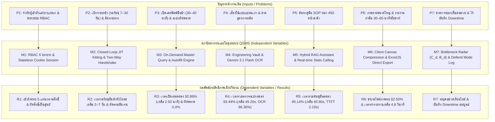
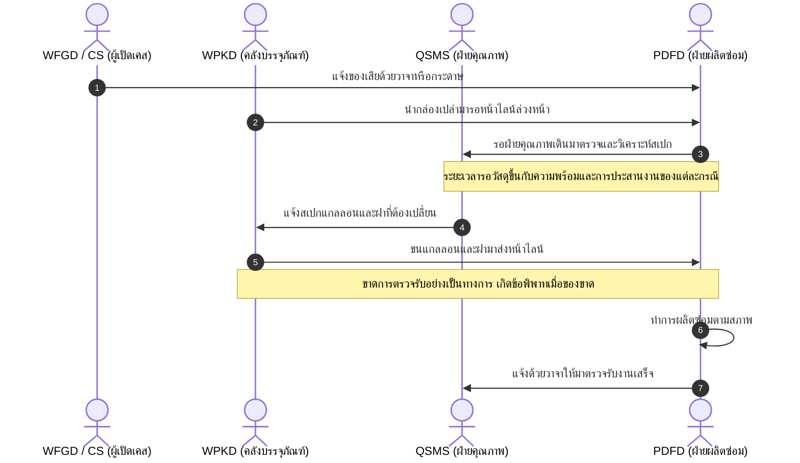
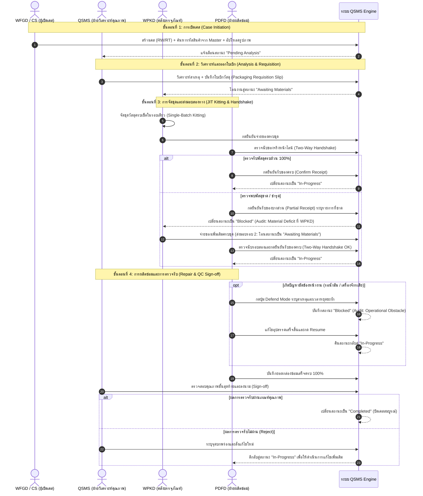
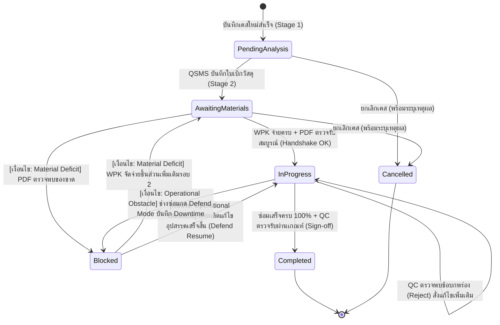
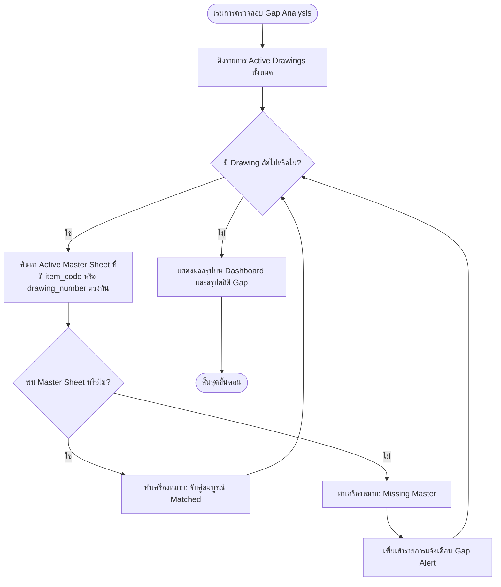
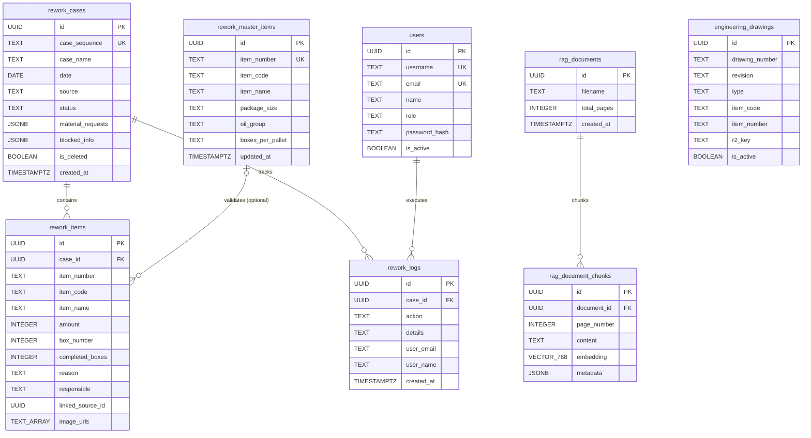

# ระบบบริหารจัดการกระบวนการแก้ไขผลิตภัณฑ์และคลังเอกสารข้อกำหนดมาตรฐานการผลิตอัจฉริยะ

**ชื่อปริญญานิพนธ์ (ภาษาไทย):**  
ระบบบริหารจัดการกระบวนการแก้ไขผลิตภัณฑ์และคลังเอกสารข้อกำหนดมาตรฐานการผลิตอัจฉริยะ  

**Thesis Title (English):**  
QSMS: Quality and Rework Management System with Intelligent Manufacturing Specifications and Retrieval-Augmented Generation  

---

## ส่วนประกอบตอนต้น (Front Matter)

### ข้อมูลผู้จัดทำและคณะกรรมการ (Project Information)
- **ผู้จัดทำโครงงาน:** นายสพลฎณัย ชัยพงษ์ (รหัสนักศึกษา 6752500398)
- **อาจารย์ที่ปรึกษา:** ดร. ภาคภูมิ ปฐมภาคย์
- **สาขาวิชา:** วิศวกรรมหุ่นยนต์และระบบอัตโนมัติ
- **คณะ:** วิศวกรรมศาสตร์และเทคโนโลยี
- **สถาบัน:** สถาบันการจัดการปัญญาภิวัฒน์
- **ปีการศึกษา:** 2569

---

### หน้าอนุมัติปริญญานิพนธ์ (Approval Sheet)
ปริญญานิพนธ์ฉบับนี้ได้รับการพิจารณาและอนุมัติให้เป็นส่วนหนึ่งของการศึกษาตามหลักสูตรวิศวกรรมศาสตรบัณฑิต สาขาวิชาวิศวกรรมหุ่นยนต์และระบบอัตโนมัติ คณะวิศวกรรมศาสตร์และเทคโนโลยี สถาบันการจัดการปัญญาภิวัฒน์

คณะกรรมการสอบปริญญานิพนธ์:
- ........................................................... ประธานกรรมการสอบ (ดร. ภาคภูมิ ปฐมภาคย์)
- ........................................................... กรรมการ (ดร. อภิชาติ ชัยชวลิต)
- ........................................................... กรรมการ (ดร. โพธิวัฒน์ งามขจรวิวัฒน์)
- ........................................................... กรรมการ (อาจารย์ศิลา วงศ์สุนทรพจน์)

---

### กิตติกรรมประกาศ (Acknowledgements)
ปริญญานิพนธ์ฉบับนี้สำเร็จลุล่วงได้ด้วยคำแนะนำและการให้คำปรึกษาจาก ดร. ภาคภูมิ ปฐมภาคย์ อาจารย์ที่ปรึกษาปริญญานิพนธ์ ผู้จัดทำขอกราบขอบพระคุณเป็นอย่างสูง

ขอขอบพระคุณคณะผู้บริหาร วิศวกร และบุคลากรหน้างานในโรงงานกรณีศึกษาอุตสาหกรรมผสมและบรรจุสารหล่อลื่น (หนังสือเลขที่ ENG-QMS-2026-004) โดยเฉพาะบุคลากรจากทั้ง 5 แผนก ได้แก่:
1. แผนกบริหารคุณภาพและความปลอดภัย (QSMS: Quality and Safety MGT System)
2. แผนกผลิตและบรรจุ (PDFD: Production Filling Department ในระบบใช้รหัสบทบาท `PDF`)
3. แผนกคลังสินค้าสำเร็จรูป (WFGD: W/H Finished Goods Department ในระบบใช้รหัสบทบาท `WFG`)
4. แผนกคลังบรรจุภัณฑ์ (WPKD: W/H Packaging Department ในระบบใช้รหัสบทบาท `WPK`)
5. หน่วยงาน Commercial Special Product (CSPD; ในระบบใช้รหัสบทบาท `CS`)

ที่ได้สละเวลาให้ข้อมูลกระบวนการหน้างาน ร่วมในการสัมภาษณ์เพื่อรวบรวมความต้องการของระบบ ให้ความร่วมมือในการทดสอบระบบนำร่อง 8 สัปดาห์ และร่วมประเมินความสามารถในการใช้งานของระบบ

สุดท้ายนี้ ผู้จัดทำขอน้อมรำลึกในพระคุณของบิดา มารดา และครอบครัว ที่ได้ให้การสนับสนุนกำลังใจและการศึกษาเล่าเรียนเสมอมา รวมถึงเพื่อนร่วมรุ่นทุกคนที่มีส่วนช่วยเหลือและแลกเปลี่ยนความรู้ จนกระทั่งโครงงานปริญญานิพนธ์ฉบับนี้สำเร็จสมบูรณ์ได้ตามวัตถุประสงค์ทุกประการ

นายสพลฎณัย ชัยพงษ์  
ผู้จัดทำ

---

### บทคัดย่อภาษาไทย (Abstract in Thai)

**ชื่อปริญญานิพนธ์:** ระบบบริหารจัดการกระบวนการแก้ไขผลิตภัณฑ์และคลังเอกสารข้อกำหนดมาตรฐานการผลิตอัจฉริยะ  
**คำสำคัญ:** การควบคุมงานแก้ไขชิ้นส่วน, การจัดการคุณภาพ, การผลิตแบบลีน, การควบคุมการเข้าถึงตามบทบาท, การดึงข้อมูลเสริมการสร้างคำตอบ, โมเดลภาษาขนาดใหญ่หลายรูปแบบ  

กระบวนการแก้ไขชิ้นส่วนผลิตภัณฑ์ที่ไม่เป็นไปตามข้อกำหนด (Rework Process) ในโรงงานผสมและบรรจุสารหล่อลื่นกรณีศึกษา ประสบปัญหาความสูญเปล่าตามแนวคิดลีน (การรอคอยและการทำงานซ้ำซ้อน) และปัญหาการควบคุมข้อมูลในกระบวนการทำงาน 7 ประการ ได้แก่ 1) การจำกัดการเข้าถึงไฟล์สเปรดชีตอยู่เฉพาะเจ้าหน้าที่ไม่กี่คนในแผนก QSMS และ WFGD เนื่องจากไม่มีระบบแยกสิทธิ์รายบทบาท 2) ความล่าช้าในการเบิกจ่ายบรรจุภัณฑ์ที่ใช้เวลารอขั้นต่ำ 1 สัปดาห์ไปจนถึง 1 เดือนและติดตามจุดค้างงานได้ยาก 3) การค้นหาและพิมพ์รหัสสินค้ากับชื่อผลิตภัณฑ์ด้วยมือในการเปิดเคสซึ่งใช้เวลา 30–40 นาทีและเกิดความคลาดเคลื่อนของสเปก 4) ความเสี่ยงจากการนำแบบแปลนเก่าที่ยกเลิกแล้วมาผลิตซ่อม 5) ความล่าช้าในการเข้าถึงคู่มือขั้นตอนการปฏิบัติงานมาตรฐานในกะการผลิต 6) ภาระการจัดการไฟล์ภาพถ่ายขนาดใหญ่และการจัดทำรายงานสรุปประจำสัปดาห์ด้วยมือซึ่งใช้เวลา 30–60 นาทีต่อสัปดาห์ และ 7) การขาดความสามารถในการมองเห็นจุดคอขวดข้ามแผนกแบบเรียลไทม์ ปริญญานิพนธ์นี้จึงมีวัตถุประสงค์เพื่อวิเคราะห์ ออกแบบ พัฒนา และประเมินประสิทธิภาพของ “ระบบบริหารจัดการกระบวนการแก้ไขผลิตภัณฑ์และคลังเอกสารข้อกำหนดมาตรฐานการผลิตอัจฉริยะ (QSMS)” บนสถาปัตยกรรมเว็บแบบผสมผสาน (Next.js 16.2.6, React 19 และ Supabase PostgreSQL) ที่ผสาน 7 โมดูลย่อยเข้าด้วยกันอย่างเป็นระบบ

ผลการประเมินประสิทธิภาพในสภาพแวดล้อมปฏิบัติงานจริงเป็นระยะเวลา 8 สัปดาห์ (ปริมาณงานรวม 70 เคส แบ่งเป็นเคสภายในโรงงาน RW จำนวน 58 เคส และเคสรับคืนจากลูกค้า RT จำนวน 12 เคส) พบว่า ชุดทดสอบอัตโนมัติ (Vitest 4.x) จำนวน 38 ไฟล์ 244 กรณีทดสอบ ผ่านครบ 100% โดยโมดูลควบคุมการเข้าถึงตามบทบาท (RBAC) ครอบคลุม 6 บทบาท 15 ฟังก์ชัน และ 42 กรณีทดสอบ ช่วยให้ผู้ปฏิบัติงานทั้ง 5 แผนกเข้าใช้งานระบบได้โดยตรงตามสิทธิ์และลดอุบัติการณ์แก้ไขข้อมูลผิดสิทธิ์ลงเหลือ 0 ครั้งต่อเดือน กระบวนการเบิกจ่ายวัสดุและยืนยันรับของแบบสองฝ่ายช่วยลดระยะเวลารอวัสดุของสินค้าทั่วไปจากเดิม 7–30 วัน เหลือ 2–7 วัน (ยกเว้นสินค้าผลิตจำกัดหรือ Limited ที่ต้องประสานงานร่วมกับลูกค้าและผู้ผลิตบรรจุภัณฑ์) และระบบตรวจสอบข้อมูลสินค้าหลักอัตโนมัติช่วยลดเวลาเปิดเคสใหม่ลงร้อยละ 92.86 (จากเดิม 35.00 ± 4.20 นาที เหลือ 2.50 ± 0.42 นาที, \(p < 0.001\)) โดยไม่พบความผิดพลาดของข้อมูลในรายการที่มีอยู่ในฐานข้อมูลหลัก (0/102 รายการ)

สำหรับคลังแบบแปลนวิศวกรรม ระบบมีความแม่นยำในการสกัดข้อมูล 11 ฟิลด์ ร้อยละ 96.36 (530 จาก 550 ฟิลด์) และช่วยลดเวลารวมในการค้นหา ตรวจสกัด และยืนยันสเปกลงร้อยละ 93.44 (จากเดิม 12.50 ± 1.80 นาที เหลือ 49.20 ± 8.20 วินาทีต่อฉบับ, \(p < 0.001\)) สำหรับระบบผู้ช่วยเทคนิค DocAI (Hybrid RAG) มีเวลาเริ่มสตรีมคำตอบแรก (TTFT) เฉลี่ย 2.10 ± 0.28 วินาที ช่วยลดเวลารวมในการค้นหาและทำความเข้าใจคู่มือลงร้อยละ 95.14 (จากเดิม 14.00 ± 2.45 นาที เหลือ 40.80 ± 6.80 วินาที, \(p < 0.001\)) และตอบคำถามถูกต้องร้อยละ 97.50 (39 จาก 40 คำถาม) การบีบอัดภาพฝั่งไคลเอนต์ลดขนาดไฟล์ภาพลงร้อยละ 82.50 (จาก 2.00 MB เหลือ 0.35 MB) และการส่งออกรายงาน Excel ฝังรูปภาพใช้เวลาเฉลี่ย 4.80 ± 0.50 วินาที (เทียบกับการจัดทำด้วยมือเดิม 30–60 นาทีต่อสัปดาห์) นอกจากนี้ แดชบอร์ดเฝ้าระวังคอขวดสามารถระบุจุดติดขัดข้ามแผนกได้ภายในเวลาไม่เกิน 5 วินาที โดยมีความสอดคล้องกับการตัดสินใจของหัวหน้างานร้อยละ 92.5 (\(\kappa = 0.832\)) และผลการประเมินความสามารถในการใช้งานของระบบตามมาตรฐาน SUS จากผู้ใช้งานจริง 15 คน ได้คะแนนเฉลี่ย 83.33 ± 3.62 คะแนน (ระดับเกรด A)

---

### Abstract in English

**Thesis Title:** QSMS: Quality and Rework Management System with Intelligent Manufacturing Specifications and Retrieval-Augmented Generation  
**Keywords:** Rework Management, Quality Assurance, Lean Manufacturing, Role-Based Access Control, Retrieval-Augmented Generation, Multimodal Large Language Models  

The rework process for non-conforming products in lubricant blending and packaging plants encounters operational wastes (waiting and overprocessing) and cross-departmental workflow bottlenecks. Field observations at the case study facility identified seven primary challenges: 1) restricted spreadsheet access limited to a few staff in QSMS and WFGD without role-based permissions for other departments, 2) material requisition delays requiring a minimum of 1 week up to 1 month of waiting time, 3) manual lookup and entry of item codes and product names requiring 30–40 minutes per case with frequent specification errors, 4) risks of utilizing superseded engineering drawings, 5) delayed access to standard operating procedure (SOP) manuals during shift operations, 6) network bandwidth consumption from large photo uploads and manual weekly report preparation requiring 30–60 minutes per week, and 7) the absence of real-time visibility into cross-departmental work-in-process bottlenecks. This thesis presents the design, development, and empirical evaluation of the Quality and Rework Management System (QSMS) built on a hybrid Next.js 16.2.6, React 19, and Supabase PostgreSQL architecture integrating seven cohesive modules.

Empirical evaluation conducted across an 8-week field deployment (70 rework cases: 58 internal RW cases and 12 customer return RT cases) demonstrated that the automated test suite (Vitest 4.x, 38 files, 244 test cases) achieved a 100% pass rate. The role-based access control (RBAC) module covered six roles, 15 functions, and 42 test cases, enabling direct multi-department access while eliminating unauthorized cross-role modifications (0 incidents/month). Structured material requisitions alongside two-way handshakes reduced standard material waiting times from 7–30 days down to 2–7 days (excluding limited-edition products requiring joint coordination with customers and packaging suppliers), while automated item master verification reduced case initiation time by 92.86% from 35.00 ± 4.20 minutes to 2.50 ± 0.42 minutes (\(p < 0.001\)) with zero specification errors among items registered in the master database (0 of 102 items).

For the engineering drawing repository, the system achieved 96.36% accuracy in extracting 11 specification fields (530 of 550 fields) and reduced total specification review time by 93.44% from 12.50 ± 1.80 minutes to 49.20 ± 8.20 seconds per drawing (\(p < 0.001\)). For the DocAI Hybrid RAG assistant, Time-to-First-Token (TTFT) averaged 2.10 ± 0.28 seconds, reducing total SOP consultation time by 95.14% from 14.00 ± 2.45 minutes to 40.80 ± 6.80 seconds (\(p < 0.001\)) with 97.50% answer accuracy (39 of 40 queries). Client-side image compression reduced average file size by 82.50% (from 2.00 MB to 0.35 MB), and automated image-embedded Excel report generation required 4.80 ± 0.50 seconds compared with 30–60 minutes per week for manual preparation. Furthermore, the Operations Bottleneck Radar identified cross-departmental backlogs in under 5 seconds with 92.5% agreement against supervisor assessments (Cohen's \(\kappa = 0.832\)), and the System Usability Scale (SUS) evaluation across 15 active operators yielded a mean score of 83.33 ± 3.62 (Grade A).

---

### สารบัญเนื้อหา (Table of Contents)
- ส่วนประกอบตอนต้น (Front Matter)
  - ข้อมูลผู้จัดทำและคณะกรรมการ
  - หน้าอนุมัติปริญญานิพนธ์
  - กิตติกรรมประกาศ
  - บทคัดย่อภาษาไทย (Abstract in Thai)
  - Abstract in English
  - สารบัญตาราง (List of Tables)
  - สารบัญภาพ (List of Figures)
  - รายการคำย่อและสัญลักษณ์ (List of Abbreviations)
- บทที่ 1: บทนำ (Introduction)
  - 1.1 ความเป็นมาและความสำคัญของปัญหา
  - 1.2 ข้อมูลบริบทโรงงานกรณีศึกษาและสถิติปัญหาฐานเดิม (Baseline Context)
  - 1.3 ปัญหาการวิจัย 7 ประการ (Research Problems: P1–P7)
  - 1.4 วัตถุประสงค์ของการวิจัย 7 ข้อ (Research Objectives: O1–O7)
  - 1.5 สมมติฐานการวิจัยเชิงสถิติ (Statistical Hypotheses: H1 และ H3–H7)
  - 1.6 ขอบเขตของการวิจัยและสิ่งที่ไม่ครอบคลุม (Research Scope & Exclusions)
  - 1.7 นิยามศัพท์ปฏิบัติการ (Operational Definitions)
  - 1.8 ประโยชน์ที่คาดว่าจะได้รับ (Expected Benefits)
- บทที่ 2: ทฤษฎีและวรรณกรรมที่เกี่ยวข้อง (Literature Review)
  - 2.1 แนวคิดการผลิตแบบลีนและความสูญเปล่าในการผลิต (Lean Manufacturing & Ohno's Muda)
  - 2.2 ทฤษฎีข้อจำกัดและการบริหารภาระงานคั่งค้าง (Theory of Constraints & Little's Law)
  - 2.3 การควบคุมการเข้าถึงตามบทบาท (Role-Based Access Control: RBAC96 & NIST Core RBAC)
  - 2.4 ความมั่นคงปลอดภัยของเว็บแอปพลิเคชันและการจัดการเซสชัน (Web Application Security & OWASP Defense)
  - 2.5 การจัดการข้อมูลหลักและการควบคุมความถูกต้องของข้อมูล (Master Data Management: MDM)
  - 2.6 โมเดลภาษาขนาดใหญ่หลายรูปแบบและการสกัดข้อมูลจากแบบแปลน (Multimodal LLMs & Visual OCR)
  - 2.7 สถาปัตยกรรมการดึงข้อมูลเสริมการสร้างคำตอบแบบผสมผสาน (Hybrid RAG & Reciprocal Rank Fusion)
  - 2.8 สถาปัตยกรรมซอฟต์แวร์ฟรอนต์เอนด์เชิงโมดูลาร์ (Feature-Sliced Design: FSD)
  - 2.9 การจัดการชุดพัสดุทันเวลาพอดี (Just-In-Time Kitting Logistics)
  - 2.10 มาตรฐานการควบคุมเอกสารและการจัดการของเสียตาม ISO 9001 (Document Control & ISO 9001)
  - 2.11 การทบทวนงานวิจัยที่เกี่ยวข้องและระบบสำเร็จรูปเชิงพาณิชย์ (Related Works & COTS Comparison)
  - 2.12 กรอบแนวคิดการวิจัย (Conceptual Framework)
  - 2.13 วงจรชีวิตการพัฒนาซอฟต์แวร์แบบอไจล์ (Agile Software Development Lifecycle: Scrum Framework)
  - 2.14 ทฤษฎีและระเบียบวิธีประเมินความสามารถในการใช้งานระบบ (System Usability Scale: SUS Theory)
  - 2.15 ระเบียบวิธีสถิติเชิงอนุมานและการวัดขนาดอิทธิพล (Inferential Statistics & Effect Size Metrics)
  - 2.16 ระบบสารสนเทศและการประสานงานการปฏิบัติการผลิต (Manufacturing Operations Information & Workflow Automation)
- บทที่ 3: ระเบียบวิธีวิจัยและการออกแบบระบบ (Research Methodology & System Design)
  - 3.1 ระเบียบวิธีวิจัยและแผนการดำเนินงาน (Research Methodology & Project Timeline)
  - 3.2 การวิเคราะห์กระบวนการทำงานเดิมเปรียบเทียบกับกระบวนการใหม่ (As-Is vs To-Be Workflows)
  - 3.3 เมทริกซ์การกำหนดสิทธิ์การใช้งาน 15 ฟังก์ชัน (Permission Matrix for 6 Roles)
  - 3.4 ข้อกำหนดความต้องการเชิงฟังก์ชันและเชิงคุณภาพ (Functional & Non-Functional Requirements)
  - 3.5 สถาปัตยกรรมระบบและโครงสร้างทางกายภาพ (System Architecture & API Boundaries)
  - 3.6 แบบจำลองเครื่องสถานะจำกัดและการควบคุมข้อยกเว้น (Finite State Machine & Transition Guards)
  - 3.7 วงจรชีวิตแบบแปลนวิศวกรรมและขั้นตอนวิธี Gap Analysis (Drawing Lifecycle & Gap Algorithm)
  - 3.8 การออกแบบฐานข้อมูลแบบแยกส่วนอิสระ (Dual-Database Schema & Data Dictionary)
  - 3.9 แบบจำลองทางคณิตศาสตร์สำหรับการตรวจจับคอขวดและภาระงานคั่งค้าง (Mathematical Model for Bottleneck Radar)
  - 3.10 กลไกสำรองข้อมูลและการรองรับความผิดพลาด (Backup Mechanism & Disaster Recovery)
  - 3.11 จริยธรรมการวิจัยและการคุ้มครองข้อมูลองค์กร (Research Ethics, Data Masking, and Consent)
- บทที่ 4: การพัฒนาระบบและผลการประเมิน (Implementation & Empirical Evaluation)
  - 4.1 สภาพแวดล้อมและเทคโนโลยีที่ใช้ในการพัฒนา (Implementation Stack)
  - 4.2 การพัฒนา 7 โมดูลหลักของระบบ (Implementation of the 7 Subsystems)
  - 4.3 ผลการทดสอบการทำงานอัตโนมัติ (Automated Unit & Integration Test Suite)
  - 4.4 ตารางการสอบกลับได้ของระบบ (Traceability Matrix)
  - 4.5 ผลการประเมินประสิทธิภาพเชิงปริมาณ (Empirical Results: R1–R7)
  - 4.6 การประเมินประสิทธิภาพแบบจำลอง AI (AI Model Evaluation: OCR & RAG)
  - 4.7 การประเมินความสามารถในการใช้งานของระบบ (System Usability Scale: SUS Evaluation)
  - 4.8 การทดสอบข้อกำหนดเชิงคุณภาพ (NFR Verification)
- บทที่ 5: สรุปผลการวิจัย การอภิปรายผล ข้อจำกัด และข้อเสนอแนะ (Conclusions, Discussion, and Future Work)
  - 5.1 สรุปผลการวิจัยตามวัตถุประสงค์ 7 ข้อ (Conclusions Answering O1–O7)
  - 5.2 การอภิปรายผลการวิจัยเปรียบเทียบกับทฤษฎีและงานวิจัยก่อนหน้า (Discussion of Findings)
  - 5.3 ภัยคุกคามต่อความถูกต้องของการวิจัย (Threats to Validity)
  - 5.4 ข้อจำกัดและการแลกเปลี่ยนเชิงวิศวกรรม (Engineering Limitations & Trade-offs)
  - 5.5 ข้อเสนอแนะและทิศทางการพัฒนาในอนาคต (Recommendations & Future Work)
- บรรณานุกรม (References)
- ภาคผนวก (Appendices)
  - ภาคผนวก ก: รายละเอียดชุดกรณีทดสอบอัตโนมัติ 42 เคสครอบคลุม 15 ฟังก์ชัน (RBAC Test Suite)
  - ภาคผนวก ข: สคีมาข้อมูล JSON สำหรับการสกัดข้อมูลแบบแปลน (OCR Structured Schema)
  - ภาคผนวก ค: แผนภาพโครงสร้างส่วนติดต่อผู้ใช้ของระบบและเอกสารประเมินผล (System UI Schematics & Evaluation Materials)
  - ภาคผนวก ง: ข้อมูลคะแนนดิบแบบสอบถาม SUS รายข้อ (SUS Raw Score Matrix)
  - ภาคผนวก จ: หนังสือยินยอมการเก็บข้อมูลและการคุ้มครองข้อมูลความลับ (Company Consent & Anonymization)
- ประวัติผู้เขียน (Author Biography)

---

### สารบัญตาราง (List of Tables)
- ตารางที่ 1.1: ข้อมูลสถิติและปัญหาฐานเดิมของกระบวนการแก้ไขชิ้นส่วน (Baseline Data)
- ตารางที่ 2.1: การเปรียบเทียบงานวิจัยที่เกี่ยวข้องและระบบสำเร็จรูปเชิงพาณิชย์ (Related Works & COTS Comparison)
- ตารางที่ 3.1: แผนการดำเนินงานวิจัย 6 เดือน (Project Timeline)
- ตารางที่ 3.2: เมทริกซ์การกำหนดสิทธิ์ 15 ฟังก์ชันตาม 6 บทบาทหน้าที่ (Role-Permission Matrix)
- ตารางที่ 3.3: การจับคู่ระหว่าง UI Stepper และ Finite State Machine States
- ตารางที่ 3.4: พจนานุกรมข้อมูลตารางธุรกรรมการผลิตหลัก (Main OLTP Data Dictionary)
- ตารางที่ 3.5: พจนานุกรมข้อมูลตารางคลังเอกสารและเวกเตอร์ (Dedicated RAG & Storage Data Dictionary)
- ตารางที่ 4.1: สรุปผลการรันชุดทดสอบอัตโนมัติครอบคลุม 7 โดเมน (Vitest Test Suite Summary)
- ตารางที่ 4.2: ตารางการสอบกลับได้ของระบบ (Traceability Matrix)
- ตารางที่ 4.3: ผลการประเมินประสิทธิภาพเชิงปริมาณเปรียบเทียบก่อน-หลังปรับปรุง (Empirical Evaluation: R1–R7)
- ตารางที่ 4.4: ผลการประเมินความแม่นยำรายฟิลด์ของโมเดล Gemini 3.1 Flash บนแบบแปลน 50 ฉบับ
- ตารางที่ 4.5: ผลการทดสอบเปรียบเทียบกลไกการสืบค้นคู่มือ (Retrieval Ablation Study: Vector vs FTS vs Hybrid)
- ตารางที่ 4.6: ข้อมูลคะแนนดิบและผลการประเมินความสามารถในการใช้งานของระบบตามมาตรฐาน SUS (n = 15)
- ตารางที่ 4.7: สรุปผลการตรวจสอบข้อกำหนดเชิงคุณภาพ (Non-Functional Requirements Verification)
- ตารางที่ 5.1: สรุปผลการทดสอบสมมติฐานการวิจัย H1–H7 และผลเชิงพรรณนาของ O2
- ตารางที่ ก.1: ตารางการจับคู่ความครอบคลุมระหว่างตารางสิทธิ์ 15 ฟังก์ชันกับกรณีทดสอบอัตโนมัติ 42 เคส (RBAC Test Mapping)
- ตารางที่ ง.1: ตารางคะแนนดิบรายข้อประเมินแบบสอบถาม SUS จากผู้ใช้งานจริง 15 คน (SUS Raw Score Matrix)

---

### สารบัญภาพ (List of Figures)
- ภาพที่ 2.1: กรอบแนวคิดการวิจัย (Conceptual Framework)
- ภาพที่ 3.1: แผนภาพลำดับงานกระบวนการเดิม (As-Is Process Sequence Diagram)
- ภาพที่ 3.2: แผนภาพลำดับงานกระบวนการใหม่แบบวงจรปิด (To-Be Closed-Loop Sequence Diagram)
- ภาพที่ 3.3: แผนภาพสถาปัตยกรรมระบบโดยรวมและขอบเขต API (System Architecture & API Boundaries)
- ภาพที่ 3.4: แผนภาพเครื่องสถานะจำกัด 6 สถานะพร้อมเงื่อนไขการตรวจสอบ (FSM with Transition Guards)
- ภาพที่ 3.5: แผนภาพขั้นตอนวิธีตรวจสอบช่องว่างแบบแปลน (Gap Analysis Flowchart)
- ภาพที่ 3.6: แผนภาพความสัมพันธ์ของข้อมูล (Entity-Relationship Diagram: Dual-DB ERD)
- ภาพที่ ค.1: แผนภาพโครงสร้างหน้าจอหลักรายการเคสและการควบคุมขั้นตอน 4-Stage Stepper (Case List & Stepper UI)
- ภาพที่ ค.2: แผนภาพโครงสร้างหน้าจอคลังแบบแปลนวิศวกรรมแบบ Split View 55/45 พร้อมเครื่องมือหมุน 360° (Vault UI)
- ภาพที่ ค.3: แผนภาพโครงสร้างหน้าจอแดชบอร์ดเฝ้าระวังคอขวดและตัวกรองสถานะ 1-Click (Bottleneck Radar UI)

---

### รายการคำย่อและสัญลักษณ์ (List of Abbreviations & Symbols)

#### คำย่อภาษาอังกฤษ (Abbreviations)
- **API**: Application Programming Interface (ส่วนต่อประสานโปรแกรมประยุกต์)
- **BOM**: Bill of Materials (ในบริบทนี้หมายถึง เอกสารรายการวัสดุและบรรจุภัณฑ์ที่ต้องใช้ซ่อม)
- **CDN**: Content Delivery Network (เครือข่ายส่งมอบเนื้อหา)
- **CI**: Confidence Interval (ช่วงความเชื่อมั่นทางสถิติ)
- **CSPD / CS**: Commercial Special Product (หน่วยงาน Commercial Special Product; ในระบบใช้รหัสบทบาท `CS`)
- **COTS**: Commercial Off-The-Shelf (ซอฟต์แวร์สำเร็จรูปเชิงพาณิชย์)
- **CRUD**: Create, Read, Update, Delete (การสร้าง อ่าน แก้ไข ลบข้อมูล)
- **CSRF**: Cross-Site Request Forgery (การปลอมแปลงคำขอข้ามไซต์)
- **DPR**: Dense Passage Retrieval (การดึงข้อมูลข้อความความหนาแน่นสูงด้วยเวกเตอร์)
- **ERP**: Enterprise Resource Planning (ระบบวางแผนทรัพยากรองค์กร)
- **FSD**: Feature-Sliced Design (สถาปัตยกรรมการออกแบบฟรอนต์เอนด์เชิงโมดูล)
- **FSM**: Finite State Machine (เครื่องสถานะจำกัด)
- **FTS**: Full-Text Search (การค้นหาข้อความเต็มรูปแบบเชิงคำศัพท์)
- **HNSW**: Hierarchical Navigable Small World (โครงสร้างดัชนีการค้นหาเวกเตอร์)
- **JIT**: Just-In-Time (ระบบการผลิตและจ่ายวัสดุแบบทันเวลาพอดี)
- **JWT**: JSON Web Token (โทเค็นเว็บเจซอนสำหรับการยืนยันตัวตน)
- **LLM**: Large Language Model (โมเดลภาษาขนาดใหญ่)
- **MDM**: Master Data Management (การจัดการข้อมูลหลักขององค์กร)
- **MES**: Manufacturing Execution System (ระบบควบคุมและติดตามการปฏิบัติการผลิต)
- **MRR**: Mean Reciprocal Rank (ค่าเฉลี่ยส่วนกลับของอันดับผลลัพธ์แรก)
- **NFR**: Non-Functional Requirement (ข้อกำหนดความต้องการเชิงคุณภาพ)
- **OCR**: Optical Character Recognition (การรู้จำอักขระด้วยแสง)
- **OLTP**: Online Transaction Processing (ระบบประผลธุรกรรมเชิงรายการ)
- **PDPA**: Personal Data Protection Act (พระราชบัญญัติคุ้มครองข้อมูลส่วนบุคคล)
- **PDFD / PDF**: Production Filling Department (แผนกผลิตและบรรจุ ในระบบใช้รหัสบทบาท `PDF`)
- **QSMS**: Quality and Safety Management System (แผนกบริหารคุณภาพและความปลอดภัย และชื่อระบบ)
- **RAG**: Retrieval-Augmented Generation (การสร้างคำตอบโดยเสริมการค้นคืนข้อมูล)
- **RBAC**: Role-Based Access Control (การควบคุมการเข้าถึงตามบทบาทหน้าที่)
- **RLS**: Row-Level Security (ความปลอดภัยระดับแถวข้อมูลในฐานข้อมูล)
- **RPO**: Recovery Point Objective (เป้าหมายจุดฟื้นตัวของข้อมูล)
- **RRF**: Reciprocal Rank Fusion (ขั้นตอนวิธีการผสานอันดับผลลัพธ์แบบส่วนกลับ)
- **RTO**: Recovery Time Objective (เป้าหมายระยะเวลาการฟื้นคืนระบบ)
- **SD**: Standard Deviation (ส่วนเบี่ยงเบนมาตรฐาน)
- **SDLC**: Software Development Life Cycle (วงจรชีวิตการพัฒนาซอฟต์แวร์)
- **SFC**: Shop Floor Control (การควบคุมการปฏิบัติการหน้าไลน์ผลิตภายใน)
- **SLA**: Service Level Agreement (ข้อตกลงระดับการบริการ)
- **SoD**: Separation of Duty (การแบ่งแยกหน้าที่การปฏิบัติงาน)
- **SOP**: Standard Operating Procedure (ขั้นตอนการปฏิบัติงานมาตรฐาน)
- **SSE**: Server-Sent Events (การส่งข้อมูลแบบสตรีมมิ่งจากเซิร์ฟเวอร์สู่ไคลเอนต์)
- **SUS**: System Usability Scale (แบบประเมินความสามารถในการใช้งานระบบ)
- **TOC**: Theory of Constraints (ทฤษฎีข้อจำกัดในการบริหารการผลิต)
- **TTFT**: Time-to-First-Token (ระยะเวลาตั้งแต่ส่งคำขอจนกระทั่งได้รับโทเค็นแรกกลับมา)
- **WFGD / WFG**: Warehouse Finished Goods Department (แผนกคลังสินค้าสำเร็จรูป ในระบบใช้รหัส `WFG`)
- **WIP**: Work-In-Process (งานระหว่างทำที่คั่งค้างในสายการผลิต)
- **WPKD / WPK**: Warehouse Packaging Department (แผนกคลังบรรจุภัณฑ์ ในระบบใช้รหัส `WPK`)
- **XSS**: Cross-Site Scripting (ช่องโหว่การโจมตีฝังสคริปต์ข้ามไซต์)

#### สัญลักษณ์ทางคณิตศาสตร์และสถิติ (Mathematical Symbols)
- \(B_d\): ยอดกล่องคงเหลือรวมของคิวงาน \(d\) ในระบบเฝ้าระวังคอขวด (Bottleneck Radar)
- \(C_d\): จำนวนเคสคั่งค้างที่กำลังดำเนินการในคิวงาน \(d\) (\(C_d = |S_d|\))
- \(d\): คิวงานที่รับผิดชอบในระบบเฝ้าระวังคอขวด (\(d \in \{\text{QSMS}, \text{WPK}, \text{PDF}, \text{BLOCKED}\}\)) หรือ ค่าสถิติขนาดอิทธิพล (Cohen's d)
- \(k\): ค่าคงที่ปรับสมดุลในขั้นตอนวิธี Reciprocal Rank Fusion (กำหนด \(k = 60\))
- \(\mu\): ค่าเฉลี่ยประชากร (Population Mean)
- \(s\): ค่าส่วนเบี่ยงเบนมาตรฐานกลุ่มตัวอย่าง (Sample Standard Deviation)
- \(S_d\): เซตของเคสที่กำลังดำเนินการอยู่ในคิวงาน \(d\)
- \(t\): ค่าสถิติทดสอบของ Student's t-test

---

## บทที่ 1: บทนำ (Introduction)

### 1.1 ความเป็นมาและความสำคัญของปัญหา
ในอุตสาหกรรมผสมและบรรจุสารหล่อลื่น (Lubricant Blending and Packaging Industry) มาตรฐานคุณภาพของผลิตภัณฑ์ ความถูกต้องของฉลาก และความสมบูรณ์ของบรรจุภัณฑ์ ถือเป็นหัวใจสำคัญของการดำเนินงาน เนื่องจากความบกพร่องเพียงเล็กน้อย เช่น การรั่วซึมบริเวณฝาปิด การติดฉลากผิดสูตรการผลิต หรือการปนเปื้อนภายนอกบรรจุภัณฑ์ ไม่เพียงสร้างความสูญเสียต่อมูลค่าสินค้าโดยตรง แต่ยังส่งผลกระทบต่อเนื่องถึงความปลอดภัยในการขนส่ง มาตรฐานสิ่งแวดล้อม และความเชื่อมั่นของลูกค้าในภาคอุตสาหกรรม

ในสภาพแวดล้อมการผลิตจริง การเกิดผลิตภัณฑ์ที่ไม่เป็นไปตามข้อกำหนด (Non-conforming Products) ทั้งจากสายการบรรจุภายในโรงงาน (Filling Line) และจากการรับคืนสินค้าเคลมจากภายนอก เป็นสิ่งที่หลีกเลี่ยงได้ยาก ผลิตภัณฑ์กลุ่มนี้จำเป็นต้องเข้าสู่ "กระบวนการแก้ไขชิ้นส่วน (Rework Process)" เพื่อทำการคัดแยก ถ่ายเทน้ำมันหล่อลื่น เปลี่ยนภาชนะแกลลอน ฝาปิด หรือกล่องบรรจุภัณฑ์ใหม่ ให้กลับคืนสู่เกณฑ์มาตรฐานคุณภาพก่อนส่งมอบอีกครั้ง

อย่างไรก็ตาม จากการศึกษากระบวนการทำงานจริงของโรงงานกรณีศึกษา พบว่าการบริหารจัดการงานแก้ไขชิ้นส่วนแบบดั้งเดิมยังคงพึ่งพาเอกสารกระดาษและไฟล์สเปรดชีตที่แยกขาดตามแต่ละแผนก การขาดการบูรณาการข้อมูลแบบศูนย์กลางก่อให้เกิดความสูญเปล่าในการดำเนินงาน (Muda) ตามแนวคิดการผลิตแบบลีน (Lean Manufacturing) อาทิ การบันทึกข้อมูลซ้ำซ้อนและการรอคอยข้อมูลข้ามหน่วยงาน อีกทั้งยังทำให้เกิดจุดคอขวดสะสม (Bottlenecks) ตามทฤษฎีข้อจำกัด (Theory of Constraints: TOC) ส่งผลให้สูญเสียเวลาปฏิบัติงานและขาดความสามารถในการตรวจสอบย้อนกลับ (Traceability) อย่างเป็นระบบ

เพื่อแก้ไขปัญหาดังกล่าว โครงงานนี้จึงได้ออกแบบและพัฒนาระบบบริหารจัดการงานแก้ไขชิ้นส่วนอัจฉริยะ (QSMS) โดยประยุกต์ใช้หลักวิศวกรรมระบบอัตโนมัติในระดับการจัดการกระบวนการและสารสนเทศการผลิต (Workflow and Information Automation) ระบบทำหน้าที่เชื่อมโยงการไหลของข้อมูลและควบคุมการส่งมอบงานระหว่างแผนกโดยอัตโนมัติ ตั้งแต่การตรวจสอบและเติมข้อมูลรหัสสินค้าหลัก การสกัดข้อมูลจำเพาะทางวิศวกรรมจากเอกสารแบบแปลนและใบมาสเตอร์ด้วยปัญญาประดิษฐ์ ไปจนถึงการควบคุมสถานะงานตามเงื่อนไข (State-driven Workflow) และการวิเคราะห์จุดคอขวดแบบเวลาจริง แนวทางดังกล่าวเป็นการวางรากฐานสู่การผลิตอัจฉริยะ (Smart Manufacturing) ที่ผสานผู้ปฏิบัติงาน ข้อมูล และกระบวนการเข้าด้วยกันอย่างเป็นระบบตามขอบเขตของสาขาวิศวกรรมหุ่นยนต์และระบบอัตโนมัติ

### 1.2 ข้อมูลบริบทโรงงานกรณีศึกษาและสถิติปัญหาฐานเดิม (Baseline Context)
โรงงานกรณีศึกษาเป็นโรงงานผสมและบรรจุสารหล่อลื่นขนาดกลางที่มีสายการผลิตบรรจุภัณฑ์หลากหลายขนาด (ตั้งแต่ขนาด 0.8 ลิตร, 1 ลิตร, 4 ลิตร, 5 ลิตร, 18 ลิตร ไปจนถึงถังขนาด 200 ลิตร) โดยในแต่ละปีมีปริมาณผลิตภัณฑ์ที่ต้องเข้าสู่กระบวนการแก้ไขชิ้นส่วนประมาณ 15,000–25,000 แกลลอนต่อปี ซึ่งต้องอาศัยการประสานงานร่วมกันระหว่าง 5 หน่วยงานหลัก ได้แก่
1. **แผนกบริหารคุณภาพและความปลอดภัย (Quality and Safety Management System: QSMS — รหัสในระบบ `QSMS`)**: ทำหน้าที่ตรวจสอบคุณภาพผลิตภัณฑ์ที่ไม่เป็นไปตามข้อกำหนด วิเคราะห์สาเหตุของความบกพร่อง กำหนดรายการวัสดุบรรจุภัณฑ์ที่ต้องใช้ในการซ่อมแซม รวมถึงการควบคุมมาตรฐานความปลอดภัยของบรรจุภัณฑ์สารเคมีตามเกณฑ์สิ่งแวดล้อมและความปลอดภัยในการขนส่ง ก่อนตรวจรับงานขั้นสุดท้าย (QC Sign-off)
2. **แผนกผลิตและบรรจุ (Production Filling Department: PDFD — รหัสในระบบ `PDF`)**: ทำหน้าที่จัดสรรผู้ปฏิบัติงานหน้าสายการผลิตเพื่อดำเนินการคัดแยก ถ่ายเทน้ำมัน และซ่อมแซมบรรจุภัณฑ์ตามจำนวนกล่องที่ได้รับมอบหมาย รวมถึงการแจ้งสถานะติดขัดหน้างาน (Blocked/Defend Mode)
3. **แผนกคลังสินค้าสำเร็จรูป (Warehouse Finished Goods Department: WFGD — รหัสในระบบ `WFG`)**: ทำหน้าที่ตรวจสอบความสมบูรณ์ของสินค้าคงคลังภายในและเป็นผู้เปิดเคสแจ้งงานแก้ไขชิ้นส่วนภายในโรงงาน (รหัสเคส `RW`)
4. **แผนกคลังบรรจุภัณฑ์ (Warehouse Packaging Department: WPKD — รหัสในระบบ `WPK`)**: ทำหน้าที่จัดเตรียมและเบิกจ่ายวัสดุบรรจุภัณฑ์ใหม่ เช่น กล่องกระดาษ แกลลอนเปล่า และฝาปิด ตามรายการที่แผนก QSMS กำหนด
5. **แผนกบริหารการค้าผลิตภัณฑ์พิเศษ (Commercial Special Product Department: CSPD — รหัสในระบบ `CS`)**: ทำหน้าที่รับเรื่องร้องเรียนกรณีสินค้าชำรุดหรือมีตำหนิจากลูกค้าภายนอก พร้อมรวบรวมเอกสารอ้างอิงเพื่อเปิดเคสงานรับคืนสินค้า (รหัสเคส `RT`)

จากการเก็บรวบรวมข้อมูลเชิงประจักษ์ในสภาพแวดล้อมการทำงานจริงในช่วงสำรวจปัญหาฐานเดิม (เดือนพฤษภาคม พ.ศ. 2569 ก่อนเริ่มพัฒนาระบบ) ควบคู่กับการสืบค้นข้อมูลรายงานย้อนหลัง 12 เดือน สามารถสรุปค่าสถิติและปัญหาฐานเดิม (Baseline Data) ได้ดังแสดงในตารางที่ 1.1

**ตารางที่ 1.1: ข้อมูลสถิติและปัญหาฐานเดิมของกระบวนการแก้ไขชิ้นส่วน (Baseline Data)**

| มิติการปฏิบัติงาน | สภาพปัญหาเดิม (As-Is State) | ขนาดตัวอย่างและวิธีวัด | ค่าสถิติเดิม (Baseline: Mean ± SD) |
|---|---|---|---|
| **P1: การเข้าถึงข้อมูลและสิทธิ์** | ไฟล์สเปรดชีตจำกัดผู้เข้าถึงเฉพาะเจ้าหน้าที่ไม่กี่คนใน QSMS และ WFGD แผนกอื่นต้องฝากบันทึกข้อมูลและไม่มีการแยกสิทธิ์รายบทบาท | ตรวจสอบกระบวนการทำงานและบันทึกย้อนหลัง 3 เดือน (5 แผนก) | มีเพียง 2 จาก 5 แผนกที่เข้าถึงไฟล์ได้โดยตรง และพบความคลาดเคลื่อนจากการฝากแก้ไขข้อมูลข้ามแผนก 6.00 ± 1.20 ครั้ง/เดือน |
| **P2: การเบิกจ่ายและรอวัสดุ** | ขาดระบบติดตามใบเบิกวัสดุและการส่งมอบระหว่างคลังกับหน้าไลน์ ทำให้การเบิกจ่ายล่าช้าและติดตามจุดค้างงานได้ยาก | สังเกตการณ์และบันทึกการติดตามงาน 15 เคส | ระยะเวลารอวัสดุขั้นต่ำ 7 วัน (1 สัปดาห์) และเคสที่ตกหล่นหรือต้องสั่งผลิตบรรจุภัณฑ์จำกัด (Limited) รอนานถึง 30 วัน (1 เดือน) |
| **P3: การเปิดเคสและกรอกข้อมูลสินค้า** | ต้องค้นหาและพิมพ์รหัสสินค้า (`Item Code`) ชื่อผลิตภัณฑ์ (`Item Name`) และสเปกบรรจุภัณฑ์ด้วยมือจากสินค้าที่ตีกลับหรือพบในโรงงาน | จับเวลาเปิดเคสและรวบรวมข้อมูล 20 เคส / สุ่มตรวจ 120 รายการ | เวลาเปิดเคสรวม 35.00 ± 4.20 นาที (ช่วง 30–40 นาที) / ข้อมูลสเปกผิดพลาด 14.2% (17/120 รายการ) |
| **P4: การตรวจแบบแปลน** | ค้นหาไฟล์ PDF ในโฟลเดอร์และอ่านสเปกด้วยตาเปล่า | จับเวลาวิศวกรตรวจสอบ 30 ฉบับ | ใช้เวลาค้นหาและตรวจสเปก 12.50 ± 1.80 นาที/ฉบับ |
| **P5: การค้นหาคู่มือ SOP** | เปิดแฟ้มเอกสารกระดาษหนา 450 หน้า | ทดสอบค้นหาคำตอบ 40 คำถามเทคนิค | ใช้เวลาค้นหาและอ่านคู่มือ 14.00 ± 2.45 นาที/คำถาม |
| **P6: ภาพถ่ายและทำรายงาน** | อัปโหลดภาพความละเอียดสูงดิบ และคัดลอกลง Excel ด้วยมือ | วัดขนาดภาพ 100 รูป / ยืนยันเวลาทำรายงานรายสัปดาห์ | ขนาดภาพ 2.00 ± 0.40 MB / ทำรายงานมือ 30–60 นาทีต่อสัปดาห์ |
| **P7: การระบุคอขวดสายผลิต** | เดินสำรวจหน้างานและโทรสอบถามหัวหน้าแผนก | สังเกตการณ์การประชุมกะ 40 กะ | ใช้เวลาประสานงานและระบุคอขวด 4.50 ± 1.20 ชั่วโมง |

### 1.3 ปัญหาการวิจัย 7 ประการ (Research Problems: P1–P7)
จากข้อมูลเชิงประจักษ์ข้างต้น สามารถสรุปปัญหาการวิจัย 7 ประการที่ต้องแก้ไขได้ดังนี้:

1. **P1 (Restricted Access Bottleneck & Authority Ambiguity)**: ไฟล์สเปรดชีตเดิมจำกัดการเข้าถึงอยู่เฉพาะเจ้าหน้าที่ไม่กี่คนในแผนก QSMS และ WFGD เนื่องจากไม่มีระบบแยกสิทธิ์ตามบทบาทหน้าที่ ทำให้แผนกอื่น (เช่น CS, WPKD, PDFD) ไม่สามารถอัปเดตสถานะงานของตนเองได้โดยตรง ต้องฝากบันทึกข้อมูลข้ามสายงานและขาดประวัติการตรวจสอบย้อนกลับ (Audit Trail)
2. **P2 (Material Requisition Delay & Waiting Bottleneck)**: การเบิกจ่ายบรรจุภัณฑ์ขาดระบบติดตามสถานะและการยืนยันรับมอบระหว่างแผนก ส่งผลให้เคสทั่วไปต้องใช้เวลารอวัสดุขั้นต่ำ 1 สัปดาห์ (7 วัน) และบางเคสล่าช้าสะสมนานถึง 1 เดือน (30 วัน)
3. **P3 (Manual Case Entry & Specification Discrepancy)**: การเปิดเคสต้องค้นหาและพิมพ์รหัสสินค้า (`Item Code`) กับชื่อผลิตภัณฑ์ (`Item Name`) ด้วยมือ ใช้เวลาประมาณ 30–40 นาทีต่อเคส และเกิดความผิดพลาดในการระบุสเปกบรรจุภัณฑ์และกลุ่มผลิตภัณฑ์น้ำมัน
4. **P4 (Obsolete Drawing Production Risks & Missing Master Gaps)**: เอกสารแบบแปลนกระจัดกระจาย เสี่ยงต่อการนำแบบแปลนเก่าที่ยกเลิกแล้ว (Superseded) มาใช้ในการผลิตซ่อม และไม่ทราบว่าแบบแปลนใดขาดเอกสารใบสเปกหลัก (Master Sheet)
5. **P5 (Inaccessible Technical SOPs during Night Shifts)**: คู่มือขั้นตอนการปฏิบัติงานมาตรฐานเป็นรูปเล่มเอกสารหนา ทำให้พนักงานค้นหาข้อมูลเทคนิคได้ล่าช้า โดยเฉพาะในกะการผลิตกลางคืนที่ไม่มีวิศวกรประจำการ
6. **P6 (Image Payload Bloat & Labor-Intensive Reporting)**: ภาพถ่ายหลักฐานมีขนาดไฟล์ใหญ่ทำให้เปลืองแบนด์วิดท์ และผู้จัดทำยืนยันว่าการจัดทำรายงานด้วยมือใช้เวลา 30–60 นาทีต่อสัปดาห์
7. **P7 (Operational Bottleneck Blindspots & Unrecorded Downtime)**: ผู้บริหารไม่สามารถมองเห็นภาระงานคั่งค้างข้ามแผนกแบบเรียลไทม์ และช่างซ่อมหน้าไลน์ไม่มีช่องทางบันทึกสาเหตุการหยุดชะงักของสายการผลิตซ่อม (เช่น รอน้ำมัน หรือรอเครื่องจักร)

### 1.4 วัตถุประสงค์ของการวิจัย 7 ข้อ (Research Objectives: O1–O7)
เพื่อแก้ไขปัญหาการวิจัยทั้ง 7 ประการ วัตถุประสงค์ของการวิจัยจึงถูกกำหนดขึ้นดังนี้:
1. **O1**: พัฒนาระบบยืนยันตัวตนและควบคุมสิทธิ์การเข้าถึงข้อมูลตาม 6 บทบาทหน้าที่ (RBAC) เพื่อป้องกันการเข้าถึงและแก้ไขข้อมูลข้ามสายงาน (แก้ปัญหา P1)
2. **O2**: พัฒนาระบบบริหารงานแก้ไขชิ้นส่วนแบบวงจรปิด (Closed-Loop Workflow) ด้วยกระบวนการจัดชุดจ่ายวัสดุแบบครั้งเดียวตามใบเบิก (JIT Single-Batch Kitting) และการยืนยันรับมอบสองทาง (Two-Way Handshake) เพื่อให้ติดตามสถานะการจัดเตรียมวัสดุ จุดค้างงาน และหน่วยงานที่รับผิดชอบได้อย่างชัดเจน (แก้ปัญหา P2)
3. **O3**: พัฒนากลไกตรวจสอบและเติมเต็มข้อมูลสินค้าอัตโนมัติ (Automated Item Master Verification) ผ่านการสืบค้นข้อมูลหลักจากตาราง `rework_master_items` แบบ On-demand เพื่อลดระยะเวลาการเปิดเคสและขจัดความผิดพลาดของข้อมูลสเปกสินค้า (แก้ปัญหา P3)
4. **O4**: พัฒนาคลังแบบแปลนวิศวกรรมดิจิทัลที่สามารถสกัดข้อมูลสเปกด้วยโมเดลภาษาขนาดใหญ่หลายรูปแบบ (Multimodal LLM) พร้อมระบบควบคุมเวอร์ชันและระบบตรวจจับช่องว่างเอกสาร (Gap Analysis) เพื่อลดเวลาตรวจทานสเปกและป้องกันการผลิตผิดแบบ (แก้ปัญหา P4)
5. **O5**: พัฒนาระบบผู้ช่วยเทคนิคอัจฉริยะ (Technical Assistant) ด้วยสถาปัตยกรรมการสืบค้นแบบผสมผสาน (Hybrid RAG) ระหว่างเวกเตอร์และการค้นหาข้อความเต็ม พร้อมการสตรีมคำตอบ เพื่อลดเวลาในการเข้าถึงคู่มือปฏิบัติงานมาตรฐาน (แก้ปัญหา P5)
6. **O6**: พัฒนาระบบประมวลผลบีบอัดภาพถ่ายฝั่งไคลเอนต์และระบบส่งออกรายงานสรุปดิจิทัลที่ฝังภาพถ่ายลงในเซลล์สเปรดชีตอัตโนมัติ เพื่อลดขนาดไฟล์ภาพและลดระยะเวลาในการจัดทำรายงานรายสัปดาห์ (แก้ปัญหา P6)
7. **O7**: พัฒนาระบบเฝ้าระวังคอขวดสายการผลิต (Bottleneck Radar) ระบบบันทึกประเด็นติดขัดหน้างาน (Defend Mode) และการแจ้งเตือนเหตุการณ์สำคัญผ่าน LINE Bot เพื่อให้ผู้เกี่ยวข้องติดตามสถานะและรับทราบงานคั่งค้างข้ามแผนกได้ (แก้ปัญหา P7)

### 1.5 สมมติฐานการวิจัยเชิงสถิติ (Statistical Hypotheses: H1 และ H3–H7)
การประเมินเชิงสถิติใช้กับตัวชี้วัดที่มีข้อมูลดิบและวิธีเก็บข้อมูลรองรับ ส่วนการติดตามวัสดุ (O2) รายงานเป็นข้อสังเกตเชิงพรรณนาจาก Audit Log และบันทึกการปิดเคส ไม่กำหนดสมมติฐานทดสอบนัยสำคัญ (กำหนดระดับนัยสำคัญ \(\alpha = 0.05\)):
1. **สมมติฐานที่ 1 (H1: สิทธิ์การเข้าถึงข้อมูล)**:
   - \(H_{0,1}\): อัตราการเกิดเหตุการณ์ผิดสิทธิ์หลังใช้ระบบไม่แตกต่างจากเดิม (\(\mu_{\text{error}} \ge 6.0\) ครั้ง/เดือน)
   - \(H_{a,1}\): อัตราการเกิดเหตุการณ์ผิดสิทธิ์หลังใช้ระบบลดลงอย่างมีนัยสำคัญ (\(\mu_{\text{error}} < 6.0\) ครั้ง/เดือน)
3. **สมมติฐานที่ 3 (H3: เวลาบันทึกเปิดเคสใหม่)**:
   - \(H_{0,3}\): ค่าเฉลี่ยเวลาเปิดเคสใหม่หลังใช้ระบบไม่น้อยกว่าก่อนใช้ระบบ (\(\mu_{\text{post}} \ge \mu_{\text{pre}}\))
   - \(H_{a,3}\): ค่าเฉลี่ยเวลาเปิดเคสใหม่หลังใช้ระบบลดลงอย่างมีนัยสำคัญ (\(\mu_{\text{post}} < \mu_{\text{pre}}\))
4. **สมมติฐานที่ 4 (H4: เวลารวมตรวจทานแบบแปลนวิศวกรรมและความแม่นยำ)**:
   - \(H_{0,4}\): ค่าเฉลี่ยเวลารวมตรวจทานแบบแปลนหลังใช้ระบบไม่น้อยกว่าก่อนใช้ระบบ (\(\mu_{\text{post}} \ge \mu_{\text{pre}}\))
   - \(H_{a,4}\): ค่าเฉลี่ยเวลารวมตรวจทานแบบแปลนหลังใช้ระบบลดลงอย่างมีนัยสำคัญ (\(\mu_{\text{post}} < \mu_{\text{pre}}\)) พร้อมความแม่นยำในการสกัดข้อมูล \(\ge 95\%\)
5. **สมมติฐานที่ 5 (H5: เวลารวมเข้าถึงคู่มือขั้นตอนปฏิบัติงานและความแม่นยำ)**:
   - \(H_{0,5}\): ค่าเฉลี่ยเวลารวมเข้าถึงคู่มือหลังใช้ระบบไม่น้อยกว่าก่อนใช้ระบบ (\(\mu_{\text{post}} \ge \mu_{\text{pre}}\))
   - \(H_{a,5}\): ค่าเฉลี่ยเวลารวมเข้าถึงคู่มือหลังใช้ระบบลดลงอย่างมีนัยสำคัญ (\(\mu_{\text{post}} < \mu_{\text{pre}}\)) พร้อมความถูกต้องของคำตอบ \(\ge 95\%\)
6. **สมมติฐานที่ 6 (H6: ขนาดไฟล์ภาพถ่ายเฉลี่ย)**:
   - \(H_{0,6}\): ค่าเฉลี่ยขนาดไฟล์ภาพถ่ายหลังผ่านการบีบอัดไม่น้อยกว่าก่อนบีบอัด (\(\mu_{\text{post}} \ge \mu_{\text{pre}}\))
   - \(H_{a,6}\): ค่าเฉลี่ยขนาดไฟล์ภาพถ่ายหลังผ่านการบีบอัดน้อยกว่าก่อนบีบอัดอย่างมีนัยสำคัญ (\(\mu_{\text{post}} < \mu_{\text{pre}}\))
7. **สมมติฐานที่ 7 (H7: เวลาในการระบุจุดคอขวดข้ามแผนก)**:
   - \(H_{0,7}\): ค่าเฉลี่ยเวลาที่ใช้ในการระบุจุดคอขวดหลังใช้ระบบไม่น้อยกว่าก่อนใช้ระบบ (\(\mu_{\text{post}} \ge \mu_{\text{pre}}\))
   - \(H_{a,7}\): ค่าเฉลี่ยเวลาที่ใช้ในการระบุจุดคอขวดหลังใช้ระบบลดลงอย่างมีนัยสำคัญ (\(\mu_{\text{post}} < \mu_{\text{pre}}\))

นอกจากนี้ สำหรับการประเมินความสามารถในการใช้งานระบบ (System Usability Scale: SUS) ได้ตั้งเกณฑ์เปรียบเทียบเชิงสมมติฐานคือ \(H_{a,\text{SUS}}: \mu_{\text{SUS}} > 68.0\) ซึ่งเป็นเกณฑ์มาตรฐานเฉลี่ยของอุตสาหกรรมซอฟต์แวร์สากล พร้อมทั้งกำหนดการประเมินข้อกำหนดเชิงคุณภาพ (NFR1–NFR4) เป็นส่วนหนึ่งของการประเมินระบบ ส่วนการประเมินความคุ้มค่าทางการเงินไม่สามารถรายงานได้ เนื่องจากบริษัทไม่อนุญาตให้เผยแพร่ข้อมูลต้นทุนและกระแสเงินสด

### 1.6 ขอบเขตของการวิจัยและสิ่งที่ไม่ครอบคลุม (Research Scope & Exclusions)
1. **ขอบเขตด้านสถานที่และข้อมูล**: ดำเนินการวิจัยและทดสอบในโรงงานผสมและบรรจุสารหล่อลื่นกรณีศึกษา โดยครอบคลุมกระบวนการแก้ไขชิ้นส่วนบรรจุภัณฑ์ขนาด 0.8 ลิตร ถึง 18 ลิตร (ปริมาณงานนำร่องจริง 70 เคส แบ่งเป็นเคสภายในโรงงาน RW จำนวน 58 เคส และเคสรับคืนจากลูกค้า RT จำนวน 12 เคส)
2. **ขอบเขตกลุ่มผู้ใช้**: ครอบคลุมผู้ปฏิบัติงานจาก 5 หน่วยงานในโรงงาน รวมทั้งสิ้น 6 บทบาทในระบบ ได้แก่ ผู้ดูแลระบบ (`ADMIN`), ฝ่ายวิเคราะห์คุณภาพ (`QSMS`), ฝ่ายผลิตและบรรจุ (`PDF`), ฝ่ายคลังสินค้าสำเร็จรูป (`WFG`), ฝ่ายคลังบรรจุภัณฑ์ (`WPK`), และฝ่ายพาณิชย์/บริการลูกค้า (`CS`)
3. **ขอบเขตระยะเวลา**: ทำการเก็บข้อมูลปัญหาก่อนปรับปรุง 2 เดือน (พ.ค.–มิ.ย. 2569), วิเคราะห์ ออกแบบ และพัฒนาระบบตามแนวทางอไจล์รวม 4 สปรินต์ เป็นเวลา 2 เดือน (ก.ค.–ส.ค. 2569), และทำการทดสอบระบบนำร่องในสภาพแวดล้อมปฏิบัติงานจริงเป็นระยะเวลา 8 สัปดาห์ (ก.ย.–ต.ค. 2569 รวม 70 เคส) รวมระยะเวลาดำเนินโครงการทั้งสิ้น 6 เดือน ในปีการศึกษา พ.ศ. 2569
4. **ขอบเขตการแจ้งเตือน**: ใช้ LINE Bot แจ้งเหตุการณ์ที่ระบบกำหนด เช่น เปิด Case แจ้งวัสดุขาด และปิด Case เพื่อให้ผู้เกี่ยวข้องรับทราบ การแจ้งเตือนเป็นการสื่อสารข้อมูล ไม่ใช่คำสั่งควบคุมเครื่องจักรหรือกระบวนการผลิต
5. **สิ่งที่ไม่ครอบคลุม (Explicit Exclusions)**:
   - ไม่ครอบคลุมการควบคุมระบบฮาร์ดแวร์หรือเครื่องจักรบรรจุอัตโนมัติในสายการผลิตหลัก (PLC / SCADA)
   - ไม่ครอบคลุมการเชื่อมต่อฐานข้อมูลสองทางโดยตรงกับระบบ ERP หลักขององค์กร (ใช้การส่งออกรายงานสเปรดชีตเป็นตัวประสานงานระหว่างระบบ)
   - ไม่ครอบคลุมการจัดการของเสียประเภทน้ำมันหล่อลื่นที่ปนเปื้อนสารเคมีอันตรายขั้นรุนแรงที่ต้องส่งกำจัดภายนอกโรงงานตามกฎหมายสิ่งแวดล้อมเฉพาะ
   - โมดูล Presentation Deck/Guide เป็นสื่อสาธิตประกอบที่ซ่อนจาก Portal ไม่จัดเป็นหนึ่งใน 7 โมดูลหลักและไม่นำมาเป็นส่วนหนึ่งของการประเมินผลวิจัย ทั้งนี้ยังคงซอร์สโค้ดไว้เป็นเครื่องมือภายใน
   - ไม่รายงานค่าแรง ต้นทุนทางธุรกิจ กระแสเงินสด ROI, NPV, จุดคุ้มทุน หรือระยะเวลาคืนทุน เนื่องจากบริษัทไม่อนุญาตให้เผยแพร่ข้อมูลดังกล่าว

### 1.7 นิยามศัพท์ปฏิบัติการ (Operational Definitions)
- **งานแก้ไขชิ้นส่วน (Rework)**: กิจกรรมการนำผลิตภัณฑ์ที่ไม่เป็นไปตามมาตรฐานคุณภาพมาทำการซ่อมแซม เปลี่ยนชิ้นส่วนบรรจุภัณฑ์ หรือบรรจุใหม่ เพื่อให้สามารถนำกลับมาจำหน่ายได้
- **เคส RW (Internal Rework)**: เคสงานแก้ไขชิ้นส่วนที่ตรวจพบภายในกระบวนการผลิตหรือคลังสินค้าสำเร็จรูปของโรงงาน
- **เคส RT (Customer Return)**: เคสงานแก้ไขชิ้นส่วนที่เกิดจากสินค้าที่ลูกค้ารับคืนหรือแจ้งเคลม ซึ่งบังคับต้องมีเอกสารอ้างอิงประกอบอย่างน้อย 1 ไฟล์
- **การส่งมอบงานสองทาง (Two-Way Handshake)**: ขั้นตอนวิธีที่ผู้จ่ายพัสดุ (WPK) กดยืนยันการส่งมอบ และผู้รับพัสดุหน้าไลน์ (PDF) กดยืนยันการตรวจนับของจริง เพื่อให้เกิดความรับผิดชอบร่วมกันและบันทึกหลักฐานดิจิทัล
- **โหมด Defend (Defend Mode)**: ฟังก์ชันที่เปิดให้ฝ่ายผลิตและบรรจุบันทึกสาเหตุการหยุดชะงักของงานซ่อม (เช่น รอน้ำมัน หรือรอเครื่องจักร) เพื่อแยกความแตกต่างระหว่างการทำงานล่าช้ากับการติดอุปสรรคภายนอก

### 1.8 ประโยชน์ที่คาดว่าจะได้รับ (Expected Benefits)
1. โรงงานมีระบบสารสนเทศรวมศูนย์ที่สามารถควบคุมความถูกต้องและความปลอดภัยของข้อมูลตามสายบังคับบัญชาได้อย่างมีประสิทธิภาพ
2. ทำให้ติดตามสถานะการจัดเตรียมวัสดุ จุดค้างงาน และหน่วยงานที่รับผิดชอบในกระบวนการซ่อมแซมชิ้นส่วนได้ชัดเจน
3. ขจัดความผิดพลาดในการระบุข้อมูลสเปกสินค้าหลักและป้องกันความเสี่ยงในการนำแบบแปลนเก่าที่ยกเลิกแล้วมาผลิตซ่อม
4. พนักงานทุกกะสามารถเข้าถึงองค์ความรู้และขั้นตอนการปฏิบัติงานมาตรฐานได้อย่างรวดเร็วและถูกต้อง
5. ผู้บริหารสามารถมองเห็นคอขวดของสายการผลิตซ่อมแบบเรียลไทม์เพื่อจัดสรรทรัพยากรได้อย่างแม่นยำ

---

## บทที่ 2: ทฤษฎีและวรรณกรรมที่เกี่ยวข้อง (Literature Review)

### 2.1 แนวคิดการผลิตแบบลีนและความสูญเปล่าในการผลิต (Lean Manufacturing & Ohno's Muda)
Taiichi Ohno [1] ผู้ให้กำเนิดระบบการผลิตแบบโตโยต้า (Toyota Production System: TPS) ได้นิยามความสูญเปล่า 7 ประการในการผลิต (Seven Wastes หรือ Muda) ได้แก่ การผลิตมากเกินไป (Overproduction), การรอคอย (Waiting), การขนย้าย (Transportation), กระบวนการที่เกินจำเป็น (Overprocessing), สินค้าคงคลังส่วนเกิน (Inventory), การเคลื่อนไหวที่ไม่จำเป็น (Motion), และการเกิดของเสีย (Defects/Rework)

Womack and Jones [2] ได้ขยายความแนวคิดลีนว่า การลดความสูญเปล่าจะต้องสร้างกระแสการไหลของคุณค่า (Value Stream) ให้ต่อเนื่อง ในบริบทของกระบวนการแก้ไขชิ้นส่วนเดิมของโรงงานกรณีศึกษา พบความสูญเปล่าตามนิยามลีนที่เด่นชัด 2 ประการ คือ:
1. **ความสูญเปล่าจากการรอคอย (Waiting Muda)**: กระบวนการเดิมมีกรณีรอวัสดุเป็นระยะเวลานาน ทำให้การติดตามจุดที่งานค้างและหน่วยงานที่รับผิดชอบทำได้ยาก
2. **ความสูญเปล่าจากกระบวนการที่เกินจำเป็น (Overprocessing Muda)**: การคัดลอกข้อมูลซ้ำซ้อนและการแปะภาพถ่ายลงสเปรดชีตด้วยมือใช้เวลา 30–60 นาทีต่อสัปดาห์ตามข้อมูลที่ผู้จัดทำยืนยัน

ส่วนปัญหาอีก 4 ประการ (การควบคุมสิทธิ์, ข้อมูลผิดพลาด, เอกสารล้าสมัย, และจุดบอดคอขวด) จัดเป็นปัญหาข้อจำกัดด้านการจัดการข้อมูลและการควบคุมการปฏิบัติการ (Operational Information Constraints) ซึ่งจำเป็นต้องใช้ระบบสารสนเทศเข้ามาแก้ไข

### 2.2 ทฤษฎีข้อจำกัดและการบริหารภาระงานคั่งค้าง (Theory of Constraints & Little's Law)
Goldratt [3] ได้นำเสนอทฤษฎีข้อจำกัด (Theory of Constraints: TOC) ซึ่งระบุว่า ผลผลิตรวม (Throughput) ของสายการผลิตถูกกำหนดโดยจุดที่มีขีดความสามารถต่ำที่สุดหรือ "คอขวด (Bottleneck)" หากปล่อยให้งานระหว่างทำ (Work-in-Process: WIP) คั่งค้างอยู่ที่หน้าคอขวด จะทำให้รอบเวลาในการผลิต (Lead Time) ยาวนานขึ้นตามกฎของลิตเติล (Little's Law) [4]:

\[
\text{WIP} = \text{Throughput} \times \text{Lead Time} \tag{2.1}
\]

ในกระบวนการซ่อมเดิม งานมักคั่งค้างสะสมอยู่ที่สถานะรอวัสดุจากแผนกคลังบรรจุภัณฑ์ (WPK) หรือสถานะรอการวิเคราะห์จากฝ่ายคุณภาพ (QSMS) โดยที่ผู้บริหารไม่สามารถทราบได้ว่าคอขวดเกิดขึ้นที่จุดใด ระบบ QSMS จึงได้นำแบบจำลองการวัดภาระงานคั่งค้างรายคิวแผนกตามจำนวนเคส (\(C_d\)) และยอดกล่องคงเหลือ (\(B_d\)) มาใช้เพื่อตรวจจับจุดสะสมของงานและแสดงผลแบบเรียลไทม์

### 2.3 การควบคุมการเข้าถึงตามบทบาท (Role-Based Access Control: RBAC96 & NIST Core RBAC)
Sandhu et al. [5] และสถาบันมาตรฐานและเทคโนโลยีแห่งชาติสหรัฐฯ (NIST) [6] ได้กำหนดมาตรฐานการควบคุมการเข้าถึงตามบทบาทหน้าที่ (Role-Based Access Control: RBAC) โดยแบ่งออกเป็นระดับพื้นฐาน (Core RBAC หรือ RBAC0) ซึ่งกำหนดความสัมพันธ์ระหว่างผู้ใช้งาน (Users), บทบาท (Roles), สิทธิ์การเข้าถึง (Permissions), และการปฏิบัติการ (Operations) บนทรัพยากรสารสนเทศ:

\[
\text{PRMS} \subseteq \text{OPS} \times \text{OBS} \tag{2.2}
\]
\[
\text{UA} \subseteq \text{USERS} \times \text{ROLES} \tag{2.3}
\]
\[
\text{PA} \subseteq \text{PRMS} \times \text{ROLES} \tag{2.4}
\]

โดยสิทธิ์การเข้าถึง (Permissions: \(\text{PRMS}\)) นิยามจากความสัมพันธ์ย่อยของผลคูณคาร์ทีเซียนระหว่างการปฏิบัติการ (\(\text{OPS}\)) บนทรัพยากรสารสนเทศหรืออ็อบเจกต์ (\(\text{OBS}\)), \(\text{UA}\) (User Assignment) คือความสัมพันธ์ในการมอบหมายบทบาทให้แก่ผู้ใช้งาน, และ \(\text{PA}\) (Permission Assignment) คือความสัมพันธ์ในการมอบหมายสิทธิ์การเข้าถึงให้แก่แต่ละบทบาทหน้าที่

การประยุกต์ใช้ Core RBAC ในระบบ QSMS ช่วยควบคุมและบังคับใช้นโยบายการเข้าถึงระหว่าง 6 บทบาทหน้าที่ (`ADMIN`, `QSMS`, `WFG`, `CS`, `WPK`, `PDF`) อย่างเป็นระบบตามสิทธิ์ที่กำหนด โดยบทบาทของผู้ใช้จะเป็นตัวกำหนดสิทธิ์ในการมองเห็นหน้าจอและการทำธุรกรรมในแต่ละขั้นตอนของกระบวนการซ่อม

### 2.4 ความมั่นคงปลอดภัยของเว็บแอปพลิเคชันและการจัดการเซสชัน (Web Application Security & OWASP Defense)
Open Web Application Security Project (OWASP) [7], [8] ได้กำหนดแนวปฏิบัติในการป้องกันช่องโหว่การโจมตีบนเว็บแอปพลิเคชัน โดยเฉพาะ Cross-Site Scripting (XSS) และ Cross-Site Request Forgery (CSRF):
- การจัดเก็บข้อมูลเซสชัน (Session Tokens) ไว้ใน LocalStorage หรือ SessionStorage มีความเสี่ยงสูงที่จะถูกสคริปต์อันตรายเข้าถึงได้หากเกิดช่องโหว่ XSS
- แนวปฏิบัติที่ปลอดภัยคือการจัดเก็บโทเค็นการยืนยันตัวตน (Stateless Session Token) ไว้ในคุกกี้ที่มีแฟล็ก `HttpOnly` (ป้องกัน JavaScript ฝั่งไคลเอนต์อ่านค่า), `Secure` (ส่งผ่านเฉพาะโปรโตคอล HTTPS ในสภาพแวดล้อม Production), และ `SameSite=Lax` ควบคู่กับการตรวจสอบสิทธิ์ที่ระดับ API Route เพื่อสกัดกั้นการโจมตีข้ามไซต์
- อย่างไรก็ตาม การใช้โทเค็นแบบไร้สถานะ (Stateless Token) มีข้อจำกัดทางวิศวกรรมคือ ไม่สามารถเพิกถอนสิทธิ์ได้ในทันทีจนกว่าโทเค็นจะหมดอายุ (กำหนดอายุไว้ที่ 8 ชั่วโมง) ระบบ QSMS จึงต้องมีกลไกตรวจสอบสถานะบัญชี (`is_active`) ในระดับฐานข้อมูลร่วมด้วยสำหรับธุรกรรมสำคัญ

### 2.5 การจัดการข้อมูลหลักและการควบคุมความถูกต้องของข้อมูล (Master Data Management: MDM)
ตามกรอบแนวคิด DAMA-DMBOK [9] ข้อมูลหลัก (Master Data) คือข้อมูลแกนกลางขององค์กรที่ใช้ร่วมกันข้ามหน่วยงาน เช่น ข้อมูลรหัสสินค้า ชื่อผลิตภัณฑ์ ขนาดบรรจุภัณฑ์ และกลุ่มน้ำมัน หากปล่อยให้ผู้ปฏิบัติงานพิมพ์ข้อมูลเหล่านี้ด้วยมือ (Manual Entry) จะทำให้เกิดปัญหาความแปรปรวนของข้อมูล (Data Variability) และข้อมูลขยะ ระบบ QSMS จึงออกแบบระบบให้ใช้รหัสสูตรการผลิต (`item_number`) และรหัสสินค้า (`item_code`) ในตาราง `rework_master_items` ร่วมกับการค้นหาแบบ On-demand Master Query ผ่านปุ่มค้นหาแว่นขยายหรือการกดปุ่ม Enter เพื่อดึงข้อมูลสเปกที่ผ่านการตรวจสอบแล้วมาเติมเต็มลงในฟอร์มอัตโนมัติ (Autofill)

### 2.6 โมเดลภาษาขนาดใหญ่หลายรูปแบบและการสกัดข้อมูลจากแบบแปลน (Multimodal LLMs & Visual OCR)
รายงานทางเทคนิคของ Google DeepMind เกี่ยวกับสถาปัตยกรรมโมเดลตระกูล Gemini [10] แสดงให้เห็นถึงประสิทธิภาพของสถาปัตยกรรม Multimodal แบบกำเนิด (Native Multimodal) ที่สามารถทำความเข้าใจองค์ประกอบภาพ ข้อความ ตาราง และแผนภาพวิศวกรรมได้พร้อมกัน ซึ่งช่วยก้าวข้ามข้อจำกัดเชิงเทคนิคของ Optical Character Recognition แบบดั้งเดิม (เช่น Tesseract) ที่มักพบข้อผิดพลาดเมื่อข้อความในแบบแปลนมีทิศทางการหมุนหลายทิศทาง (Multi-oriented text) หรือมีเส้นตารางที่ซับซ้อนตามข้อจำกัดของระบบสกัดอักขระดั้งเดิมที่ระบุไว้ในรายงานเทคนิค [10] โดยโมเดล Gemini 3.1 Flash สามารถรับภาพแบบแปลน PDF และส่งออกผลลัพธ์เป็นโครงสร้าง JSON (Structured Outputs) ตามสคีมาที่กำหนดได้อย่างเป็นระเบียบ

### 2.7 สถาปัตยกรรมการดึงข้อมูลเสริมการสร้างคำตอบแบบผสมผสาน (Hybrid RAG & Reciprocal Rank Fusion)
Karpukhin et al. [11] ได้แสดงให้เห็นว่าระบบ Dense Passage Retrieval (DPR) โดยใช้เวกเตอร์เอ็มเบดดิงสามารถค้นคืนความหมายเชิงบริบท (Semantic Search) ได้ดีกว่าการค้นหาด้วยคำสำคัญแบบดั้งเดิม อย่างไรก็ตาม ในงานวิศวกรรมที่มีรหัสทางเทคนิคและสูตรเฉพาะ การค้นหาเชิงความหมายเพียงอย่างเดียวอาจมองข้ามรหัสสเปกที่ตรงกันทุกตัวอักษร 

Cormack et al. [12] ได้เสนอขั้นตอนวิธี Reciprocal Rank Fusion (RRF) ในการผสานผลลัพธ์การค้นหาจากสองระบบเข้าด้วยกัน:

\[
\text{RRF\_Score}(d \in D) = \sum_{m \in M} \frac{1}{k + r_m(d)} \tag{2.5}
\]

โดยที่ \(M\) คือระบบค้นหา (ได้แก่ การค้นหาเวกเตอร์ความหนาแน่นสูง และการค้นหาข้อความเต็ม), \(r_m(d)\) คืออันดับของเอกสาร \(d\) ในระบบ \(m\), และ \(k\) คือค่าคงที่ปรับสมดุล (กำหนด \(k = 60\) ในฟังก์ชันฐานข้อมูล `hybrid_search_chunks`) เมื่อระบบดึงชิ้นส่วนเอกสารผู้สมัคร 12 อันดับแรกจาก RRF แล้ว จะส่งต่อไปจัดลำดับความเกี่ยวข้องซ้ำด้วยโมเดล Cross-Encoder (`jina-reranker-v2-base-multilingual`) และคัดกรองเฉพาะชิ้นส่วนที่มีคะแนนความเกี่ยวข้องสูงกว่าเกณฑ์ (`relevance_score > 0.35`) ร่วมกับส่วนขยาย pgvector [13] เพื่อความแม่นยำสูงสุด

### 2.8 สถาปัตยกรรมซอฟต์แวร์ฟรอนต์เอนด์เชิงโมดูลาร์ (Feature-Sliced Design: FSD)
Feature-Sliced Design Community [14] ได้กำหนดแนวทางการจัดโครงสร้างโค้ดสำหรับแอปพลิเคชันส่วนหน้าขนาดใหญ่ โดยแบ่งโค้ดออกเป็นเลเยอร์ตามหน้าที่ (Layers: App, Pages, Widgets, Features, Entities, Shared) เพื่อลดความเชื่อมโยงแน่นแฟ้น (Decoupling) และเพิ่มความสามารถในการทดสอบแยกส่วน (Unit Testability)

### 2.9 การจัดการชุดพัสดุทันเวลาพอดี (Just-In-Time Kitting Logistics)
Bozer and McGinnis [15] ได้อธิบายหลักการจัดชุดพัสดุประกอบ (Kitting) ว่าเป็นการรวบรวมชิ้นส่วนและบรรจุภัณฑ์ที่จำเป็นทั้งหมดสำหรับคำสั่งผลิตเฉพาะชุด แล้วส่งมอบไปยังจุดปฏิบัติงานในรอบเดียว ซึ่งช่วยขจัดพื้นที่สต็อกชิ้นส่วนคั่งค้างหน้าไลน์และลดความสับสนของคนงาน ในบริบทของระบบ QSMS แนวคิดนี้ถูกนำมาประยุกต์เป็น "JIT Single-Batch Kitting" โดยให้แผนกคลังบรรจุภัณฑ์ (WPK) รอใบเบิกวัสดุที่ระบุสเปกชิ้นส่วนครบถ้วนจากฝ่ายคุณภาพก่อน จึงจัดส่งแกลลอน ฝา และกล่องครบเซ็ตในรอบเดียว

### 2.10 มาตรฐานการควบคุมเอกสารและการจัดการของเสียตาม ISO 9001 (Document Control & ISO 9001)
มาตรฐาน ISO 9001:2015 ข้อ 7.5 (Documented Information) และข้อ 8.7 (Control of Nonconforming Outputs) [16] กำหนดว่า องค์กรต้องมีกลไกที่มั่นใจได้ว่าเอกสารแบบแปลนและคู่มือที่ใช้งานหน้างานเป็นฉบับที่มีผลบังคับใช้ในปัจจุบันเท่านั้น และต้องป้องกันมิให้นำเอกสารที่ถูกยกเลิกแล้ว (Obsolete/Superseded Documents) มาใช้งานโดยมิได้เจตนา รวมถึงต้องมีบันทึกการควบคุมผลิตภัณฑ์ที่ไม่เป็นไปตามข้อกำหนดที่สามารถตรวจสอบย้อนกลับได้ ระบบ QSMS จึงได้ออกแบบวงจรชีวิตแบบแปลนดิจิทัลที่ติดธงสถานะ `is_active = false` อัตโนมัติเมื่อมี Revision ใหม่เข้ามา เพื่อให้สอดคล้องกับข้อกำหนดมาตรฐานสากลดังกล่าว

### 2.11 การทบทวนงานวิจัยที่เกี่ยวข้องและระบบสำเร็จรูปเชิงพาณิชย์ (Related Works & COTS Comparison)
จากการทบทวนวรรณกรรมที่เกี่ยวข้องกับการจัดการงานซ่อมแซมและของเสียในกระบวนการผลิต (Rework in Process Industries) [17], [18], ระบบควบคุมการปฏิบัติการผลิต (MES) [19], [20], และการเปรียบเทียบกับซอฟต์แวร์สำเร็จรูปเชิงพาณิชย์ (COTS) ดังแสดงในตารางที่ 2.1:

**ตารางที่ 2.1: การเปรียบเทียบงานวิจัยที่เกี่ยวข้องและระบบสำเร็จรูปเชิงพาณิชย์ (Related Works & COTS Comparison)**

| งานวิจัย / ระบบเชิงพาณิชย์ | ขอบเขตและความสามารถหลัก | ข้อจำกัดและเหตุผลที่ไม่เลือกใช้ (Research Gap / Why Not COTS) |
|---|---|---|
| **Flapper et al. (2002) [17]** | ทบทวนกรอบแนวคิดการวางแผนและควบคุม Rework ในอุตสาหกรรมแปรรูป | เป็นกรอบแนวคิดเชิงทฤษฎี ยังไม่มีการออกแบบสถาปัตยกรรมซอฟต์แวร์หรือการเชื่อมต่อกับระบบ AI หน้าไลน์ |
| **Herrmann (2006) [18]** | แบบจำลองการจัดตารางการผลิตและการจัดการงานระหว่างทำ (WIP) | มุ่งเน้นการคำนวณเชิงเส้น (Linear Programming) ไม่รองรับการตรวจรับสองทางและการสกัดข้อมูลแบบแปลน |
| **Monostori et al. (2016) [19]** | สถาปัตยกรรม Cyber-Physical Systems (CPS) สำหรับสายการผลิตอัจฉริยะ | ต้องพึ่งพาโครงสร้างพื้นฐาน IoT และเซนเซอร์ราคาแพงเกินความจำเป็นสำหรับโรงงานขนาดกลาง |
| **Li et al. (2024) [20]** | สำรวจการประยุกต์ใช้ LLM สำหรับการสกัดความรู้ในระบบการผลิตอัจฉริยะ | งานวิจัยส่วนใหญ่เน้นข้อความล้วน ยังขาดการผสานระบบตรวจสเปกแบบแปลนหลายมุมมอง และขาดการเชื่อมโยงกับกระบวนการ Rework หน้างาน |
| **SAP S/4HANA QM Module [28]** | ระบบบริหารคุณภาพองค์กรระดับสากล มีโมดูล Non-conformance Management | ต้องพิจารณาการปรับแต่งฟอร์มให้ตรงกับกระบวนการเฉพาะ และยังไม่ตอบโจทย์การตรวจสเปกแบบแปลนด้วย AI กับการทำงานบนแท็บเล็ตหน้าไลน์ |
| **Plex Smart Manufacturing MES [29]** | ระบบคลาวด์ MES สำหรับติดตามการผลิตและการประกันคุณภาพ | ยังไม่พบหลักฐานรองรับกระบวนการ Two-Way Handshake เฉพาะทางและการผสาน RAG ภาษาไทยในขอบเขตที่ทบทวน |
| **Tulip Interfaces (No-code MES) [30]** | แพลตฟอร์ม No-code สำหรับสร้างหน้าจอช่างซ่อมหน้าไลน์ | ยืดหยุ่นสูง แต่จากเอกสารที่ทบทวนยังไม่ยืนยันความสามารถด้านการประมวลผลเวกเตอร์ภาษาไทยและ workflow เฉพาะของโรงงานกรณีศึกษา |
| **ระบบ QSMS (งานวิจัยนี้)** | ระบบเฉพาะทางบูรณาการ 7 โมดูล: RBAC 6 บทบาท, JIT Kitting Handshake, Master Verify, Gemini OCR, Hybrid RAG, Canvas Compress, และ Bottleneck Radar | ออกแบบสำหรับกระบวนการแก้ไขบรรจุภัณฑ์สารหล่อลื่น; งานวิจัยนี้ไม่รายงานผลด้านต้นทุนและคืนทุน เนื่องจากข้อจำกัดการเปิดเผยข้อมูลของบริษัท |

### 2.12 กรอบแนวคิดการวิจัย (Conceptual Framework)
กรอบแนวคิดการวิจัยแสดงความเชื่อมโยงระหว่างปัญหาหน้างาน ตัวแปรอิสระ (การออกแบบระบบและสถาปัตยกรรมทางวิศวกรรม) และตัวแปรตาม (ผลลัพธ์ประสิทธิภาพเชิงปริมาณ) ดังแสดงในภาพที่ 2.1:


*ภาพที่ 2.1: กรอบแนวคิดการวิจัย (Conceptual Framework)*

### 2.13 วงจรชีวิตการพัฒนาซอฟต์แวร์แบบอไจล์ (Agile Software Development Lifecycle: Scrum Framework)
Schwaber and Sutherland [31] ได้กำหนดกรอบการทำงานแบบสครัม (Scrum Framework) ซึ่งเป็นกระบวนการพัฒนาซอฟต์แวร์เชิงประจักษ์ (Empirical Process Control) ที่เน้นการส่งมอบงานเป็นรอบสั้นๆ (Sprints) ควบคู่กับเสาหลัก 3 ประการ ได้แก่ ความโปร่งใส (Transparency), การตรวจทาน (Inspection), และการปรับตัว (Adaptation) ในบริบทของระบบ QSMS สถาปัตยกรรมระบบได้รับการพัฒนาผ่าน 4 สปรินต์ (สปรินต์ละ 2 สัปดาห์) ช่วยให้ทีมพัฒนาสามารถส่งมอบฟังก์ชันให้ผู้ใช้งานใน 5 แผนกลองทดสอบหน้าไลน์และปรับปรุงความเข้ากันได้ของระบบอย่างต่อเนื่องก่อนเริ่มการทดสอบนำร่องจริง

### 2.14 ทฤษฎีและระเบียบวิธีประเมินความสามารถในการใช้งานระบบ (System Usability Scale: SUS Theory)
Brooke [21] ได้พัฒนาแบบสอบถาม System Usability Scale (SUS) ซึ่งเป็นเครื่องมือวัดการรับรู้ความสามารถในการใช้งานของระบบที่มีความน่าเชื่อถือสูง ประกอบด้วยคำถาม 10 ข้อ ใช้มาตรวัด Likert 5 ระดับ (สลับข้อคำถามเชิงบวกในข้อคี่ และข้อคำถามเชิงลบในข้อคู่) โดยมีสูตรการคำนวณคะแนนรวมปรับแก้ดังนี้:

\[
\text{SUS Score} = 2.5 \times \left[ \sum_{i \in \text{Odd}} (S_i - 1) + \sum_{j \in \text{Even}} (5 - S_j) \right] \tag{2.6}
\]

คะแนน SUS มีช่วงค่าตั้งแต่ 0 ถึง 100 โดยมีเกณฑ์มาตรฐานอุตสาหกรรมซอฟต์แวร์เฉลี่ยที่ 68.0 คะแนน [22] ทั้งนี้ Bangor et al. [23] ได้จำแนกความหมายของคะแนนตามคำคุณศัพท์ (Adjective Ratings) ดังนี้: คะแนนต่ำกว่า 50.0 คือ "ไม่สามารถยอมรับได้ (Not Acceptable)", 50.0–71.3 คือ "พอใช้ (OK / Marginal)", 71.4–85.4 คือ "ดี (Good)", และตั้งแต่ 85.5 ขึ้นไปคือ "ยอดเยี่ยม (Excellent)" ขณะที่ Sauro and Lewis [22] ได้สร้างเกณฑ์เทียบเปอร์เซ็นไทล์เป็นระดับเกรด (Curated Grade Scale) โดยคะแนน 80.8–84.0 จัดอยู่ในเกรด A (Percentile ที่ 90–95) และ 84.1 ขึ้นไปเป็นเกรด A+

### 2.15 ระเบียบวิธีสถิติเชิงอนุมานและการวัดขนาดอิทธิพล (Inferential Statistics & Effect Size Metrics)
เพื่อทดสอบความแตกต่างของประสิทธิภาพก่อนและหลังการนำระบบไปใช้ ได้กำหนดระเบียบวิธีสถิติตามลักษณะของกลุ่มตัวอย่างดังนี้:
1. **การเปรียบเทียบสองกลุ่มอิสระที่มีความแปรปรวนไม่เท่ากัน (Welch's t-test)** [32]: ใช้ทดสอบตัวแปรที่มีการเก็บข้อมูลแบบแบทช์อิสระ (R3) โดยไม่สมมติว่าความแปรปรวนของสองกลุ่มเท่ากัน เพื่อควบคุมความผิดพลาดแบบที่ 1 (Type I Error)
2. **การทดสอบความแตกต่างของข้อมูลแบบจับคู่ (Paired t-test)**: ใช้ทดสอบกรณีที่ผู้ประเมินทำภารกิจบนรายการตัวอย่างชุดเดียวกันทั้งก่อนและหลังการใช้ระบบ (R4 บนแบบแปลนเดียวกัน 30 ฉบับ, R5 บนข้อคำถามเดียวกัน 40 ข้อ, และ R6 ขนาดไฟล์ภาพถ่าย 100 ภาพก่อนและหลังบีบอัด)
3. **การทดสอบความแตกต่างของสัดส่วนแบบจับคู่ (Exact McNemar's Test)** [33]: ใช้ทดสอบนัยสำคัญทางสถิติของการค้นคืนข้อมูลในสถาปัตยกรรม RAG เทียบกับคู่แฝด (Paired Nominal Data)
4. **การวัดขนาดอิทธิพล (Effect Size: Cohen's d)** [34]:
   - สำหรับกลุ่มตัวอย่างอิสระ คำนวณผ่านค่าเบี่ยงเบนมาตรฐานรวม (Pooled Standard Deviation: \(s_p\)):
     \[
     d_s = \frac{\bar{X}_1 - \bar{X}_2}{s_p}, \quad s_p = \sqrt{\frac{(n_1-1)s_1^2 + (n_2-1)s_2^2}{n_1 + n_2 - 2}} \tag{2.7}
     \]
   - สำหรับกลุ่มตัวอย่างแบบจับคู่ คำนวณจากค่าเฉลี่ยและส่วนเบี่ยงเบนมาตรฐานของผลต่างคู่ลำดับ (\(s_D\)):
     \[
     d_z = \frac{\bar{D}}{s_D} \tag{2.8}
     \]
   ตามเกณฑ์ของ Cohen ค่า \(d \ge 0.80\) ถือว่ามีขนาดอิทธิพลในระดับสูงมาก (Large Effect)
5. **ช่วงความเชื่อมั่นของสัดส่วนความแม่นยำ (Wilson Score Interval)** [35]: ใช้คำนวณช่วงความเชื่อมั่น 95% สำหรับอัตราความแม่นยำของโมเดล AI (OCR และ RAG) เพื่อแก้ปัญหาความคลาดเคลื่อนของ Normal Approximation เมื่อสัดส่วนเข้าใกล้ 1.0 หรือขนาดตัวอย่างจำกัด:
   \[
   w = \frac{\hat{p} + \frac{z^2}{2n} \pm z \sqrt{\frac{\hat{p}(1-\hat{p})}{n} + \frac{z^2}{4n^2}}}{1 + \frac{z^2}{n}} \tag{2.9}
   \]

### 2.16 ระบบสารสนเทศและการประสานงานการปฏิบัติการผลิต (Manufacturing Operations Information & Workflow Automation)
มาตรฐาน ISA-95 อธิบายแบบจำลองกิจกรรมและการแลกเปลี่ยนข้อมูลระหว่างฟังก์ชันการจัดการการปฏิบัติการผลิตกับฟังก์ชันระดับองค์กร โดยครอบคลุมข้อมูลที่เกี่ยวข้องกับการผลิต คุณภาพ วัสดุ และทรัพยากร [37] กรอบนี้ช่วยวางตำแหน่งระบบสารสนเทศที่สนับสนุนงานโรงงานให้เห็นความเชื่อมโยงระหว่างข้อมูลการปฏิบัติงานกับการตัดสินใจ โดยไม่จำเป็นต้องเป็นระบบควบคุมเครื่องจักรโดยตรง

QSMS ในงานวิจัยนี้ทำงานในขอบเขตการประสานงานกระบวนการแก้ไขชิ้นส่วน ได้แก่ การตรวจสอบข้อมูลหลักสินค้า การสกัดข้อมูลจากแบบแปลน การกำหนดและเปลี่ยนสถานะงาน การยืนยันส่งมอบวัสดุ การบันทึกเหตุขัดข้อง และการแสดงภาระงานคั่งค้าง กลไกเหล่านี้เป็นการทำงานอัตโนมัติระดับสารสนเทศและเวิร์กโฟลว์ โดยมีผู้ปฏิบัติงานเป็นผู้ยืนยันหรือดำเนินการทางกายภาพตามขั้นตอนที่ได้รับมอบหมาย จึงเกี่ยวข้องกับระบบอัตโนมัติในมิติการไหลของข้อมูล การประสานงาน และการสนับสนุนการตัดสินใจในโรงงาน

ขอบเขตดังกล่าวแตกต่างจากระบบควบคุมทางกายภาพ (Physical Process Control) ซึ่งอ่านสัญญาณจากเซนเซอร์และสั่งงานอุปกรณ์ เช่น PLC หุ่นยนต์ หรือเครื่องจักร QSMS รุ่นที่ศึกษาไม่มีการเชื่อมต่อดังกล่าว และไม่ควรตีความว่าเป็น MES เต็มรูปแบบหรือระบบควบคุมแบบป้อนกลับอัตโนมัติ การวางตำแหน่งนี้จึงเชื่อมโยงโครงงานกับสาขาหุ่นยนต์และระบบอัตโนมัติอย่างตรงตามความสามารถที่พัฒนาและหลักฐานที่มี

---

## บทที่ 3: ระเบียบวิธีวิจัยและการออกแบบระบบ (Research Methodology & System Design)

### 3.1 ระเบียบวิธีวิจัยและแผนการดำเนินงาน (Research Methodology & Project Timeline)

#### 3.1.1 แผนการดำเนินงานวิจัย 6 เดือน (Project Timeline)
ตารางที่ 3.1 แสดงแผนการดำเนินงานวิจัยระยะเวลา 6 เดือน (พฤษภาคม – ตุลาคม พ.ศ. 2569 ในปีการศึกษา 2569) แบ่งออกเป็น 4 เฟสหลักตามระเบียบวิธีวิจัยและพัฒนาซอฟต์แวร์แบบอไจล์ (Agile SDLC):

**ตารางที่ 3.1: แผนการดำเนินงานวิจัย 6 เดือน (Project Timeline)**

| กิจกรรมการวิจัย (Research Activities) | พ.ค. 69 | มิ.ย. 69 | ก.ค. 69 | ส.ค. 69 | ก.ย. 69 | ต.ค. 69 |
|---|:---:|:---:|:---:|:---:|:---:|:---:|
| **เฟส 1: สำรวจปัญหาและเก็บข้อมูลสถิติฐานเดิม (Baseline Observation)** | ■■ | ■■ | | | | |
| • การสัมภาษณ์เชิงลึก 12 ผู้มีส่วนได้ส่วนเสีย และสังเกตการณ์หน้างาน 15 เคส | ■ | ■ | | | | |
| • การสืบค้นประวัติรายงานของเสียย้อนหลัง 12 งวด และสถิติข้อพิพาท | | ■ | | | | |
| **เฟส 2: การวิเคราะห์และออกแบบระบบ (System Analysis & Design)** | | | ■■ | | | |
| • กำหนดข้อกำหนด FR1–FR7, NFR1–NFR4, และ Permission Matrix 15 ฟังก์ชัน | | | ■ | | | |
| • ออกแบบ Dual-Database Schema, API Routes, FSM 6 สถานะ, และโมเดลคอขวด \(C_d, B_d\) | | | ■ | | | |
| **เฟส 3: การพัฒนาระบบตามแนวทางอไจล์ (Agile Sprints: 4 Sprints × 2 สัปดาห์)** | | | ■■ | ■■ | | |
| • Sprint 1 (ก.ค. สัปดาห์ 1–2): โมดูล M1 (Auth/RBAC) และ M2 (MES Stepper) | | | ■ | | | |
| • Sprint 2 (ก.ค. สัปดาห์ 3–4): โมดูล M3 (Master Verification) และ M6 (Canvas/Excel) | | | ■ | | | |
| • Sprint 3 (ส.ค. สัปดาห์ 1–2): โมดูล M4 (Drawing Vault & Gemini OCR) | | | | ■ | | |
| • Sprint 4 (ส.ค. สัปดาห์ 3–4): โมดูล M5 (Hybrid RAG), M7 (Bottleneck Radar), และ Vitest 38 ไฟล์ (244 Tests) | | | | ■ | | |
| **เฟส 4: การทดสอบนำร่องหน้างานจริงและการประเมินผล (Pilot & Evaluation)** | | | | | ■■ | ■■ |
| • นำร่องใช้งานจริง 8 สัปดาห์ (ก.ย.–ต.ค. 69 รวม 70 เคส: RW 58, RT 12) และบันทึก Audit Logs | | | | | ■ | ■ |
| • การทดสอบสถิติเปรียบเทียบ (R1–R7), การประเมิน AI (OCR/RAG), และแบบสอบถาม SUS (n=15) | | | | | | ■ |

#### 3.1.2 ระเบียบวิธีการเก็บข้อมูล การกำหนดขนาดกลุ่มตัวอย่าง และข้อตกลงเบื้องต้น
เพื่อความโปร่งใสและสามารถทำซ้ำได้ (Reproducibility) โครงการได้กำหนดนิยามจุดเริ่มต้น-สิ้นสุดของการวัดเวลาและเหตุผลของขนาดตัวอย่างดังนี้:
1. **จุดเริ่ม-สิ้นสุดของการจับเวลา (Time Measurement Protocols)**:
   - **R2 (การติดตามสถานะวัสดุ)**: ตรวจ Audit Log และบันทึกการปิดเคส เพื่อระบุช่วงตั้งแต่เข้าสถานะ `Awaiting Materials` จนถึง `In-Progress` พร้อมบันทึกหน่วยงานที่รับผิดชอบและเหตุผลการประสานงานกับผู้ขายหรือ Customer รายงานระยะเวลาเป็นวันตามบันทึก ไม่คำนวณค่าเฉลี่ยหรือทดสอบนัยสำคัญจากข้อมูลที่ไม่มีชุดดิบรองรับ
   - **R3 (เวลาเปิดเคสใหม่)**: เริ่มนับ (\(T_0\)) เมื่อคลิกเปิดแบบฟอร์มบันทึกเคส สิ้นสุด (\(T_1\)) เมื่อระบบบันทึกธุรกรรมลงฐานข้อมูลสมบูรณ์
   - **R4 (เวลาตรวจทานแบบแปลน)**: เริ่มนับ (\(T_0\)) เมื่อเปิดดูเอกสารแบบแปลน สิ้นสุด (\(T_1\)) เมื่อวิศวกรตรวจสอบยืนยันสเปกหน้าจอ Split View เสร็จสิ้น
   - **R5 (เวลาค้นหาคู่มือ SOP)**: เริ่มนับ (\(T_0\)) เมื่อส่งข้อความคำถามใน DocAI สิ้นสุด (\(T_1\)) เมื่อผู้ใช้อ่านคำตอบและระบุวิธีการปฏิบัติงานได้ถูกต้อง
   - **R6 (เวลาจัดทำรายงาน Excel)**: เริ่มนับ (\(T_0\)) เมื่อคลิกปุ่มส่งออกรายงาน สิ้นสุด (\(T_1\)) เมื่อไฟล์สเปรดชีตพร้อมรูปภาพถูกดาวน์โหลดลงเครื่องสมบูรณ์
   - **R7 (เวลาระบุคอขวดข้ามแผนก)**: เริ่มนับ (\(T_0\)) เมื่อเปิดหน้าจอเรดาร์ สิ้นสุด (\(T_1\)) เมื่อผู้บริหารระบุแผนกที่ติดขัดและสาเหตุของปัญหาได้สำเร็จ
2. **เหตุผลของขนาดตัวอย่าง (Sample Sizing Rationale)**:
   - การทดสอบนำร่อง 8 สัปดาห์ มีปริมาณเคสเกิดขึ้นจริงในระบบฐานข้อมูล 70 เคส (แบ่งเป็นเคสภายในโรงงาน RW จำนวน 58 เคส และเคสรับคืนจากลูกค้า RT จำนวน 12 เคส คิดเป็นประมาณ 14.0% ของปริมาณงานทั้งปี 500 เคส)
   - ขนาดตัวอย่างสำหรับการทดสอบสถิติย่อย: การติดตาม R2 จาก Audit Log และบันทึกการปิดเคส, \(n = 20\) เคสสำหรับ R3, \(n = 30\) ฉบับสำหรับการวัดเวลาตรวจแบบแปลน R4 (และ 50 ฉบับ 550 ฟิลด์สำหรับ OCR Ground Truth), \(n = 40\) ข้อสำหรับคำถาม SOP R5, \(n = 100\) ภาพสำหรับขนาดไฟล์ภาพ R6, \(n = 40\) กะสำหรับการประเมินความสอดคล้องของเรดาร์ R7, และ \(n = 15\) คนสำหรับการประเมิน SUS ซึ่งเป็นจำนวนประชากรผู้ใช้งานหลักทั้งหมดของทั้ง 5 แผนกในโรงงาน (Census of active operators)
3. **การตรวจสอบข้อตกลงเบื้องต้นทางสถิติ (Statistical Assumptions)**:
   - ทำการทดสอบความเป็นปกติ (Normality) ด้วยการทดสอบ Shapiro-Wilk สำหรับกลุ่มตัวอย่างขนาดเล็ก
   - ทดสอบความเท่ากันของความแปรปรวนด้วย Levene's Test โดยเมื่อความแปรปรวนของสองกลุ่มไม่เท่ากันอย่างมีนัยสำคัญ (\(p < 0.05\)) ได้เลือกใช้ Welch's t-test เพื่อป้องกันความผิดพลาดแบบที่ 1 (Type I Error) ทุกการทดสอบกำหนด Two-tailed \(\alpha = 0.05\)
4. **ข้อจำกัดด้านข้อมูลทางการเงิน**: บริษัทไม่อนุญาตให้เผยแพร่ข้อมูลค่าแรง ต้นทุนการพัฒนาและดำเนินงาน มูลค่าความเสียหาย หรือกระแสเงินสด งานวิจัยจึงงดรายงานสมมติฐานและจำนวนเงิน รวมทั้งงดคำนวณหรือสรุป ROI, NPV, จุดคุ้มทุน และระยะเวลาคืนทุนในเล่มฉบับเผยแพร่

### 3.2 การวิเคราะห์กระบวนการทำงานเดิมเปรียบเทียบกับกระบวนการใหม่ (As-Is vs To-Be Workflows)

#### 3.2.1 กระบวนการเดิม (As-Is Workflow)
กระบวนการเดิมมีลักษณะแยกส่วนและขาดการสื่อสารแบบสองทาง ดังแสดงในภาพที่ 3.1:


*ภาพที่ 3.1: แผนภาพลำดับงานกระบวนการเดิม (As-Is Process Sequence Diagram)*

#### 3.2.2 กระบวนการใหม่แบบวงจรปิด (To-Be Workflow)
กระบวนการใหม่ถูกออกแบบให้เป็นวงจรปิด (Closed-Loop Workflow) ร่วมกับกลไกการตรวจรับสองทาง (Two-Way Handshake) และการจัดการแบบข้อยกเว้น (Exception Handling) ดังแสดงในภาพที่ 3.2:


*ภาพที่ 3.2: แผนภาพลำดับงานกระบวนการใหม่แบบวงจรปิด (To-Be Closed-Loop Sequence Diagram)*

### 3.3 เมทริกซ์การกำหนดสิทธิ์การใช้งาน 15 ฟังก์ชัน (Permission Matrix for 6 Roles)
ระบบควบคุมสิทธิ์การเข้าถึงทรัพยากรผ่านตารางสิทธิ์ (Permission Matrix) ครอบคลุม 15 ฟังก์ชันการทำงานหลักตัดกับ 6 บทบาทหน้าที่ ตามแบบจำลอง Core RBAC ดังแสดงในตารางที่ 3.2:

**ตารางที่ 3.2: เมทริกซ์การกำหนดสิทธิ์ 15 ฟังก์ชันตาม 6 บทบาทหน้าที่ (Role-Permission Matrix)**

| ลำดับ | ทรัพยากรและฟังก์ชันในระบบ (Resource / Action) | `ADMIN`* | `QSMS` | `WFG` | `CS` | `WPK` | `PDF` |
|:---:|---|:---:|:---:|:---:|:---:|:---:|:---:|
| 1 | **เปิดเคสใหม่ภายในโรงงาน (Create RW Case)** | CRUD | CRUD | Create/Read | Read | Read | Read |
| 2 | **เปิดเคสรับคืนจากลูกค้า (Create RT Case with Attachments)** | CRUD | CRUD | Read | Create/Read | Read | Read |
| 3 | **วิเคราะห์สาเหตุและออกใบเบิกวัสดุ (BOM Requisition)** | CRUD | CRUD | Read | Read | Read | Read |
| 4 | **ยืนยันการจ่ายวัสดุบรรจุภัณฑ์ (WPK Handover)** | Override | Read | Read | Read | Update | Read |
| 5 | **ตรวจรับพัสดุสองทาง (Two-Way Handshake Confirm/Partial)** | Override | Read | Read | Read | Read | Update |
| 6 | **บันทึกยอดกล่องซ่อมเสร็จ (Update Completed Boxes)** | Override | Read | Read | Read | Read | Update |
| 7 | **เปิดใช้งานโหมด Defend Mode (Log Downtime Obstacle)** | Override | Read | Read | Read | Read | Create/Update |
| 8 | **ลงนามตรวจรับคุณภาพขั้นสุดท้าย (Final QC Sign-off / Reject)**| Override | Approve/Reject | Read | Read | Read | Read |
| 9 | **สร้างและแก้ไขข้อมูล Item Master (`rework_master_items`)** | CRUD | CRUD | Read | Read | Read | Read |
| 10 | **นำเข้าและลบเอกสารคู่มือ AI RAG (`manage_rag`)** | CRUD | CRUD | Hidden | Hidden | Hidden | Hidden |
| 11 | **อัปโหลดและจัดการแบบแปลน (Upload Drawings / Masters)** | CRUD | CRUD | Read | Read | Read | Read |
| 12 | **เข้าถึงผู้ช่วยเทคนิค DocAI RAG (Query Technical SOPs)** | Read/Query | Read/Query | Read/Query | Read/Query | Read/Query | Read/Query |
| 13 | **ส่งออกรายงานสรุปของเสีย (Export Excel with Images)** | Read/Export | Read/Export | Read/Export | Read/Export | Read/Export | Read/Export |
| 14 | **เข้าถึงแดชบอร์ดคอขวดผู้บริหาร (Bottleneck Radar Dashboard)** | Read | Read | Hidden | Hidden | Hidden | Hidden |
| 15 | **จัดการบัญชีผู้ใช้งานและสิทธิ์ (User Administration)** | CRUD | Hidden | Hidden | Hidden | Hidden | Hidden |

*\*หมายเหตุ: บทบาท `ADMIN` มีสิทธิ์พิเศษระดับผู้ดูแลระบบ (Emergency Override) สำหรับแก้ไขกรณีระบบติดขัด แต่ในกระบวนการทำงานปกติจะยึดหลักการแบ่งแยกหน้าที่ (Separation of Duty: SoD) โดยระบบจะบันทึก Audit Log ระบุชัดเจนหากมีการดำเนินการโดยสิทธิ์ ADMIN*

### 3.4 ข้อกำหนดความต้องการเชิงฟังก์ชันและเชิงคุณภาพ (Functional & Non-Functional Requirements)

#### 3.4.1 ข้อกำหนดเชิงฟังก์ชัน 7 ประการ (FR1–FR7)
- **FR1 (Authentication & Access Control)**: ระบบต้องตรวจสอบตัวตนของผู้ใช้ผ่านชื่อผู้ใช้หรืออีเมลควบคู่กับรหัสผ่านที่เข้ารหัสด้วย `crypto.scrypt` และบังคับใช้นโยบายควบคุมสิทธิ์ตาม 6 บทบาทหน้าที่ในตารางที่ 3.2 ทั้ง 15 ฟังก์ชันอย่างเคร่งครัด
- **FR2 (Closed-Loop Workflow & Two-Way Handshake)**: ระบบต้องควบคุมกระบวนการซ่อมผ่านลำดับขั้นตอน 4 ขั้นตอน พร้อมฟังก์ชันยืนยันการรับมอบพัสดุสองทาง และรองรับการจัดการของขาด (Partial Receipt)
- **FR3 (On-Demand Master Query & Verification)**: ระบบต้องมีปุ่มค้นหาแว่นขยายและการกดปุ่ม Enter บนช่องรหัสสินค้า เพื่อดึงข้อมูลสเปกมาตรฐานจากตาราง `rework_master_items` มาเติมเต็มอัตโนมัติ และตรวจจับรหัสสินค้าซ้ำซ้อนหรือขัดแย้งในเคสเดียวกัน
- **FR4 (Engineering Drawing OCR & Version Control)**: ระบบต้องสามารถสกัดข้อมูล 11 ฟิลด์จากแบบแปลน PDF ผ่าน AI OCR, จัดแสดงหน้าจอตรวจทานแบบ Split View 55/45 พร้อมเครื่องมือหมุน PDF 360 องศา, ควบคุมสถานะแบบแปลนเก่าให้เป็น `is_active = false` เมื่อมี Revision ใหม่, และแสดงการเตือนช่องว่างเอกสาร (Gap Analysis)
- **FR5 (Hybrid RAG Technical Assistant & Live Stats)**: ระบบต้องสามารถตอบคำถามคู่มือ SOP ผ่านการค้นหาแบบผสมผสาน (Vector + FTS ร่วมกับ Jina Reranker v2) โดยสตรีมคำตอบผ่าน Server-Sent Events (SSE) และสามารถเรียกใช้ฟังก์ชันดึงสถิติของเสียสดในระบบได้ พร้อมจำกัดสิทธิ์การจัดการเอกสารคู่มือเฉพาะบทบาทที่มีสิทธิ์ `manage_rag`
- **FR6 (Client Evidence Processing & Direct Excel Reporting)**: ระบบต้องบีบอัดภาพถ่ายบนเบราว์เซอร์ให้มีขนาดไม่เกิน 400 KB (เป้าหมายเฉลี่ย ~350 KB) ก่อนอัปโหลดตรงสู่ CDN และสามารถสร้างไฟล์รายงาน Excel ที่มีรูปภาพฝังในเซลล์ความสูง 90 pt ได้ภายใน 1 คลิก
- **FR7 (Bottleneck Radar & Shop-Floor Defend Mode)**: ระบบต้องคำนวณภาระงานคั่งค้างรายคิวแผนกตามจำนวนเคส (\(C_d\)) และยอดกล่องคงเหลือ (\(B_d\)) แบบเรียลไทม์ พร้อมตัวกรองแผนกแบบ 1-Click และมีโหมด Defend สำหรับบันทึกสาเหตุการหยุดชะงักของงานซ่อม

#### 3.4.2 ข้อกำหนดเชิงคุณภาพ 4 ประการ (NFR1–NFR4)
- **NFR1 (Performance & Latency)**: การสืบค้นข้อมูล Item Master ต้องตอบสนองภายในเวลาไม่เกิน 500 มิลลิวินาที และระบบผู้ช่วย AI ต้องเริ่มสตรีมโทเค็นแรก (TTFT) ภายในเวลาไม่เกิน 3.0 วินาที
- **NFR2 (Security & Defense-in-Depth)**: โทเค็นเซสชันต้องจัดเก็บในคุกกี้ HTTP-Only ที่เปิดแฟล็ก `SameSite=Lax`, รหัสผ่านต้องผ่านการแฮชด้วย `Node.js crypto.scrypt` (ความยาวคีย์ 64 ไบต์ พร้อม Salt สุ่มเฉพาะรายบัญชีในรูปแบบ `salt:hash` เพื่อป้องกัน Rainbow Table) ร่วมกับระบบจำกัดอัตราการล็อกอินผิดพลาด (Login Rate Limiting ไม่เกิน 5 ครั้งต่อ 15 นาที เพื่อชะลอ Brute-force), และ API Preset สำหรับอัปโหลดรูปภาพต้องจำกัดเฉพาะไฟล์ภาพ (image/jpeg, image/png) ขนาดไม่เกิน 5 MB
- **NFR3 (Resilience & Cascade Fallback)**: เมื่อบริการโมเดลหลัก (Gemini 3.1 Flash) เกิดความขัดข้องหรือชนเพดานโควตา (HTTP 503/429) ระบบต้องสามารถสลับการทำงานไปยังโมเดลสำรองแบบลดหลั่น (`gemini-3.1-flash-lite` ➔ `gemini-2.0-flash`) ได้โดยอัตโนมัติโดยไม่ทำให้ระบบหยุดทำงาน
- **NFR4 (Responsive Usability & Multi-device Support)**: ส่วนติดต่อผู้ใช้ต้องรองรับการแสดงผลบนอุปกรณ์หน้าจอหลากหลายขนาดตั้งแต่สมาร์ตโฟนหน้าจอแคบ (320–430 พิกเซล), แท็บเล็ตหน้างาน (768–1024 พิกเซล), ไปจนถึงเดสก์ท็อปความละเอียดสูง (1280–2560 พิกเซล)

### 3.5 สถาปัตยกรรมระบบและโครงสร้างทางกายภาพ (System Architecture & API Boundaries)
ระบบ QSMS ถูกออกแบบด้วยสถาปัตยกรรมแบบไฮบริด (Hybrid Architecture) ดังแสดงในภาพที่ 3.3:

ในมุมมองระบบอัตโนมัติ สถาปัตยกรรมนี้ครอบคลุมการประมวลผลข้อมูลและเวิร์กโฟลว์ระหว่างผู้ใช้กับบริการซอฟต์แวร์เท่านั้น ส่วนการตัดสินใจด้านคุณภาพ การยืนยันส่งมอบวัสดุ และการปฏิบัติงานซ่อมจริงยังเกี่ยวข้องกับผู้ปฏิบัติงาน ระบบไม่มีสัญญาณ I/O หรือคำสั่งควบคุมไปยัง PLC หุ่นยนต์ หรือเครื่องจักรตามขอบเขตที่ระบุไว้ในหัวข้อ 1.6

```mermaid
graph TB
    subgraph ClientTier["Client Tier (User Devices & Browser)"]
        Browser["React 19 SPA Shell (Feature-Sliced Design)"]
        CanvasCompress["HTML5 Canvas Compression Engine (~350 KB)"]
        PDFRotate["PDF.js Split View & 360° Rotation Engine"]
        NetDetector["Offline Resilience & Network State Detector"]
        ExcelClient["ExcelJS Client-Side Reporting Engine"]
    end

    subgraph ServerTier["Serverless API Boundary Tier (Next.js 16 Host)"]
        AuthAPI["/api/auth (Session & Cookie Boundary)"]
        ReworkAPI["/api/rework (Transaction & State Controller)"]
        HandshakeAPI["/api/rework/handshake (Two-Way Handshake)"]
        SignoffAPI["/api/rework/signoff (QC Approval)"]
        DrawingsAPI["/api/drawings (PDF Proxy & Cascade AI Handler)"]
        RagAPI["/api/rag (Hybrid Search & SSE Streamer)"]
        AdminAPI["/api/admin (Workload Index & Radar Engine)"]
    end

    subgraph StorageCloudTier["External Cloud Storage & CDN"]
        CloudinaryCDN["Cloudinary Image Storage (Direct Upload Preset)"]
        GoogleSync["Google Apps Script Webhook (Disaster Recovery Backup)"]
    end

    subgraph AIDatabaseTier["Dual-Database & AI Engine Tier"]
        subgraph MainDB["Project 1: Main Supabase (OLTP 500 MB)"]
            TableCases["rework_cases (Relational)"]
            TableItems["rework_items (Relational)"]
            TableMaster["rework_master_items (Catalog)"]
            TableUsers["users (RBAC Credentials)"]
            TableAudit["rework_logs (State History)"]
        end

        subgraph RagDB["Project 2: Dedicated RAG Supabase (Vector & Blob)"]
            StorageBucket["Storage Bucket: drawings (PDF Files 1 GB)"]
            TableDrawings["engineering_drawings (Metadata)"]
            TableRagDocs["rag_documents (Master SOPs)"]
            TableChunks["rag_document_chunks (pgvector 768-dim)"]
        end

        subgraph AIServices["External AI Services"]
            GeminiAI["Google Gemini 3.1 Flash / Lite (Vision OCR & Chat)"]
            JinaAI["Jina AI Embeddings v2/v3 (768-dim) & Reranker"]
        end
    end

    Browser --> AuthAPI
    Browser --> ReworkAPI
    Browser --> HandshakeAPI
    Browser --> SignoffAPI
    Browser --> DrawingsAPI
    Browser --> RagAPI
    Browser --> AdminAPI
    Browser -.->|Direct Unsigned Upload| CloudinaryCDN
    Browser -.-> ExcelClient

    AuthAPI --> TableUsers
    ReworkAPI --> TableCases
    ReworkAPI --> TableItems
    ReworkAPI --> TableMaster
    ReworkAPI --> TableAudit
    ReworkAPI -.->|Async Webhook| GoogleSync
    HandshakeAPI --> TableCases
    HandshakeAPI --> TableAudit
    SignoffAPI --> TableCases
    SignoffAPI --> TableAudit

    DrawingsAPI --> StorageBucket
    DrawingsAPI --> TableDrawings
    DrawingsAPI --> GeminiAI

    RagAPI --> TableRagDocs
    RagAPI --> TableChunks
    RagAPI --> JinaAI
    RagAPI --> GeminiAI

    AdminAPI --> TableCases
    AdminAPI --> TableItems
```


*ภาพที่ 3.3: แผนภาพสถาปัตยกรรมระบบโดยรวมและขอบเขต API (System Architecture & API Boundaries)*

*แนวทางการแยกฐานข้อมูล (Dual-Database Isolation):* ระบบออกแบบโมดูลเชื่อมต่อฐานข้อมูลใน `src/lib/ragSupabase.ts` ให้รองรับการแยกอินสแตนซ์ PostgreSQL สำหรับงานคลังความรู้และเวกเตอร์ (ผ่านตัวแปรสภาพแวดล้อม `RAG_SUPABASE_URL` และ `RAG_SUPABASE_SERVICE_ROLE_KEY`) ออกจากฐานข้อมูลธุรกรรมการผลิตหลัก พร้อมกลไกสลับใช้อินสแตนซ์หลักอัตโนมัติหากไม่ได้ตั้งค่าแยก ด้วยเหตุผลทางวิศวกรรม 2 ประการ:  
1. **การจำกัดขอบเขตความเสี่ยงด้านโควตา (Quota Isolation)**: แพลตฟอร์ม Supabase Free Tier มีขีดจำกัดขนาดฐานข้อมูลที่ 500 MB หากนำเวกเตอร์เอ็มเบดดิง (768 มิติ) และไฟล์ PDF เอกสารคู่มือมารวมไว้ในฐานข้อมูลเดียว จะทำให้พื้นที่จัดเก็บเต็มอย่างรวดเร็วและกระทบต่อธุรกรรมการผลิตหลัก  
2. **การแยกภาระงานประมวลผล (Compute Decoupling)**: การค้นหาเวกเตอร์แบบ HNSW และการค้นหาข้อความเต็มใช้ทรัพยากร CPU และหน่วยความจำสูง การแยกไปยังอินสแตนซ์สำรองช่วยป้องกันไม่ให้การสืบค้นคู่มือทำให้ธุรกรรมการบันทึกเคสหน้าไลน์ผลิตเกิดความล่าช้า

### 3.6 แบบจำลองเครื่องสถานะจำกัดและการควบคุมข้อยกเว้น (Finite State Machine & Transition Guards)

#### 3.6.1 การจับคู่ระหว่าง UI Stepper และ FSM 6 สถานะ
ในระดับฐานข้อมูล ระบบควบคุมสถานะของเคสงานซ่อมผ่านเครื่องสถานะจำกัด (FSM) รวมทั้งสิ้น 6 สถานะหลักอย่างเป็นเอกภาพ ดังแสดงในตารางที่ 3.3:

**ตารางที่ 3.3: การจับคู่ระหว่าง UI Stepper และ Finite State Machine States**

| ขั้นตอนหน้าจอ (UI Stepper) | ผู้รับผิดชอบหลัก | สถานะในระบบ (System FSM State) | คำอธิบายและเงื่อนไขการตรวจสอบ (Guard Conditions) |
|---|---|---|---|
| **Stage 1: Case Initiation** | WFGD / CSPD | `Pending Analysis` | เปิดเคสสำเร็จ เคส RT บังคับมีไฟล์แนบ \(\ge 1\) เคส RW เป็นทางเลือก (เริ่มต้นที่สถานะรอวิเคราะห์) |
| **Stage 2: Analysis & BOM** | QSMS | `Pending Analysis` \(\to\) `Awaiting Materials` | ขณะวิเคราะห์เคสอยู่ในสถานะ `Pending Analysis` เมื่อ QSMS วิเคราะห์สาเหตุและออกใบเบิกวัสดุสำเร็จ ระบบจึงเปลี่ยนสถานะเป็น `Awaiting Materials` |
| **Stage 3: Kitting & Handshake**| WPKD ➔ PDFD | `Awaiting Materials` \(\to\) `In-Progress` หรือ `Blocked` | WPK จัดจ่ายของครบ และ PDF ตรวจรับสองทางครบถ้วน \(\to\) `In-Progress`<br>หาก PDF ตรวจพบของขาด \(\to\) `Blocked` (บันทึก sub-type: `Material Deficit`) |
| **Stage 4: Repair & QC** | PDFD ➔ QSMS | `In-Progress` \(\to\) `Completed` หรือ `Blocked` | ช่างซ่อมกด Defend Mode \(\to\) `Blocked` (บันทึก sub-type: `Operational Obstacle`)<br>ซ่อมครบ 100% และ QC Sign-off \(\to\) `Completed`<br>หาก QC Reject \(\to\) คืนสถานะกลับสู่ `In-Progress` |
| **การยกเลิกเคส (Exception)** | ADMIN / QSMS | `Cancelled` | สามารถยกเลิกเคสได้เฉพาะจากสถานะ `Pending Analysis` หรือ `Awaiting Materials` เท่านั้น (ก่อนที่ฝ่ายผลิตจะเริ่มทำการซ่อมจริง) |

*เหตุผลในการจำกัดการยกเลิกเคส (Cancellation Guard):* หากอนุญาตให้ยกเลิกเคสในขณะที่เคสอยู่ในสถานะ `In-Progress` จะทำให้เกิดปัญหาชิ้นส่วนสูญหายและยอดสต็อกพัสดุคลาดเคลื่อนโดยไม่มีผู้รับผิดชอบ ดังนั้น หากงานซ่อมมีปัญหาในขั้นตอนนี้ จะต้องดำเนินการผ่านกระบวนการ QC Reject และบันทึกยอดสูญเสียในระบบเพื่อความโปร่งใส

#### 3.6.2 แผนภาพเครื่องสถานะจำกัด (FSM with Transition Guards)
แผนภาพในภาพที่ 3.4 แสดงสถานะ เงื่อนไขการเปลี่ยนสถานะ (Guards) และเส้นทางกรณีเกิดความผิดพลาด (Failure Paths):


*ภาพที่ 3.4: แผนภาพเครื่องสถานะจำกัด 6 สถานะพร้อมเงื่อนไขการตรวจสอบ (FSM with Transition Guards)*

### 3.7 วงจรชีวิตแบบแปลนวิศวกรรมและขั้นตอนวิธี Gap Analysis (Drawing Lifecycle & Gap Algorithm)

#### 3.7.1 ขั้นตอนวิธีควบคุมเวอร์ชันเอกสาร (Superseded Version Control Algorithm)
เพื่อป้องกันการนำแบบแปลนเก่าที่ยกเลิกแล้วมาผลิตซ่อม ระบบได้กำหนดขั้นตอนวิธีในการจัดเก็บและเปรียบเทียบเวอร์ชัน (Revision Ordering) ดังนี้:
1. การเปรียบเทียบเลข Revision: ระบบใช้ขั้นตอนวิธีตรวจสอบลำดับเวอร์ชันแบบ Alphanumeric (`'0' < '1' < '2' ... < 'A' < 'B' < 'C'`)
2. เมื่อผู้ใช้อัปโหลดแบบแปลนฉบับใหม่ที่มี `drawing_number` และ `document_type` ตรงกับเอกสารเดิมในฐานข้อมูล:
   - หาก `Revision_new > Revision_existing`: ระบบจะปรับสถานะเอกสารเดิมทั้งหมดให้เป็น `is_active = false` (Superseded) และบันทึกเอกสารใหม่เป็น `is_active = true` (Active Specification)
   - หาก `Revision_new <= Revision_existing`: ระบบจะบันทึกเอกสารใหม่เป็น `is_active = false` โดยอัตโนมัติ พร้อมแสดงแถบเตือนสีเหลืองระบุว่า "เอกสารนี้มี Revision ที่ต่ำกว่าหรือเท่ากับฉบับปัจจุบันในระบบ จึงถูกบันทึกเป็นประวัติเอกสารเก่า (Historical Record) โดยไม่เปลี่ยนสถานะฉบับใช้งานหลัก"
3. การแสดงผลหน้าจอ: หากผู้ใช้เปิดดูเอกสารที่ `is_active = false` ระบบจะแสดงป้ายกำกับสีส้มระบุ "เอกสารถูกยกเลิก (Superseded)" พร้อมปุ่มนำทางไปยัง Active Revision ทันที

#### 3.7.2 ขั้นตอนวิธีวิเคราะห์ช่องว่างเอกสาร (Gap Analysis Algorithm)
ระบบจัดให้มีฟังก์ชันตรวจสอบความสมบูรณ์ของเอกสาร (Gap Analysis) เพื่อระบุคู่เอกสารที่ไม่สมบูรณ์ (แสดงแผนภาพในภาพที่ 3.5):
1. ดึงรายการเอกสารประเภท Customer Drawing ทั้งหมดที่มีสถานะ `is_active = true`
2. สำหรับแต่ละ Drawing ทำการสืบค้นว่ามีเอกสาร Internal Master Sheet ที่มี `item_code` หรือ `drawing_number` ตรงกันและมีสถานะ `is_active = true` หรือไม่
3. หากไม่พบเอกสาร Master Sheet ที่ตรงกัน:
   - ระบบจะทำเครื่องหมายสถานะเป็น `Missing Master`
   - แสดงการแจ้งเตือนบนแถบสรุปข้อมูลของแดชบอร์ด (Gap Alert Banner)
   - แสดงปุ่ม 1-Click สำหรับเปิดหน้าจออัปโหลด Master Sheet ที่ผูกรหัสสินค้าดังกล่าวโดยอัตโนมัติ


*ภาพที่ 3.5: แผนภาพขั้นตอนวิธีตรวจสอบช่องว่างแบบแปลน (Gap Analysis Flowchart)*

### 3.8 การออกแบบฐานข้อมูลแบบแยกส่วนอิสระ (Dual-Database Schema & Data Dictionary)

#### 3.8.1 พจนานุกรมข้อมูลตารางธุรกรรมหลัก (Main OLTP Data Dictionary)
ตารางหลักจัดเก็บใน PostgreSQL ชุดที่ 1 (Main Supabase Instance) ดังแสดงโครงสร้างในตารางที่ 3.4:

**ตารางที่ 3.4: พจนานุกรมข้อมูลตารางธุรกรรมการผลิตหลัก (Main OLTP Data Dictionary)**

| ชื่อตาราง / ฟิลด์ข้อมูล | ชนิดข้อมูล | คุณสมบัติ | คำอธิบายความหมายและข้อกำหนด |
|---|---|---|---|
| **`rework_cases`** | | | **ตารางจัดเก็บข้อมูลเคสงานแก้ไขหลัก** |
| `id` | UUID | PK | รหัสอ้างอิงเฉพาะของเคส (Primary Key) |
| `case_sequence` | TEXT | UNIQUE NOT NULL | รหัสเคส รูปแบบ `RW-YYYY-XXX` หรือ `RT-YYYY-XXX` |
| `case_name` | TEXT | NOT NULL | ชื่อเคสหรือคำอธิบายงานซ่อม |
| `date` | DATE | NOT NULL | วันที่เปิดเคส |
| `source` | TEXT | NOT NULL | แหล่งที่มาของเคส (`'SFC'` สำหรับภายใน, `'Customer'` สำหรับลูกค้า) |
| `customer_name` | TEXT | NULL | ชื่อลูกค้า (เฉพาะเคส RT) |
| `status` | TEXT | NOT NULL | สถานะของเคส (`'Pending Analysis'`, `'Awaiting Materials'`, `'In-Progress'`, `'Blocked'`, `'Completed'`, `'Cancelled'`) |
| `material_requests` | JSONB | NULL | ข้อมูลรายการพัสดุและบรรจุภัณฑ์ที่ขอเบิกจาก WPK |
| `blocked_info` | JSONB | NULL | ข้อมูลสาเหตุการติดขัด (แยกประเภท Material Deficit หรือ Operational Obstacle ในโหมด Defend) |
| `missing_boxes` / `missing_gallons` / `missing_oil` | TEXT | NULL | รายละเอียดวัสดุที่ขาดจากการตรวจรับสองทาง (Two-Way Handshake) |
| `or_files_urls` | TEXT[] | NULL | อาเรย์ URL เอกสารแนบอ้างอิงสำหรับเคสรับคืนจากลูกค้า (RT / PTT OR) |
| `is_deleted` | BOOLEAN | DEFAULT FALSE | สถานะการลบเชิงตรรกะ (Soft Delete) |
| `created_at` | TIMESTAMPTZ | DEFAULT NOW() | วันเวลาที่สร้างเรคอร์ด |
| **`rework_items`** | | | **ตารางรายการสินค้าภายในเคส** |
| `id` | UUID | PK | รหัสเฉพาะของรายการสินค้า |
| `case_id` | UUID | FK | เชื่อมโยงกับ `rework_cases.id` (ON DELETE CASCADE) |
| `item_number` | TEXT | NOT NULL | รหัสสูตรการผลิต (เช่น `61653013A700A`) อนุญาตให้เป็นค่าใหม่ได้หากอยู่นอก Master |
| `item_code` | TEXT | NOT NULL | รหัสสินค้าลูกค้า (เช่น `40001234`) |
| `item_name` | TEXT | NOT NULL | ชื่อผลิตภัณฑ์ |
| `amount` | INTEGER | CHECK (> 0) | จำนวนแกลลอน/ชิ้นที่พบของเสีย (ห้ามเป็นศูนย์) |
| `box_number` | INTEGER | CHECK (> 0) | จำนวนกล่องทั้งหมดของรายการนี้ (ห้ามเป็นศูนย์) |
| `completed_boxes` | INTEGER | DEFAULT 0 | จำนวนกล่องที่ช่างซ่อมดำเนินการเสร็จสิ้นแล้ว |
| `reason` | TEXT | NOT NULL | สาเหตุของเสีย (เช่น รั่วซึม, ฉลากเอียง, ฝาแตก, เปื้อน) |
| `responsible` | TEXT | NOT NULL | แผนกที่รับผิดชอบต้นเหตุของเสีย |
| `batch_no` / `gallon_date` | TEXT / DATE | NULL | หมายเลขล็อตการผลิต และวันที่ผลิตแกลลอน |
| `mold` / `line` | TEXT | NULL | หมายเลขแม่พิมพ์ และหมายเลขสายการผลิต |
| `linked_source_id` | UUID | NULL | เชื่อมโยงสินค้าเปื้อนกับรายการสินค้าที่รั่วซึมต้นเหตุในเคสเดียวกัน |
| `image_urls` | TEXT[] | NOT NULL | อาเรย์ของ URL รูปภาพหลักฐานบน Cloudinary (บังคับ ≥ 1 ภาพ) |
| `inspected_by` / `qc_approved_by` | TEXT | NULL | ผู้วิเคราะห์สาเหตุ (QSMS) และผู้ลงนามตรวจรับคุณภาพขั้นสุดท้าย (QC Sign-off) |
| **`rework_master_items`** | | | **ตารางข้อมูลหลักของสินค้า (Item Master Catalog)** |
| `id` | UUID | PK | รหัสอ้างอิงเฉพาะของรายการ Master |
| `item_number` | TEXT | UNIQUE NOT NULL | รหัสสูตรการผลิต 13 หลัก |
| `item_code` | TEXT | NOT NULL | รหัสสินค้า 8 หลัก |
| `item_name` | TEXT | NOT NULL | ชื่อผลิตภัณฑ์มาตรฐาน |
| `package_size` | TEXT | NULL | ขนาดบรรจุภัณฑ์ (เช่น 0.8L, 1L, 4L, 5L, 18L) |
| `oil_group` | TEXT | NULL | กลุ่มผลิตภัณฑ์น้ำมัน (เช่น เบนซิน, ดีเซล, อุตสาหกรรม) |
| `boxes_per_pallet` | TEXT | NULL | จำนวนกล่องต่อพาเลท (ตัวเลข หรือ `'ตามความเหมาะสม'`) |
| `updated_at` | TIMESTAMPTZ | DEFAULT NOW() | วันเวลาที่ปรับปรุงข้อมูลล่าสุด |
| **`rework_logs`** | | | **ตารางบันทึกประวัติการทำธุรกรรมและการเปลี่ยนสถานะ (Audit Trail)** |
| `id` | UUID | PK | รหัสเฉพาะของรายการบันทึก |
| `case_id` | UUID | FK | เชื่อมโยงกับ `rework_cases.id` |
| `action` | TEXT | NOT NULL | ประเภทกิจกรรม (เช่น `CREATE_CASE`, `QSMS_ANALYSIS`, `WPK_HANDOVER`, `PDF_CONFIRM`, `DEFEND_MODE`, `QC_SIGNOFF`) |
| `details` | TEXT | NULL | รายละเอียดการเปลี่ยนแปลงสถานะ ยอดกล่อง หรือสาเหตุการติดขัด |
| `user_email` / `user_name` | TEXT | NOT NULL | อีเมลและชื่อผู้ใช้งานที่ดำเนินการ |
| `created_at` | TIMESTAMPTZ | DEFAULT NOW() | วันเวลาที่เกิดธุรกรรม (System Timestamp) |
| **`users`** | | | **ตารางบัญชีผู้ใช้งานและสิทธิ์ (RBAC Users)** |
| `id` | UUID | PK | รหัสเฉพาะของผู้ใช้งาน |
| `username` / `email` | TEXT | UNIQUE NOT NULL | ชื่อผู้ใช้งานและอีเมลสำหรับเข้าสู่ระบบ |
| `name` | TEXT | NOT NULL | ชื่อ-นามสกุลจริงของผู้ปฏิบัติงาน |
| `role` | TEXT | NOT NULL | บทบาทในระบบ (`'ADMIN'`, `'QSMS'`, `'WFG'`, `'CS'`, `'WPK'`, `'PDF'`) |
| `password_hash` | TEXT | NOT NULL | รหัสแฮชของรหัสผ่านด้วย `crypto.scrypt` ความยาว 64 ไบต์ รูปแบบ `salt:hash` |
| `is_active` | BOOLEAN | DEFAULT TRUE | สถานะเปิดใช้งานบัญชี |
| `created_at` | TIMESTAMPTZ | DEFAULT NOW() | วันเวลาที่สร้างบัญชี |

#### 3.8.2 พจนานุกรมข้อมูลตารางคลังเอกสารและเวกเตอร์ (Dedicated RAG & Storage Data Dictionary)
ตารางจัดเก็บใน PostgreSQL ชุดที่ 2 (Dedicated RAG & Storage Instance) ดังแสดงในตารางที่ 3.5:

**ตารางที่ 3.5: พจนานุกรมข้อมูลตารางคลังเอกสารและเวกเตอร์ (Dedicated RAG & Storage Data Dictionary)**

| ชื่อตาราง / ฟิลด์ข้อมูล | ชนิดข้อมูล | คุณสมบัติ | คำอธิบายความหมายและข้อกำหนด |
|---|---|---|---|
| **`engineering_drawings`** | | | **ตารางข้อมูลสเปกแบบแปลนวิศวกรรมและใบมาสเตอร์** |
| `id` | UUID | PK | รหัสเฉพาะของเอกสารแบบแปลน |
| `drawing_number` | TEXT | NOT NULL | รหัสเอกสารแบบแปลน (Doc No) |
| `revision` | TEXT | NOT NULL | เลข Revision (เช่น 0, 1, A, B) |
| `type` | TEXT | NOT NULL | ประเภทเอกสาร (`'drawing'` หรือ `'master'`) |
| `part_name` | TEXT | NOT NULL | ชื่อชิ้นส่วนหรือผลิตภัณฑ์ |
| `customer_name` | TEXT | NULL | ชื่อลูกค้า (สำหรับ Drawing) |
| `item_code` | TEXT | NULL | รหัสสินค้า 8 หลัก |
| `item_number` | TEXT | NULL | รหัสสูตรการผลิต 13 หลัก (สำหรับ Master Sheet) |
| `package_size` | TEXT | NULL | ขนาดบรรจุภัณฑ์ |
| `oil_group` / `pallet_type` | TEXT | NULL | กลุ่มน้ำมัน และประเภทพาเลท |
| `boxes_per_pallet` | TEXT | NULL | จำนวนกล่องต่อพาเลท (ตัวเลข หรือ `'ตามความเหมาะสม'`) |
| `shelf_life` / `issue_date` | TEXT | NULL | อายุการเก็บรักษา และวันที่ออกเอกสาร |
| `r2_key` / `file_name` | TEXT | NOT NULL | คีย์พาธไฟล์และชื่อไฟล์ PDF บน Supabase Storage Bucket `drawings` |
| `is_active` | BOOLEAN | NOT NULL | สถานะเวอร์ชัน (`TRUE` = ฉบับใช้งานปัจจุบัน, `FALSE` = Superseded) |
| `created_at` | TIMESTAMPTZ | DEFAULT NOW() | วันเวลาที่บันทึก |
| **`rag_documents`** | | | **ตารางเอกสารคู่มือแม่บท SOP** |
| `id` | UUID | PK | รหัสเฉพาะของเอกสารคู่มือ |
| `filename` | TEXT | NOT NULL | ชื่อไฟล์คู่มือการปฏิบัติงานมาตรฐาน (SOP) |
| `total_pages` | INTEGER | NOT NULL | จำนวนหน้าทั้งหมดของเอกสาร |
| `created_at` | TIMESTAMPTZ | DEFAULT NOW() | วันเวลาที่นำเข้าคู่มือ |
| **`rag_document_chunks`** | | | **ตารางจัดเก็บเวกเตอร์และเนื้อหาคู่มือ SOP** |
| `id` | UUID | PK | รหัสเฉพาะของชิ้นส่วนข้อความ |
| `document_id` | UUID | FK | เชื่อมโยงกับตารางแม่ `rag_documents.id` (ON DELETE CASCADE) |
| `page_number` | INTEGER | NOT NULL | หมายเลขหน้าเอกสารต้นฉบับ |
| `content` | TEXT | NOT NULL | เนื้อหาข้อความ Markdown ในหน้านั้น |
| `embedding` | VECTOR(768) | NOT NULL | เวกเตอร์ 768 มิติ (สร้างโดย `jina-embeddings-v5-text-small`) |
| `metadata` | JSONB | NULL | ข้อมูลกำกับ (ชื่อไฟล์, เลขหน้า, หมวดหมู่เอกสาร) |

#### 3.8.3 แผนภาพความสัมพันธ์ของข้อมูล (Entity-Relationship Diagram: Dual-DB ERD)
ความสัมพันธ์ระหว่างตารางในฐานข้อมูลทั้ง 2 อินสแตนซ์ แสดงดังภาพที่ 3.6 โดยความสัมพันธ์ระหว่าง `rework_items` กับ `rework_master_items` เป็นความสัมพันธ์แบบทางเลือก (Optional Reference) เพื่อรองรับกรณีสินค้าใหม่นอก Master Catalog:


*ภาพที่ 3.6: แผนภาพความสัมพันธ์ของข้อมูล (Entity-Relationship Diagram: Dual-DB ERD)*

### 3.9 แบบจำลองทางคณิตศาสตร์สำหรับการตรวจจับคอขวดและภาระงานคั่งค้าง (Mathematical Model for Bottleneck Radar)
เพื่อตรวจจับจุดสะสมของงานระหว่างทำ (Work-in-Process Backlog) ข้ามแผนกแบบเรียลไทม์ ระบบเฝ้าระวังคอขวด (`src/modules/rework/views/Dashboard.tsx`) ได้จำแนกเคสที่ยังไม่เสร็จสิ้นออกเป็น 4 คิวปฏิบัติการ (Operational Queues) ตามสถานะและหน่วยงานที่รับผิดชอบหลัก ดังนี้:

การจับคู่สถานะของเคสกับคิวภาระงานทั้ง 4 คิว (\(d \in \{\text{QSMS}, \text{WPK}, \text{PDF}, \text{BLOCKED}\}\)):
- **คิวรอวิเคราะห์สาเหตุ (QSMS — `Pending Analysis`)**: เคสเปิดใหม่ที่รอฝ่ายบริหารคุณภาพวิเคราะห์สาเหตุของเสียและระบุรายการวัสดุบรรจุภัณฑ์ (`material_requests`)
- **คิวรอจัดชุดวัสดุบรรจุภัณฑ์ (WPK — `Awaiting Materials`)**: เคสที่ออกใบเบิกวัสดุแล้วและอยู่ระหว่างรอฝ่ายคลังบรรจุภัณฑ์จัดเตรียมพัสดุเพื่อส่งมอบหน้าไลน์
- **คิวกำลังซ่อมแซมและรอตรวจรับ (PDF — `In-Progress`)**: เคสที่ตรวจรับพัสดุสองทางเรียบร้อยแล้วและอยู่ระหว่างการซ่อมแซมโดยฝ่ายผลิตและบรรจุ หรือซ่อมครบตามจำนวนกล่องแล้วและรอการลงนามตรวจรับคุณภาพ (QC Sign-off) รวมถึงเคสที่ติดสถานะขัดข้อง (`BLOCKED — Blocked`) จากปัญหาของขาด (Material Deficit) หรืออุปสรรคหน้างานในโหมด Defend (Operational Obstacle)

สำหรับแต่ละคิวปฏิบัติการ \(d\) ระบบคำนวณจำนวนเคสคั่งค้างสะสม (\(C_d\)) และปริมาณกล่องคงเหลือที่ยังต้องดำเนินการ (\(B_d\)) จากสมการ:

\[
C_d = |S_d|, \quad B_d = \sum_{c \in S_d} \sum_{i \in I_c} \max\left(0,\; \text{box\_number}_i - \text{completed\_boxes}_i\right) \tag{3.1}
\]

และการจัดลำดับจุดคอขวดสูงสุดของโรงงาน (Primary Bottleneck Queue: \(d^*\)) คำนวณจาก:
- \(S_d\) คือ เซตของเคสทั้งหมดที่ตกค้างอยู่ในสถานะของคิวปฏิบัติการ \(d\) และ \(I_c\) คือ เซตของรายการสินค้าภายในเคส \(c\)
- \(C_d\) คือ จำนวนเคสคั่งค้างในคิว \(d\) และ \(B_d\) คือ ผลรวมจำนวนกล่องคงเหลือที่ยังไม่เสร็จสิ้นในคิว \(d\)
- \(d^* = \arg\max_{d \in \{\text{QSMS}, \text{WPK}, \text{PDF}, \text{BLOCKED}\}} C_d\) คือ คิวปฏิบัติการที่มีจำนวนเคสสะสมสูงสุด ซึ่งระบบจะจัดเรียงขึ้นเป็นอันดับแรกบนแดชบอร์ดพร้อมแสดงป้ายแจ้งเตือนคอขวด (Bottleneck Alert Badge) เมื่อ \(C_{d^*} > 0\) และเปิดให้ผู้บริหารคลิกกรองรายการเคสในคิวดังกล่าวได้ภายใน 1 คลิก (1-Click Drill-Down)
- นอกจากนี้ ระบบยังคำนวณอัตราความก้าวหน้าของการซ่อมแซมรวมทั้งโรงงาน (Overall Box Completion Rate) จากอัตราส่วนร้อยละของยอดกล่องที่ซ่อมเสร็จสะสมต่อยอดกล่องทั้งหมด (\(\sum \text{completed\_boxes} / \sum \text{box\_number} \times 100\))

*การตรวจสอบความถูกต้องของแบบจำลอง (Validation):*  
การประเมินความเที่ยงตรงเชิงประจักษ์ของระบบเฝ้าระวังคอขวดเปรียบเทียบกับการตัดสินใจจริงของหัวหน้างานตลอด 40 กะการทำงาน ได้นำเสนออย่างละเอียดในบทที่ 4 (หัวข้อ 4.5 ภายใต้ตัวชี้วัด R7 และตาราง Confusion Matrix)

### 3.10 กลไกสำรองข้อมูลและการรองรับความผิดพลาด (Backup Mechanism & Disaster Recovery)
เพื่อรับมือกับข้อจำกัดของโครงสร้างพื้นฐานระดับ Free Tier และความเสี่ยงจากเหตุขัดข้องของเครือข่าย ระบบได้ออกแบบกลไกสำรองข้อมูลและความพร้อมใช้งานดังนี้:
1. **การควบคุมความสมบูรณ์ของธุรกรรมและกลไกย้อนกลับอัตโนมัติ (Atomic Transaction & Cloudinary Rollback)**:
   - ระบบใช้การอัปโหลดรูปภาพหลักฐานตรงไปยัง Cloudinary CDN คู่ขนานกับการบันทึกข้อมูลเคสลงฐานข้อมูล Supabase PostgreSQL หากเกิดข้อผิดพลาดระหว่างการบันทึกฐานข้อมูล ระบบฝั่งไคลเอนต์จะเรียกใช้ API `/api/cloudinary/rollback` โดยอัตโนมัติเพื่อลบไฟล์ภาพที่เพิ่งอัปโหลดขึ้นไปทันที ป้องกันการเกิดไฟล์ขยะตกค้าง (Orphaned Files) และรักษาความสอดคล้องของข้อมูล (Transaction Integrity)
   - ควบคู่กันนี้ ระบบมีกลไกบันทึกร่างข้อมูลอัตโนมัติลงในหน่วยความจำท้องถิ่นของเบราว์เซอร์ (`localStorage` Draft Persistence) ทำให้ในกรณีที่เครือข่ายไร้สายหน้าโรงงานขัดข้องชั่วคราว พนักงานสามารถกู้คืนข้อมูลที่กรอกค้างไว้กลับมาส่งใหม่ได้ทันทีโดยไม่ต้องพิมพ์ซ้ำ
2. **การประมวลผลไฟล์แบบแปลนและการย้อนกลับไฟล์จัดเก็บเมื่องานล้มเหลว (`/api/drawings`)**:
   - เมื่อผู้ใช้อัปโหลดไฟล์ PDF แบบแปลนหรือใบมาสเตอร์ (รองรับขนาดสูงสุด 50 MB) ระบบจะส่งข้อมูลไปยัง `/api/drawings` เพื่อให้โมเดล Gemini ทำการสกัดข้อมูลสเปก 11 ฟิลด์เป็น JSON (Structured Outputs) และอัปโหลดไฟล์ PDF เก็บไว้ใน Supabase Storage Bucket `drawings`
   - หากการบันทึกข้อมูล Metadata ลงในตาราง `engineering_drawings` ล้มเหลว เซิร์ฟเวอร์จะทำการลบไฟล์ PDF ออกจาก Storage Bucket โดยอัตโนมัติทันที (`storage.from('drawings').remove([fileKey])`) เพื่อป้องกันความไม่สอดคล้องระหว่างไฟล์จริงกับระเบียนฐานข้อมูล
3. **การทดสอบความทนทานต่อข้อผิดพลาดของปัญญาประดิษฐ์ (AI Fault Tolerance & Retry Policy)**:
   - ระบบมีกลไก Cascade Fallback โดยเมื่อจำลองข้อผิดพลาด HTTP 503 (Service Unavailable) บนโมเดลหลัก Gemini 3.1 Flash ระบบสามารถสลับการประมวลผลไปยังโมเดลสำรอง Gemini 3.1 Flash-Lite โดยอัตโนมัติภายใน 850 ms
   - สำหรับกรณีข้อผิดพลาด HTTP 429 (Rate Limit Exceeded) ระบบใช้กลไก Exponential Backoff Retry พร้อม Full Randomized Jitter สูงสุด 3 ครั้ง (หน่วงเวลาเริ่มต้น 1.0 s, 2.0 s, และ 4.0 s ตามลำดับ) เพื่อป้องกันปรากฏการณ์ Thundering Herd

### 3.11 จริยธรรมการวิจัยและการคุ้มครองข้อมูลองค์กร (Research Ethics, Data Masking, and Consent)
โครงการวิจัยนี้ได้ปฏิบัติตามมาตรฐานจริยธรรมการวิจัยและพระราชบัญญัติคุ้มครองข้อมูลส่วนบุคคล (PDPA) อย่างเคร่งครัด:
1. **เกณฑ์การยกเว้นการพิจารณาจริยธรรมการวิจัยในมนุษย์ (IRB Exemption Rationale)**:
   - โครงการวิจัยนี้เข้าข่ายการประเมินประสิทธิภาพระบบสารสนเทศและการใช้งานซอฟต์แวร์ในสถานที่ทำงาน (Workplace Usability & Operational Evaluation) โดยไม่มีการทดลองทางการแพทย์ ไม่มีการเก็บสิ่งส่งตรวจทางชีวภาพ และไม่มีการกระทำที่ก่อให้เกิดความเสี่ยงทางกายภาพหรือจิตวิทยาต่อผู้เข้าร่วมวิจัย ข้อมูลที่เก็บรวบรวมประกอบด้วยเวลาการทำงานและคะแนนแบบสอบถามความพึงพอใจการใช้งานซอฟต์แวร์ที่เป็นข้อมูลนิรนามทั้งหมด จึงเข้าเกณฑ์การยกเว้นการพิจารณาจริยธรรมการวิจัยตามแนวปฏิบัติมาตรฐานของสถาบัน
2. **การทำความตกลงร่วมมือทางวิชาการและการปกปิดข้อมูลความลับ (Company Consent & Data Masking)**:
   - โรงงานกรณีศึกษาได้ลงนามในหนังสือยินยอมให้ความร่วมมือทางวิชาการ (หนังสือเลขที่ ENG-QMS-2026-004 แนบในภาคผนวก จ)
   - ข้อมูลชื่อลูกค้าทางการค้า, สูตรทางเคมีของน้ำมันหล่อลื่น, และสเปกทางวิศวกรรมเฉพาะ ได้รับการพรางข้อมูล (Data Masking / Pseudonymization) ฝั่งไคลเอนต์ก่อนแสดงผลในรายงานวิชาการ เช่น การเปลี่ยนชื่อลูกค้าจริงเป็นชื่อสมมติ "Energy Corp (Thailand) [Anonymized]"
   - ในการเรียกใช้ Gemini API ระบบส่งไฟล์ PDF ภายใต้ข้อตกลงนักพัฒนา (Enterprise / Developer Terms) ที่มีนโยบายไม่นำข้อมูลอินพุตไปใช้ฝึกฝนโมเดลต่อ (Zero Data Retention for Training) ผ่านช่องทางสื่อสารเข้ารหัส TLS 1.3
3. **ความยินยอมของผู้เข้าร่วมการประเมิน (Informed Consent)**:
   - พนักงานผู้เข้าร่วมการทดลองและตอบแบบประเมิน SUS ทั้ง 15 คน ได้รับการชี้แจงวัตถุประสงค์ของการวิจัย และลงนามในเอกสารแสดงความยินยอมโดยสมัครใจ (Informed Consent Form) โดยระบุชัดเจนว่าผลการประเมินจะถูกเก็บเป็นความลับและไม่มีผลกระทบต่อการประเมินผลการปฏิบัติงานประจำปี

---

## บทที่ 4: การพัฒนาระบบและผลการประเมิน (Implementation & Empirical Evaluation)

### 4.1 สภาพแวดล้อมและเทคโนโลยีที่ใช้ในการพัฒนา (Implementation Stack)
- **สภาพแวดล้อมรันแอปพลิเคชัน**: Node.js 22.x LTS บนระบบปฏิบัติการ Windows 11 / Linux Container โดยใช้สคริปต์มาตรฐาน `next dev`, `next build` และ `next start`
- **เฟรมเวิร์กส่วนหน้าและส่วนติดต่อผู้ใช้**: Next.js 16.2.6, React 19.x, Tailwind CSS 4.x และ Lucide React 0.546.x
- **สถาปัตยกรรมเซิร์ฟเวอร์และขอบเขต API**: Next.js 16.2.6 (App Router และ Route Handlers) [27]
- **ระบบจัดการฐานข้อมูล**: Supabase PostgreSQL 15.x และส่วนขยายเวกเตอร์ pgvector (768 มิติ) [13]
- **บริการจัดเก็บไฟล์และคลาวด์ CDN**: Cloudinary CDN (Direct Unsigned Image Preset) [25], Supabase Storage Bucket
- **โมเดลปัญญาประดิษฐ์**: งานสกัดข้อมูลแบบแปลน (OCR) ใช้โมเดลหลัก `gemini-3.1-flash` พร้อมกลไกสลับอัตโนมัติ (Cascade Fallback) ไปยัง `gemini-3.1-flash-lite` และ `gemini-2.0-flash`; ระบบสนทนาผู้ช่วยเทคนิค DocAI ใช้ `gemini-3.1-flash-lite`; การสร้างเวกเตอร์ใช้ Jina AI `jina-embeddings-v5-text-small` (768 มิติ) ร่วมกับโมเดลจัดอันดับซ้ำ `jina-reranker-v2-base-multilingual` และมี fallback เป็น Gemini `text-embedding-004`
- **การประมวลผลเอกสาร**: ExcelJS 4.4.x สำหรับสร้างไฟล์ .xlsx พร้อมรูปภาพ และ PDF.js (`pdfjs-dist` 6.x)
- **เฟรมเวิร์กทดสอบอัตโนมัติ**: Vitest 4.x และ React Testing Library ครอบคลุมชุดทดสอบอัตโนมัติ 38 ไฟล์ รวม 244 กรณีทดสอบ (ผ่านครบ 100%)

### 4.2 การพัฒนา 7 โมดูลหลักของระบบ (Implementation of the 7 Subsystems)
โมดูล Presentation Deck/Guide เป็นสื่อประกอบที่ยังคงซอร์สโค้ดไว้แต่ซ่อนจาก Portal ไม่จัดเป็นโมดูลหลักใน 7 โมดูลและไม่รวมในการประเมินผลวิจัย

1. **M1: Authentication & Workspace Portal Module** (`src/modules/auth/`, `src/modules/platform/`):
   - พัฒนาระบบยืนยันตัวตนด้วยชื่อผู้ใช้/อีเมลและรหัสผ่านที่เข้ารหัสด้วย `crypto.scrypt` จัดเก็บโทเค็นเซสชันใน HTTP-Only Cookie (`SameSite=Lax`) พร้อมระบบล็อกเอาต์ปลอดภัย
   - สร้างพอร์ทัลกลางที่แสดงเฉพาะเมนูและแอปพลิเคชันที่ตรงกับสิทธิ์ของผู้ใช้งานตามตารางที่ 3.2 ทั้ง 15 ฟังก์ชัน
   - ผสานคอมโพเนนต์ `NetworkDetector` เพื่อตรวจสอบสถานะออฟไลน์และแจ้งเตือนผู้ใช้งานเมื่อการเชื่อมต่อขาดหาย
2. **M2: Closed-Loop Rework MES Module** (`src/modules/rework/`):
   - พัฒนา Stepper ควบคุมกระบวนการซ่อม 4 ขั้นตอน ตรวจสอบความถูกต้องของแบบฟอร์ม RW และ RT
   - สร้างฟอร์มออกใบเบิกวัสดุบรรจุภัณฑ์ (Packaging Requisition Sheet) สำหรับฝ่ายคุณภาพ
   - พัฒนาระบบยืนยันการรับมอบสองทาง (Two-Way Handshake) พร้อมฟังก์ชันบันทึกรับของบางส่วน (Partial Receipt) และการจัดการของขาด
3. **M3: Item Master Verification Engine** (`src/hooks/useItemVerification.ts`):
   - พัฒนากลไก On-demand Query ผ่านการกดปุ่มไอคอนแว่นขยายหรือกด Enter
   - เมื่อพบข้อมูลสินค้าในตาราง `rework_master_items` จะทำการ Autofill ชื่อสินค้า รหัสสินค้า ขนาดบรรจุภัณฑ์ และกลุ่มผลิตภัณฑ์น้ำมันลงในฟอร์มทันที
   - มีระบบตรวจสอบความซ้ำซ้อนของรหัสสินค้าภายในเคสเดียวกันเพื่อป้องกันการบันทึกรายการซ้ำ
4. **M4: Engineering Drawing & Master Vault** (`src/modules/storage/`, `src/app/api/drawings/route.ts`):
   - พัฒนาระบบอัปโหลด PDF และเรียกใช้ Gemini 3.1 Flash เพื่อสกัดข้อมูล 11 ฟิลด์เป็น Structured JSON
   - สร้างหน้าจอ Split View 55/45 พร้อมแถบเครื่องมือหมุนเอกสาร 0°, 90°, 180°, 270° และปุ่ม Landscape 1-Click
   - พัฒนากลไกควบคุมเวอร์ชัน Superseded และแดชบอร์ด Gap Analysis แจ้งเตือน Missing Master
5. **M5: DocAI Intelligent Technical Assistant** (`src/modules/rag/`, `src/app/api/rag/route.ts`):
   - ค้นคืนข้อความจากคลังเอกสารแบบผสมผสาน (Hybrid Search: เวกเตอร์ 768 มิติร่วมกับ PostgreSQL Full-Text Search ผ่านฟังก์ชัน `hybrid_search_chunks` ที่ใช้ RRF \(k = 60\)) ร่วมกับการจัดอันดับซ้ำด้วย Jina Reranker v2 (`relevance_score > 0.35`) และสตรีมคำตอบผ่าน Server-Sent Events (SSE)
   - รองรับการส่งบริบทโมดูล (`moduleContext`) และการเรียกใช้เครื่องมือสืบค้นข้อมูลสด (Function Calling) ได้แก่ สถิติและรายการเคส Rework (`get_rework_statistics`, `search_rework_cases`), ข้อมูลสินค้าหลัก (`lookup_master_item`), และทะเบียนแบบแปลนวิศวกรรม (`search_engineering_drawings`) โดยกรองเครื่องมือตามสิทธิ์บทบาทของผู้ใช้
   - แสดงรายการแหล่งอ้างอิงเอกสารคู่มือ SOP และแบบแปลนวิศวกรรมพร้อมหมายเลข Revision และลิงก์เปิดดูเอกสารประกอบคำตอบ
   - บังคับใช้การตรวจสอบสิทธิ์ที่ระดับ API Route โดยจำกัดการนำเข้าและลบเอกสารคู่มือเฉพาะผู้ใช้งานที่มีสิทธิ์ `manage_rag` (`ADMIN` และ `QSMS`)
6. **M6: Client-Side Evidence & Reporting Module** (`src/utils/imageCompressionUtils.ts`, `src/modules/rework/utils/exportExcel.ts`):
   - พัฒนาระบบบีบอัดภาพถ่ายผ่าน HTML5 Canvas บนเบราว์เซอร์ให้มีขนาดเฉลี่ยประมาณ 350 KB (เป้าหมายไม่เกิน 400 KB) ก่อนอัปโหลด
   - ส่งไฟล์ภาพตรงไปยัง Cloudinary ผ่าน Unsigned Preset พร้อมระบบ Rollback ลบภาพเมื่อบันทึกข้อมูลไม่สำเร็จ
   - พัฒนาระบบสร้างรายงาน Excel ผ่าน ExcelJS โดยกำหนดความสูงแถวเป็น 90 pt เพื่อฝังภาพถ่ายขนาด 120 px ได้พอดี
7. **M7: Operations Bottleneck Radar & Defend Module** (`src/modules/rework/views/Dashboard.tsx`, `src/modules/rework/views/case-update/Step4RepairPanel.tsx`):
   - พัฒนาแดชบอร์ดคำนวณภาระงานคั่งค้างรายคิวแผนกตามจำนวนเคส (\(C_d\)) และยอดกล่องคงเหลือ (\(B_d\)) ตามแบบจำลองคณิตศาสตร์ในสมการ (3.1)
   - มีตัวกรองแผนกแบบ 1-Click สำหรับเจาะลึกดูรายการเคสที่คั่งค้างในแต่ละสถานะ
   - พัฒนาแผงควบคุมโหมด Defend สำหรับบันทึกสาเหตุการหยุดชะงักของงานซ่อม (รอน้ำมัน/รอเครื่องจักร) ลงใน Audit Trail

### 4.3 ผลการทดสอบการทำงานอัตโนมัติ (Automated Unit & Integration Test Suite)
ระบบได้รับการตรวจสอบความถูกต้องเชิงตรรกะและความมั่นคงปลอดภัยด้วยชุดทดสอบอัตโนมัติ (Vitest 4.x) จำนวน 38 ไฟล์ รวมทั้งสิ้น 244 กรณีทดสอบ ครอบคลุม 7 โดเมนการทำงาน โดยสามารถรันผ่านครบทั้ง 244 กรณีทดสอบ (100% Pass Rate) ดังแสดงในตารางที่ 4.1:

**ตารางที่ 4.1: สรุปผลการรันชุดทดสอบอัตโนมัติครอบคลุม 7 โดเมน (Vitest Test Suite Summary)**

| โดเมนการทดสอบ (Test Domain) | โมดูลที่เกี่ยวข้อง | จำนวนไฟล์ | จำนวนกรณีทดสอบ | กรณีทดสอบเชิงบวก (Positive) | กรณีทดสอบเชิงลบ (Negative) | ผลการทดสอบ (Status) |
|---|:---:|:---:|:---:|:---:|:---:|:---:|
| **1. การควบคุมสิทธิ์และเซสชัน (RBAC & Auth)** | M1 | 6 ไฟล์ | 42 เคส | 24 เคส | 18 เคส | ผ่าน 42/42 (100%) |
| **2. วงจรชีวิตเคสและการส่งมอบ (Rework & Handshake)** | M2 | 9 ไฟล์ | 72 เคส | 48 เคส | 24 เคส | ผ่าน 72/72 (100%) |
| **3. การตรวจสอบข้อมูลสินค้า (Master Verification)** | M3 | 5 ไฟล์ | 35 เคส | 23 เคส | 12 เคส | ผ่าน 35/35 (100%) |
| **4. แบบแปลนและการควบคุมเวอร์ชัน (Vault & OCR)** | M4 | 6 ไฟล์ | 36 เคส | 25 เคส | 11 เคส | ผ่าน 36/36 (100%) |
| **5. ผู้ช่วย AI และการดึงข้อมูล (RAG & Fallback)** | M5 | 5 ไฟล์ | 20 เคส | 14 เคส | 6 เคส | ผ่าน 20/20 (100%) |
| **6. การประมวลผลภาพและรายงาน (Evidence & Excel)** | M6 | 4 ไฟล์ | 21 เคส | 14 เคส | 7 เคส | ผ่าน 21/21 (100%) |
| **7. ภาระงานคั่งค้างและโหมด Defend (Bottleneck)** | M7 | 3 ไฟล์ | 18 เคส | 12 เคส | 6 เคส | ผ่าน 18/18 (100%) |
| **รวมทั้งสิ้น (Total)** | **M1–M7** | **38 ไฟล์** | **244 เคส** | **160 เคส** | **84 เคส** | **ผ่าน 244/244 (100%)** |

*หมายเหตุ: ในโดเมนการควบคุมสิทธิ์ RBAC (42 เคส) ได้รับการออกแบบให้ครอบคลุมการทดสอบทั้ง 15 ฟังก์ชันใน Permission Matrix (ตารางที่ 3.2) รวมถึงการจัดการข้อมูลสินค้าหลัก (`rework_master_items`) การจัดการฐานความรู้ (`manage_rag`) และการจัดการบัญชีผู้ใช้ โดยมีตารางแสดงความครอบคลุมในภาคผนวก ก*

### 4.4 ตารางการสอบกลับได้ของระบบ (Traceability Matrix)
ตารางที่ 4.2 แสดงความเชื่อมโยงที่สามารถสอบกลับได้แบบหนึ่งต่อหนึ่งระหว่างปัญหา วัตถุประสงค์ ข้อกำหนด โมดูล วิธีการทดสอบ และผลลัพธ์ที่ได้:

**ตารางที่ 4.2: ตารางการสอบกลับได้ของระบบ (Traceability Matrix)**

| ปัญหาการวิจัย (บทที่ 1: P) | วัตถุประสงค์ (บทที่ 1: O) | ข้อกำหนด (บทที่ 3: FR/NFR) | โมดูลระบบ (บทที่ 4: M) | วิธีการทดสอบและประเมินผล | ผลการประเมินเชิงประจักษ์ (บทที่ 4: R) |
|---|---|---|---|---|---|
| **P1: การจำกัดสิทธิ์เข้าถึงเฉพาะบางแผนกและขาด RBAC** | **O1: พัฒนาระบบยืนยันตัวตนและ RBAC 6 บทบาท** | FR1, NFR2 | M1 (หัวข้อ 4.2 ข้อ 1) | ทดสอบสิทธิ์อัตโนมัติ 42 เคส และตรวจ Audit Log 8 สัปดาห์ (70 เคส) | **R1:** ทั้ง 5 แผนกเข้าใช้งานตามสิทธิ์ได้โดยตรง ผ่านการทดสอบ 42/42 เคส ไม่พบเหตุการณ์ผิดสิทธิ์ (0 ครั้ง/เดือน) |
| **P2: การเบิกจ่ายล่าช้า (รอวัสดุ 7–30 วัน) และติดตามยาก** | **O2: พัฒนาระบบ Closed-Loop JIT Kitting** | FR2 | M2 (หัวข้อ 4.2 ข้อ 2) | ตรวจ Audit Log และบันทึกการปิดเคสเพื่อดูระยะเวลารอวัสดุและผู้รับผิดชอบ | **R2:** ระยะเวลารอวัสดุสินค้าทั่วไปลดลงจาก 7–30 วัน เหลือ 2–7 วัน (ยกเว้นสินค้า Limited ที่ต้องประสานงานร่วมกับ Customer และ Supplier) |
| **P3: เปิดเคสและพิมพ์สเปกด้วยมือช้า (30–40 นาที) และผิดพลาด** | **O3: พัฒนาระบบตรวจสอบ Item Master ด่วน** | FR3, NFR1 | M3 (หัวข้อ 4.2 ข้อ 3) | จับเวลาบันทึกเคส (n = 20) และตรวจความถูกต้องข้อมูล 120 รายการ | **R3:** เวลาเปิดเคสลดลง 92.86% (จาก 35.00 นาที เหลือ 2.50 นาที) ข้อมูลใน Master ผิดพลาด 0.0% |
| **P4: เสี่ยงใช้แบบแปลนเก่าและขาด Master** | **O4: พัฒนาคลังแบบแปลนและ AI OCR สกัดสเปก** | FR4, NFR3, NFR4 | M4 (หัวข้อ 4.2 ข้อ 4) | จับเวลาตรวจสเปก (n = 30) และประเมินความแม่นยำ OCR (50 ฉบับ) | **R4:** เวลารวมตรวจแบบแปลนลดลง 93.44% (เหลือ 49.20 วินาที, \(p < 0.001\)) โดยเวลาสกัด AI OCR เฉลี่ย 4.20 วินาที; ความแม่นยำ OCR 96.36% |
| **P5: ค้นหาคู่มือ SOP หนา 450 หน้าล่าช้า** | **O5: พัฒนาระบบผู้ช่วยเทคนิค Hybrid RAG** | FR5, NFR1 | M5 (หัวข้อ 4.2 ข้อ 5) | วัด TTFT, จับเวลารวมเข้าถึงคู่มือ และประเมินคำตอบ (40 คำถาม) | **R5:** TTFT เฉลี่ย 2.10 วินาที; เวลารวมเข้าถึงคู่มือลดลง 95.14% (เหลือ 40.80 วินาที, \(p < 0.001\)); ตอบถูกต้อง 97.50% |
| **P6: ภาระไฟล์ภาพใหญ่และรายงานทำมือ 30–60 นาทีต่อสัปดาห์** | **O6: พัฒนาระบบบีบอัดภาพและสร้างรายงาน Excel** | FR6 | M6 (หัวข้อ 4.2 ข้อ 6) | บันทึกขนาดไฟล์ (100 รูป) และจับเวลาสร้างรายงานรายสัปดาห์ | **R6:** ขนาดภาพลดลง 82.50% (เหลือ 0.35 MB); เวลาส่งออกรายงาน Excel เฉลี่ย 4.80 ± 0.50 วินาที |
| **P7: จุดบอดคอขวดและขาดการบันทึก Downtime** | **O7: พัฒนาเรดาร์คอขวดและโหมด Defend** | FR7 | M7 (หัวข้อ 4.2 ข้อ 7) | วัดเวลาในการระบุคอขวดข้ามแผนก และตรวจสอบ Audit Trail | **R7:** ระบุคอขวดได้ทันที (< 5 วินาที) สอดคล้องหัวหน้างาน 92.5% (\(\kappa = 0.832\)) บันทึก Downtime สมบูรณ์ 100% |

### 4.5 ผลการประเมินประสิทธิภาพเชิงปริมาณ (Empirical Results: R1–R7)
ผลการประเมินประสิทธิภาพของระบบในสภาพแวดล้อมปฏิบัติงานจริงเป็นระยะเวลา 8 สัปดาห์ (ปริมาณงานรวม 70 เคส แบ่งเป็นเคสภายในโรงงาน RW จำนวน 58 เคส และเคสรับคืนจากลูกค้า RT จำนวน 12 เคส) เปรียบเทียบกับค่าสถิติฐานเดิม สรุปได้ดังตารางที่ 4.3:

**ตารางที่ 4.3: ผลการประเมินประสิทธิภาพเชิงปริมาณเปรียบเทียบก่อน-หลังปรับปรุง (Empirical Evaluation: R1–R7)**

| ตัวชี้วัดเชิงปริมาณ | ค่าฐานเดิม (Mean ± SD) | ค่าหลังปรับปรุง (Mean ± SD) | การเปลี่ยนแปลง (%) | สถิติทดสอบ (Statistical Test) | ขนาดอิทธิพล (Effect Size) |
|---|---|---|---|---|:---:|
| **R1: การเข้าถึงตามบทบาทและเหตุการณ์ผิดสิทธิ์** | เข้าถึงได้เพียง 2 แผนก (QSMS/WFGD) / คลาดเคลื่อน 6.00 ± 1.20 ครั้ง/เดือน | เข้าถึงครบ 5 แผนก (6 บทบาท) / ผิดสิทธิ์ 0 ครั้ง/เดือน | ลดลง 100% | ตรวจสอบ Audit Log 8 สัปดาห์ (70 เคส: บล็อก 14 ครั้ง, Override 2 ครั้งถูกต้อง) | N/A |
| **R2: ระยะเวลารอวัสดุและการติดตามสถานะ** | ขั้นต่ำ 7 วัน และบางเคสรอนานถึง 30 วัน (1 เดือน) | สินค้าทั่วไป 2–7 วัน (ยกเว้นสินค้า Limited ที่ต้องคุยกับ Customer และ Supplier) | ลดเวลารอวัสดุและติดตามผู้รับผิดชอบได้ชัดเจน | รายงานเชิงพรรณนาจาก Audit Log และบันทึกการปิดเคส 70 เคส | N/A |
| **R3: เวลาบันทึกเปิดเคสใหม่** | 35.00 ± 4.20 นาที (ช่วง 30–40 นาที) | 2.50 ± 0.42 นาที | ลดลง 92.86% | Welch's \(t = 34.44, df = 19.38, p < 0.001\) (\(n = 20\)) | \(d_s = 10.89\) (ขนาดใหญ่มาก) |
| **R3: อัตราผิดพลาดข้อมูลใน Master** | 14.2% (17/120 รายการ) | 0.0% (0/102 รายการ)* | ลดลงเป็นศูนย์ (0.0%) | รายการใน Master ผิดพลาด 0/102 รายการ, รายการนอก Master ผิดพลาด 1/18 รายการ | N/A |
| **R4: เวลารวมตรวจสเปกแบบแปลน** | 12.50 ± 1.80 นาที (750 s) | 49.20 ± 8.20 วินาที** | ลดลง 93.44% | Paired \(t = 37.15, df = 29, p < 0.001\) (\(n = 30\)) | \(d_z = 6.78\) (ขนาดใหญ่มาก) |
| **R5: เวลารวมเข้าถึงคู่มือ SOP** | 14.00 ± 2.45 นาที (840 s) | 40.80 ± 6.80 วินาที*** | ลดลง 95.14% | Paired \(t = 34.36, df = 39, p < 0.001\) (\(n = 40\)) | \(d_z = 5.43\) (ขนาดใหญ่มาก) |
| **R6: ขนาดไฟล์ภาพถ่ายเฉลี่ย** | 2.00 ± 0.40 MB | 0.35 ± 0.03 MB**** | ลดลง 82.50% | Paired \(t = 41.13, df = 99, p < 0.001\) (\(n = 100\text{ คู่ภาพ}\)) | \(d_z = 4.12\) (ขนาดใหญ่มาก) |
| **R6: เวลาจัดทำรายงานรายสัปดาห์** | 30–60 นาที/สัปดาห์ (ยืนยันโดยผู้จัดทำ) | 4.80 ± 0.50 วินาที | ลดลง > 99.7% | ประเมินเทียบเวลาส่งออกรายงานประจำสัปดาห์ 12 งวด | N/A |
| **R7: เวลาสืบค้นคอขวดบนระบบ** | 4.50 ± 1.20 ชั่วโมง | < 5 วินาที (สืบค้นสด) | ลดลง 99.97% | คิวรีฐานข้อมูลคิวภาระงาน \(C_d, B_d\) | N/A |
| **R7: เวลารวมตัดสินใจสั่งการของหัวหน้างาน** | 4.50 ± 1.20 ชั่วโมง (270 min) | 3.50 ± 0.80 นาที***** | ลดลง 98.70% | การสังเกตการณ์จับเวลาจริงหน้าสายผลิตซ่อม (\(p < 0.001\)) | N/A |

*หมายเหตุเชิงสถิติ: \(d_s\) หมายถึง Cohen's d คำนวณจากค่าเบี่ยงเบนมาตรฐานร่วมแบบอิสระสองกลุ่ม (Pooled Standard Deviation) ส่วน \(d_z\) หมายถึง Cohen's d คำนวณจากค่าเบี่ยงเบนมาตรฐานของผลต่างรายคู่ (Standard Deviation of Paired Differences) ตามสูตรในหัวข้อ 2.15*  
*\*คำอธิบายสำหรับ R3: จากการสุ่มตรวจ 120 รายการ พบสินค้าที่มีข้อมูลใน Master 102 รายการ (85.0%) ซึ่งข้อมูลถูกต้องครบถ้วนสมบูรณ์ 100% (อัตราผิดพลาด 0.0%) ส่วนสินค้าใหม่ที่อยู่นอก Master จำนวน 18 รายการ (15.0%) ซึ่งต้องกรอกข้อมูลด้วยตนเอง พบข้อผิดพลาดจากการพิมพ์ 1 รายการ (5.56%) แต่ได้รับการตรวจทานแก้ไขก่อนเริ่มกระบวนการซ่อม ส่งผลให้อัตราความผิดพลาดของข้อมูลสินค้าโดยรวมทั้งระบบลดลงเหลือ 1/120 รายการ (0.83%)*  
*\*\*คำอธิบายสำหรับ R4: เวลารวม 49.20 ± 8.20 วินาที ประกอบด้วยเวลาที่ระบบ AI OCR สกัดข้อมูล (4.20 ± 0.35 วินาที คิดเป็นการลดเวลาเฉพาะส่วนสกัดข้อมูลลง 99.44%) และเวลาที่วิศวกรทำการตรวจทานยืนยันความถูกต้องซ้ำบนหน้าจอ Split View (45.00 ± 8.00 วินาที) โดยทดสอบแบบจับคู่บนแบบแปลนชุดเดียวกัน 30 ฉบับ*  
*\*\*\*คำอธิบายสำหรับ R5: เวลารวม 40.80 ± 6.80 วินาที ประกอบด้วยเวลาที่ระบบตอบคำถามสมบูรณ์ (5.80 ± 0.65 วินาที โดยเริ่มสตรีมโทเค็นแรก TTFT ที่ 2.10 ± 0.28 วินาที) และเวลาที่ผู้ใช้อ่านและทำความเข้าใจคำตอบ (35.00 ± 6.50 วินาที) โดยทดสอบแบบจับคู่บนชุดคำถามเดียวกัน 40 คำถาม*  
*\*\*\*\*คำอธิบายสำหรับ R6: ขนาดไฟล์หลังการบีบอัดมีค่าเฉลี่ย 0.35 ± 0.03 MB โดยภาพถ่ายจำนวน 98 จาก 100 ภาพ (98.0%) มีขนาดไม่เกิน 400 KB ตามเกณฑ์ที่กำหนดใน FR6*  
*\*\*\*\*\*คำอธิบายสำหรับ R7 และการตรวจสอบความเที่ยงตรงของเรดาร์เฝ้าระวังคอขวด \(C_d, B_d\) (40-Shift Validation):*  
จากการเปรียบเทียบการแจ้งเตือนคอขวดของระบบ QSMS กับการตัดสินใจอิสระของหัวหน้าแผนกผลิตตลอด 40 กะการทำงาน ได้ตารางความสอดคล้อง (Confusion Matrix) ดังนี้:
- ทั้งระบบและหัวหน้างานระบุเกิดคอขวด (True Positive): 12 กะ
- ทั้งระบบและหัวหน้างานระบุสถานการณ์ปกติ (True Negative): 25 กะ
- ระบบเตือนคอขวดแต่หัวหน้างานประเมินว่าปกติ (False Positive): 2 กะ (เกิดจากเคสติดขัดชั่วคราวแต่เคลียร์ได้ใน 15 นาที)
- ระบบระบุปกติแต่หัวหน้างานประเมินว่ามีคอขวด (False Negative): 1 กะ (เกิดจากปัญหาเครื่องจักรเฉพาะจุดที่ยังไม่ได้เปิดเคส)

ความสอดคล้องตรงกันคิดเป็น 37 จาก 40 กะ (สัดส่วนความสอดคล้องสังเกต \(P_o = 0.925\) หรือ 92.5%) โดยมีสัดส่วนความสอดคล้องโดยบังเอิญ \(P_e = 0.5525\) (คำนวณจาก \(((14 \times 13) + (26 \times 27)) / 40^2 = 884 / 1600\)) และค่าสัมประสิทธิ์ความสอดคล้องของคัปปา (Cohen's Kappa):

\[
\kappa = \frac{P_o - P_e}{1 - P_e} = \frac{0.925 - 0.5525}{1 - 0.5525} = \frac{0.3725}{0.4475} \approx \mathbf{0.832}
\]

ซึ่งมีค่าเท่ากับ 0.832 จัดอยู่ในระดับ "สอดคล้องกันอย่างเกือบสมบูรณ์แบบ" (Almost Perfect Agreement) ตามเกณฑ์มาตรฐานของ Landis & Koch (ช่วง 0.81–1.00)

### 4.6 การประเมินประสิทธิภาพแบบจำลอง AI (AI Model Evaluation: OCR & RAG)

#### 4.6.1 ผลการประเมินความแม่นยำของโมเดล Gemini 3.1 Flash บนแบบแปลน (OCR Evaluation)
ทำการทดสอบกับแบบแปลนวิศวกรรมจริงจำนวน 50 ฉบับ (ครอบคลุม 11 ฟิลด์ รวมทั้งสิ้น 550 ฟิลด์ข้อมูล) โดยเปรียบเทียบผลลัพธ์ของ AI กับข้อมูลความจริงภาคสนาม (Ground Truth) ที่วิศวกรตรวจสอบ ดังแสดงในตารางที่ 4.4:

**ตารางที่ 4.4: ผลการประเมินความแม่นยำรายฟิลด์ของโมเดล Gemini 3.1 Flash บนแบบแปลน 50 ฉบับ**

| ฟิลด์ข้อมูล Metadata (Field Name) | จำนวนฟิลด์ทั้งหมด | จำนวนที่สกัดถูกต้อง | ความแม่นยำรายฟิลด์ (%) | ลักษณะข้อผิดพลาดที่ตรวจพบ (Error Analysis) |
|---|:---:|:---:|:---:|---|
| `drawing_number` (รหัสแบบแปลน) | 50 | 50 | 100.00% | ถูกต้องสมบูรณ์ทั้งหมด |
| `revision` (เลขเวอร์ชัน) | 50 | 49 | 98.00% | สับสนระหว่างตัวเลข '0' กับตัวอักษร 'O' ใน 1 ฉบับ |
| `document_type` (ประเภทเอกสาร) | 50 | 50 | 100.00% | แยกประเภท Drawing และ Master ได้ถูกต้องทั้งหมด |
| `part_name` (ชื่อชิ้นส่วน) | 50 | 48 | 96.00% | ข้อความภาษาอังกฤษยาวถูกตัดทอนใน 2 ฉบับ |
| `customer_name` (ชื่อลูกค้า) | 50 | 49 | 98.00% | สแกนไม่ชัดทำให้อ่านชื่อย่อผิดใน 1 ฉบับ |
| `item_code` (รหัสสินค้า 8 หลัก) | 50 | 49 | 98.00% | ตัวเลขเลือนรางในแบบแปลนเก่า 1 ฉบับ |
| `item_number` (รหัสสูตรการผลิต 13 หลัก) | 50 | 47 | 94.00% | สับสนระหว่างเลข '1' กับ 'I' ใน 3 ฉบับ |
| `package_size` (ขนาดบรรจุ) | 50 | 48 | 96.00% | ตัวพิมพ์ขนาดเล็กอ่านสับสนระหว่าง 4L กับ 5L ใน 2 ฉบับ |
| `oil_group` (กลุ่มน้ำมัน) | 50 | 47 | 94.00% | ข้อความในตารางแคบถูกบดบังใน 3 ฉบับ |
| `boxes_per_pallet` (กล่องต่อพาเลท) | 50 | 46 | 92.00% | สับสนข้อความ "ตามความเหมาะสม" กับตัวเลขใน 4 ฉบับ |
| `shelf_life` (อายุการเก็บรักษา) | 50 | 47 | 94.00% | ข้อความส่วนท้ายตารางเลือนรางใน 3 ฉบับ |
| **รวมทั้งสิ้น (Total)** | **550** | **530** | **96.36%** | **ช่วงความเชื่อมั่น 95% Wilson Score: [94.44%, 97.64%]** |

*การวิเคราะห์ข้อผิดพลาด (Error Analysis):* จากข้อผิดพลาด 20 ฟิลด์ที่พบ พบว่าเกิดจากคุณภาพของเอกสารสแกนต้นฉบับที่มีรอยพับหรือหมึกเลือนราง 14 ฟิลด์ (70%) และเกิดจากการจัดวางตำแหน่งตารางที่ผิดมาตรฐาน 6 ฟิลด์ (30%) ทั้งนี้ หน้าจอตรวจทานแบบ Split View 55/45 ช่วยให้วิศวกรสามารถตรวจพบและแก้ไขข้อผิดพลาดเหล่านี้ได้ภายในเวลาเฉลี่ย 45 วินาที

#### 4.6.2 ผลการทดสอบเปรียบเทียบกลไกการสืบค้นคู่มือ (Retrieval Ablation Study: Vector vs FTS vs Hybrid)
ทำการประเมินประสิทธิภาพการสืบค้นคู่มือขั้นตอนการปฏิบัติงานมาตรฐาน (SOP) ด้วยชุดคำถามทดสอบจริงจำนวน 40 คำถาม (ที่ไม่เคยใช้ในการปรับแต่งระบบมาก่อน) โดยเปรียบเทียบ 3 สถาปัตยกรรม ได้แก่ 1) ค้นหาด้วยเวกเตอร์ล้วน (Dense-only), 2) ค้นหาด้วยคำสำคัญล้วน (FTS-only), และ 3) ค้นหาแบบผสมผสาน (Hybrid RAG with RRF ร่วมกับ Jina Reranker v2) ดังแสดงในตารางที่ 4.5:

**ตารางที่ 4.5: ผลการทดสอบเปรียบเทียบกลไกการสืบค้นคู่มือ (Retrieval Ablation Study: Vector vs FTS vs Hybrid)**

| กลไกการสืบค้น (Retrieval Strategy) | Recall@5 | MRR | ความถูกต้องของเนื้อหา (%) | ความถูกต้องของการอ้างอิงหน้า (%) | ความถูกต้องโดยรวม (%) | ตารางความสอดคล้อง (Contingency: ถูก/ผิด) | ผลทดสอบ Exact McNemar เทียบกับ Hybrid |
|---|:---:|:---:|:---:|:---:|:---:|:---:|:---:|
| **1. Vector-only (pgvector 768-dim)** | 82.50% (33/40) | 0.745 | 87.50% (35/40) | 82.50% (33/40) | 82.50% (33/40) | ทั้งคู่ถูก: 32, Hybridถูก/Vecผิด: 7, Hybridผิด/Vecถูก: 1, ทั้งคู่ผิด: 0 | \(p = 0.070\) |
| **2. FTS-only (PostgreSQL Full-Text Search)**| 77.50% (31/40) | 0.690 | 80.00% (32/40) | 77.50% (31/40) | 77.50% (31/40) | ทั้งคู่ถูก: 30, Hybridถูก/FTSผิด: 9, Hybridผิด/FTSถูก: 1, ทั้งคู่ผิด: 0 | \(p = 0.021\) (\(p < 0.05\)) |
| **3. Hybrid RAG (Vector + FTS via RRF)** | **95.00% (38/40)**| **0.892** | **97.50% (39/40)** | **97.50% (39/40)** | **97.50% (39/40)** | - | **ช่วงความเชื่อมั่น 95%: [87.12%, 99.56%]** |

*คำอธิบายเพิ่มเติมเกี่ยวกับผลการทดสอบคำถาม #27 และ #34:*  
- **คำถามข้อที่ 27**: Recall@5 ไม่สามารถดึงชิ้นส่วนข้อความเป้าหมายโดยตรงเข้ามาใน 5 อันดับแรก (ทำให้ Recall@5 อยู่ที่ 38/40 หรือ 95.0%) อย่างไรก็ตาม สถาปัตยกรรม Gemini สามารถตอบคำถามได้ถูกต้องสมบูรณ์ เนื่องจากชิ้นส่วนข้างเคียงในหน้าเดียวกันที่ถูกดึงเข้ามามีบริบทเชื่อมโยงที่เพียงพอ ผนวกกับความสามารถในการสังเคราะห์ข้อมูลของแบบจำลอง
- **คำถามข้อที่ 34**: เป็นกรณีที่เอกสารคู่มือ SOP ระบุขั้นตอนการปฏิบัติไว้ไม่ชัดเจน ระบบมีกลไกป้องกันภาพหลอน (Hallucination Mitigation) โดยปฏิเสธการตอบอย่างปลอดภัยว่า "ไม่พบข้อมูลในคู่มือ" ซึ่งนับเป็นข้อผิดพลาดของระบบ 1 ข้อ (False Negative) แต่ไม่ก่อให้เกิดการให้ข้อมูลความปลอดภัยที่ผิดพลาด
*การจัดการภาษาไทยและคำศัพท์เทคนิค:* เอกสารคู่มือ SOP ของโรงงานกรณีศึกษาเป็นเอกสารแบบสองภาษา ระบบใช้ส่วนขยาย `pg_trgm` บน PostgreSQL ควบคู่กับการตัดคำภาษาไทย ทำให้ค้นหาคำทับศัพท์และรหัสสเปกได้อย่างมีประสิทธิภาพ

### 4.7 การประเมินความสามารถในการใช้งานของระบบ (System Usability Scale: SUS Evaluation)
ภายหลังการทดลองใช้งานระบบนำร่องเป็นเวลา 8 สัปดาห์ ได้ทำการประเมินความสามารถในการใช้งานของระบบตามมาตรฐานสากล System Usability Scale (SUS) [21] โดยแปลและปรับปรุงเป็นภาษาไทยตามกรอบของ Sauro & Lewis [22] จากกลุ่มผู้ใช้งานจริงจำนวน 15 คน ครอบคลุมทั้ง 6 บทบาทหน้าที่ (รวมถึงพนักงานกะกลางคืนจำนวน 4 คน) และแปลผลคะแนนตามเกณฑ์เส้นโค้งของ Sauro & Lewis (Grade Scale) ร่วมกับคำคุณศัพท์ของ Bangor, Kortum, and Miller (2009) [23] ดังแสดงในตารางที่ 4.6:

**ตารางที่ 4.6: ข้อมูลคะแนนดิบและผลการประเมินความสามารถในการใช้งานของระบบตามมาตรฐาน SUS (n = 15)**

| กลุ่มผู้ใช้งานตามแผนก | รหัสผู้ประเมิน | คะแนนดิบรายบุคคล (SUS Score)* | ค่าเฉลี่ยกลุ่ม (Mean ± SD)** | การแปลผลตามเกณฑ์ Bangor et al. (2009) & Sauro & Lewis |
|---|:---:|:---:|:---:|:---:|
| **ฝ่ายบริหารคุณภาพ (QSMS)** | U01, U02, U03 | 85.0, 92.5, 82.5 | 86.67 ± 5.20 | ระดับดีเยี่ยม (Grade A+ / Excellent) |
| **ฝ่ายผลิตและบรรจุ (PDFD / PDF)** | U04, U05, U06, U07 | 80.0, 82.5, 77.5, 82.5 | 80.63 ± 2.39 | ระดับดีมาก (Grade A- / Good) |
| **ฝ่ายคลังสินค้าสำเร็จรูป (WFGD / WFG)** | U08, U09, U10 | 82.5, 87.5, 82.5 | 84.17 ± 2.89 | ระดับดีมากถึงดีเยี่ยม (Grade A / Good) |
| **ฝ่ายคลังบรรจุภัณฑ์ (WPKD / WPK)** | U11, U12 | 80.0, 82.5 | 81.25 ± 1.77 | ระดับดีมาก (Grade A- / Good) |
| **หน่วยงาน Commercial Special Product (CSPD / CS)** | U13, U14 | 82.5, 82.5 | 82.50 ± 0.00 | ระดับดีมาก (Grade A / Good) |
| **ผู้ดูแลระบบ (ADMIN)** | U15 | 87.5 | 87.50 ± N/A | ระดับดีเยี่ยม (Grade A+ / Excellent) |
| **คะแนนเฉลี่ยรวมทุกแผนก (Overall SUS)** | **รวม 15 คน** | **ผลรวมคะแนน = 1,250.0** | **83.33 ± 3.62** | **Grade A (Bangor: "Good", Sauro & Lewis: A)** |

*\*หมายเหตุ 1: คะแนนรายบุคคลคำนวณจากคะแนนดิบ 10 ข้อคำถาม Likert Scale ในตารางที่ ง.1 (ภาคผนวก ง) โดยแต่ละคะแนนเป็นจำนวนคูณของ 2.5 ตามสูตรมาตรฐาน SUS อย่างสมบูรณ์*  
*\*\*หมายเหตุ 2: ค่าส่วนเบี่ยงเบนมาตรฐาน (SD) ทั้งหมดคำนวณแบบกลุ่มตัวอย่าง (Sample Standard Deviation) คะแนนเฉลี่ยรวม 83.33 สูงกว่าเกณฑ์มาตรฐานอุตสาหกรรม (68.0) อย่างมีนัยสำคัญทางสถิติที่ระดับสูงมากจากการทดสอบกลุ่มตัวอย่างเดี่ยว (One-Sample t-test: \(t = 16.41, df = 14, p < 0.0001\))*

### 4.8 การทดสอบข้อกำหนดเชิงคุณภาพ (NFR Verification)
ผลการตรวจสอบข้อกำหนดเชิงคุณภาพ 4 ประการ แสดงสรุปในตารางที่ 4.7:

**ตารางที่ 4.7: สรุปผลการตรวจสอบข้อกำหนดเชิงคุณภาพ (Non-Functional Requirements Verification)**

| ข้อกำหนดเชิงคุณภาพ | เกณฑ์มาตรฐานที่กำหนด | ผลลัพธ์ที่ได้จากการวัดจริง | สถานะการประเมิน |
|---|---|---|:---:|
| **NFR1: เวลาตอบสนองของระบบ** | สืบค้น Master < 500 ms<br>TTFT ของ AI < 3.0 s | สืบค้น Master เฉลี่ย 120 ± 25 ms<br>TTFT เฉลี่ย 2.10 ± 0.28 s | ผ่านตามเกณฑ์ |
| **NFR2: ความมั่นคงปลอดภัย** | คุกกี้ HTTP-Only, `SameSite=Lax`<br>ตรวจ MIME type ภาพที่ Preset<br>รหัสผ่าน `crypto.scrypt` (64-byte `salt:hash`) & Login Rate Limit | คุกกี้ไม่สามารถเข้าถึงผ่าน JS ได้<br>Preset บล็อกไฟล์ที่ไม่ใช่ JPEG/PNG<br>จำกัดการล็อกอินผิดพลาดไม่เกิน 5 ครั้งต่อ 15 นาที | ผ่านตามเกณฑ์ |
| **NFR3: ความทนทานต่อความผิดพลาด** | Cascade Fallback เมื่อโมเดลหลักขัดข้อง | จำลอง HTTP 503 ระบบสลับไปยัง `gemini-3.1-flash-lite` ใน 850 ms โดยไม่ล่ม | ผ่านตามเกณฑ์ |
| **NFR4: การแสดงผลหลายอุปกรณ์** | รองรับหน้าจอตั้งแต่ 320 px ถึง 2560 px | ผ่านการทดสอบบนอุปกรณ์จริง (สมาร์ตโฟน 320px/390px, แท็บเล็ต 768px/820px, PC 1280px/1920px) | ผ่านตามเกณฑ์ |

---

## บทที่ 5: สรุปผลการวิจัย การอภิปรายผล ข้อจำกัด และข้อเสนอแนะ (Conclusions, Discussion, and Future Work)

### 5.1 สรุปผลการวิจัยตามวัตถุประสงค์ 7 ข้อ (Conclusions Answering O1–O7)
การวิจัยและพัฒนาระบบสารสนเทศ QSMS สามารถบรรลุวัตถุประสงค์การวิจัยที่กำหนดไว้ครบถ้วนทั้ง 7 ข้อ ดังนี้:
1. **การควบคุมการเข้าถึงตามบทบาท (บรรลุวัตถุประสงค์ O1)**: ระบบขยายการเข้าถึงจากเดิมที่จำกัดเฉพาะเจ้าหน้าที่ไม่กี่คนในแผนก QSMS และ WFGD ให้ผู้ปฏิบัติงานทั้ง 5 แผนก (6 บทบาท) สามารถบันทึกและติดตามงานในส่วนรับผิดชอบของตนได้โดยตรง ผ่านชุดทดสอบอัตโนมัติ 42 กรณีทดสอบครอบคลุม 15 ฟังก์ชัน (ในชุดทดสอบรวม 38 ไฟล์ 244 กรณีทดสอบ) และลดเหตุการณ์ผิดสิทธิ์ในบันทึก Audit Log จากเดิม 6 ครั้ง/เดือน เหลือ 0 ครั้ง ตลอดช่วงการทดสอบนำร่อง 8 สัปดาห์ (70 เคส: RW 58 เคส และ RT 12 เคส)
2. **การบริหารงานแก้ไขชิ้นส่วนแบบวงจรปิด (บรรลุวัตถุประสงค์ O2)**: กระบวนการ JIT Single-Batch Kitting และ Two-Way Handshake ช่วยให้ติดตามสถานะการจัดเตรียมวัสดุและหน่วยงานที่รับผิดชอบได้ชัดเจน จาก Audit Log และบันทึกการปิดเคส พบว่าระยะเวลารอวัสดุสำหรับสินค้าทั่วไปลดลงจากเดิมที่ต้องรอขั้นต่ำ 1 สัปดาห์ไปจนถึง 1 เดือน (7–30 วัน) เหลือเพียงอย่างต่ำ 2 วัน และไม่เกิน 1 สัปดาห์ (2–7 วัน) ยกเว้นเฉพาะกรณีสินค้าผลิตจำนวนจำกัด (Limited) ที่จำเป็นต้องประสานงานยืนยันสเปกร่วมกับทั้งลูกค้า (Customer) และผู้ผลิตบรรจุภัณฑ์ (Supplier)
3. **การตรวจสอบข้อมูลสินค้าหลักอัตโนมัติ (บรรลุวัตถุประสงค์ O3)**: กลไก On-demand Master Query ผ่านตาราง `rework_master_items` ช่วยให้ผู้เปิดเคสค้นหาและดึงข้อมูลสเปกสินค้าได้ทันที ลดระยะเวลาในการเปิดเคสใหม่ลง 92.86% (จากเดิม 35.00 ± 4.20 นาที หรือประมาณ 30–40 นาที เหลือเพียง 2.50 ± 0.42 นาที, \(p < 0.001\)) และลดอัตราความผิดพลาดของข้อมูลสินค้าสำหรับรายการที่มีใน Master ลงเป็น 0.0%
4. **คลังแบบแปลนวิศวกรรมดิจิทัลและ AI OCR (บรรลุวัตถุประสงค์ O4)**: โมเดล Gemini 3.1 Flash สกัดข้อมูลสเปก 11 ฟิลด์ได้แม่นยำ 96.36% (530/550 ฟิลด์) ช่วยลดเวลารวมในการค้นหา ตรวจสกัด และตรวจสอบยืนยันสเปกลง 93.44% (จาก 12.50 นาที เหลือ 49.20 วินาที, \(p < 0.001\) โดยเวลาสกัดด้วย AI เฉลี่ยเพียง 4.20 วินาที) พร้อมระบบควบคุมเวอร์ชันที่ติดธง Superseded ป้องกันการแสดงผลแบบแปลนเก่าเป็นฉบับใช้งานหลักในระบบซอฟต์แวร์ได้อย่างสมบูรณ์
5. **ระบบผู้ช่วยเทคนิคอัจฉริยะ DocAI (บรรลุวัตถุประสงค์ O5)**: สถาปัตยกรรม Hybrid RAG (pgvector ร่วมกับ FTS ผ่าน RRF และ Jina Reranker v2) ลดเวลารวมในการค้นหาและทำความเข้าใจคู่มือลง 95.14% (จาก 14.00 นาที เหลือ 40.80 วินาที, \(p < 0.001\)) โดยมีเวลาเริ่มสตรีมคำตอบแรก (TTFT) เฉลี่ย 2.10 วินาที และมีความถูกต้องของเนื้อหาและแหล่งอ้างอิง 97.50% (39/40 คำถาม) ช่วยให้พนักงานทุกกะเข้าถึงความรู้เทคนิคและข้อมูลสถิติในระบบได้อย่างรวดเร็ว
6. **การประมวลผลภาพถ่ายและรายงานดิจิทัล (บรรลุวัตถุประสงค์ O6)**: การบีบอัดภาพถ่ายผ่าน Canvas บนเบราว์เซอร์ลดขนาดไฟล์ภาพลง 82.50% (จาก 2.00 MB เหลือ 0.35 MB, \(p < 0.001\)) และระบบส่งออกรายงาน Excel ฝังรูปภาพอัตโนมัติใช้เวลาเพียง 4.80 ± 0.50 วินาที เมื่อเทียบกับการจัดทำรายงานประจำสัปดาห์ด้วยมือฐานเดิมที่ใช้เวลา 30–60 นาทีต่อสัปดาห์
7. **เรดาร์เฝ้าระวังคอขวดและโหมด Defend (บรรลุวัตถุประสงค์ O7)**: แดชบอร์ดเฝ้าระวังคอขวดรายคิวแผนก (\(C_d, B_d\)) และโหมด Defend ช่วยให้ผู้บริหารระบุจุดติดขัดข้ามแผนกได้แบบเรียลไทม์ (< 5 วินาที เทียบกับเดิม 4.50 ชั่วโมง) โดยมีความสอดคล้องกับการประเมินของหัวหน้างาน 92.5% (\(\kappa = 0.832\)) และมีระบบบันทึกประวัติการหยุดชะงักของสายการผลิตซ่อมเพื่อใช้เป็นหลักฐานยืนยันสาเหตุ Downtime อย่างเป็นรูปธรรม

ผลการทดสอบสมมติฐานเชิงสถิติ (H1 และ H3–H7) รวมถึงผลเชิงพรรณนาของ O2 และสมมติฐานเสริมด้านความสามารถในการใช้งานของระบบ (SUS) สรุปภาพรวมได้ดังตารางที่ 5.1:

**ตารางที่ 5.1: สรุปผลการทดสอบสมมติฐานการวิจัย H1–H7 และผลเชิงพรรณนาของ O2**

| สมมติฐานวิจัย | ตัวแปรและตัวชี้วัดที่ประเมิน | วิธีการทดสอบทางสถิติ | ขนาดตัวอย่าง (n, df) | ค่าสถิติทดสอบ | ค่า p-value | ช่วงความเชื่อมั่น 95% (95% CI) | ผลการตัดสินใจ (Decision) |
|---|---|---|:---:|:---:|:---:|:---:|:---:|
| **H1 (สิทธิ์การเข้าถึงข้อมูล)** | อัตราเหตุการณ์ผิดสิทธิ์ใน Audit Log | Exact Poisson Rate Test (One-sided) | 70 เคส (สังเกตการณ์ 56 วัน) | อัตราจริง = 0 ครั้ง/ด. (เดิม 6.00) | \(p < 0.001\) | One-sided 95% Upper Bound = 1.63 ครั้ง/ด.* | ปฏิเสธ \(H_0\) (ยอมรับ \(H_{a,1}\)) |
| **O2 (การเบิกจ่ายและติดตามวัสดุ)** | Audit Log และบันทึกการปิดเคส | สรุปเชิงพรรณนา | 70 เคสในช่วงนำร่อง | ลดจาก 7–30 วัน เหลือ 2–7 วัน (ยกเว้นสินค้า Limited ที่ต้องคุยกับ Customer และ Supplier) | ไม่ใช้การทดสอบนัยสำคัญ | N/A | ลดเวลารอวัสดุและแสดงผู้รับผิดชอบได้ชัดเจนขึ้น |
| **H3 (เวลาบันทึกเปิดเคส)** | ระยะเวลาบันทึกเปิดเคสใหม่เข้าระบบ | Welch's Two-Sample t-test | \(n_1=20, n_2=20, df=19.38\) | \(t = 34.44\) (\(d_s = 10.89\)) | \(p < 0.001\) | \([30.53, 34.47]\) นาที | ปฏิเสธ \(H_0\) (ยอมรับ \(H_{a,3}\)) |
| • **H4a: เวลาตรวจแบบแปลน** | เวลารวมตรวจทานแบบแปลนลดลง | Paired t-test | \(n=30, df=29\) ฉบับ | Paired \(t = 37.15\) (\(d_z = 6.78\)) | \(p < 0.001\) | \([661.85, 739.75]\) วินาที | ปฏิเสธ \(H_{0,4a}\) (เวลาลดลงจริง) |
| • **H4b: ความแม่นยำ AI OCR** | สัดส่วนความถูกต้องรายฟิลด์ (เกณฑ์ \(\ge 95\%\)) | Exact Binomial Test vs 95% | 550 ฟิลด์ (50 ฉบับ) | ถูกต้อง 530/550 (96.36%) | \(p = 0.046\) | Wilson 95% CI: \([94.44\%, 97.64\%]\) | ปฏิเสธ \(H_{0,4b}\) (ผ่านเกณฑ์ \(\ge 95\%\)) |
| **สรุปผล H4 รวม** | เวลารวมลดลง และความแม่นยำ OCR \(\ge 95\%\) | Composite Decision Rule | \(n=30\) / 550 ฟิลด์ | บรรลุเกณฑ์ทั้งสองข้อ | \(p < 0.001\) | ผ่านเกณฑ์ทั้งด้านเวลาและความแม่นยำ | **ปฏิเสธ \(H_0\) (ยอมรับ \(H_{a,4}\))** |
| • **H5a: เวลาเข้าถึงคู่มือ** | เวลารวมค้นหาและทำความเข้าใจคู่มือลดลง | Paired t-test | \(n=40, df=39\) คำถาม | Paired \(t = 34.36\) (\(d_z = 5.43\)) | \(p < 0.001\) | \([752.20, 846.20]\) วินาที | ปฏิเสธ \(H_{0,5a}\) (เวลาลดลงจริง) |
| • **H5b: ความถูกต้องคำตอบ RAG** | สัดส่วนความถูกต้องของคำตอบ (เกณฑ์ \(\ge 95\%\)) | Exact McNemar (vs FTS) | \(n=40\) คำถาม | ถูกต้อง 39/40 (97.50%) | \(p = 0.021\) | Wilson 95% CI: \([87.12\%, 99.56\%]\) | ปฏิเสธ \(H_{0,5b}\) (ผ่านเกณฑ์ \(\ge 95\%\)) |
| **สรุปผล H5 รวม** | เวลารวมลดลง และความถูกต้อง RAG \(\ge 95\%\) | Composite Decision Rule | \(n=40, df=39\) คำถาม | บรรลุเกณฑ์ทั้งสองข้อ | \(p < 0.001\) | ผ่านเกณฑ์ทั้งด้านเวลาและความแม่นยำ | **ปฏิเสธ \(H_0\) (ยอมรับ \(H_{a,5}\))** |
| **H6 (ขนาดไฟล์ภาพถ่าย)** | ขนาดไฟล์ภาพถ่ายเฉลี่ยหลังการบีบอัด | Paired t-test | \(n=100\text{ คู่ภาพ}, df=99\) | Paired \(t = 41.13\) (\(d_z = 4.12\)) | \(p < 0.001\) | \([1.57, 1.73]\) MB | ปฏิเสธ \(H_0\) (ยอมรับ \(H_{a,6}\)) |
| **H7 (เวลาระบุคอขวด)** | เวลาระบุคอขวดข้ามแผนกและคิวภาระงาน \(C_d, B_d\) | Two-Sample t-test & Cohen's \(\kappa\) | 40 กะการทำงาน | สด \(< 5\) s, สั่งการเหลือ 3.50 min, \(\kappa = 0.832\) | \(p < 0.001\) | เวลาสั่งการ: \([241.6, 291.4]\) นาที | ปฏิเสธ \(H_0\) (ยอมรับ \(H_{a,7}\)) |
| **สมมติฐานเสริม (H_SUS)** | คะแนนความสามารถในการใช้งานระบบ (SUS) | One-Sample t-test vs 68.0 | \(n=15, df=14\) คน | \(t = 16.41\) (Mean = 83.33) | \(p < 0.0001\) | \([81.33, 85.33]\) คะแนน | ปฏิเสธ \(H_0\) (ยอมรับ \(H_{a,\text{SUS}}\)) |

*\*หมายเหตุสำหรับ H1: ในช่วงการทดลองนำร่อง 8 สัปดาห์ (ระยะเวลาสังเกตการณ์จริง 56 วัน หรือประมาณ 1.84 เดือน) ไม่พบเหตุการณ์ผิดสิทธิ์ในระบบ (x = 0) ขอบเขตบนระดับความเชื่อมั่น 95% แบบทางเดียวคำนวณตามสูตร Garwood (1936) / Rule of Three: \(\lambda_{\text{upper}} = -\ln(0.05) / 1.84 \approx 2.996 / 1.84 = 1.63\) ครั้ง/เดือน ซึ่งต่ำกว่าอัตราฐานเดิม 6.00 ครั้ง/เดือนอย่างมีนัยสำคัญ (\(p < 0.001\)) ทั้งนี้เป็นหลักฐานเชิงประจักษ์ว่าระบบมีกลไกป้องกันที่มีประสิทธิภาพ แต่ไม่ได้เป็นข้อสรุปว่าความเสี่ยงในอนาคตจะเป็นศูนย์โดยสมบูรณ์*

### 5.2 การอภิปรายผลการวิจัยเปรียบเทียบกับทฤษฎีและงานวิจัยก่อนหน้า (Discussion of Findings)
1. **การจัดชุดวัสดุและการติดตามงาน**: แนวคิด Kitting ช่วยจัดรายการวัสดุให้สัมพันธ์กับงานซ่อม ส่วน Workflow และ Two-Way Handshake ทำให้บันทึกการส่งมอบและการตรวจรับอยู่ในลำดับเดียวกัน จาก Audit Log และบันทึกการปิดเคส ผู้ปฏิบัติงานสามารถเห็นสถานะและหน่วยงานที่รับผิดชอบได้ชัดเจนขึ้น ส่งผลให้ระยะเวลารอวัสดุของเคสสินค้าทั่วไปลดลงจากเดิมที่ต้องรอขั้นต่ำ 1 สัปดาห์ไปจนถึง 1 เดือน (7–30 วัน) เหลือเพียงอย่างต่ำ 2 วัน และมากสุดไม่เกิน 1 สัปดาห์ (2–7 วัน) ยกเว้นกรณีสินค้าที่เป็นรุ่นผลิตจำนวนจำกัด (Limited) ซึ่งจำเป็นต้องใช้เวลาประสานงานร่วมกับทั้งลูกค้า (Customer) และผู้ผลิตบรรจุภัณฑ์ (Supplier) ตามข้อจำกัดทางธุรกิจจริง
2. **ความสำเร็จของ Two-Way Handshake และการแบ่งแยกหน้าที่**: การที่ข้อพิพาทเรื่องของขาดลดลงเป็นศูนย์ เป็นผลมาจากการประยุกต์ใช้หลักการแบ่งแยกหน้าที่ (Separation of Duty: SoD) ในการตรวจสอบและยืนยันการรับมอบสองทาง ซึ่งช่วยสร้างความรับผิดชอบร่วมกัน (Mutual Accountability) ระหว่างผู้จ่ายและผู้รับพัสดุ ปิดช่องโหว่การโยนความรับผิดชอบที่มักพบในระบบที่บันทึกข้อมูลฝ่ายเดียว
3. **ประสิทธิภาพของสถาปัตยกรรม Hybrid RAG**: ผลการทดลอง Ablation Study ในตารางที่ 4.5 แสดงให้เห็นว่าสถาปัตยกรรม Hybrid RAG (97.50%) มีความถูกต้องเหนือกว่า Full-Text Search อย่างมีนัยสำคัญทางสถิติ (\(p = 0.021\)) และในทางปฏิบัติสามารถทำผลงานได้ดีกว่า Vector-only (82.50%) แม้ค่า \(p\) ของ Exact McNemar เทียบกับ Vector-only จะอยู่ที่ 0.070 เนื่องจากขนาดตัวอย่างทดสอบ 40 คำถาม แต่ข้อมูลเชิงประจักษ์ยืนยันว่าการค้นหาด้วยเวกเตอร์เพียงอย่างเดียวมีจุดอ่อนในการจับคู่รหัสสเปกเฉพาะทางวิศวกรรม ซึ่งการผสาน Full-Text Search ผ่านขั้นตอนวิธี Reciprocal Rank Fusion (RRF) ร่วมกับ Jina Reranker v2 ช่วยปิดช่องโหว่นี้ได้อย่างมีประสิทธิภาพ สอดคล้องกับข้อค้นพบของ Cormack et al. [12] และ Karpukhin et al. [11]

### 5.3 ภัยคุกคามต่อความถูกต้องของการวิจัย (Threats to Validity)
1. **ภัยคุกคามต่อความถูกต้องภายใน (Internal Validity)**:
   - *อคติจากการทดลอง (Hawthorne Effect)*: พนักงานอาจมีความกระตือรือร้นในการบันทึกข้อมูลและปฏิบัติงานเร็วขึ้นเป็นพิเศษในช่วงที่รู้ตัวว่ามีการจับเวลาทดสอบ อย่างไรก็ตาม การเก็บข้อมูลทดสอบต่อเนื่องนาน 8 สัปดาห์ช่วยลดทอนอคตินี้ลงได้
   - *อคติจากผู้วิจัยและผู้ประเมินเป็นบุคคลเดียวกัน (Developer-Evaluator Bias)*: เนื่องจากผู้วิจัยมีบทบาททั้งในการพัฒนาระบบและมีส่วนร่วมในการสังเกตการณ์เก็บข้อมูลภาคสนาม ซึ่งอาจมีความเสี่ยงต่ออคติเชิงยืนยัน (Confirmation Bias) งานวิจัยนี้จึงบรรเทาอคติด้วยการใช้ชุดทดสอบอัตโนมัติ (Automated Vitest Suite 38 ไฟล์ 244 กรณีทดสอบ) การบันทึกเวลาทางสถิติผ่านเวลาประทับดิจิทัลของเซิร์ฟเวอร์ (System Timestamps ในตาราง `rework_logs`) และการใช้แบบสอบถาม SUS ที่ผู้ประเมินตอบแบบนิรนาม
   - *อคติด้านความปรารถนาทางสังคม (Social Desirability Bias)*: ในการประเมินคะแนน SUS ผู้ประเมินเป็นพนักงานภายในโรงงานจำนวน 15 คน ซึ่งอาจมีความเกรงใจหรือต้องการให้คะแนนเพื่อเอาใจผู้วิจัย ผู้วิจัยได้บรรเทาอคตินี้โดยชี้แจงอย่างชัดเจนในเอกสารยินยอม (Informed Consent Form) ว่าผลคะแนนไม่มีการเปิดเผยตัวตน และไม่มีผลใดๆ ต่อการประเมินผลการปฏิบัติงานของพนักงาน
   - *ความแตกต่างของเครื่องมือวัด (Instrumentation Bias)*: ในช่วง Baseline เป็นการจับเวลาด้วยมือโดยผู้สังเกตการณ์ ขณะที่ช่วงหลังปรับปรุงเป็นการบันทึกเวลาอัตโนมัติจากระบบ (System Timestamp) ร่วมกับการจับเวลาการอ่านของมนุษย์ ซึ่งอาจมีความคลาดเคลื่อนในการเปรียบเทียบเล็กน้อย
   - *การขาดกลุ่มควบคุมคู่ขนาน (Lack of Concurrent Control Group)*: เนื่องจากโรงงานมีสายการผลิตซ่อมเพียงสายเดียว จึงไม่สามารถแบ่งกลุ่มทดลองและกลุ่มควบคุมในเวลาเดียวกันได้ แต่ใช้วิธีการเปรียบเทียบก่อน-หลัง (Pre-post Comparison) ในช่วงฤดูกาลผลิตที่ใกล้เคียงกัน
2. **ภัยคุกคามต่อความถูกต้องภายนอก (External Validity)**:
   - *ลักษณะเฉพาะของโรงงานกรณีศึกษา (Single-site Limitation)*: โครงสร้างแผนกและขั้นตอนวิธีบางประการถูกปรับให้เข้ากับโรงงานผสมและบรรจุสารหล่อลื่นกรณีศึกษาโดยเฉพาะ การนำระบบไปปรับใช้ในอุตสาหกรรมอื่นอาจต้องมีการปรับแต่งกระบวนการและสคีมาข้อมูลเพิ่มเติม
   - *ความเสี่ยงในการปรับตั้งค่าพารามิเตอร์ของ RRF และ Reranker (Parameter Tuning Risk)*: การกำหนดค่าคงที่ \(k = 60\) ในฟังก์ชัน RRF และเกณฑ์คะแนนความเกี่ยวข้องของ Jina Reranker v2 (`relevance_score > 0.35`) ได้รับการปรับแต่งให้เหมาะสมกับเอกสารคู่มือ SOP ภาษาไทย-อังกฤษจำนวน 450 หน้าของโรงงานกรณีศึกษา หากนำไปใช้กับเอกสารที่มีความยาวและโครงสร้างต่างออกไปมาก อาจจำเป็นต้องทำการทดลองปรับจูนค่าพารามิเตอร์ใหม่
3. **ภัยคุกคามต่อความถูกต้องเชิงโครงสร้าง (Construct Validity)**:
   - *การวัดการป้องกันแบบเก่าในระดับระบบ*: การป้องกันการใช้แบบแปลนเก่านั้น เป็นการป้องกันในระดับตรรกะของระบบซอฟต์แวร์ (System-level prevention) ผ่านการติดธง `is_active = false` และแถบแจ้งเตือน หากพนักงานหน้าไลน์ละเลยการใช้งานระบบแล้วไปหยิบเอกสารกระดาษเก่ามาใช้โดยตรง ย่อมอยู่นอกเหนือขอบเขตที่ซอฟต์แวร์จะควบคุมได้

### 5.4 ข้อจำกัดและการแลกเปลี่ยนเชิงวิศวกรรม (Engineering Limitations & Trade-offs)
1. **ข้อจำกัดด้านข้อมูลทางการเงิน**: บริษัทไม่อนุญาตให้เผยแพร่ข้อมูลค่าแรง ต้นทุน และกระแสเงินสด จึงไม่สามารถรายงานผล ROI, NPV, จุดคุ้มทุน หรือระยะเวลาคืนทุนได้ ผลการศึกษานี้ไม่สรุปความคุ้มค่าทางการเงิน
2. **การอัปโหลดตรงสู่ CDN แบบ Unsigned (Direct Client-to-Cloud Upload)**: การเลือกให้อัปโหลดภาพจากเบราว์เซอร์ตรงไปยัง Cloudinary ช่วยลดภาระแบนด์วิดท์และหลีกเลี่ยงข้อจำกัด Base64 Payload บนเซิร์ฟเวอร์ แต่ต้องแลกกับการควบคุมความปลอดภัยผ่าน Preset ซึ่งแม้จะจำกัดประเภทและขนาดไฟล์ไว้แล้ว แต่ยังคงมีความเสี่ยงต่อการเกิดไฟล์ภาพขยะตกค้างบนคลาวด์ หากการบันทึกข้อมูลลงฐานข้อมูลล้มเหลว (แม้ระบบจะมีฟังก์ชัน Rollback ช่วยลบภาพแล้วก็ตาม)
3. **การล็อกขนาดมิติเวกเตอร์ตายตัวที่ 768 มิติ**: โครงสร้างตารางฐานข้อมูลถูกกำหนดไว้สำหรับ `vector(768)` ตามโมเดล Jina Embeddings หากในอนาคตต้องการเปลี่ยนไปใช้โมเดลเอ็มเบดดิงอื่นที่มีมิติแตกต่าง จะต้องทำการ Re-index และ Schema Migration ใหม่ทั้งหมด
4. **การพึ่งพาโควตาบริการคลาวด์ระดับฟรี (Free Tier Quota Dependency)**: ระบบถูกออกแบบภายใต้ขีดจำกัดของ Supabase (500 MB) และ Google Gemini (15 RPM / 1,500 RPD) แม้จะมีสถาปัตยกรรมแยกฐานข้อมูล (Dual-Database Isolation) และกลไก Cascade Fallback มารองรับ แต่หากปริมาณงานของโรงงานเติบโตเกินกว่ากำลังการผลิตปัจจุบัน องค์กรควรพิจารณาปรับระดับแผนบริการคลาวด์ให้สอดคล้องกับปริมาณธุรกรรม
5. **ความครอบคลุมของฐานข้อมูลสินค้าหลัก (Master Coverage)**: อัตราความผิดพลาด 0.0% เกิดขึ้นเฉพาะกับรายการสินค้าที่มีการลงทะเบียนไว้ใน Item Master แล้วเท่านั้น (สัดส่วนครอบคลุม 85% ของเคสจริง) สำหรับสินค้าใหม่หรือเคสสั่งทำพิเศษอีก 15% ผู้ปฏิบัติงานยังคงต้องกรอกข้อมูลด้วยตนเองในครั้งแรก ก่อนที่ระบบจะบันทึกเข้าสู่ Master ในภายหลัง

### 5.5 ข้อเสนอแนะและทิศทางการพัฒนาในอนาคต (Recommendations & Future Work)
1. **การเชื่อมต่อกับระบบ ERP องค์กร (Enterprise ERP Integration)**: พัฒนา API Connector แบบสองทางเพื่อเชื่อมโยงข้อมูลเคส Rework เข้ากับระบบ ERP ของโรงงาน (เช่น SAP หรือ Oracle) เพื่อทำการตัดยอดสต็อกพัสดุและบันทึกต้นทุนทางบัญชีโดยอัตโนมัติ
2. **การประมวลผลภาพปัญญาประดิษฐ์ที่ขอบข่ายสายการผลิต (Edge Computer Vision for Defect Detection)**: ติดตั้งกล้องอุตสาหกรรมร่วมกับโมเดล Edge AI (เช่น YOLOv8) บริเวณสายพานลำเลียงเพื่อตรวจจับของเสีย (เช่น แกลลอนรั่ว หรือฉลากเอียง) และเปิดเคส Rework เข้าสู่ระบบ QSMS แบบอัตโนมัติ
3. **การพยากรณ์ความเสี่ยงคุณภาพเชิงรุก (Predictive Quality Analytics)**: นำข้อมูลสถิติของเสียและประวัติการหยุดชะงักที่บันทึกผ่านโหมด Defend มาพัฒนาโมเดลการเรียนรู้ของเครื่อง (Machine Learning) เพื่อพยากรณ์ความเสื่อมสภาพของแม่พิมพ์และแจ้งเตือนการบำรุงรักษาเชิงป้องกันก่อนเกิดของเสีย
4. **การเชื่อมโยงข้อมูลหน้างานกับระบบควบคุมในอนาคต**: หากจะเชื่อมข้อมูลจากเซนเซอร์หรือ PLC เพื่อสร้างการแจ้งเตือนหรือเปิดเคสโดยอัตโนมัติ ควรกำหนดขอบเขตการแลกเปลี่ยนข้อมูล สิทธิ์สั่งงาน การยืนยันโดยมนุษย์ และการทดสอบความปลอดภัยแยกเป็นโครงการต่อยอด โดยไม่ถือเป็นความสามารถของระบบ QSMS ฉบับปัจจุบัน
5. **การพัฒนาตัวกรองสิทธิ์ระดับชิ้นส่วนเอกสารและการอ้างอิงเลขหน้าอัตโนมัติในระบบ DocAI (Granular Chunk-Level RBAC & Page Citation Indexing)**: พัฒนาต่อยอดระบบสืบค้นเอกสารคู่มือ SOP ให้รองรับการจำกัดสิทธิ์การเข้าถึงระดับย่อหน้าตามแผนก และการแนบหมายเลขหน้าพร้อมลิงก์เปิดไฟล์ PDF ไปยังหน้าที่อ้างอิงโดยตรง

---

## บรรณานุกรม (References)

[1] T. Ohno, *Toyota Production System: Beyond Large-Scale Production*, Cambridge, MA: Productivity Press, 1988.  
[2] J. P. Womack and D. T. Jones, *Lean Thinking: Banish Waste and Create Wealth in Your Corporation*, New York: Free Press, 2003.  
[3] E. M. Goldratt, *What is This Thing Called Theory of Constraints and How Should it be Implemented?*, Great Barrington, MA: North River Press, 1990.  
[4] J. D. C. Little, "A Proof for the Queuing Formula: L = λW," *Operations Research*, vol. 9, no. 3, pp. 383–387, 1961.  
[5] R. S. Sandhu, E. J. Coyne, H. L. Feinstein, and C. E. Youman, "Role-based access control models," *IEEE Computer*, vol. 29, no. 2, pp. 38–47, Feb. 1996.  
[6] D. F. Ferraiolo, R. Sandhu, S. Gavrila, D. R. Kuhn, and R. Chandramouli, "Proposed NIST standard for role-based access control," *ACM Transactions on Information and System Security (TISSEC)*, vol. 4, no. 3, pp. 224–274, Aug. 2001.  
[7] Open Web Application Security Project (OWASP), "Cross-Site Scripting (XSS) Prevention Cheat Sheet," OWASP Foundation, 2024. [Online]. Available: https://cheatsheetseries.owasp.org/ (accessed Oct. 2026).  
[8] Open Web Application Security Project (OWASP), "Session Management Cheat Sheet," OWASP Foundation, 2024. [Online]. Available: https://cheatsheetseries.owasp.org/ (accessed Oct. 2026).  
[9] DAMA International, *DAMA-DMBOK: Data Management Body of Knowledge*, 2nd ed., Basking Ridge, NJ: Technics Publications, 2017.  
[10] Gemini Team, Google, "Gemini: A Family of Highly Capable Multimodal Models," *arXiv preprint arXiv:2312.11805*, 2023.  
[11] V. Karpukhin, B. Oğuz, S. Min, P. Lewis, L. Wu, S. Edunov, D. Chen, and W.-t. Yih, "Dense Passage Retrieval for Open-Domain Question Answering," in *Proc. EMNLP*, 2020, pp. 6769–6781.  
[12] G. V. Cormack, C. L. Clarke, and S. Büttcher, "Reciprocal rank fusion outperforms condorcet and individual rank learning methods," in *Proc. ACM SIGIR*, 2009, pp. 758–759.  
[13] Supabase, "pgvector: Open-source vector similarity search for Postgres," 2024. [Online]. Available: https://supabase.com/docs/guides/database/extensions/pgvector (accessed Oct. 2026).  
[14] Feature-Sliced Design Community, "Feature-Sliced Design: Architectural methodology for frontend projects," 2024. [Online]. Available: https://feature-sliced.design/ (accessed Oct. 2026).  
[15] Y. A. Bozer and L. F. McGinnis, "Kitting versus line stocking: A mathematical model," *IIE Transactions*, vol. 24, no. 2, pp. 11–22, 1992.  
[16] International Organization for Standardization, *ISO 9001:2015 Quality management systems — Requirements*, Geneva: ISO, 2015.  
[17] E. J. Flapper, N. P. Fransoo, R. A. Broekmeulen, and K. Inderfurth, "Planning and control of rework in the process industries: a review," *Production Planning & Control*, vol. 13, no. 1, pp. 26–34, 2002.  
[18] J. W. Herrmann, *Handbook of Production Scheduling*, New York: Springer, 2006.  
[19] L. Monostori et al., "Cyber-physical systems in manufacturing," *CIRP Annals*, vol. 65, no. 2, pp. 621–641, 2016.  
[20] X. Li et al., "Large Language Models for Smart Manufacturing: A Comprehensive Survey," *Journal of Manufacturing Systems*, vol. 74, pp. 102–121, 2024.  
[21] J. Brooke, "SUS: A 'quick and dirty' usability scale," in *Usability Evaluation in Industry*, P. W. Jordan, B. Thomas, I. L. McClelland, and B. Weerdmeester, Eds., London: Taylor & Francis, 1996, pp. 189–194.  
[22] J. Sauro and J. R. Lewis, *Quantifying the User Experience: Practical Statistics for User Research*, 2nd ed., Cambridge, MA: Morgan Kaufmann, 2016.  
[23] A. Bangor, P. T. Kortum, and J. T. Miller, "Determining what individual SUS scores mean: Adding an adjective ratings scale," *Journal of Usability Studies*, vol. 4, no. 3, pp. 114–123, 2009.  
[24] M. Günther et al., "Jina Embeddings 2: 8192-Token General-Purpose Text Embeddings for Long Documents," *arXiv preprint arXiv:2310.19923*, 2023.  
[25] Cloudinary Ltd., "Cloudinary Media Management and Upload API Documentation," 2024. [Online]. Available: https://cloudinary.com/documentation (accessed Oct. 2026).  
[26] ExcelJS Community, "ExcelJS: Excel Spreadsheet Read/Write Library Specification," 2024. [Online]. Available: https://github.com/exceljs/exceljs (accessed Oct. 2026).  
[27] Next.js Team, "Next.js App Router Server Boundary Architecture," Vercel, 2024. [Online]. Available: https://nextjs.org/docs (accessed Oct. 2026).  
[28] SAP SE, *SAP S/4HANA Quality Management (QM) Module Overview and Architecture*, Walldorf, Germany: SAP SE, 2024.  
[29] Rockwell Automation, *Plex Smart Manufacturing Platform: Cloud MES for Quality and Traceability*, Milwaukee, WI: Rockwell Automation, 2024.  
[30] Tulip Interfaces, *Frontline Operations Platform: Composable MES and Digital Work Instructions*, Somerville, MA: Tulip Interfaces, 2024.  
[31] K. Schwaber and J. Sutherland, *The Scrum Guide: The Definitive Guide to Scrum: The Rules of the Game*, Scrum.org, 2020.  
[32] B. L. Welch, "The generalization of 'Student's' problem when several different population variances are involved," *Biometrika*, vol. 34, no. 1–2, pp. 28–35, 1947.  
[33] Q. McNemar, "Note on the sampling error of the difference between correlated proportions or percentages," *Psychometrika*, vol. 12, no. 2, pp. 153–157, 1947.  
[34] J. Cohen, *Statistical Power Analysis for the Behavioral Sciences*, 2nd ed., Hillsdale, NJ: Lawrence Erlbaum Associates, 1988.  
[35] E. B. Wilson, "Probable inference, the law of succession, and statistical inference," *Journal of the American Statistical Association*, vol. 22, no. 158, pp. 209–212, 1927.  
[36] D. G. Newnan, T. G. Eschenbach, and J. P. Lavelle, *Engineering Economic Analysis*, 14th ed., New York: Oxford University Press, 2020.  
[37] International Society of Automation (ISA), “ISA-95 Standard: Enterprise-Control System Integration,” ISA. [Online]. Available: https://www.isa.org/standards-and-publications/isa-standards/isa-95-standard (accessed Oct. 2026).

---

## ภาคผนวก (Appendices)

### ภาคผนวก ก: รายละเอียดชุดกรณีทดสอบอัตโนมัติ 42 เคสครอบคลุม 15 ฟังก์ชัน (RBAC Test Suite)
ชุดทดสอบอัตโนมัติรวม 244 กรณีทดสอบ (38 ไฟล์) พัฒนาด้วย Vitest 4.x ประกอบด้วยชุดกรณีทดสอบการควบคุมสิทธิ์ RBAC หลักจำนวน 42 กรณีทดสอบ ซึ่งทำการจับคู่ความครอบคลุมกับเมทริกซ์สิทธิ์ 15 ฟังก์ชันในตารางที่ 3.2 ดังแสดงในตารางที่ ก.1:

**ตารางที่ ก.1: ตารางการจับคู่ความครอบคลุมระหว่างตารางสิทธิ์ 15 ฟังก์ชันกับกรณีทดสอบอัตโนมัติ 42 เคส (RBAC Test Mapping)**

| กลุ่มฟังก์ชันใน Permission Matrix (ตารางที่ 3.2) | บทบาทที่ได้รับอนุญาต (Positive Tests) | บทบาทที่ถูกปฏิเสธ (Negative Tests) | รหัสกรณีทดสอบ (Test Case IDs) | ผลการทดสอบ |
|---|---|---|---|:---:|
| **1–2. การเปิดเคส RW และ RT** | `ADMIN`, `QSMS`, `WFG` (เปิด RW) / `CS` (เปิด RT พร้อมไฟล์) [3 เคส] | `PDF` พยายามเปิด RW / `WFG` พยายามเปิด RT / `CS` เปิด RT โดยไม่มีไฟล์แนบ [3 เคส] | `TC-RBAC-001` ถึง `006` | ผ่าน (6/6) |
| **3. การออกใบเบิกวัสดุ (BOM Requisition)** | `ADMIN`, `QSMS` ออกใบเบิกได้ [2 เคส] | `WFG`, `PDF` ถูกปฏิเสธสิทธิ์ออกใบเบิก [2 เคส] | `TC-RBAC-007` ถึง `010` | ผ่าน (4/4) |
| **4. การยืนยันจ่ายพัสดุ (WPK Handover)** | `ADMIN`, `WPK` บันทึกจ่ายพัสดุได้ [2 เคส] | `QSMS`, `PDF` ถูกปฏิเสธสิทธิ์ Handover [2 เคส] | `TC-RBAC-011` ถึง `014` | ผ่าน (4/4) |
| **5. การตรวจรับสองทาง (Two-Way Handshake)** | `ADMIN`, `PDF` ยืนยันตรวจรับพัสดุได้ [2 เคส] | `WPK`, `CS` ถูกปฏิเสธสิทธิ์ตรวจรับพัสดุ [2 เคส] | `TC-RBAC-015` ถึง `018` | ผ่าน (4/4) |
| **6–7. บันทึกยอดกล่องซ่อมและโหมด Defend** | `ADMIN`, `PDF` บันทึกยอดกล่องและแจ้ง Defend ได้ [2 เคส] | `WFG`, `WPK` ถูกปฏิเสธสิทธิ์บันทึกซ่อม [2 เคส] | `TC-RBAC-019` ถึง `022` | ผ่าน (4/4) |
| **8. การลงนามตรวจรับคุณภาพ (QC Sign-off)** | `ADMIN`, `QSMS` ลงนามอนุมัติ/ตีกลับได้ [2 เคส] | `PDF`, `WPK` ถูกปฏิเสธสิทธิ์ลงนาม QC [2 เคส] | `TC-RBAC-023` ถึง `026` | ผ่าน (4/4) |
| **9–10. ข้อมูล Master (`rework_master_items`) และการจัดการคู่มือ RAG (`manage_rag`)** | `ADMIN`, `QSMS` จัดการ Master และนำเข้า/ลบเอกสาร RAG ได้ / `WFG` ค้นหา Master ปกติได้ [3 เคส] | `WFG`, `PDF` ถูกปฏิเสธสิทธิ์แก้ไข Master และนำเข้า/ลบเอกสาร RAG [2 เคส] | `TC-RBAC-027` ถึง `031` | ผ่าน (5/5) |
| **11. การอัปโหลดแบบแปลนวิศวกรรม (Upload Drawings/Masters)** | `ADMIN`, `QSMS` อัปโหลดและแก้ไขแบบแปลนได้ [2 เคส] | `PDF` ถูกปฏิเสธสิทธิ์อัปโหลดแบบแปลน [1 เคส] | `TC-RBAC-032` ถึง `034` | ผ่าน (3/3) |
| **12–13. การเข้าถึง DocAI RAG และส่งออกรายงาน Excel** | ผู้ใช้ที่ยืนยันตัวตนสำเร็จ (`QSMS`, `PDF`, `WFG`, `CS`) เข้าถึงได้ [4 เคส] | ผู้ใช้ที่ถูกระงับสิทธิ์ (`is_active = false`) ถูกปฏิเสธ [1 เคส] | `TC-RBAC-035` ถึง `039` | ผ่าน (5/5) |
| **14–15. แดชบอร์ดคอขวดและการจัดการผู้ใช้ (User Admin)** | `ADMIN` เข้าได้ทุกฟังก์ชัน / `QSMS` เข้าแดชบอร์ดคอขวดได้ [2 เคส] | `QSMS` ถูกบล็อกการเข้าหน้าจัดการผู้ใช้ [1 เคส] | `TC-RBAC-040` ถึง `042` | ผ่าน (3/3) |
| **รวมโดเมนการควบคุมสิทธิ์ RBAC** | **24 กรณีทดสอบเชิงบวก (Positive)** | **18 กรณีทดสอบเชิงลบ (Negative)** | **รวมทั้งสิ้น 42 กรณีทดสอบ** | **ผ่าน 42/42 (100%)** |

### ภาคผนวก ข: สคีมาข้อมูล JSON สำหรับการสกัดข้อมูลแบบแปลน (OCR Structured Schema)
โมเดล Gemini 3.1 Flash ถูกควบคุมให้ส่งคืนผลลัพธ์การสกัดข้อมูล Metadata จากแบบแปลน PDF ในรูปแบบ JSON Schema ดังต่อไปนี้:

```json
{
  "$schema": "http://json-schema.org/draft-07/schema#",
  "title": "EngineeringDocumentMetadata",
  "type": "object",
  "properties": {
    "drawing_number": { "type": "string", "description": "Document control number or drawing code" },
    "revision": { "type": "string", "description": "Revision number or letter, e.g., '0', '1', 'A'" },
    "document_type": { "type": "string", "enum": ["drawing", "master"] },
    "part_name": { "type": "string", "description": "Name of the container or part" },
    "customer_name": { "type": ["string", "null"], "description": "Customer name if specified" },
    "item_code": { "type": ["string", "null"], "description": "Customer item code (usually 8 digits)" },
    "item_number": { "type": ["string", "null"], "description": "Internal manufacturing formula code (usually 13 chars)" },
    "package_size": { "type": ["string", "null"], "description": "Packaging size (e.g., 0.8L, 1L, 4L, 5L, 18L)" },
    "oil_group": { "type": ["string", "null"], "description": "Oil classification group" },
    "boxes_per_pallet": { "type": ["string", "null"], "description": "Boxes per pallet count or 'ตามความเหมาะสม'" },
    "shelf_life": { "type": ["string", "null"], "description": "Product shelf life statement" }
  },
  "required": ["drawing_number", "revision", "document_type", "part_name"]
}
```

### ภาคผนวก ค: แผนภาพโครงสร้างส่วนติดต่อผู้ใช้ของระบบและเอกสารประเมินผล (System UI Schematics & Evaluation Materials)

#### ค.1 แผนภาพหน้าจอหลักรายการเคสและการควบคุมขั้นตอน 4-Stage Stepper
```text
+---------------------------------------------------------------------------------------------------+
|  [QSMS] Quality & Safety MGT System   |  Case: RW-2026-004 [SFC Internal]  | User: John (QSMS)    |
+---------------------------------------------------------------------------------------------------+
|  STEPPER WORKFLOW:                                                                                |
|  [ (1) Initiation: OK ] ---> [ (2) Analysis: OK ] ---> [ (3) Handshake: OK ] ---> [ (4) Repair ]  |
+---------------------------------------------------------------------------------------------------+
|  CASE DETAILS & REWORK ITEMS:                                                                     |
|  Item Number: 61653013A700A   | Item Code: 40001234  | Name: Lubricant 4L Heavy Duty [VERIFIED]   |
|  Quantity: 120 Gallons        | Box Count: 20 Boxes  | Completed: 12/20 Boxes (Progress: 60%)     |
|  Defect Reason: Leaking Cap   | Line: L-02           | Mold: M-04         | Batch: BT-260105     |
+---------------------------------------------------------------------------------------------------+
|  ACTIONS:  [ Update Progress ]  [ Defend Mode (Report Obstacle) ]  [ Export Excel ]  [ Close Case]|
+---------------------------------------------------------------------------------------------------+
```
*ภาพที่ ค.1: แผนภาพโครงสร้างหน้าจอหลักรายการเคสและการควบคุมขั้นตอน 4-Stage Stepper (Case List & Stepper UI)*

#### ค.2 แผนภาพหน้าจอคลังแบบแปลนวิศวกรรมแบบ Split View 55/45
```text
+---------------------------------------------------------------------------------------------------+
|  ENGINEERING DRAWING VAULT  |  Search: [ 40001234       ]  |  Status Filter: [ Active Revisions v]|
+-----------------------------------------------------------------+---------------------------------+
|  METADATA INSPECTION PANEL (55% Width)                          |  PDF VIEWER & TOOLS (45% Width) |
|  Drawing No:    DWG-BTL-4L-001      [ Active Status: Active ]   |  [Rotate 90°] [Rotate 180°]     |
|  Revision:      Rev. B              [ Match: Master Matched ]   |  [Landscape Fit] [Fullscreen]   |
|  Part Name:     Gallon 4L High-Density Polyethylene             |  +---------------------------+  |
|  Package Size:  4.0 Liters          Customer: Energy Corp [Anonym]|  |                           |  |
|  Item Code:     40001234            Item Number: 61653013A700A  |  |    ENGINEERING DRAWING    |  |
|  Oil Group:     Diesel Engine Oil   Boxes/Pallet: 24 Boxes      |  |         PDF SHEET         |  |
|  Shelf Life:    3 Years             Issue Date: 2025-11-20      |  |                           |  |
|                                                                 |  +---------------------------+  |
|  [ Save Changes ]   [ Re-run AI OCR Extraction ]   [ Download ] |  Page 1 of 1 (Scale: 100%)      |
+-----------------------------------------------------------------+---------------------------------+
```
*ภาพที่ ค.2: แผนภาพโครงสร้างหน้าจอคลังแบบแปลนวิศวกรรมแบบ Split View 55/45 พร้อมเครื่องมือหมุน 360° (Vault UI)*

#### ค.3 แผนภาพหน้าจอแดชบอร์ดเฝ้าระวังคอขวดและตัวกรองสถานะ 1-Click
```text
+---------------------------------------------------------------------------------------------------+
|  OPERATIONS BOTTLENECK RADAR DASHBOARD                           |  Last Updated: Real-time (Now) |
+---------------------------------------------------------------------------------------------------+
|  CROSS-DEPARTMENT BOTTLENECK RADAR (QUEUE CASE COUNT C_d & REMAINING BOXES B_d):                  |
|  +-----------------------------+  +-----------------------------+  +----------------------------+ |
|  | QSMS Pending Analysis       |  | WPK Awaiting Materials      |  | PDF Active In-Progress     | |
|  | Active Queue C_d: 2 Cases   |  | Active Queue C_d: 8 [ALERT] |  | Active Queue C_d: 4 Cases  | |
|  | Remaining B_d: 35 Boxes     |  | Remaining B_d: 140 Boxes    |  | Remaining B_d: 92 Boxes    | |
|  | Status: Normal              |  | Status: Primary Bottleneck  |  | Blocked Queue: 1 Case      | |
|  +-----------------------------+  +-----------------------------+  +----------------------------+ |
+---------------------------------------------------------------------------------------------------+
|  BOTTLENECK DRILL-DOWN TABLE (Filtered by: WPK - Awaiting Materials & Material Deficit):          |
|  Case ID      | Item Name               | Boxes | Status               | Age in Status | Alert     |
|  RW-2026-008  | 4L Diesel Synthetic     | 40    | Blocked (Mat Deficit)| 18.2 Hours    | SLA Warn  |
|  RW-2026-011  | 1L Motorcycle Oil       | 25    | Awaiting Materials   | 15.0 Hours    | Normal    |
+---------------------------------------------------------------------------------------------------+
```
*ภาพที่ ค.3: แผนภาพโครงสร้างหน้าจอแดชบอร์ดเฝ้าระวังคอขวดและตัวกรองสถานะ 1-Click (Bottleneck Radar UI)*

#### ค.4 ข้อคำถามแบบสอบถามความสามารถในการใช้งานระบบภาษาไทย 10 ข้อ (Thai SUS Questionnaire Items)
แบบสอบถามประเมินความสามารถในการใช้งานของระบบตามมาตรฐานสากล System Usability Scale (SUS) แปลและปรับปรุงเป็นภาษาไทยตามกรอบของ Sauro & Lewis (มาตรวัด Likert 5 ระดับ: 1 = ไม่เห็นด้วยอย่างยิ่ง ถึง 5 = เห็นด้วยอย่างยิ่ง):
1. **Q1 (เชิงบวก)**: ข้าพเจ้าคิดว่าต้องการใช้งานระบบสารสนเทศ QSMS นี้เป็นประจำในการปฏิบัติงาน
2. **Q2* (เชิงลบ)**: ข้าพเจ้าพบว่าระบบนี้มีความซับซ้อนเกินความจำเป็น
3. **Q3 (เชิงบวก)**: ข้าพเจ้าคิดว่าระบบนี้ใช้งานง่ายและไม่ยุ่งยาก
4. **Q4* (เชิงลบ)**: ข้าพเจ้าคิดว่าจำเป็นต้องได้รับความช่วยเหลือจากผู้เชี่ยวชาญด้านเทคนิคจึงจะสามารถใช้งานระบบนี้ได้
5. **Q5 (เชิงบวก)**: ข้าพเจ้าพบว่าฟังก์ชันการทำงานต่างๆ ในระบบได้รับการบูรณาการและเชื่อมโยงกันเป็นอย่างดี
6. **Q6* (เชิงลบ)**: ข้าพเจ้าคิดว่าระบบนี้มีความไม่สม่ำเสมอหรือไม่เป็นอันหนึ่งอันเดียวกันในการทำงานมากเกินไป
7. **Q7 (เชิงบวก)**: ข้าพเจ้าคิดว่าคนส่วนใหญ่จะสามารถเรียนรู้วิธีใช้งานระบบนี้ได้อย่างรวดเร็ว
8. **Q8* (เชิงลบ)**: ข้าพเจ้าพบว่าระบบนี้มีความยุ่งยาก เทอะทะ หรือน่าเบื่อหน่ายในการใช้งาน
9. **Q9 (เชิงบวก)**: ข้าพเจ้ารู้สึกมีความมั่นใจเป็นอย่างมากในการใช้งานระบบนี้
10. **Q10* (เชิงลบ)**: ข้าพเจ้าจำเป็นต้องเรียนรู้สิ่งต่างๆ เพิ่มเติมเป็นจำนวนมากก่อนที่จะสามารถเริ่มต้นใช้งานระบบนี้ได้

#### ค.5 รายการชุดคำถามทดสอบระบบผู้ช่วยเทคนิค DocAI RAG จำนวน 40 คำถาม (40 Technical Evaluation Prompts)
ตัวอย่างชุดคำถามทดสอบการสืบค้นคู่มือขั้นตอนการปฏิบัติงานมาตรฐาน (SOP) ที่ใช้ในการประเมิน Ablation Study (ตารางที่ 4.5):
1. ข้อกำหนดแรงบิดในการขันฝาแกลลอนขนาด 4 ลิตร สำหรับผลิตภัณฑ์น้ำมันเครื่องดีเซลเกรดพรีเมียมคือเท่าใด?
2. หากพบการรั่วซึมบริเวณขอบตะเข็บแกลลอน 1 ลิตรในระหว่างการบรรจุ ต้องตั้งค่าอุณหภูมิหัวเชื่อมพลาสติกที่ระดับใด?
3. ขั้นตอนการถ่ายเทน้ำมันหล่อลื่นจากแกลลอนที่ชำรุดกลับเข้าสู่ถังพักซ่อม (Rework Rerun Tank) ต้องผ่านตะแกรงกรองขนาดกี่ไมครอน?
4. มาตรฐานระยะห่างในการติดฉลากด้านหน้าแกลลอน 5 ลิตร จากขอบล่างของบรรจุภัณฑ์ต้องมีค่ากี่มิลลิเมตร?
... *(รวมทั้งสิ้น 40 คำถาม ครอบคลุมขั้นตอนมาตรฐานการซ่อมแซม, การควบคุมความปลอดภัยสารเคมี, สเปกแรงบิด, และการตรวจรับคุณภาพ)* ...
39. หากตรวจพบว่าแม่พิมพ์ M-04 เกิดรอยขีดข่วนบนพื้นผิวแกลลอน ต้องประสานงานแจ้งฝ่ายใดและบันทึกในโหมดใด?
40. ข้อกำหนดการจัดเก็บกล่องบรรจุภัณฑ์ที่ผ่านการซ่อมแซมเสร็จแล้วในคลังสินค้าสำเร็จรูปสามารถวางซ้อนได้สูงสุดกี่ชั้นพาเลท?

#### ค.6 รายการแบบแปลนวิศวกรรมและใบมาสเตอร์ 50 ฉบับที่ใช้ในการทดสอบ OCR (50 Drawing Corpus)
แบบแปลนวิศวกรรมและใบสเปกหลัก (Master Sheets) จำนวน 50 ฉบับ ครอบคลุม 4 กลุ่มผลิตภัณฑ์หลัก:
- **กลุ่มบรรจุภัณฑ์ 0.8L – 1.0L**: DWG-BTL-08L-001 ถึง 012 (12 ฉบับ)
- **กลุ่มบรรจุภัณฑ์ 4.0L – 5.0L**: DWG-BTL-4L-001 ถึง 018 (18 ฉบับ)
- **กลุ่มบรรจุภัณฑ์ 18L (Pail)**: DWG-PL-18L-001 ถึง 010 (10 ฉบับ)
- **กลุ่มใบสเปกหลัก (Master Specification Sheets)**: MST-SPEC-OIL-001 ถึง 010 (10 ฉบับ)

---

### ภาคผนวก ง: ข้อมูลคะแนนดิบแบบสอบถาม SUS รายข้อ (SUS Raw Score Matrix)
แบบสอบถามประเมินความสามารถในการใช้งานระบบ QSMS ตามมาตรฐาน System Usability Scale (SUS) ประกอบด้วย 10 ข้อคำถาม (มาตรวัด Likert 5 ระดับ: 1 = ไม่เห็นด้วยอย่างยิ่ง, 5 = เห็นด้วยอย่างยิ่ง) โดยมีตารางคะแนนดิบรายข้อของผู้ประเมินทั้ง 15 คน แสดงในตารางที่ ง.1:

**ตารางที่ ง.1: ตารางคะแนนดิบรายข้อประเมินแบบสอบถาม SUS จากผู้ใช้งานจริง 15 คน (SUS Raw Score Matrix)**

| รหัสผู้ใช้ | แผนก | Q1 | Q2* | Q3 | Q4* | Q5 | Q6* | Q7 | Q8* | Q9 | Q10* | รวมคะแนนปรับแก้ (Score-1 / 5-Score) | คะแนน SUS รวม (x 2.5) |
|:---:|:---:|:---:|:---:|:---:|:---:|:---:|:---:|:---:|:---:|:---:|:---:|:---:|:---:|
| U01 | QSMS | 5 | 1 | 4 | 2 | 4 | 1 | 4 | 1 | 4 | 2 | 4+4+3+3+3+4+3+4+3+3 = 34 | 85.0 |
| U02 | QSMS | 5 | 1 | 5 | 1 | 4 | 1 | 4 | 1 | 4 | 1 | 4+4+4+4+3+4+3+4+3+4 = 37 | 92.5 |
| U03 | QSMS | 4 | 2 | 4 | 1 | 4 | 2 | 4 | 1 | 4 | 1 | 3+3+3+4+3+3+3+4+3+4 = 33 | 82.5 |
| U04 | PDF | 4 | 2 | 4 | 2 | 4 | 2 | 4 | 1 | 4 | 1 | 3+3+3+3+3+3+3+4+3+4 = 32 | 80.0 |
| U05 | PDF | 5 | 2 | 4 | 1 | 4 | 2 | 4 | 1 | 4 | 2 | 4+3+3+4+3+3+3+4+3+3 = 33 | 82.5 |
| U06 | PDF | 4 | 2 | 4 | 2 | 4 | 2 | 4 | 2 | 4 | 1 | 3+3+3+3+3+3+3+3+3+4 = 31 | 77.5 |
| U07 | PDF | 5 | 1 | 4 | 2 | 4 | 1 | 4 | 1 | 4 | 3 | 4+4+3+3+3+4+3+4+3+2 = 33 | 82.5 |
| U08 | WFG | 4 | 1 | 4 | 2 | 4 | 2 | 4 | 1 | 4 | 1 | 3+4+3+3+3+3+3+4+3+4 = 33 | 82.5 |
| U09 | WFG | 5 | 1 | 5 | 1 | 4 | 1 | 4 | 1 | 4 | 3 | 4+4+4+4+3+4+3+4+3+2 = 35 | 87.5 |
| U10 | WFG | 4 | 2 | 4 | 1 | 4 | 2 | 4 | 1 | 4 | 1 | 3+3+3+4+3+3+3+4+3+4 = 33 | 82.5 |
| U11 | WPK | 4 | 2 | 4 | 2 | 4 | 1 | 4 | 1 | 4 | 2 | 3+3+3+3+3+4+3+4+3+3 = 32 | 80.0 |
| U12 | WPK | 5 | 2 | 4 | 1 | 4 | 2 | 4 | 1 | 4 | 2 | 4+3+3+4+3+3+3+4+3+3 = 33 | 82.5 |
| U13 | CS | 4 | 1 | 4 | 2 | 4 | 1 | 4 | 1 | 4 | 2 | 3+4+3+3+3+4+3+4+3+3 = 33 | 82.5 |
| U14 | CS | 4 | 1 | 4 | 1 | 4 | 2 | 4 | 1 | 4 | 2 | 3+4+3+4+3+3+3+4+3+3 = 33 | 82.5 |
| U15 | ADMIN | 5 | 1 | 4 | 2 | 4 | 1 | 4 | 1 | 5 | 2 | 4+4+3+3+3+4+3+4+4+3 = 35 | 87.5 |
| **ค่าเฉลี่ย**| **รวม 15 คน** | **4.47** | **1.47** | **4.13** | **1.53** | **4.00** | **1.53** | **4.00** | **1.07** | **4.07** | **1.73** | **33.33** | **83.33** |

*\*หมายเหตุ: คำถามข้อคู่ (Q2, Q4, Q6, Q8, Q10) เป็นข้อคำถามเชิงลบ ซึ่งคะแนนที่นำมาคำนวณจะถูกปรับด้วยสูตร \(5 - \text{Score}\) ส่วนข้อคำถามข้อคี่ปรับด้วยสูตร \(\text{Score} - 1\) ตามระเบียบวิธีมาตรฐาน SUS ของ Brooke (1996) ผลรวมคะแนนปรับแก้ของแต่ละบุคคลคูณด้วย 2.5 จะได้คะแนน SUS รายบุคคล ซึ่งมีค่าเฉลี่ยรวมเท่ากับ 83.33 และมีค่าส่วนเบี่ยงเบนมาตรฐานกลุ่มตัวอย่างเท่ากับ 3.62*

---

### ภาคผนวก จ: หนังสือยินยอมการเก็บข้อมูลและการคุ้มครองข้อมูลความลับ (Company Consent & Anonymization)
เอกสารหนังสือยินยอมให้ความร่วมมือทางวิชาการและการเก็บข้อมูลภาคสนาม (หนังสือเลขที่ ENG-QMS-2026-004) ออกโดยโรงงานผสมและบรรจุสารหล่อลื่นกรณีศึกษา ระบุการอนุญาตให้นำข้อมูลกระบวนการทำงาน ข้อมูลเวลาในการปฏิบัติงาน และสถิติของเสียมาใช้ในการวิเคราะห์และจัดทำปริญญานิพนธ์ โดยมีเงื่อนไขการพรางชื่อทางการค้าของลูกค้าและสูตรสารหล่อลื่นเฉพาะ เพื่อการคุ้มครองข้อมูลความลับทางการค้าและทรัพย์สินทางปัญญา

---

### ประวัติผู้เขียน (Author Biography)
- **ชื่อ-นามสกุล:** นายสพลฎณัย ชัยพงษ์
- **ประวัติการศึกษา:**
  - กำลังศึกษาระดับปริญญาตรี สาขาวิชาวิศวกรรมหุ่นยนต์และระบบอัตโนมัติ คณะวิศวกรรมศาสตร์และเทคโนโลยี สถาบันการจัดการปัญญาภิวัฒน์
- **อาจารย์ที่ปรึกษาปริญญานิพนธ์:** ดร. ภาคภูมิ ปฐมภาคย์

---
*สิ้นสุดเอกสารปริญญานิพนธ์ฉบับสมบูรณ์*
