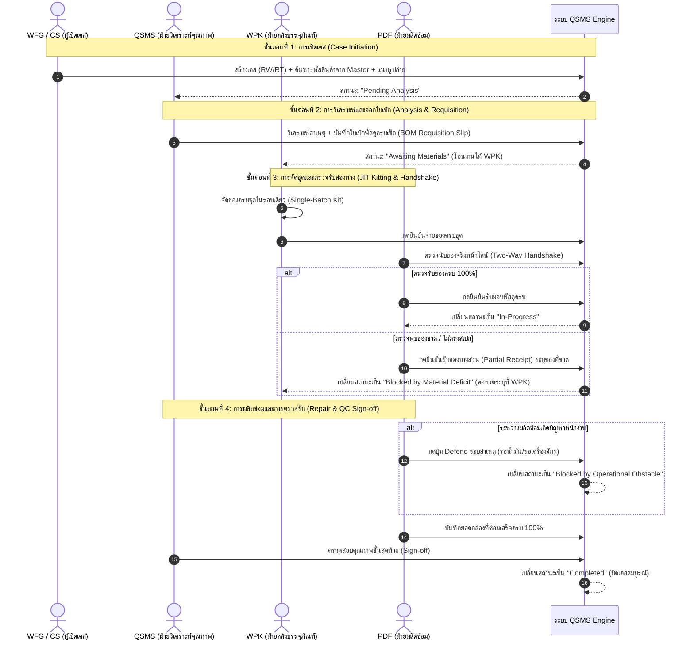

# Thesis Knowledge Base 02: Process Specification

## 1. หน่วยงานและบทบาทผู้ใช้งาน 6 บทบาท (6 Operational Roles)

| บทบาท | ชื่อเต็ม | ความรับผิดชอบในกระบวนการ | สิทธิ์หลักในระบบ |
|---|---|---|---|
| **`ADMIN`** | System Administrator | ดูแลระบบ จัดการผู้ใช้ จัดการ Item Master | สิทธิ์เต็มทุกฟังก์ชัน, จัดการผู้ใช้, ลบเคส, กู้คืนระบบ |
| **`QSMS`** | Quality Assurance / Inspection | วิเคราะห์สาเหตุของเสีย, สร้างใบเบิกวัสดุ (BOM), ตรวจรับงานขั้นสุดท้าย (Sign-off) | จัดการเคส, วิเคราะห์หาสาเหตุ, ออกใบเบิก, เซ็นปิดเคส |
| **`WFG`** | Warehouse Finished Goods | ตรวจสอบและเปิดเคสของเสียที่พบในคลังสินค้าภายใน (RW) | เปิดเคส RW, ดูภาพรวม, แนบรูปหลักฐาน |
| **`CS`** | Customer Service | รับเรื่องและเปิดเคสสินค้าที่ลูกค้ารับคืนหรือแจ้งเคลม (RT) | เปิดเคส RT, อัปโหลดเอกสารลูกค้า, ดูภาพรวม |
| **`WPK`** | Warehouse Packaging | จัดเตรียมชุดบรรจุภัณฑ์ (JIT Kitting) ตามใบเบิก และส่งมอบให้ฝ่ายซ่อม | จ่ายของตามใบเบิก, ยืนยันการส่งมอบวัสดุ |
| **`PDF`** | Production Defect Fix | ตรวจรับพัสดุ (Two-Way Handshake), ผลิตซ่อมตามยอดกล่อง, บันทึกปัญหา (Defend Mode) | ตรวจรับวัสดุ, บันทึกกล่องที่ซ่อมเสร็จ, กด Defend Mode |

---

## 2. กระบวนการเดิม (As-Is Workflow) และปัญหาความสูญเปล่า
1. **การแจ้งเคส**: WFG หรือ CS ส่งอีเมลหรือแจ้งเปิดงานด้วยกระดาษ
2. **การเบิกล่วงหน้า (Premature Requisition)**: WPK นำกล่องเปล่ามารอที่หน้าไลน์ล่วงหน้า 1 รอบ โดยยังไม่ทราบว่าชิ้นส่วนด้านใน (แกลลอน, ฝา, น้ำมัน) ต้องเปลี่ยนหรือไม่
3. **การวิเคราะห์ล่าช้า**: ฝ่าย QC ตรวจสอบสาเหตุและแจ้งสเปกที่ต้องซ่อมจริง
4. **การขนย้ายรอบที่สอง (Double Handling)**: WPK ต้องเบิกแกลลอนและชิ้นส่วนมาเพิ่มเป็นรอบที่ 2
5. **ข้อพิพาทของขาด**: เมื่อชิ้นส่วนขาดแคลน ไม่มีการตรวจรับอย่างเป็นทางการ ทำให้งานค้างสะสม และเกิดการโต้เถียงเรื่องความรับผิดชอบ

---

## 3. กระบวนการใหม่ (To-Be Workflow) บนระบบ QSMS

กระบวนการใหม่ทำงานผ่าน 4 ขั้นตอน (Process Stages) และ 5 สถานะเชิงระบบ (System States):

---

## 4. เงื่อนไขเคส RW และ RT
- **เคสภายใน (RW: SFC Internal)**: เกิดจากของเสียในสายการผลิตภายใน เปิดเคสได้ทันทีโดยไม่ต้องแนบเอกสารภายนอก (เอกสารแนบเป็นทางเลือก)
- **เคสภายนอก (RT: Customer Return)**: เกิดจากสินค้าตีกลับของลูกค้า บังคับต้องมีเอกสารแนบ (เช่น ใบส่งของ, ใบแจ้งเคลม, ไฟล์ Excel/PDF อ้างอิง) อย่างน้อย 1 ไฟล์ก่อนเปิดเคส
